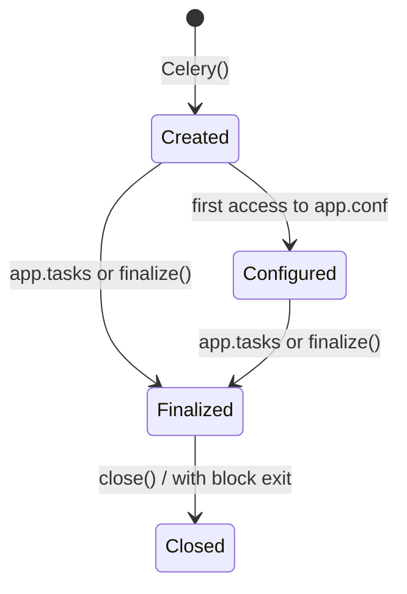

## Overview

Every Celery program starts from an instance of `celery.app.base.Celery`. The instance is the root object everything else hangs off: the configuration, the task registry, the broker connection pool, the result backend, and factory classes such as `app.Task`, `app.AsyncResult` and `app.Worker` that are subclassed so they know which app they belong to. Celery has no module-level singletons for these; two apps in one process each have their own.

Sources: [celery/app/base.py:252-332](repo://celery/app/base.py#L252-L332)

The class is built to be cheap to create and to pickle. The constructor records its arguments, but it reads no configuration, imports no tasks and opens no connection; each of those happens on first use. How the stored settings are later turned into `app.conf` is the subject of [[Configuration and Loaders]], and what `@app.task` produces is covered in [[Defining Tasks]].

Sources: [celery/app/base.py:343-434](repo://celery/app/base.py#L343-L434)

## Constructor arguments

`Celery(main=None, loader=None, backend=None, amqp=None, events=None, log=None, control=None, set_as_current=True, tasks=None, broker=None, include=None, changes=None, config_source=None, fixups=None, task_cls=None, autofinalize=True, namespace=None, strict_typing=True, **kwargs)`.

Sources: [celery/app/base.py:343-348](repo://celery/app/base.py#L343-L348)

| Argument | Effect |
| --- | --- |
| `main` | Name of the main module; used instead of `__main__` when generating task names |
| `broker`, `backend`, `include`, `**kwargs` | Stored as pending settings `broker_url`, `result_backend`, `include` and any other key |
| `config_source` | Object or module read by the loader when configuration is first loaded |
| `namespace` | Prefix for setting names, used when settings live in a shared config such as Django's |
| `loader`, `amqp`, `events`, `log`, `control`, `tasks`, `task_cls` | Classes or `module:Class` strings replacing the default components |
| `fixups` | Fix-up plug-ins; defaults to the built-in list, which includes the Django fixup |
| `set_as_current` | Make the new app the current app of this thread |
| `autofinalize` | When false, using the task registry before `finalize()` raises `RuntimeError` |
| `strict_typing` | Stored on the app; tasks use it as the default for argument checking |

Sources: [celery/app/base.py:255-288](repo://celery/app/base.py#L255-L288), [celery/app/base.py:349-404](repo://celery/app/base.py#L349-L404)

The broker, backend and extra keyword arguments go through `__autoset`, which writes them into `_preconf` and remembers that they were set automatically. `_preconf` is wrapped in a `Settings` over a `PendingConfiguration`, so nothing is read until a key is accessed. The constructor then instantiates every fixup, makes itself current if asked, creates the app signals `on_configure`, `on_after_configure`, `on_after_finalize` and `on_after_fork`, calls the `on_init()` hook for subclasses, and registers itself in the weak set of active apps.

Sources: [celery/app/base.py:385-434](repo://celery/app/base.py#L385-L434), [celery/app/base.py:444-450](repo://celery/app/base.py#L444-L450)

## Lifecycle

An app passes through three stages, each triggered by use rather than by an explicit call.

Sources: [celery/app/base.py:1564-1570](repo://celery/app/base.py#L1564-L1570), [celery/app/base.py:1601-1609](repo://celery/app/base.py#L1601-L1609)

Sources: [celery/app/base.py:657-677](repo://celery/app/base.py#L657-L677), [celery/app/base.py:1230-1280](repo://celery/app/base.py#L1230-L1280), [celery/app/base.py:1564-1570](repo://celery/app/base.py#L1564-L1570), [celery/app/base.py:1601-1609](repo://celery/app/base.py#L1601-L1609)

Configuration happens when `app.conf` or a pending setting is first read: `_load_config` sends `on_configure`, lets the loader read `config_source`, merges the result with `_preconf`, applies pending defaults and pending periodic tasks, and sends `on_after_configure`. [[Configuration and Loaders]] follows that path in detail.

Sources: [celery/app/base.py:1247-1280](repo://celery/app/base.py#L1247-L1280)

Finalization happens when `app.tasks` is accessed, since that property calls `self.finalize(auto=True)`. Under `_finalize_mutex`, `finalize` marks the app finalized, runs every callback registered with `connect_on_app_finalize` (this is how built-in tasks and `shared_task` functions are added to each app), evaluates the `PromiseProxy` objects that `@app.task` queued in `_pending`, binds every registered task to the app, and sends `on_after_finalize`. With `autofinalize=False`, an automatic finalization raises `RuntimeError('Contract breach: app not finalized')` instead.

Sources: [celery/app/base.py:657-677](repo://celery/app/base.py#L657-L677), [celery/app/base.py:1601-1609](repo://celery/app/base.py#L1601-L1609), [celery/_state.py:36-52](repo://celery/_state.py#L36-L52)

`close()` drops the broker connection pool and deregisters the app; the app is also a context manager whose `__exit__` calls `close()`. The docstring notes this is only needed for dynamically created apps.

Sources: [celery/app/base.py:466-478](repo://celery/app/base.py#L466-L478), [celery/app/base.py:1382-1386](repo://celery/app/base.py#L1382-L1386)

## Current and default app

Code that does not receive an app explicitly (for example `shared_task` proxies, or a result object created without `app=`) asks `celery._state` for one. There are two levels: a thread-local `current_app`, set by every app created with `set_as_current=True` (so it holds the last instantiated app), and a process-wide `default_app`. When neither exists, `_get_current_app` creates a fallback app named `'default'` with no fixups, using the loader from `CELERY_LOADER` or the `default` loader.

Sources: [celery/_state.py:64-104](repo://celery/_state.py#L64-L104), [celery/app/base.py:452-458](repo://celery/app/base.py#L452-L458)

Three environment variables help find code that relies on the implicit app: `C_STRICT_APP` makes `get_current_app` raise, `C_WARN_APP` prints a stack trace on each call, and `CELERY_TRACE_APP` switches `app_or_default` to a tracing version that raises when the default app is used in the main process.

Sources: [celery/_state.py:107-118](repo://celery/_state.py#L107-L118), [celery/_state.py:163-197](repo://celery/_state.py#L163-L197)

`celery._state` also keeps the stack of executing tasks. `current_task` is the top of that stack; `get_current_worker_task` walks it from the top and returns the first task whose `request.called_directly` is false, which is the task the worker itself is running rather than one it called inline. `send_task` uses the worker task to fill in `root_id` and `parent_id` ([[Sending Tasks]]).

Sources: [celery/_state.py:73-142](repo://celery/_state.py#L73-L142), [celery/app/base.py:1501-1514](repo://celery/app/base.py#L1501-L1514)

## Lazy proxies

`celery.local.Proxy`, adapted from Werkzeug, forwards every attribute access and operator to the object returned by a callable, calling it each time. `current_app` and `current_task` are such proxies, and so is the object returned by `shared_task`, which looks the task up in the current app's registry on every use.

Sources: [celery/local.py:52-66](repo://celery/local.py#L52-L66), [celery/_state.py:138-142](repo://celery/_state.py#L138-L142), [celery/app/__init__.py:24-71](repo://celery/app/__init__.py#L24-L71)

`PromiseProxy` evaluates its callable only once, stores the result in `__thing`, deletes the callable and its arguments, and runs any callbacks queued with `__then__`. `@app.task` returns a `PromiseProxy` around `_task_from_fun` while the app is not finalized, and `finalize` forces each one with `maybe_evaluate`.

Sources: [celery/local.py:282-358](repo://celery/local.py#L282-L358), [celery/app/base.py:553-575](repo://celery/app/base.py#L553-L575)

## Services on the app

Most components are created on first access and cached. `amqp`, `control`, `events`, `log` and `loader` are `cached_property` attributes that instantiate the configured class with `app=self`. The backend is different: `backend` builds it through `backends.by_url` from `backend_cls` or the `result_backend` setting, and stores it once for the app when the backend class says it is `thread_safe`, or once per thread in `self._local` otherwise.

Sources: [celery/app/base.py:1534-1595](repo://celery/app/base.py#L1534-L1595), [celery/app/base.py:1224-1228](repo://celery/app/base.py#L1224-L1228)

Classes that need to know their app are produced by `subclass_with_self`, which creates a subclass of the given class with the app set on a class attribute (default `app`) and, unless `keep_reduce` is set, a `__reduce__` that rebuilds the object through the current app on unpickling. `Worker`, `WorkController`, `Beat`, `AsyncResult`, `ResultSet` and `GroupResult` are built this way, and `app.Task` is the base task class from `create_task_cls`, which stores the app on `_app` and is marked abstract.

Sources: [celery/app/base.py:1335-1376](repo://celery/app/base.py#L1335-L1376), [celery/app/base.py:1430-1486](repo://celery/app/base.py#L1430-L1486)

`timezone` is cached from the `timezone` setting, falling back to UTC when `enable_utc` is set and to local time otherwise; `now()` returns the current time in that zone, and `uses_utc_timezone()` compares the two.

Sources: [celery/app/base.py:1197-1200](repo://celery/app/base.py#L1197-L1200), [celery/app/base.py:1615-1632](repo://celery/app/base.py#L1615-L1632)

## Broker connections and producers

`connection_for_read()` and `connection_for_write()` return lazy `kombu.Connection` objects for the `broker_read_url` and `broker_write_url` settings; the older `connection()` delegates to the write variant. `_connection` fills in user, password, vhost, port, transport, SSL, login method, failover strategy, transport options and connect timeout from the configuration when the caller does not pass them.

Sources: [celery/app/base.py:1043-1129](repo://celery/app/base.py#L1043-L1129)

`app.pool` is the broker connection pool (not the worker's execution pool): on first use it registers the after-fork handler, sets Kombu's pool limit from `broker_pool_limit`, and takes the pool for the write connection. `connection_or_acquire()` and `producer_or_acquire()` return a `FallbackContext` that uses the object the caller passed or acquires one from the pool, waiting up to `broker_pool_acquire_timeout`. When the pool is exhausted, Kombu's `LimitExceeded` becomes an `OperationalError` whose message names both settings.

Sources: [celery/app/base.py:1131-1191](repo://celery/app/base.py#L1131-L1191), [celery/app/base.py:1488-1500](repo://celery/app/base.py#L1488-L1500)

## Pickling and forking

An app crosses process boundaries by pickling: `__reduce__` returns the class and `__reduce_keys__`, which includes only the configuration changes (`_conf.changes`, or `_preconf` if not yet configured) plus the component class names, so the defaults never travel. A subclass that defines its own `__reduce_args__` gets the older positional form.

Sources: [celery/app/base.py:1391-1428](repo://celery/app/base.py#L1391-L1428), [celery/app/base.py:376-379](repo://celery/app/base.py#L376-L379)

After a fork, `_after_fork` drops the connection pool and the AMQP producer pool, since sockets cannot be shared with a child, and sends `on_after_fork`. It is registered with `multiprocessing.register_after_fork` the first time the connection pool is created.

Sources: [celery/app/base.py:118-124](repo://celery/app/base.py#L118-L124), [celery/app/base.py:460-464](repo://celery/app/base.py#L460-L464), [celery/app/base.py:1282-1288](repo://celery/app/base.py#L1282-L1288)
