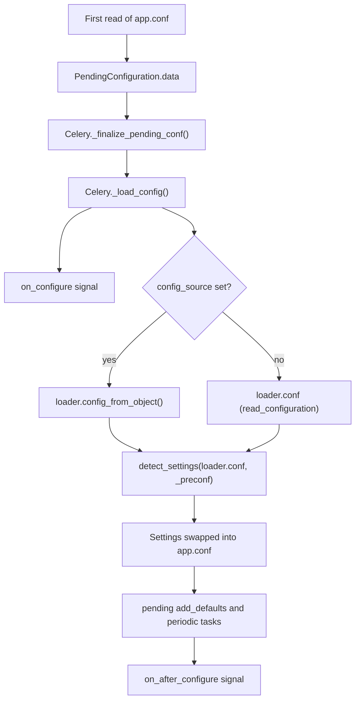

## Overview

Celery settings come from several places: arguments to the `Celery` constructor, assignments to `app.conf` before the app is configured, a configuration object or module named with `config_from_object`, environment variables, and command-line `key=value` pairs. All of them end up in one `Settings` object, a chain of mappings whose last layer is the full set of defaults declared in `celery/app/defaults.py`.

Sources: [celery/app/utils.py:68-127](repo://celery/app/utils.py#L68-L127), [celery/app/defaults.py:66-72](repo://celery/app/defaults.py#L66-L72)

Reading the configuration is delayed until a setting is first needed, which is why code can call `app.conf.update(...)` or `app.config_from_object(...)` after creating the app and before any task runs. The loader object (`app.loader`) does the reading and also owns the hooks a worker calls at start, before each task and after each task. The app object itself is described in [[The Celery Application]]; Django's settings and its fixup are covered in [[Django Integration]].

Sources: [celery/app/base.py:208-249](repo://celery/app/base.py#L208-L249), [celery/loaders/base.py:33-81](repo://celery/loaders/base.py#L33-L81)

## Defaults and namespaces

`NAMESPACES` is a nested dict of `Option` objects. Top-level keys such as `accept_content`, `enable_utc`, `imports`, `include` and `timezone` sit beside namespaces (`beat`, `broker`, `cache`, `cassandra`, `control`, `event`, `redis`, `result`, `security`, `database`, `task`, `worker`, and one per backend), and `flatten` joins them with underscores, so `broker=Namespace(url=...)` becomes the setting `broker_url`. Each `Option` has a default and a type (`string`, `int`, `float`, `bool`, `dict`, `tuple`, `list` or `any`) used by `to_python` to convert text values.

Sources: [celery/app/defaults.py:42-108](repo://celery/app/defaults.py#L42-L108), [celery/app/defaults.py:378-401](repo://celery/app/defaults.py#L378-L401)

From that tree the module derives `DEFAULTS` (new key to default), `SETTING_KEYS`, and the two maps `_TO_OLD_KEY` and `_TO_NEW_KEY` between new lowercase names and the old uppercase names (`CELERY_*`, `CELERYBEAT_*`, `CELERYD_*`) that each namespace declares through `__old__`. `find(name, namespace)` searches the tree by name, which is what `app.conf.find_option` uses.

Sources: [celery/app/defaults.py:23-40](repo://celery/app/defaults.py#L23-L40), [celery/app/defaults.py:403-447](repo://celery/app/defaults.py#L403-L447)

## The Settings object

`Settings` extends `ConfigurationView`, a `ChainMap` over a changes mapping and a list of default mappings, with attribute access and an optional key prefix. A few properties are computed rather than looked up:

Sources: [celery/app/utils.py:68-78](repo://celery/app/utils.py#L68-L78)

| Property | Resolution order |
| --- | --- |
| `broker_url` | `CELERY_BROKER_URL` env var, then `broker_url`, then `broker_host` |
| `broker_read_url` | `CELERY_BROKER_READ_URL` env var, then `broker_read_url`, then `broker_url` |
| `broker_write_url` | `CELERY_BROKER_WRITE_URL` env var, then `broker_write_url`, then `broker_url` |
| `result_backend` | `CELERY_RESULT_BACKEND` env var, then `result_backend`, then the old `CELERY_RESULT_BACKEND` key |
| `task_default_exchange`, `task_default_routing_key` | The setting, then `task_default_queue` |
| `timezone` | `timezone`, then Django's `TIME_ZONE` |

Sources: [celery/app/utils.py:68-127](repo://celery/app/utils.py#L68-L127), [celery/utils/collections.py:353-383](repo://celery/utils/collections.py#L353-L383)

`without_defaults()` drops the last map, so `value_set_for(key)` tells whether a user set a key. `table()` and `humanize()` produce the configuration listing used in bug reports, censoring keys that match `HIDDEN_SETTINGS` (names containing `API`, `TOKEN`, `KEY`, `SECRET`, `PASS` and similar).

Sources: [celery/app/utils.py:37-40](repo://celery/app/utils.py#L37-L40), [celery/app/utils.py:129-196](repo://celery/app/utils.py#L129-L196)

## When configuration is loaded

Until the first read, `app.conf` wraps a `PendingConfiguration`. Writes (`__setitem__`, `update`, `setdefault`, `clear`) and `in` checks go straight to the `_preconf` dict; the first read touches the `data` cached property, which calls the app's `_finalize_pending_conf` and swaps in the real settings.

Sources: [celery/app/base.py:208-249](repo://celery/app/base.py#L208-L249), [celery/app/base.py:1230-1245](repo://celery/app/base.py#L1230-L1245)

Sources: [celery/app/base.py:1247-1280](repo://celery/app/base.py#L1247-L1280), [celery/loaders/base.py:252-257](repo://celery/loaders/base.py#L252-L257)

`_load_config` sends `on_configure`, asks the loader to read `config_source` if one was given, and calls `detect_settings` with the loader's configuration (passed through `find_deprecated_settings`), the pre-configuration and the set of keys the constructor set automatically. If someone already holds a reference to `app.conf`, the new settings are swapped into that object in place, so earlier references keep working. Callables queued by `add_defaults` and periodic tasks queued by `add_periodic_task` before configuration are applied last, then `on_after_configure` fires with the settings as `source`.

Sources: [celery/app/base.py:679-701](repo://celery/app/base.py#L679-L701), [celery/app/base.py:1247-1280](repo://celery/app/base.py#L1247-L1280)

## Old and new setting names

`detect_settings` decides whether a configuration uses the new lowercase names or the old uppercase ones by counting how many keys of each kind it contains, and picks the majority. With a namespace prefix it always uses the new format. Keys left in the minority format raise `ImproperlyConfigured` with a list of renames, unless the user also provided the other spelling of the same key. The chosen format's defaults are deep-copied, the pre-configuration keys are converted to that format, and the result is a `Settings` with the user configuration and defaults as its layers; old keys found are kept in `deprecated_settings` so `maybe_warn_deprecated_settings` can warn that they go away in 6.0.

Sources: [celery/app/utils.py:239-285](repo://celery/app/utils.py#L239-L285), [celery/app/utils.py:198-211](repo://celery/app/utils.py#L198-L211)

## Configuration sources

`config_from_object(obj, silent=False, force=False, namespace=None)` records the object (or a dotted module name) as `_config_source` and, only if the app is already configured or `force` is set, clears `_conf` and reads it immediately. Otherwise it is read on first access as above. The loader imports a string with `_smart_import`, which accepts `module`, `module.attr` or `module:attr`, converts the result to a mapping, and picks up an `override_backends` dict if the object defines one.

Sources: [celery/app/base.py:703-725](repo://celery/app/base.py#L703-L725), [celery/loaders/base.py:118-145](repo://celery/loaders/base.py#L118-L145)

`config_from_envvar(variable_name)` reads a module name from the environment variable and passes it to `config_from_object`; an unset variable raises `ImproperlyConfigured` unless `silent` is true.

Sources: [celery/app/base.py:727-743](repo://celery/app/base.py#L727-L743)

`config_from_cmdline(argv, namespace='celery')` updates the configuration from `key=value` arguments parsed by `cmdline_config_parser`. A key may be written `ns.key` or `ns_key`; a leading `.` or `_` means the default namespace. Values are converted with the option's type, or with an explicit cast prefix such as `(json)` or `(int)`, where `tuple`, `list` and `dict` casts are parsed as JSON.

Sources: [celery/app/base.py:745-748](repo://celery/app/base.py#L745-L748), [celery/loaders/base.py:159-209](repo://celery/loaders/base.py#L159-L209)

## Loaders

A loader is chosen by name through `get_loader_cls`, which knows two aliases. The app constructor uses the `CELERY_LOADER` environment variable, then the app's `loader_cls`, then `celery.loaders.app:AppLoader`.

Sources: [celery/loaders/__init__.py:10-18](repo://celery/loaders/__init__.py#L10-L18), [celery/app/base.py:436-442](repo://celery/app/base.py#L436-L442)

| Alias | Class | Configuration source when no `config_source` is set |
| --- | --- | --- |
| `app` | `AppLoader` | The module named by `CELERY_CONFIG_MODULE`, or nothing |
| `default` | `Loader` | `CELERY_CONFIG_MODULE` or `celeryconfig`; a missing module gives empty settings |

Sources: [celery/loaders/__init__.py:10-18](repo://celery/loaders/__init__.py#L10-L18), [celery/loaders/app.py:1-8](repo://celery/loaders/app.py#L1-L8), [celery/loaders/default.py:13-44](repo://celery/loaders/default.py#L13-L44), [celery/app/base.py:436-442](repo://celery/app/base.py#L436-L442), [celery/loaders/base.py:211-219](repo://celery/loaders/base.py#L211-L219)

The `default` loader is the one the fallback default app uses. When its `celeryconfig` module cannot be imported it returns empty settings, and warns with `NotConfigured` only if `C_WNOCONF` is set and the process was not forked by multiprocessing.

Sources: [celery/loaders/default.py:24-44](repo://celery/loaders/default.py#L24-L44), [celery/_state.py:92-100](repo://celery/_state.py#L92-L100)

`BaseLoader` also defines the hooks the worker calls: `on_worker_init` (from `init_worker`, after importing the default modules), `on_worker_process_init` in each pool child, `on_task_init` before a task runs and `on_process_cleanup` after it, and `on_worker_shutdown`. They do nothing in the base class; fixups and custom loaders override them. The tracer looks up `on_task_init` and `on_process_cleanup` once when it is built ([[Task Execution Pipeline]]).

Sources: [celery/loaders/base.py:60-116](repo://celery/loaders/base.py#L60-L116), [celery/app/trace.py:386-387](repo://celery/app/trace.py#L386-L387)

## Importing task modules

A worker imports its task modules in `import_default_modules`, which first sends the `import_modules` signal and re-raises any exception a receiver returned (the comment explains that logging is not set up yet, so a swallowed error would be invisible), then imports every module in `default_modules`: the loader's built-in modules, the `imports` setting and the `include` setting.

Sources: [celery/loaders/base.py:94-111](repo://celery/loaders/base.py#L94-L111), [celery/loaders/base.py:240-246](repo://celery/loaders/base.py#L240-L246)

`app.autodiscover_tasks(packages=None, related_name='tasks', force=False)` adds modules found by convention. Without `force` it connects a receiver to `import_modules`, so discovery runs only when the worker imports its default modules; `packages` may be a callable for the same reason. For each package, `find_related_module` imports the package and then `package.tasks`; a missing `tasks` module is skipped, but an import error raised from inside it propagates. When `packages` is empty, the packages come from fixups that implement `autodiscover_tasks`, which is how Django's installed apps are scanned ([[Django Integration]]). A module-level `_RACE_PROTECTION` flag prevents recursive discovery when a discovered module triggers discovery again.

Sources: [celery/app/base.py:782-844](repo://celery/app/base.py#L782-L844), [celery/loaders/base.py:221-278](repo://celery/loaders/base.py#L221-L278)
