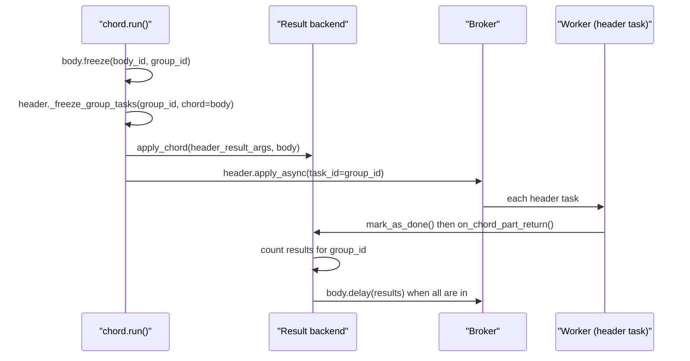

## Overview

A `group` sends several signatures at once so they can run in parallel, and returns a `GroupResult` that collects their results. A `chord` adds a callback: a group (the header) plus a signature (the body) that runs once with the list of all header results. Groups are entirely a client-side construct: the client freezes and publishes each member. Chords need cooperation from the result backend, because some process must notice when the last header task finishes and send the body.

Sources: [celery/canvas.py:1492-1520](repo://celery/canvas.py#L1492-L1520), [celery/canvas.py:1971-1990](repo://celery/canvas.py#L1971-L1990)

Both are signatures and compose with the chaining rules in [[Signatures and Chains]]: `group | task` becomes a chord, and a group followed by a step inside a chain is upgraded the same way. The result objects they return are described in [[Task States and AsyncResult]], and the backend base class in [[Result Backend Interface]].

Sources: [celery/canvas.py:1593-1601](repo://celery/canvas.py#L1593-L1601), [celery/canvas.py:1212-1238](repo://celery/canvas.py#L1212-L1238)

## Building a group

`group(*tasks, **options)` accepts signatures, or a single iterable of them, including a generator. Its members live in `kwargs['tasks']` of a `celery.group` signature, wrapped in a lazy `regen` so a generator is only consumed when needed. Options passed to the group apply to every member.

Sources: [celery/canvas.py:1516-1591](repo://celery/canvas.py#L1516-L1591)

A few methods differ from a plain signature:

Sources: [celery/canvas.py:1593-1608](repo://celery/canvas.py#L1593-L1608)

| Method | Behaviour |
| --- | --- |
| `group \| other` | `chord(self, body=other)`; an empty group on the right returns `self` |
| `skew(start=1.0, stop=None, step=1.0)` | Gives each member an increasing `countdown` |
| `link(sig)` | Adds an immutable clone of `sig` to the first member only |
| `link_error(sig)` | Adds a clone of the errback to every member |
| `set_immutable(flag)` | Sets the flag on every member |

Sources: [celery/canvas.py:1593-1608](repo://celery/canvas.py#L1593-L1608), [celery/canvas.py:1690-1696](repo://celery/canvas.py#L1690-L1696), [celery/canvas.py:1662-1665](repo://celery/canvas.py#L1662-L1665)

## Sending a group

`group.apply_async(args, kwargs, add_to_parent=True, producer=None, **options)` refuses `link` and `link_error` with `TypeError` (the message says to use a chord, or to link the individual tasks), runs `apply` when `task_always_eager` is on, and returns a frozen `GroupResult` for an empty group. Otherwise:

Sources: [celery/canvas.py:1610-1625](repo://celery/canvas.py#L1610-L1625)

1. `_freeze_gid` merges options (keeping immutable ones such as `group_id`) and makes the group's `task_id`, or a new UUID, the `group_id`.
2. `_prepared` clones every member, recursively unrolls nested groups into the same flat list, prepends partial arguments to mutable members, and freezes each one with the group id, root id and its position as `group_index`.
3. `_apply_tasks` takes one producer from the pool and calls `apply_async` on each member with `add_to_parent=False`. When members carry a `chord` option, it counts the expected results with `_chord._descend` and, at the last member, calls `backend.set_chord_size(group_id, chord_size)`.
4. Each result is attached to a `vine.barrier`, so the `GroupResult` knows when every member has reported.
5. The `GroupResult` is added to the calling task's children when called from inside a task. A group containing exactly one nested group returns that inner result.

Sources: [celery/canvas.py:1610-1650](repo://celery/canvas.py#L1610-L1650), [celery/canvas.py:1720-1760](repo://celery/canvas.py#L1720-L1760), [celery/canvas.py:1762-1827](repo://celery/canvas.py#L1762-L1827), [celery/canvas.py:1829-1837](repo://celery/canvas.py#L1829-L1837)

`group.freeze()` assigns ids without sending: `_freeze_group_tasks` sets the group's `task_id`, `group_id`, `chord`, `group_index`, `root_id` and `parent_id` options and freezes each member. For a generator-backed group, it uses `itertools.tee` so the members are frozen lazily as they are consumed; otherwise `_freeze_unroll` flattens nested groups with a stack and numbers the members in order.

Sources: [celery/canvas.py:1839-1906](repo://celery/canvas.py#L1839-L1906), [celery/canvas.py:1908-1945](repo://celery/canvas.py#L1908-L1945)

`_descend` defines how many results a member contributes to a chord: a plain signature counts 1, a group the sum of its members, a chain the size of its last non-empty step, and a chord the size of its body.

Sources: [celery/canvas.py:2196-2222](repo://celery/canvas.py#L2196-L2222)

## Building a chord

`chord(header, body=None, **options)` stores the header (normalized to a list by `_maybe_group`) and the body in `kwargs['header']` and `kwargs['body']` of a `celery.chord` signature. Calling `chord(header)(body)` supplies the body at call time. `chord | task` chains the task into the body, as does a one-member group; anything else falls back to the signature rules.

Sources: [celery/canvas.py:1475-1489](repo://celery/canvas.py#L1475-L1489), [celery/canvas.py:2072-2096](repo://celery/canvas.py#L2072-L2096)

`chord.freeze()` freezes the header as a group with `chord=body`, takes the header's id as the chord's id, freezes the body with the caller's id, group and chord, and walks the body's result parents to attach the header result at the top, raising `RuntimeError('Recursive result parents')` if it finds a cycle. It returns the body's result.

Sources: [celery/canvas.py:2098-2121](repo://celery/canvas.py#L2098-L2121)

`link(callback)` on a chord links only the body. `link_error(errback)` always links the body and nested chords in the header; it links header tasks too only when `task_allow_error_cb_on_chord_header` is on, and otherwise emits a `CPendingDeprecationWarning` announcing that the default may change.

Sources: [celery/canvas.py:2313-2349](repo://celery/canvas.py#L2313-L2349), [celery/app/defaults.py:323-323](repo://celery/app/defaults.py#L323-L323)

## Running a chord

`chord.apply_async` merges partial arguments and the body (from the call or the stored one), clones the header group, runs everything in-process through `apply` when `task_always_eager` is on, and otherwise calls `run`.

Sources: [celery/canvas.py:2145-2180](repo://celery/canvas.py#L2145-L2180)

Sources: [celery/canvas.py:2229-2291](repo://celery/canvas.py#L2229-L2291), [celery/backends/base.py:179-185](repo://celery/backends/base.py#L179-L185)

`run` takes the header's `task_id` (or a new UUID) as the group id, applies the chord's options to the body, freezes the body with its own id and the group id, and freezes the header tasks with `chord=body`, so every header message carries the body signature in its `chord` field. With a non-empty header it calls `backend.apply_chord(...)` and then sends the header group; with an empty header it sends `body.delay([])` at once. The body result's parent is set to the header result, and that body result is what the caller gets back.

Sources: [celery/canvas.py:2229-2291](repo://celery/canvas.py#L2229-L2291)

Any backend that cannot synchronize refuses before anything is sent: `prepare_steps` and the default `apply_chord` call `ensure_chords_allowed`, which raises `NotImplementedError` on the disabled backend ("Starting chords requires a result backend to be configured") and on the RPC backend.

Sources: [celery/backends/base.py:53-60](repo://celery/backends/base.py#L53-L60), [celery/backends/base.py:861-867](repo://celery/backends/base.py#L861-L867), [celery/backends/base.py:1263-1273](repo://celery/backends/base.py#L1263-L1273), [celery/backends/rpc.py:22-30](repo://celery/backends/rpc.py#L22-L30)

## How the body is triggered

### The part-return hook

After a header task stores its result, `mark_as_done` or `mark_as_failure` calls `on_chord_part_return(request, state, result)` whenever `request.chord` is set. What happens next depends on the backend.

Sources: [celery/backends/base.py:179-199](repo://celery/backends/base.py#L179-L199)

### Polling with chord_unlock

The base `Backend.apply_chord` uses `fallback_chord_unlock`, which sends the built-in `celery.chord_unlock` task with the group id, the body and the header results as tuples, routed to the body's queue and priority. `unlock_chord` rebuilds the `GroupResult`, and if it is not ready retries itself after `result_chord_retry_interval` seconds (1 by default) with no retry limit. Once ready, it joins the results with `result_chord_join_timeout` (3 seconds by default) and sends `callback.delay(ret)`.

Sources: [celery/backends/base.py:838-867](repo://celery/backends/base.py#L838-L867), [celery/app/builtins.py:36-98](repo://celery/app/builtins.py#L36-L98), [celery/app/defaults.py:224-225](repo://celery/app/defaults.py#L224-L225)

### Counters in key-value backends

Key-value backends that set `implements_incr = True` (the cache, DynamoDB and GCS backends among them) replace `apply_chord` with `_apply_chord_incr`, which only saves the header `GroupResult`. Each `on_chord_part_return` then restores the group, increments the `chord-unlock-<group_id>` counter, and compares it with the size from `request.chord['chord_size']` or the number of results. When the counter reaches the size, the worker that finished last joins the results, calls `callback.delay(ret)`, and deletes the group and the counter; until then it refreshes the counter's expiry. More increments than expected log a warning.

Sources: [celery/backends/base.py:964-979](repo://celery/backends/base.py#L964-L979), [celery/backends/base.py:1183-1256](repo://celery/backends/base.py#L1183-L1256), [celery/backends/cache.py:96-96](repo://celery/backends/cache.py#L96-L96)

### Redis

The Redis backend keeps three keys per group: `.j` holds the encoded `[1, task_id, state, result]` of each finished part, `.s` holds the chord size written by `set_chord_size`, and `.t` counts parts added later by `Task.add_to_chord`. By default (`result_chord_ordered` in `result_backend_transport_options`) `.j` is a sorted set scored by `group_index`, so the body receives results in header order; otherwise it is a list in completion order. One pipeline adds the part, reads the ready count, `.t` and `.s`, and refreshes expiry.

Sources: [celery/backends/redis.py:553-591](repo://celery/backends/redis.py#L553-L591), [celery/backends/redis.py:593-622](repo://celery/backends/redis.py#L593-L622)

When the ready count equals size plus `.t`, the backend builds the result list. If `apply_chord` saved the header `GroupResult` (it does so only when a header member is itself a group, to keep nesting), it joins that; otherwise it decodes the stored tuples directly, which the comment says "should be faster for large numbers of simple results". A stored part in a propagating state raises `ChordError('Dependency ... raised ...')`. It then sends `callback.delay(resl)` and deletes the three keys.

Sources: [celery/backends/redis.py:573-584](repo://celery/backends/redis.py#L573-L584), [celery/backends/redis.py:624-686](repo://celery/backends/redis.py#L624-L686)

`Task.add_to_chord(sig, lazy=False)` lets a header task grow its own chord: it sets the new signature's group, group index, chord and root id from the current request, freezes it, tells the backend (`.t` is incremented in Redis; other backends raise `NotImplementedError`), and sends it unless `lazy`.

Sources: [celery/app/task.py:1097-1119](repo://celery/app/task.py#L1097-L1119), [celery/backends/base.py:829-830](repo://celery/backends/base.py#L829-L830)

## Errors in a chord

If joining the header raises, because a header task failed, the group can no longer be restored, or sending the body fails, the backend calls `chord_error_from_stack(callback, exc)` with a `ChordError` whose `__cause__` is the original exception. For a single-task body it builds a fake request from the body's options, calls the body's errbacks, and stores the body as failed, so a caller waiting on the chord result sees the error instead of waiting forever. For a group body, `_handle_group_chord_error` revokes every task of the body group, calls each one's errbacks, marks each as failed with the original exception and marks the group itself failed; the docstring cites issue #8786, where group bodies otherwise hung.

Sources: [celery/backends/base.py:68-77](repo://celery/backends/base.py#L68-L77), [celery/backends/base.py:325-358](repo://celery/backends/base.py#L325-L358), [celery/backends/base.py:360-424](repo://celery/backends/base.py#L360-L424)

Failures inside a chain that ends in a chord reach the chord too. `mark_as_failure` walks the failed task's remaining `chain` steps, stores the failure for each step that has a task id, calls `on_chord_part_return` for any step that is a member of a chord, and descends into a chord step's body, because "a chord step completes only when its body does" (issue #9674). Without this, an enclosing chord would wait for a result that never comes.

Sources: [celery/backends/base.py:200-252](repo://celery/backends/base.py#L200-L252)
