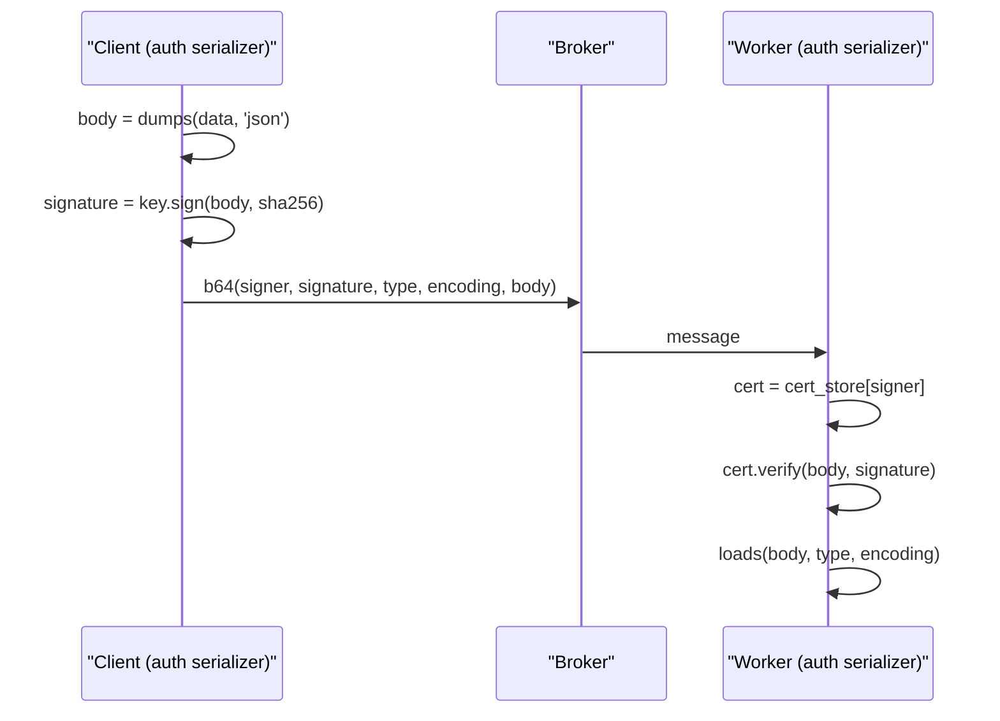

## Overview

Message signing lets workers reject task messages that were not produced by a trusted sender. It is implemented as a Kombu serializer named `auth`: the sender serializes the message body with an ordinary serializer, signs those bytes with its private key, and packs the signature, the signer's certificate id and the body together. The receiver looks the signer up in a store of trusted certificates and verifies the signature before decoding anything. Signing protects authenticity and integrity; the body is not encrypted.

Sources: [celery/security/serialization.py:15-58](repo://celery/security/serialization.py#L15-L58)

Signing requires the `cryptography` package (the `auth` extra); importing `celery.security` without it raises `ImproperlyConfigured` with installation instructions. Only RSA keys and certificates are accepted.

Sources: [celery/security/__init__.py:8-41](repo://celery/security/__init__.py#L8-L41), [celery/security/key.py:12-25](repo://celery/security/key.py#L12-L25), [celery/security/certificate.py:29-39](repo://celery/security/certificate.py#L29-L39)

## Enabling it

The bundled example configures an app like this:

Sources: [examples/security/mysecureapp.py:28-34](repo://examples/security/mysecureapp.py#L28-L34)

```python
app.conf.update(
    security_key='ssl/worker.key',
    security_certificate='ssl/worker.pem',
    security_cert_store='ssl/*.pem',
    task_serializer='auth',
    event_serializer='auth',
    accept_content=['auth'],
    result_accept_content=['json']
)
app.setup_security()
```

Sources: [examples/security/mysecureapp.py:35-44](repo://examples/security/mysecureapp.py#L35-L44)

`app.setup_security(allowed_serializers=None, key=None, key_password=None, cert=None, store=None, digest='sha256', serializer='json')` delegates to `celery.security.setup_security`, and its docstring notes that it "will affect all application instances (a global operation)" because it changes Kombu's global serializer registry.

Sources: [celery/app/base.py:750-780](repo://celery/app/base.py#L750-L780)

`setup_security` then:

Sources: [celery/security/__init__.py:44-49](repo://celery/security/__init__.py#L44-L49)

1. Disables insecure serializers in Kombu, except those in `allowed_serializers`.
2. Requires `task_serializer = 'auth'` and `accept_content = ['auth']`, raising `ImproperlyConfigured` otherwise, with the explanation that "there is no point in signing messages if they are not verified".
3. Takes the key, key password, certificate, certificate store and digest from the arguments or the `security_*` settings, and raises `ImproperlyConfigured` if any of key, certificate and store is missing.
4. Reads the key and certificate files and calls `register_auth`, then makes `auth` Kombu's default serializer.

Sources: [celery/security/__init__.py:44-74](repo://celery/security/__init__.py#L44-L74)

| Setting | Meaning |
| --- | --- |
| `security_key` | Path to this node's PEM private key |
| `security_key_password` | Password for the key, if encrypted |
| `security_certificate` | Path to this node's PEM certificate |
| `security_cert_store` | Directory or glob of trusted PEM certificates |
| `security_digest` | Hash used for signing, default `sha256` |

Sources: [celery/app/defaults.py:239-247](repo://celery/app/defaults.py#L239-L247), [celery/app/defaults.py:21-21](repo://celery/app/defaults.py#L21-L21)

`register_auth` builds a `SecureSerializer` from a `PrivateKey`, a `Certificate` and an `FSCertStore`, and registers its `serialize` and `deserialize` methods under the name `auth` with content type `application/data`.

Sources: [celery/security/serialization.py:80-90](repo://celery/security/serialization.py#L80-L90)

## Signing and verifying

`SecureSerializer.serialize(data)` serializes the data with the inner serializer (`json` by default), signs the resulting bytes with the private key, and packs five fields: the base64 signer id, the base64 signature, the content type, the content encoding and the body, joined by the separator `\x00\x01` and base64-encoded as a whole. The comment explains why the serialized bytes rather than the data are signed: "the receiver doesn't have to decode the contents to verify the signature (and thus avoiding potential flaws in the decoding step)".

Sources: [celery/security/serialization.py:12-43](repo://celery/security/serialization.py#L12-L43), [celery/security/serialization.py:60-78](repo://celery/security/serialization.py#L60-L78)

`deserialize(data)` unpacks the fields, looks the signer up in the certificate store, verifies the signature over the body, and only then decodes the body with its own content type, using `force=True` because the inner content type may not be in the accept list. Any error during packing, unpacking or verification is re-raised as `SecurityError`.

Sources: [celery/security/serialization.py:45-58](repo://celery/security/serialization.py#L45-L58), [celery/security/utils.py:16-26](repo://celery/security/utils.py#L16-L26)



Sources: [celery/security/serialization.py:31-78](repo://celery/security/serialization.py#L31-L78)

Both signing and verification use RSA-PSS padding with MGF1 over the configured digest and the maximum salt length. `get_digest_algorithm` maps the digest name to the `cryptography` hash class by upper-casing it (`'sha256'` to `hashes.SHA256`).

Sources: [celery/security/key.py:27-35](repo://celery/security/key.py#L27-L35), [celery/security/certificate.py:64-71](repo://celery/security/certificate.py#L64-L71), [celery/security/utils.py:10-14](repo://celery/security/utils.py#L10-L14)

## Certificates and the certificate store

`Certificate(pem)` loads an X.509 certificate and identifies it by issuer plus serial number (`get_id()`), the value carried as the signer in each message; it also exposes `has_expired()`, `get_pubkey()` and `verify()`. `PrivateKey(pem, password=None)` loads the PEM key. Invalid data raises `SecurityError` with "Invalid certificate" or "Invalid private key".

Sources: [celery/security/certificate.py:29-71](repo://celery/security/certificate.py#L29-L71), [celery/security/key.py:12-25](repo://celery/security/key.py#L12-L25)

`FSCertStore(path)` loads every certificate matching the path, a directory (all files in it) or a glob such as `ssl/*.pem`. It raises `SecurityError` for an expired certificate or for two certificates with the same id. Looking up an unknown signer raises `SecurityError('Unknown certificate: ...')`, so a message signed by a key whose certificate is not in the store is refused. Every node that receives signed messages therefore needs the certificates of every node that sends them.

Sources: [celery/security/certificate.py:74-110](repo://celery/security/certificate.py#L74-L110)

## What is covered

The setup example also sets `event_serializer = 'auth'`, so events are signed, while results are stored with `result_accept_content = ['json']` and are not signed. Task messages use `task_serializer`, and remote control messages use the same `task_serializer` and `accept_content` ([[Remote Control and Revocation]]). A worker that receives an unsigned message in a content type it does not accept rejects it as invalid ([[The Consumer]]).

Sources: [examples/security/mysecureapp.py:35-43](repo://examples/security/mysecureapp.py#L35-L43), [celery/app/control.py:439-445](repo://celery/app/control.py#L439-L445), [celery/worker/consumer/consumer.py:782-785](repo://celery/worker/consumer/consumer.py#L782-L785)
