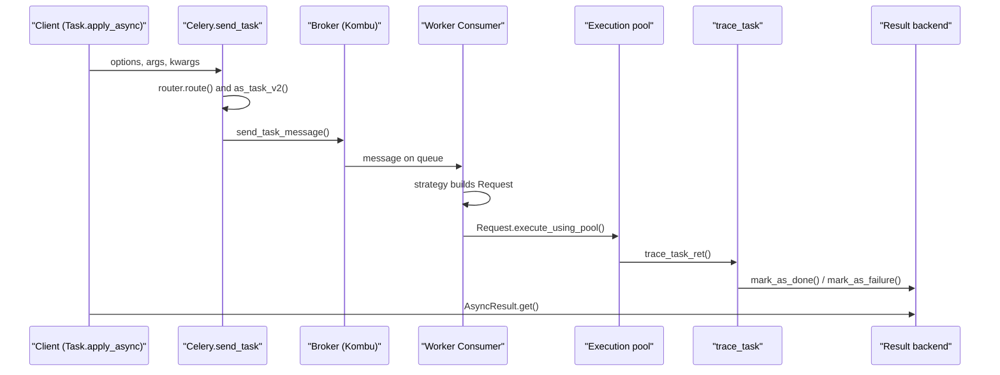

## Overview

Celery is a distributed task queue: an application declares functions as tasks, a client sends a call to one of them as a message to a broker, and a separate worker process takes the message off a queue, runs the function and optionally stores its return value in a result backend. The package describes itself as a "Distributed Task Queue" and exports the pieces a user touches directly: the `Celery` app, `shared_task`, `Task`, and the workflow primitives `chain`, `chord`, `chunks`, `group`, `signature`, `xmap` and `xstarmap`.

Sources: [celery/__init__.py:1-42](repo://celery/__init__.py#L1-L42)

Messaging is delegated to Kombu: `celery.app.amqp` imports `Connection`, `Consumer`, `Exchange`, `Producer` and `Queue` from `kombu` and builds Celery's task message on top of them, so Celery itself never speaks a broker protocol.

Sources: [celery/app/amqp.py:1-34](repo://celery/app/amqp.py#L1-L34)

## Parts of Celery

| Area | What it does | Page |
| --- | --- | --- |
| Application | Holds configuration, the task registry and lazily created services (AMQP, backend, control, events) | [[The Celery Application]] |
| Configuration | Default settings, `config_from_object`, loaders and task autodiscovery | [[Configuration and Loaders]] |
| Tasks | Turns functions into `Task` classes, binds them to an app | [[Defining Tasks]] |
| Sending | `delay`/`apply_async`/`send_task` build and publish a protocol v2 message | [[Sending Tasks]] |
| Routing | Chooses exchange, routing key and queue; declares the queues a worker consumes | [[Routing and Queues]] |
| Canvas | Signatures, chains, groups, chords and stamping | [[Signatures and Chains]], [[Groups and Chords]], [[Stamping]] |
| Results | States, `AsyncResult`, and the pluggable stores behind them | [[Task States and AsyncResult]], [[Result Backend Interface]], [[Result Backend Catalogue]] |
| Worker | Bootsteps that start the pool, the consumer and the event loop | [[Worker Startup and Bootsteps]], [[The Consumer]] |
| Execution | Strategy, `Request`, the tracer, retries and time limits | [[Task Execution Pipeline]], [[Retries, Failures and Time Limits]] |
| Pools | Prefork, threads, solo, eventlet, gevent | [[Concurrency Pools]] |
| Control | Broadcast commands, inspection and revocation | [[Remote Control and Revocation]] |
| Beat | Sends periodic tasks on a schedule | [[Beat Scheduler]], [[Schedules]] |
| Events | Worker and task events, heartbeats, monitors | [[Events and Monitoring]] |
| CLI and operations | The `celery` command, `celery multi`, daemonization | [[Command Line Interface]], [[Multi and Daemonization]] |
| Integrations | Message signing, signals, Django, testing helpers | [[Message Signing]], [[Signals]], [[Django Integration]], [[Testing Utilities]] |

Sources: [celery/app/base.py:252-332](repo://celery/app/base.py#L252-L332), [celery/worker/worker.py:63-88](repo://celery/worker/worker.py#L63-L88)

## Main flow

A task call travels from the client to a worker and back through the result backend.

Sources: [celery/app/base.py:1029-1040](repo://celery/app/base.py#L1029-L1040), [celery/app/trace.py:590-604](repo://celery/app/trace.py#L590-L604)

Sources: [celery/app/task.py:675-708](repo://celery/app/task.py#L675-L708), [celery/app/base.py:953-1040](repo://celery/app/base.py#L953-L1040), [celery/worker/strategy.py:132-208](repo://celery/worker/strategy.py#L132-L208), [celery/worker/request.py:341-372](repo://celery/worker/request.py#L341-L372), [celery/app/trace.py:590-604](repo://celery/app/trace.py#L590-L604)

1. `Task.apply_async` merges the task's default execution options with the caller's, and either runs the task locally when `task_always_eager` is set or hands off to `app.send_task` ([[Sending Tasks]]).
2. `send_task` asks the router for the destination ([[Routing and Queues]]), builds the message with `amqp.create_task_message` and publishes it through a pooled producer, then returns an `AsyncResult` for the new task id ([[Sending Tasks]]).
3. On the worker, the consumer receives the message and the task's strategy wraps it in a `Request`, checking revocation, ETA and rate limits ([[The Consumer]], [[Task Execution Pipeline]]).
4. `Request.execute_using_pool` passes the tracer function and the raw body to the pool's `apply_async` ([[Concurrency Pools]]).
5. The tracer built by `build_tracer` calls the task, dispatches callbacks and the next chain step, and stores the outcome with `mark_as_done` or through the error handlers ([[Task Execution Pipeline]], [[Retries, Failures and Time Limits]]).
6. The caller reads the outcome from the result backend through `AsyncResult` ([[Task States and AsyncResult]]).

Sources: [celery/app/task.py:675-708](repo://celery/app/task.py#L675-L708), [celery/app/base.py:1009-1040](repo://celery/app/base.py#L1009-L1040), [celery/worker/request.py:341-372](repo://celery/worker/request.py#L341-L372), [celery/app/trace.py:586-604](repo://celery/app/trace.py#L586-L604)

## Design decisions

### Lazy app and lazy tasks

Creating a `Celery` instance does almost no work: broker and backend arguments are stored in a `_preconf` dict and the settings are wrapped in a `PendingConfiguration` that is only resolved on first access. The constructor comment gives the reason: "these options are moved to the config to simplify pickling of the app object".

Sources: [celery/app/base.py:385-404](repo://celery/app/base.py#L385-L404)

The `@app.task` decorator likewise returns a `PromiseProxy` until the app is finalized; the docstring states that "the act of creating the task is not performed until the task is used or the task registry is accessed". `finalize` then evaluates the pending proxies under a mutex and binds every registered task, which lets modules declare tasks before the app is fully configured ([[The Celery Application]]).

Sources: [celery/app/base.py:536-582](repo://celery/app/base.py#L536-L582), [celery/app/base.py:657-677](repo://celery/app/base.py#L657-L677)

### Bootsteps

The worker is not a fixed class hierarchy but a `Blueprint`, "a directed acyclic graph of reusable components". `WorkController.Blueprint` lists its default steps (Hub, Pool, Beat, Timer, StateDB, Consumer, Autoscaler) and adds the user's `app.steps['worker']`, so users can insert their own components without subclassing the worker ([[Worker Startup and Bootsteps]]).

Sources: [celery/bootsteps.py:1-1](repo://celery/bootsteps.py#L1-L1), [celery/worker/worker.py:76-88](repo://celery/worker/worker.py#L76-L88), [celery/worker/worker.py:125-140](repo://celery/worker/worker.py#L125-L140)

### Message protocol v2

`as_task_v2` puts everything the worker needs to route and schedule a task (name, id, ETA, expiry, time limits, root and parent ids, stamps) in message headers, and keeps only `(args, kwargs, embed)` in the body, where `embed` carries callbacks, errbacks, chain and chord. Because the worker strategy reads `message.headers` directly, it can decide on revocation, ETA and rate limiting without decoding the body ([[Sending Tasks]], [[Task Execution Pipeline]]).

Sources: [celery/app/amqp.py:369-417](repo://celery/app/amqp.py#L369-L417), [celery/worker/strategy.py:132-162](repo://celery/worker/strategy.py#L132-L162)

### Pluggable pools and backends

Both execution pools and result backends are resolved by name through alias tables and `symbol_by_name`. Pools come from `celery.concurrency.ALIASES`, which also accepts an out-of-tree pool through the `CELERY_CUSTOM_WORKER_POOL` environment variable; backends come from `BACKEND_ALIASES`, extended by loader overrides and the `celery.result_backends` entry-point namespace, and a URL such as `redis://` selects the backend by its scheme ([[Concurrency Pools]], [[Result Backend Interface]]).

Sources: [celery/concurrency/__init__.py:11-43](repo://celery/concurrency/__init__.py#L11-L43), [celery/app/backends.py:15-69](repo://celery/app/backends.py#L15-L69)

### Unrolled tracer

The function that runs a task on the worker is built once per task by `build_tracer`, which looks up hooks and signal receivers ahead of time and skips `Task.__call__` when the task does not override it. Its own comment explains the shape: "we've unrolled all the calls for performance reasons" ([[Task Execution Pipeline]]).

Sources: [celery/app/trace.py:373-411](repo://celery/app/trace.py#L373-L411), [celery/app/trace.py:475-489](repo://celery/app/trace.py#L475-L489)
