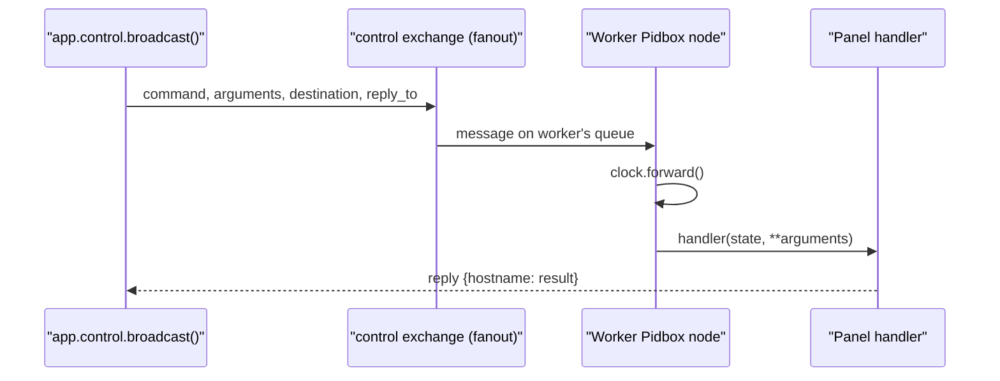

## Overview

Running workers can be inspected and commanded over the broker. A client publishes a command to a fanout exchange; every worker (or the ones named as destinations) receives it in its mailbox, runs the matching handler, and can reply. The module docstring separates two kinds: inspect commands, which have no side effects and return information such as the active or registered tasks, and control commands, which change something, such as adding a queue or revoking a task.

Sources: [celery/app/control.py:1-14](repo://celery/app/control.py#L1-L14)

The client side is `app.control` (`celery.app.control.Control`) and its `inspect()` factory; the worker side is the consumer's `Control` bootstep, the `Pidbox` mailbox, and the command registry in `celery.worker.control`. The `celery control`, `celery inspect` and `celery status` commands are thin wrappers over this API ([[Command Line Interface]]).

Sources: [celery/app/control.py:426-460](repo://celery/app/control.py#L426-L460), [celery/worker/consumer/control.py:1-33](repo://celery/worker/consumer/control.py#L1-L33)

## The mailbox

`Control.__init__` creates a Kombu `Mailbox` on the `control_exchange` exchange (`celery` by default) of type `fanout`, using the app's accepted content and task serializer and the app's producer pool. Queue behaviour comes from the `control_queue_*` settings: per-message TTL and reply TTL of 300 seconds, queues expiring after 10 seconds unused, exclusive and not durable by default. Setting both `control_queue_durable` and `control_queue_exclusive` raises `ImproperlyConfigured`, because exclusive queues are deleted automatically and cannot be durable. After a fork, the mailbox's producer pool is dropped.

Sources: [celery/app/control.py:426-456](repo://celery/app/control.py#L426-L456), [celery/app/defaults.py:151-157](repo://celery/app/defaults.py#L151-L157)



Sources: [celery/app/control.py:755-790](repo://celery/app/control.py#L755-L790), [celery/worker/pidbox.py:16-45](repo://celery/worker/pidbox.py#L16-L45)

`broadcast(command, arguments=None, destination=None, connection=None, reply=False, timeout=1.0, limit=None, callback=None, channel=None, pattern=None, matcher=None, **extra_kwargs)` merges extra keyword arguments into `arguments`, acquires a connection, and calls the mailbox's `_broadcast`. `destination` is a list of node names; `pattern` with `matcher` selects nodes by pattern instead. With `reply=True` it waits up to `timeout` seconds and returns the list of replies, stopping early after `limit` replies, and calls `callback` for each.

Sources: [celery/app/control.py:755-790](repo://celery/app/control.py#L755-L790)

## Inspecting workers

`app.control.inspect(destination=None, timeout=1.0, callback=None, connection=None, limit=None, pattern=None, matcher=None)` returns an `Inspect` bound to the app. Each method broadcasts one inspect command with `reply=True` and merges the replies with `flatten_reply` into `{node_name: reply}`. A node that answers twice triggers a `DuplicateNodenameWarning` asking for unique `-n` names. With a single string destination, the method returns that node's reply alone.

Sources: [celery/app/control.py:38-64](repo://celery/app/control.py#L38-L64), [celery/app/control.py:73-118](repo://celery/app/control.py#L73-L118), [celery/app/control.py:457-460](repo://celery/app/control.py#L457-L460)

| Inspect method | Worker returns |
| --- | --- |
| `ping()` | `{'ok': 'pong'}` (default timeout 0.2 s on the worker side) |
| `active(safe=None)` | `info()` of each executing request |
| `reserved()` | Requests reserved (prefetched) but not active |
| `scheduled()` | ETA requests waiting on the timer, with ETA and priority |
| `revoked()` | The revoked task ids |
| `registered(*taskinfoitems)` | Registered task names, optionally with attributes such as `rate_limit` |
| `stats()` | The worker controller's statistics (pool, broker, rusage, totals) |
| `active_queues()` | The queues the consumer is consuming from |
| `query_task(*ids)` | State (`active`, `reserved` or `ready`) and info for each id |
| `conf(with_defaults=False)` | The worker's configuration, with secrets censored |
| `report()` | The bug-report text |
| `clock()` | The worker's Lamport clock |
| `memsample()`, `memdump()`, `objgraph()` | Memory diagnostics |

Sources: [celery/app/control.py:119-235](repo://celery/app/control.py#L119-L235), [celery/app/control.py:236-350](repo://celery/app/control.py#L236-L350), [celery/app/control.py:350-424](repo://celery/app/control.py#L350-L424), [celery/worker/control.py:79-131](repo://celery/worker/control.py#L79-L131), [celery/worker/control.py:399-490](repo://celery/worker/control.py#L399-L490)

## Controlling workers

`Control` provides one method per control command; each calls `broadcast` and accepts the same `destination`, `reply` and `timeout` keywords.

Sources: [celery/app/control.py:488-600](repo://celery/app/control.py#L488-L600), [celery/app/control.py:600-719](repo://celery/app/control.py#L600-L719), [celery/app/control.py:720-753](repo://celery/app/control.py#L720-L753)

| Method | Worker effect |
| --- | --- |
| `revoke(task_id, terminate=False, signal='SIGTERM')` | Revoke one id or a list, optionally killing running jobs |
| `revoke_by_stamped_headers(headers, terminate=False)` | Revoke by stamp value ([[Stamping]]) |
| `terminate(task_id, signal='SIGTERM')` | `revoke` with `terminate=True` |
| `rate_limit(task_name, rate_limit)` | Set the task's `rate_limit` and rebuild the consumer's token buckets |
| `time_limit(task_name, soft=None, hard=None)` | Set the task's soft and hard limits for later executions |
| `add_consumer(queue, ...)` / `cancel_consumer(queue)` | Start or stop consuming a queue ([[Routing and Queues]]) |
| `enable_events()` / `disable_events()` | Turn task events on or off |
| `heartbeat()` | Send an immediate worker heartbeat |
| `pool_grow(n=1)` / `pool_shrink(n=1)` | Resize the pool and adjust the prefetch count; refused when autoscaling |
| `autoscale(max, min)` | Change the autoscaler's range; error if autoscaling is off |
| `pool_restart(modules=None, reload=False)` | Restart pool processes, only when `worker_pool_restarts` is on |
| `shutdown()` | Raise `WorkerShutdown(EX_OK)` on the worker, a warm shutdown |
| `ping()` | Same as the inspect `ping` |
| `purge()` | Not a broadcast: deletes all waiting messages from the task queues and returns the count |

Sources: [celery/app/control.py:462-479](repo://celery/app/control.py#L462-L479), [celery/worker/control.py:245-323](repo://celery/worker/control.py#L245-L323), [celery/worker/control.py:541-630](repo://celery/worker/control.py#L541-L630)

`rate_limit` validates the string with `rate()` before changing anything and answers `{'error': ...}` for an invalid rate or an unknown task; `time_limit` likewise reports unknown tasks. Replies use `ok(value)` and `nok(value)`, which wrap the value as `{'ok': ...}` or `{'error': ...}`.

Sources: [celery/worker/control.py:31-36](repo://celery/worker/control.py#L31-L36), [celery/worker/control.py:255-321](repo://celery/worker/control.py#L255-L321)

## The command registry

Worker-side commands are plain functions taking a `state` argument, registered in `Panel` with the `@control_command(...)` or `@inspect_command(...)` decorators. Registration stores the function under its name (and an optional `alias`, such as `dump_active` for `active`) in the global `Panel.data`, and its metadata (type, visibility, default timeout, one-line help from the docstring, a signature string, argument converters and the name of a variadic argument) in `Panel.meta`, which the CLI uses to build its command list. Any module imported by the worker can register additional commands this way.

Sources: [celery/worker/control.py:22-76](repo://celery/worker/control.py#L22-L76)

```python
@control_command(
    args=[('n', int)],
    signature='[N=1]',
)
def pool_grow(state, n=1, **kwargs):
    """Grow pool by n processes/threads."""
    if state.consumer.controller.autoscaler:
        return nok("pool_grow is not supported with autoscale. Adjust autoscale range instead.")
    else:
        state.consumer.pool.grow(n)
        state.consumer._update_prefetch_count(n)
    return ok('pool will grow')
```

Sources: [celery/worker/control.py:541-552](repo://celery/worker/control.py#L541-L552)

## The worker's mailbox

The consumer's `Control` step is included when `worker_enable_remote_control` is on and the transport supports fanout exchanges, and it requires the `Tasks` step. It creates a `Pidbox`, or a `gPidbox` for green pools. `Pidbox` creates a mailbox `Node` named after the worker's host name with `Panel.data` as handlers and a `state` object exposing `app`, `hostname` and `consumer` (handlers reach the pool and controller through `state.consumer`). On start it opens a channel on the consumer's connection and listens.

Sources: [celery/worker/consumer/control.py:17-33](repo://celery/worker/consumer/control.py#L17-L33), [celery/worker/pidbox.py:16-50](repo://celery/worker/pidbox.py#L16-L50)

For each message it forwards the Lamport clock ("clients usually don't have a valid clock to adjust with") and lets the node dispatch it. An unknown command is logged as `No such control command`; any other exception is logged and the mailbox is reset by closing and reopening its channel.

Sources: [celery/worker/pidbox.py:32-41](repo://celery/worker/pidbox.py#L32-L41), [celery/worker/pidbox.py:52-75](repo://celery/worker/pidbox.py#L52-L75)

`gPidbox` runs the mailbox in its own green thread spawned on the pool, with its own read connection, draining events in one-second slices until shutdown or until the consumer's connection is gone; resets are counted and applied inside that loop. Stopping waits for the loop to exit.

Sources: [celery/worker/pidbox.py:78-126](repo://celery/worker/pidbox.py#L78-L126)

## Revocation

Revoking a task id does three things on each worker that receives the command: the id is added to `worker_state.revoked`, the backend is told to store it as `REVOKED` (a failure is logged, not raised), and with `terminate=True` every matching request the worker currently holds is terminated with the given signal. A request that has not started yet is marked to be terminated as soon as the pool accepts it.

Sources: [celery/worker/control.py:134-155](repo://celery/worker/control.py#L134-L155), [celery/worker/control.py:214-242](repo://celery/worker/control.py#L214-L242), [celery/worker/request.py:416-426](repo://celery/worker/request.py#L416-L426)

A message for a revoked id that arrives later, or is already reserved, is discarded: the strategy checks the revoked set before accepting it and `execute_using_pool` checks again before handing it to the pool ([[Task Execution Pipeline]]). Because the check happens in the worker, only workers running when the revoke was broadcast know about it.

Sources: [celery/worker/strategy.py:162-163](repo://celery/worker/strategy.py#L162-L163), [celery/worker/request.py:470-509](repo://celery/worker/request.py#L470-L509)

Three mechanisms keep revocations across workers and restarts:

Sources: [celery/worker/state.py:69-71](repo://celery/worker/state.py#L69-L71)

- The revoked set is a `LimitedSet` holding at most `CELERY_WORKER_REVOKES_MAX` ids (50,000), each expiring after `CELERY_WORKER_REVOKE_EXPIRES` seconds (3 hours) once the limit is exceeded.
- With `--statedb`, the `StateDB` bootstep creates a `Persistent` store: a `shelve` file holding the revoked set (zlib-compressed pickle under `zrevoked`) and the logical clock. It is merged at startup, purging expired ids, and saved at exit; older formats are still read.
- At startup, `Mingle` sends the `hello` inspect command with the worker's revoked ids; each other worker adds them to its own set, purges expired entries, and replies with its revoked set and clock, which the new worker merges ([[The Consumer]]).

Sources: [celery/worker/state.py:35-71](repo://celery/worker/state.py#L35-L71), [celery/worker/state.py:191-288](repo://celery/worker/state.py#L191-L288), [celery/worker/components.py:208-219](repo://celery/worker/components.py#L208-L219), [celery/worker/control.py:381-396](repo://celery/worker/control.py#L381-L396), [celery/worker/consumer/mingle.py:46-75](repo://celery/worker/consumer/mingle.py#L46-L75)
