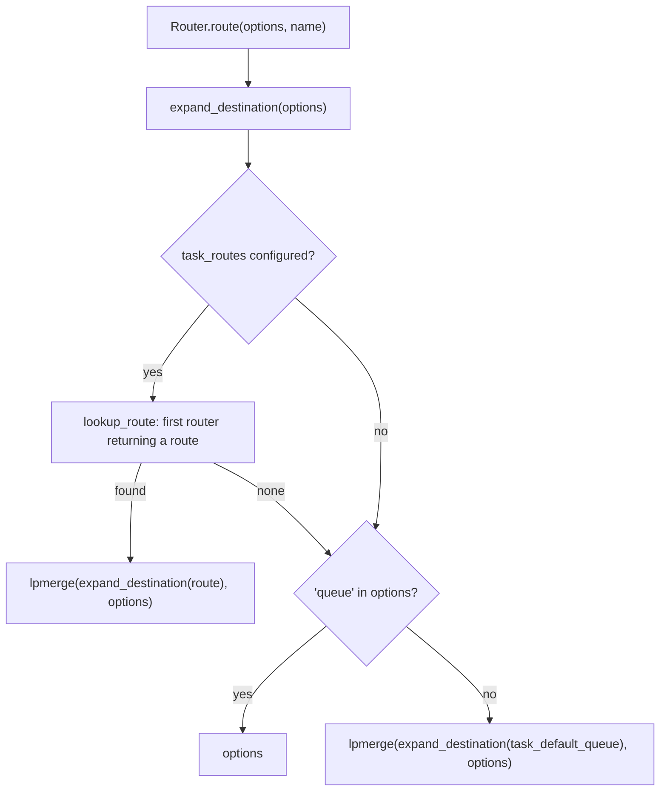

## Overview

Routing answers two questions: when a client sends a task, which exchange, routing key and queue does the message go to; and when a worker starts, which queues does it consume from. Both answers come from the same `Queues` mapping on `app.amqp`, built from the `task_queues` setting, and the first also depends on the `task_routes` setting, interpreted by `celery.app.routes.Router`.

Sources: [celery/app/amqp.py:609-633](repo://celery/app/amqp.py#L609-L633), [celery/app/routes.py:56-76](repo://celery/app/routes.py#L56-L76)

`send_task` calls `router.route(...)` and passes the result to the task sender, which turns a queue into an exchange and routing key at publish time; that publish step is described in [[Sending Tasks]]. The worker side uses `Queues.consume_from` to build its task consumer ([[The Consumer]]).

Sources: [celery/app/base.py:924-925](repo://celery/app/base.py#L924-L925), [celery/app/amqp.py:317-324](repo://celery/app/amqp.py#L317-L324)

## Queue declarations

`app.amqp.queues` is created on first use by `AMQP.Queues(conf.task_queues)`, which fills its arguments from the configuration:

Sources: [celery/app/amqp.py:612-615](repo://celery/app/amqp.py#L612-L615)

| Setting | Default | Used for |
| --- | --- | --- |
| `task_queues` | `None` | Queue declarations (a list of `kombu.Queue` or a dict of name to options) |
| `task_default_queue` | `'celery'` | Queue used when nothing else matches; declared automatically when `task_queues` is empty |
| `task_default_queue_type` | `'classic'` | `'quorum'` adds `x-queue-type: quorum` to that default queue |
| `task_default_exchange`, `task_default_exchange_type` | queue name, `'direct'` | Exchange given to queues that have none |
| `task_default_routing_key` | queue name | Routing key given to queues that have none |
| `task_create_missing_queues` | `True` | Create a queue on lookup of an unknown name |
| `task_create_missing_queue_type` | `'classic'` | Type of queues created that way |
| `task_create_missing_queue_exchange_type` | `None` | Exchange type for created queues |
| `task_queue_max_priority` | `None` | `x-max-priority` for queues that do not set one |

Sources: [celery/app/amqp.py:273-306](repo://celery/app/amqp.py#L273-L306), [celery/app/defaults.py:278-286](repo://celery/app/defaults.py#L278-L286), [celery/app/defaults.py:306-307](repo://celery/app/defaults.py#L306-L307), [celery/app/utils.py:112-124](repo://celery/app/utils.py#L112-L124)

`Queues` is a `dict` from name to `kombu.Queue`. Each queue added goes through `_add`, which fills in the default exchange and routing key and, when a maximum priority is configured, sets `x-max-priority` in the queue arguments unless the queue already has one. Dict-style declarations go through `add_compat`, which still accepts the old `binding_key` name and defaults the routing key to the queue name. Queues may have an `alias`, kept in a weak dictionary and consulted first on lookup.

Sources: [celery/app/amqp.py:63-146](repo://celery/app/amqp.py#L63-L146)

Looking up an unknown name calls `__missing__`. With `create_missing` on, `new_missing` builds a queue whose exchange and routing key are both the queue name; the exchange is `Exchange(name)` by default (the `autoexchange` hook can change that, for example to use the default exchange) or of the type set by `task_create_missing_queue_exchange_type`. A missing queue type of `quorum` adds `x-queue-type: quorum`, and anything other than `classic` or `quorum` raises `ValueError`. With `create_missing` off, the lookup raises `KeyError`.

Sources: [celery/app/amqp.py:99-102](repo://celery/app/amqp.py#L99-L102), [celery/app/amqp.py:201-217](repo://celery/app/amqp.py#L201-L217), [celery/app/amqp.py:243-247](repo://celery/app/amqp.py#L243-L247)

## Routes

`task_routes` is expanded once by `routes.prepare` into a list of routers, cached in `AMQP._rtable` and rebuilt when the setting changes. A single value is treated as a one-element list, and each entry becomes:

Sources: [celery/app/routes.py:132-136](repo://celery/app/routes.py#L132-L136)

| Entry | Becomes |
| --- | --- |
| A dict, or a list of `(pattern, route)` pairs | `MapRoute` |
| A string | A lazy import of that object; a pre-4.0 class with `route_for_task` is instantiated |
| Anything else (a function or router object) | Used as is |

Sources: [celery/app/routes.py:114-136](repo://celery/app/routes.py#L114-L136), [celery/app/amqp.py:314-315](repo://celery/app/amqp.py#L314-L315), [celery/app/amqp.py:621-625](repo://celery/app/amqp.py#L621-L625), [celery/app/amqp.py:659-662](repo://celery/app/amqp.py#L659-L662)

`MapRoute` separates exact names from patterns. Keys that are compiled regular expressions are kept as patterns, keys containing `*` are translated from glob syntax with `fnmatch.translate`, and everything else is an exact name. A lookup tries the exact name first, then the patterns in declaration order; the first match wins. A route value that is a dict is returned as a copy of the options; a plain string is taken as the queue name, `{'queue': value}`.

Sources: [celery/app/routes.py:26-53](repo://celery/app/routes.py#L26-L53)

```python
task_routes = {
    'feed.tasks.import_feed': {'queue': 'feeds'},
    'video.*': 'media',
    re.compile(r'(image|audio)\.tasks\..*'): {'queue': 'media'},
}
```

Sources: [celery/app/routes.py:29-53](repo://celery/app/routes.py#L29-L53)

A function router is called as `router(name, args, kwargs, options, task=task_type)` and returns a route or `None`; objects with the old `route_for_task(task, args, kwargs)` method are called that way instead.

Sources: [celery/app/routes.py:98-111](repo://celery/app/routes.py#L98-L111)

## How a route is resolved

`Router.route(options, name, args, kwargs, task_type)` combines the caller's options, the routes and the default queue.

Sources: [celery/app/routes.py:66-76](repo://celery/app/routes.py#L66-L76)



Sources: [celery/app/routes.py:66-111](repo://celery/app/routes.py#L66-L111)

`expand_destination` turns a `queue` entry into a `kombu.Queue`: a string route is a queue name, a dict route has its `queue` key popped and looked up in `Queues` (which may create it), and a `Queue` instance is used directly. An unknown name with queue creation disabled raises `QueueNotFound('Queue ... missing from task_queues')`. Because the merge is `lpmerge(route, options)`, values the caller passes to `apply_async` win over the route's, and `None` values in the options do not erase route values. The comment in `expand_destination` notes that a dict route can reuse a configured queue and override only parts such as the routing key, which is how topic exchanges are addressed.

Sources: [celery/app/routes.py:78-96](repo://celery/app/routes.py#L78-L96), [celery/utils/collections.py:47-55](repo://celery/utils/collections.py#L47-L55)

At publish time the sender converts the chosen queue into an exchange and routing key, falling back to the anonymous exchange for direct queues ([[Sending Tasks]]).

Sources: [celery/app/amqp.py:520-546](repo://celery/app/amqp.py#L520-L546)

## Worker queue selection

All declared queues are consumed by default: `Queues` remembers the initial set as `_default_consume_from`. `WorkController.setup_queues` applies the worker's `-Q`/`--queues` list with `select`, which replaces the consume set with exactly those queues (creating any missing ones if allowed), and the `-X`/`--exclude-queues` list with `deselect`, which removes names from the current consume set. Unknown names raise `ImproperlyConfigured`. Queues left out are still known for routing; they are just not consumed.

Sources: [celery/app/amqp.py:59-60](repo://celery/app/amqp.py#L59-L60), [celery/app/amqp.py:83-84](repo://celery/app/amqp.py#L83-L84), [celery/app/amqp.py:172-223](repo://celery/app/amqp.py#L172-L223), [celery/worker/worker.py:167-181](repo://celery/worker/worker.py#L167-L181)

With `worker_direct` enabled, each worker also consumes from a queue named `<hostname>.dq2` bound to the `C.dq2` exchange with the hostname as routing key, so a task can be routed to one specific worker. `select_add` adds it to whichever consume set is active, so `-Q` does not drop it.

Sources: [celery/worker/worker.py:180-181](repo://celery/worker/worker.py#L180-L181), [celery/utils/nodenames.py:14-54](repo://celery/utils/nodenames.py#L14-L54), [celery/app/amqp.py:159-170](repo://celery/app/amqp.py#L159-L170)

A running worker can start and stop consuming from queues through remote control: `Consumer.add_task_queue` uses an existing declaration or declares a new direct queue and adds it with `select_add`, and `cancel_task_queue` deselects the queue and cancels the consumer for it ([[Remote Control and Revocation]]).

Sources: [celery/worker/consumer/consumer.py:632-657](repo://celery/worker/consumer/consumer.py#L632-L657)

## Quorum queues

`detect_quorum_queues(app, driver_type)` reports whether any declared queue has `x-queue-type: quorum`, and only on an `amqp` (RabbitMQ) transport. Three places use it: `send_task` switches ETA and countdown messages to native delayed delivery ([[Sending Tasks]]); the consumer's `DelayedDelivery` step sets up the delayed-delivery exchanges ([[The Consumer]]); and the consumer's `Tasks` step disables global QoS when `worker_detect_quorum_queues` is on, logging that the prefetch count is now static, because quorum queues do not support global QoS.

Sources: [celery/utils/quorum_queues.py:4-20](repo://celery/utils/quorum_queues.py#L4-L20), [celery/worker/consumer/tasks.py:103-124](repo://celery/worker/consumer/tasks.py#L103-L124), [celery/worker/consumer/delayed_delivery.py:60-66](repo://celery/worker/consumer/delayed_delivery.py#L60-L66)
