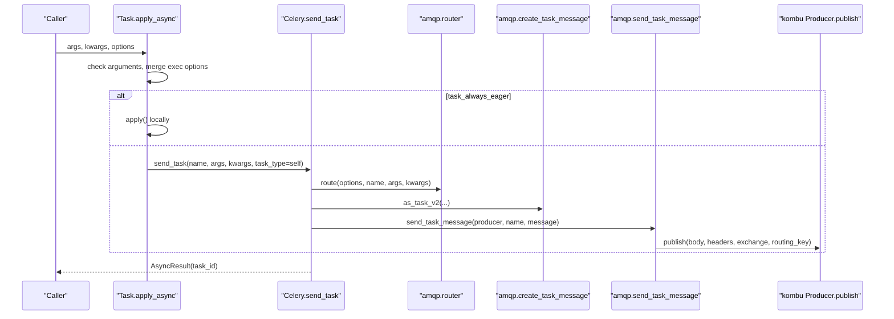

## Overview

Calling a task asynchronously means publishing a message that names the task and carries its arguments. Three entry points lead to the same publish call: `Task.delay(*args, **kwargs)`, `Task.apply_async(args, kwargs, **options)`, and `app.send_task(name, ...)`, which needs only the task's name and so works for tasks defined in another code base. Each returns an `AsyncResult` for the new task id.

Sources: [celery/app/task.py:523-535](repo://celery/app/task.py#L523-L535), [celery/app/base.py:846-862](repo://celery/app/base.py#L846-L862)

The work is split between the app, which merges options, routes the call and acquires a producer, and `app.amqp`, which formats the message and publishes it through Kombu. Where the message ends up (exchange, routing key, queue) is decided by the router described in [[Routing and Queues]]; how the worker reads the message is in [[Task Execution Pipeline]].

Sources: [celery/app/base.py:1009-1040](repo://celery/app/base.py#L1009-L1040), [celery/app/amqp.py:225-272](repo://celery/app/amqp.py#L225-L272)

## Call path

Sources: [celery/app/task.py:658-708](repo://celery/app/task.py#L658-L708), [celery/app/base.py:926-1040](repo://celery/app/base.py#L926-L1040), [celery/app/amqp.py:505-605](repo://celery/app/amqp.py#L505-L605)

## apply_async

`Task.apply_async(args=None, kwargs=None, task_id=None, producer=None, link=None, link_error=None, shadow=None, **options)` accepts the execution options documented on the method: `countdown`, `eta`, `expires`, `queue`, `exchange`, `routing_key`, `priority`, `serializer`, `compression`, `retry`, `retry_policy`, `time_limit`, `soft_time_limit`, `headers`, `ignore_result`, `add_to_parent`, `connection`, plus any keyword `kombu.Producer.publish` accepts.

Sources: [celery/app/task.py:536-652](repo://celery/app/task.py#L536-L652)

Before sending, it:

Sources: [celery/app/task.py:658-681](repo://celery/app/task.py#L658-L681)

1. Raises `ValueError` if the class's `soft_time_limit` is greater than its `time_limit`.
2. When `typing` is enabled, calls `__header__(*args, **kwargs)`, the stub generated from the function signature, so a wrong number of arguments raises `TypeError` in the caller rather than on the worker.
3. Computes `shadow` with `shadow_name`, an overridable hook for a different name in logs and monitoring.
4. Merges the task's cached execution options (`queue`, `routing_key`, `exchange`, `priority`, `expires`, `serializer`, `delivery_mode`, `compression`, `time_limit`, `soft_time_limit` and the deprecated `immediate` and `mandatory`) under the caller's options, and defaults `ignore_result` and `priority` from the task.

Sources: [celery/app/task.py:32-36](repo://celery/app/task.py#L32-L36), [celery/app/task.py:658-681](repo://celery/app/task.py#L658-L681)

With `task_always_eager` set, it serializes and deserializes `(args, kwargs)` with the chosen serializer (so non-serializable arguments fail as they would in production) and then calls `self.apply(...)` inside `denied_join_result()`, returning an `EagerResult`. Otherwise it calls `app.send_task` with `task_type=self` and the task's own `AsyncResult` class.

Sources: [celery/app/task.py:682-708](repo://celery/app/task.py#L682-L708)

## send_task

### Task id and eager warning

`send_task` generates a UUID when no `task_id` is given and warns with `AlwaysEagerIgnored` if `task_always_eager` is set, since eager mode only applies to `apply_async`.

Sources: [celery/app/base.py:862-874](repo://celery/app/base.py#L862-L874)

### Options from the registry

When called by name without `task_type`, it looks the name up in the raw registry (`self._tasks`, not `self.tasks`, so the app is not finalized just for this) and, if found, merges the task's non-`None` execution options under the caller's. When `apply_async` already supplied `task_type`, this is skipped so the caller's explicit values are not overridden twice. `time_limit`, `soft_time_limit` and `expires` use a sentinel to tell "omitted" from an explicit `None`, which clears a task-level default.

Sources: [celery/app/base.py:876-924](repo://celery/app/base.py#L876-L924)

### Routing and delayed delivery

`router.route(options, route_name or name, args, kwargs, task_type)` returns the final options including the destination queue ([[Routing and Queues]]). For tasks with an ETA or countdown on a RabbitMQ broker whose queues include a quorum queue, Celery uses Kombu's native delayed delivery: it converts the ETA into a countdown, computes a routing key with `calculate_routing_key`, and publishes to the `celery_delayed_27` topic exchange instead of the queue. This only works for topic or fanout exchanges; with a direct exchange it logs a warning that the task may block a worker process until its ETA.

Sources: [celery/app/base.py:926-962](repo://celery/app/base.py#L926-L962), [celery/utils/quorum_queues.py:4-20](repo://celery/utils/quorum_queues.py#L4-L20)

### Expiry, parents and priority

An `expires` value (datetime, ISO string or seconds) is turned into a seconds-from-now `expiration` message property. A value in the past is clamped to `0` with a warning quoting RabbitMQ's documentation that a TTL of 0 expires the message unless a consumer can take it at once.

Sources: [celery/app/base.py:964-986](repo://celery/app/base.py#L964-L986)

If the call happens inside a task the worker is running, `root_id` defaults to the parent's root (or its id) and `parent_id` to the parent's id; with `task_inherit_parent_priority` the parent's delivery priority becomes the default priority. After publishing, the result is added to the parent's `request.children` when `add_to_parent` is true and the parent has `trail` enabled ([[Defining Tasks]]).

Sources: [celery/app/base.py:988-998](repo://celery/app/base.py#L988-L998), [celery/app/base.py:1029-1041](repo://celery/app/base.py#L1029-L1041), [celery/app/task.py:1229-1232](repo://celery/app/task.py#L1229-L1232)

### Publishing

The message is built by `amqp.create_task_message`, the `stamped_headers` keys are removed from the options, and a producer is taken from the pool with `producer_or_acquire` (or created on the given `connection`). Inside Kombu's `_reraise_as_library_errors`, it calls `backend.on_task_call(producer, task_id)` unless the result is ignored (the RPC backend uses this hook to set up the reply queue) and then `amqp.send_task_message`. The returned `AsyncResult` gets `ignored = ignore_result`.

Sources: [celery/app/base.py:1000-1036](repo://celery/app/base.py#L1000-L1036)

## The task message

`create_task_message` is chosen once from `task_protocols` by the `task_protocol` setting, which defaults to `2`. `as_task_v2` validates that `args` is a list or tuple and `kwargs` a mapping, converts `countdown` and numeric `expires` into timezone-aware datetimes using `app.now()` and `app.timezone`, renders ETA and expiry as ISO 8601 strings, computes `argsrepr`/`kwargsrepr` with `saferepr` (truncated at 1024 characters by default), and sets `root_id` to the task id when there is none.

Sources: [celery/app/amqp.py:257-272](repo://celery/app/amqp.py#L257-L272), [celery/app/amqp.py:326-367](repo://celery/app/amqp.py#L326-L367), [celery/app/defaults.py:295-295](repo://celery/app/defaults.py#L295-L295)

The resulting `task_message` named tuple has four parts:

Sources: [celery/app/amqp.py:32-33](repo://celery/app/amqp.py#L32-L33)

| Part | Content |
| --- | --- |
| `headers` | `lang`, `task`, `id`, `shadow`, `eta`, `expires`, `group`, `group_index`, `retries`, `timelimit` (`[hard, soft]`), `root_id`, `parent_id`, `argsrepr`, `kwargsrepr`, `origin` (node name), `ignore_result`, `replaced_task_nesting`, `stamped_headers`, `stamps` |
| `properties` | `correlation_id` (the task id) and `reply_to` |
| `body` | `(args, kwargs, embed)` where `embed` is `{'callbacks', 'errbacks', 'chain', 'chord'}` |
| `sent_event` | Fields for a `task-sent` event, or `None` unless `task_send_sent_event` is enabled |

Sources: [celery/app/amqp.py:32-33](repo://celery/app/amqp.py#L32-L33), [celery/app/amqp.py:369-418](repo://celery/app/amqp.py#L369-L418), [celery/app/base.py:1003-1011](repo://celery/app/base.py#L1003-L1011)

Protocol 1, from `as_task_v1`, puts everything in the body dict and sends no headers; the worker still accepts it and converts it to the v2 layout ([[Task Execution Pipeline]]).

Sources: [celery/app/amqp.py:420-478](repo://celery/app/amqp.py#L420-L478)

## The task sender

`send_task_message` is a closure created once by `_create_task_sender`, which reads the defaults it needs (`task_publish_retry`, `task_publish_retry_policy`, `task_default_delivery_mode`, default exchange, routing key, serializer and compression) and the signal receiver lists ahead of time, so an unused signal costs nothing per message.

Sources: [celery/app/amqp.py:485-504](repo://celery/app/amqp.py#L485-L504)

For each message it updates the headers with any caller `headers` and the properties with extra keyword arguments, then resolves the destination. With neither queue nor exchange it uses `default_queue`; a queue name is looked up in `amqp.queues`. The delivery mode falls back from the queue's exchange to `task_default_delivery_mode`. For a direct exchange missing an exchange or routing key, it publishes to the anonymous default exchange with the queue name as routing key; otherwise it uses the queue's exchange and routing key. The queue is declared on publish unless it is a `Broadcast` queue or `declare` was given.

Sources: [celery/app/amqp.py:505-546](repo://celery/app/amqp.py#L505-L546)

The retry policy is the default `task_publish_retry_policy` (`max_retries` 3, `interval_start` 0, `interval_max` 1, `interval_step` 0.2) updated by the caller's `retry_policy`, with retrying on by default through `task_publish_retry`. Around `producer.publish(...)` it sends `before_task_publish` (with body, exchange, routing key, declare list, headers, properties and retry policy, so receivers can modify headers) and `after_task_publish`, plus the deprecated `task_sent` signal. When the message carries a `sent_event`, it publishes a `task-sent` event with the queue, exchange and routing key added, using a disabled event dispatcher it drives with the same producer ([[Events and Monitoring]], [[Signals]]).

Sources: [celery/app/amqp.py:547-605](repo://celery/app/amqp.py#L547-L605), [celery/app/defaults.py:296-305](repo://celery/app/defaults.py#L296-L305), [celery/app/amqp.py:653-657](repo://celery/app/amqp.py#L653-L657)

## Producer pool

`amqp.producer_pool` is Kombu's producer pool for the app's write connection, limited to the same size as the connection pool (`broker_pool_limit`, 10 by default). It is reset after fork with the connection pool, as described in [[The Celery Application]]. A change to `task_routes` on the configuration rebuilds the router through `_handle_conf_update`.

Sources: [celery/app/amqp.py:635-662](repo://celery/app/amqp.py#L635-L662), [celery/app/defaults.py:100-101](repo://celery/app/defaults.py#L100-L101)
