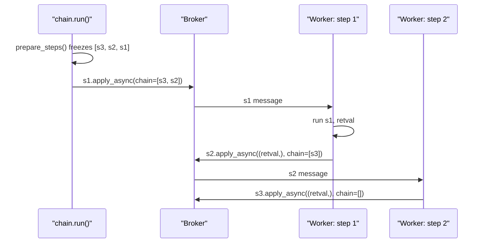

## Overview

A signature captures one task invocation (task name, positional arguments, keyword arguments and execution options) as a value that can be stored, passed to another task, serialized into a message and applied later. Signatures are the building blocks of Celery's canvas: callbacks, chains, groups and chords are all signatures, and the worker receives them inside the task message as plain dicts and turns them back into objects.

Sources: [celery/canvas.py:233-276](repo://celery/canvas.py#L233-L276)

This page covers the `Signature` class itself and the sequential primitives built on it: `chain`, `xmap`, `xstarmap` and `chunks`. Parallel work with `group` and `chord` is in [[Groups and Chords]], and attaching metadata to every signature in a canvas is in [[Stamping]].

Sources: [celery/canvas.py:935-956](repo://celery/canvas.py#L935-L956), [celery/canvas.py:1385-1470](repo://celery/canvas.py#L1385-L1470)

## The Signature value

`Signature` subclasses `dict`. Its constructor stores five keys (`task`, `args` as a tuple, `kwargs`, `options` (the given `options` merged with extra keywords) and `subtask_type`) plus `immutable`. When `task` is a task object rather than a name, the name is stored and the object is kept in `_type`; when the first argument is already a dict, the dict is copied as is. Attribute access goes through `getitem_property`, so `sig.args` reads `sig['args']` and `sig.id` reads `sig['options']['task_id']`.

Sources: [celery/canvas.py:310-332](repo://celery/canvas.py#L310-L332), [celery/canvas.py:865-874](repo://celery/canvas.py#L865-L874)

Because it is a dict, a signature serializes with JSON like any other value. `__reduce__` pickles it as `signature(dict(self))` and `__json__` returns `dict(self)`; the task class is not stored but looked up lazily through `type`, which uses `_type` or `app.tasks[self['task']]`. For a task name the local app does not know, `_apply_async` falls back to `app.send_task` with the name.

Sources: [celery/canvas.py:823-830](repo://celery/canvas.py#L823-L830), [celery/canvas.py:843-863](repo://celery/canvas.py#L843-L863)

Turning dicts back into objects is `Signature.from_dict`: if the dict has a `subtask_type`, the class registered under that name with `@Signature.register_type` builds it (`chain`, `group`, `chord`, `xmap`, `xstarmap`, `chunks` register themselves this way). `signature(varies, ...)` clones an existing signature, converts a dict with `from_dict`, or constructs a new one; `maybe_signature(d, app=None, clone=False)` does the same but passes `None` through and rebinds the app, which is what the worker uses on callbacks and chain steps.

Sources: [celery/canvas.py:283-308](repo://celery/canvas.py#L283-L308), [celery/canvas.py:2395-2439](repo://celery/canvas.py#L2395-L2439)

## Creating signatures

Tasks provide shortcuts. `task.signature(args, kwargs, **options)` and its alias `subtask` bind the signature to the task's app; `task.s(*args, **kwargs)` is the star-argument form, and `task.si(...)` creates an immutable signature. `task.map(it)`, `task.starmap(it)` and `task.chunks(it, n)` wrap `task.s()` in the primitives described below.

Sources: [celery/app/task.py:962-1001](repo://celery/app/task.py#L962-L1001)

```python
add.s(2, 2)                                   # add(2, 2)
add.signature((2, 2), countdown=10)           # with execution options
add.s(2, 2).set(countdown=10).set(expires=30) # .set returns self
add.si(2, 2)                                  # ignores the parent's result
```

Sources: [celery/canvas.py:240-260](repo://celery/canvas.py#L240-L260), [celery/canvas.py:560-569](repo://celery/canvas.py#L560-L569)

## Partial application and immutability

Applying a signature merges new arguments into the stored ones through `_merge`. New positional arguments are prepended, new keyword arguments override stored ones, and new options override stored options, except for `group_id` and `stamped_headers` (and any stamped header key), which `_IMMUTABLE_OPTIONS` protects because changing them during freezing "would disrupt completion of parent tasks". An immutable signature keeps its arguments and only merges options, unless `force=True`.

Sources: [celery/canvas.py:276-281](repo://celery/canvas.py#L276-L281), [celery/canvas.py:442-484](repo://celery/canvas.py#L442-L484)

Prepending is what makes callbacks work: when a task finishes, the worker calls `callback.apply_async((retval,))`, so the parent's return value becomes the callback's first argument. An immutable callback (`si`) ignores it.

Sources: [celery/app/trace.py:426-473](repo://celery/app/trace.py#L426-L473)

| Method | Effect |
| --- | --- |
| `apply_async(args, kwargs, route_name=None, **options)` | Drops `None` options, merges, calls the task's `apply_async` (or `send_task`) |
| `delay(*args, **kwargs)` | `apply_async(args, kwargs)` |
| `apply(args, kwargs, **options)` | Merges and runs the task locally with `Task.apply` |
| `__call__(*args, **kwargs)` | Merges and calls the task function in the current process |
| `clone(args, kwargs, **options)` / `partial` | New signature with merged values and deep-copied options |
| `replace(args, kwargs, options)` | Clone with whole sections replaced |
| `set(immutable=None, **options)` | Updates options in place, returns `self` |
| `~sig` | `apply_async().get()` |

Sources: [celery/canvas.py:334-420](repo://celery/canvas.py#L334-L420), [celery/canvas.py:486-569](repo://celery/canvas.py#L486-L569), [celery/canvas.py:820-821](repo://celery/canvas.py#L820-L821)

## Freezing

`freeze(_id=None, group_id=None, chord=None, root_id=None, parent_id=None, group_index=None)` fixes the task id before sending. It keeps an existing `task_id` option or sets one from `_id` or a new UUID, sets `root_id`, `parent_id`, `chord` and `group_index` when given, sets `group_id` only if none is present, defaults `reply_to` to the app's per-thread id, and returns an `AsyncResult` for the id. The docstring warns that applying a frozen signature twice sends two messages with the same id. Composite primitives freeze their members first so a caller can hold a result tree before anything runs.

Sources: [celery/canvas.py:509-554](repo://celery/canvas.py#L509-L554)

## Callbacks and errbacks

`link(callback)` and `link_error(errback)` append to the `link` and `link_error` option lists (converting a single value into a list and skipping duplicates) and return the argument, so `a.link(b).link(c)` links `c` to `b`. `on_error(errback)` is the variant that returns the original signature for chaining, as in `add.s(2, 2).on_error(errback.s()).delay()`. These options become the message's `callbacks` and `errbacks` ([[Sending Tasks]]); how errbacks are called on failure is in [[Retries, Failures and Time Limits]].

Sources: [celery/canvas.py:685-746](repo://celery/canvas.py#L685-L746)

## Building chains

`a | b` produces a chain. `Signature.__or__` turns task-or-task into `_chain(a, b)`, prepends a task to an existing chain, and unrolls a one-member group before chaining. `chain(a, b, c)` reduces its arguments with `|` so it builds the same object; a single iterable argument (such as a generator) is accepted too.

Sources: [celery/canvas.py:759-786](repo://celery/canvas.py#L759-L786), [celery/canvas.py:1322-1382](repo://celery/canvas.py#L1322-L1382)

`_chain.__or__` handles the combinations that change shape:

Sources: [celery/canvas.py:960-962](repo://celery/canvas.py#L960-L962)

| Expression | Result |
| --- | --- |
| `chain \| chain` | One flat chain |
| `chain \| group` | Chain ending in the group; if the chain ends in a chord, the group is chained into the chord's body |
| `chain-ending-in-group \| task` | The group and the task become a `chord` |
| `chain-ending-in-chord \| task` | The task is chained into the chord's body |
| `chain \| task` | Chain with the task appended |

Sources: [celery/canvas.py:960-1006](repo://celery/canvas.py#L960-L1006)

A chain is itself a signature for the built-in `celery.chain` task, with its members in `kwargs['tasks']`. `unchain_tasks()` returns clones of the members, moving the chain's own `link` callbacks onto the last task and its `link_error` errbacks onto every task.

Sources: [celery/canvas.py:935-956](repo://celery/canvas.py#L935-L956), [celery/canvas.py:1017-1034](repo://celery/canvas.py#L1017-L1034)

## Running a chain

`chain.apply_async` runs the whole chain locally with `apply` when `task_always_eager` is set (each step's `get()` result feeding the next). Otherwise it calls `run`, which calls `prepare_steps` and then sends only the first task.

Sources: [celery/canvas.py:1036-1094](repo://celery/canvas.py#L1036-L1094), [celery/canvas.py:1294-1302](repo://celery/canvas.py#L1294-L1302)

`prepare_steps` walks the members from last to first, so the list it builds is reversed and the worker can take the next step with `chain.pop()`. For each step it:

Sources: [celery/canvas.py:1167-1180](repo://celery/canvas.py#L1167-L1180)

1. Converts dicts to signatures and unrolls one-member groups, skipping empty groups in the middle of a chain.
2. Clones the step, giving the first step the chain's partial arguments.
3. Splices nested chains into the walk.
4. Upgrades a group followed by a step into `chord(group, body=next_step)`.
5. Freezes the step: the last step gets the chain's task id, group id, chord body and group index, so a group or chord containing this chain synchronizes on its last task; other steps only get the root id.
6. Sets each result's `parent` to the previous step's result, and applies the chain's `link_error` to every step (and to a chord's body).

Sources: [celery/canvas.py:1180-1240](repo://celery/canvas.py#L1180-L1240), [celery/canvas.py:1240-1292](repo://celery/canvas.py#L1240-L1292)

`run` then pops the first task off the reversed list and calls its `apply_async` with the options returned by `_prepare_chain_from_options`, which put the remaining steps in the `chain` option. That option ends up in the message body's `embed['chain']`. The long comment above `_prepare_chain_from_options` explains why it builds a `ChainMap` rather than modifying the options: the same options dict is shared by every task in a group, and mutating its `chain` list once caused tasks in a group to inherit each other's chain steps (issue #5354). `run` returns the last task's result, whose `parent` links walk back to the first step.

Sources: [celery/canvas.py:877-932](repo://celery/canvas.py#L877-L932), [celery/canvas.py:1072-1094](repo://celery/canvas.py#L1072-L1094)



Sources: [celery/canvas.py:1072-1094](repo://celery/canvas.py#L1072-L1094), [celery/app/trace.py:466-473](repo://celery/app/trace.py#L466-L473)

On the worker, after a step succeeds, the tracer takes `chain[-1]`, turns it into a signature and applies it with the return value and `chain=chain[:-1]`, before storing the step's own result ([[Task Execution Pipeline]]). The comment in `prepare_steps` gives the reason for this design over nested `link` callbacks: it "avoids pickle blowing the stack on the recursion required by linking task together in a tree structure". With protocol 1, or `use_link=True`, chains still use links.

Sources: [celery/canvas.py:1158-1166](repo://celery/canvas.py#L1158-L1166), [celery/app/trace.py:466-473](repo://celery/app/trace.py#L466-L473)

`chain.freeze()` runs `prepare_steps` without cloning and returns the first result in its list, the result of the last step.

Sources: [celery/canvas.py:1096-1105](repo://celery/canvas.py#L1096-L1105)

## Map, starmap and chunks

`xmap(task, it)` and `xstarmap(task, it)` are immutable signatures for the built-in `celery.map` and `celery.starmap` tasks. They send a single message containing the whole iterable; the worker runs `task(item)` (or `task(*item)`) for each item sequentially in one process and returns the list. The `xmap` docstring stresses that this "is not a parallel operation like group". `apply_async` routes the message by the inner task's name.

Sources: [celery/canvas.py:1385-1434](repo://celery/canvas.py#L1385-L1434), [celery/app/builtins.py:101-120](repo://celery/app/builtins.py#L101-L120)

`chunks(task, it, n)` splits the iterable into parts of `n` items and sends a `group` of `xstarmap` signatures, one per part, so the parts run in parallel while items within a part run sequentially. `chunks.group()` returns that group without sending it; the built-in `celery.chunks` task calls `apply_chunks` when a chunks signature is itself sent as a task.

Sources: [celery/canvas.py:1437-1473](repo://celery/canvas.py#L1437-L1473), [celery/app/builtins.py:123-130](repo://celery/app/builtins.py#L123-L130)
