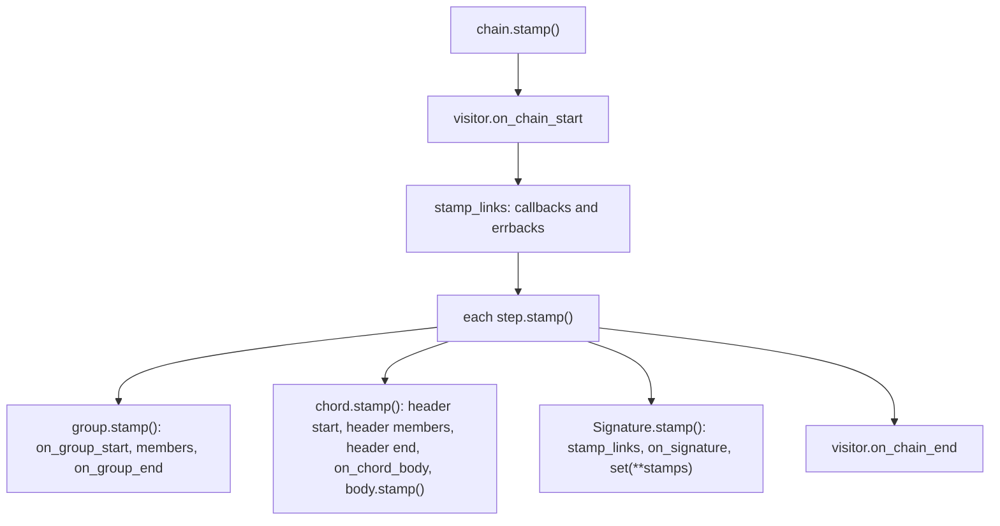

## Overview

Stamping attaches custom key/value metadata ("stamps") to every signature in a canvas before it is sent, without changing the tasks' arguments. A stamp becomes a message header of each task, is visible on the worker as `request.stamps`, and can be used to revoke every task that carries it. Typical uses in the bundled examples are a per-task monitoring id and a shared marker used to cancel part of a workflow.

Sources: [celery/canvas.py:614-634](repo://celery/canvas.py#L614-L634), [examples/stamping/visitors.py:9-19](repo://examples/stamping/visitors.py#L9-L19), [examples/stamping/revoke_example.py:22-43](repo://examples/stamping/revoke_example.py#L22-L43)

Stamping is a walk over the canvas: each primitive's `stamp()` method visits its members, callbacks and errbacks, and a `StampingVisitor` decides which stamps each one gets. The primitives themselves are described in [[Signatures and Chains]] and [[Groups and Chords]].

Sources: [celery/canvas.py:119-128](repo://celery/canvas.py#L119-L128)

## The visitor API

`StampingVisitor` is an abstract class. The only required method is `on_signature(sig, **headers)`; every other hook has a default. Each `on_*_start`, `on_signature`, `on_chord_body`, `on_callback` and `on_errback` hook returns a dict of stamps to add, and each `on_*_end` hook returns nothing.

Sources: [celery/canvas.py:119-230](repo://celery/canvas.py#L119-L230)

| Hook | Called for | Default |
| --- | --- | --- |
| `on_signature(sig, **headers)` | Each plain signature | Abstract |
| `on_group_start(group, **headers)` / `on_group_end` | A group before and after its members | `{}` / nothing |
| `on_chain_start(chain, **headers)` / `on_chain_end` | A chain before and after its steps | `{}` / nothing |
| `on_chord_header_start(chord, **headers)` / `on_chord_header_end` | A chord's header | Wraps the header in a `group` and delegates to the group hooks |
| `on_chord_body(chord, **headers)` | A chord's body, before stamping it | `{}` |
| `on_callback(callback, **headers)` | Each `link` callback | `{}` |
| `on_errback(errback, **headers)` | Each `link_error` errback | `{}` |

Sources: [celery/canvas.py:125-230](repo://celery/canvas.py#L125-L230)

The examples define three visitors: `MyStampingVisitor` gives every signature the same `mystamp` value, `MonitoringIdStampingVisitor` gives each signature a fresh UUID in `mtask_id`, and `FullVisitor` overrides every hook to show the order of calls.

Sources: [examples/stamping/visitors.py:9-22](repo://examples/stamping/visitors.py#L9-L22)

```python
class MonitoringIdStampingVisitor(StampingVisitor):
    def on_signature(self, sig: Signature, **headers) -> dict:
        mtask_id = str(uuid4())
        logger.critical(f"Visitor: Sig '{sig}' is stamped with: {mtask_id}")
        return {"mtask_id": mtask_id}
```

Sources: [examples/stamping/visitors.py:9-67](repo://examples/stamping/visitors.py#L9-L67)

## Walking the canvas

`stamp(visitor=None, append_stamps=False, **headers)` exists on every primitive. Stamps can come from the visitor, from keyword `headers` passed directly, or both; without a visitor, `sig.stamp(foo='bar')` stamps every member with `foo`.

Sources: [celery/canvas.py:614-634](repo://celery/canvas.py#L614-L634)



Sources: [celery/canvas.py:1107-1118](repo://celery/canvas.py#L1107-L1118), [celery/canvas.py:1667-1688](repo://celery/canvas.py#L1667-L1688), [celery/canvas.py:2123-2143](repo://celery/canvas.py#L2123-L2143), [celery/canvas.py:614-634](repo://celery/canvas.py#L614-L634)

For a plain signature, `stamp` first stamps its links, then asks `on_signature` for stamps, merges them with the passed headers and the signature's existing stamps through `_stamp_headers`, and writes the result into the options with `set(**headers)`. Composite primitives call their start hook, stamp their own links, stamp each member with the merged headers, and call their end hook. A group or chord header built from a generator is not consumed: `_stamp_regen_task` is mapped over the lazy `regen` so each member is stamped when it is produced.

Sources: [celery/canvas.py:65-71](repo://celery/canvas.py#L65-L71), [celery/canvas.py:1667-1688](repo://celery/canvas.py#L1667-L1688)

`stamp_links` stamps each callback with `on_callback` stamps and each errback with `on_errback` stamps, starting each time from a deep copy of the incoming headers. It passes `self_headers=False`, and the comment explains why: otherwise "the link copies the stamps of the linked signature, and we don't want that".

Sources: [celery/canvas.py:636-683](repo://celery/canvas.py#L636-L683)

## Merging stamps

`_stamp_headers(visitor_headers=None, append_stamps=False, self_headers=True, **headers)` produces the final stamps for one signature. It keeps a `stamped_headers` list naming which option keys are stamps, merges the visitor's stamps into the passed headers, and then, when `self_headers` is on, merges in the stamps already present in the signature's options, restricted to keys listed in its existing `stamped_headers`.

Sources: [celery/canvas.py:571-612](repo://celery/canvas.py#L571-L612)

`append_stamps` controls duplicates. With `False`, the default, a later value replaces an earlier one, so the visitor's value wins over the passed headers. With `True`, `_merge_dictionaries` turns a duplicated key into a list holding both values, so repeated stamping accumulates. The comment in `_stamp_headers` explains that the default favours the visitor and accepts losing the duplicate from `headers`, rather than silently turning a stamp into a list.

Sources: [celery/canvas.py:74-116](repo://celery/canvas.py#L74-L116), [celery/canvas.py:588-600](repo://celery/canvas.py#L588-L600)

Stamped keys cannot be overwritten later by partial application: `Signature._merge` treats `stamped_headers` and every key it lists as immutable options, so `apply_async(**options)` cannot replace a stamp already on the signature.

Sources: [celery/canvas.py:465-477](repo://celery/canvas.py#L465-L477)

## From options to message headers

A stamped signature carries its stamps as ordinary options plus a `stamped_headers` list. When it is sent, `as_task_v2` copies each listed option into a `stamps` dict and puts both `stamped_headers` and `stamps` in the message headers, and `send_task` then removes the stamp keys from the publish options so they are not passed to Kombu as message properties.

Sources: [celery/app/amqp.py:369-389](repo://celery/app/amqp.py#L369-L389), [celery/app/base.py:1013-1015](repo://celery/app/base.py#L1013-L1015)

On the worker, `Request.stamped_headers` reads the header list and `Request.stamps` returns the value of each listed stamp. The task sees them as `self.request.stamps` and `self.request.stamped_headers`, as the `log_demo` helper in the examples prints. When the task is retried or replaced, `Context.as_execution_options()` copies `stamped_headers` and every stamp back into the options, so stamps survive into the new message.

Sources: [celery/worker/request.py:327-334](repo://celery/worker/request.py#L327-L334), [examples/stamping/tasks.py:13-36](repo://examples/stamping/tasks.py#L13-L36), [celery/app/task.py:168-196](repo://celery/app/task.py#L168-L196)

## Stamping on replace

`Task.replace(sig)` ends by calling `self.on_replace(sig)`, so a task class can stamp the replacement signature there before it is sent. The example `StampOnReplace` applies two visitors and then calls `super().on_replace(sig)`, which the docstring requires so that the replacement is actually sent (or applied eagerly) and `Ignore` is raised. `MonitoredTask` stamps with `append_stamps=False`, so its fresh monitoring id replaces any `mtask_id` the replacement already carried.

Sources: [celery/app/task.py:1029-1095](repo://celery/app/task.py#L1029-L1095), [celery/app/task.py:1211-1227](repo://celery/app/task.py#L1211-L1227), [examples/stamping/tasks.py:39-71](repo://examples/stamping/tasks.py#L39-L71)

## Revoking by stamp

`AsyncResult.revoke_by_stamped_headers(headers, terminate=False, signal=None)` and `app.control.revoke_by_stamped_headers(...)` broadcast the `revoke_by_stamped_headers` control command. Each worker adds the values to `worker_state.revoked_stamps` (a list per stamp name, also accepting `name=value` strings) and, with `terminate=True`, terminates every active request whose stamps intersect the given values ([[Remote Control and Revocation]]).

Sources: [celery/result.py:167-190](repo://celery/result.py#L167-L190), [celery/app/control.py:512-535](repo://celery/app/control.py#L512-L535), [celery/worker/control.py:160-211](repo://celery/worker/control.py#L160-L211)

Tasks that arrive later are dropped in `Request.revoked()`: when the id is not revoked, it checks each of the request's stamped headers against `revoked_stamps`, matching any element when the stamp is a list, and discards the task with a log line naming the revoking header. The revoke example stamps a whole workflow with monitoring ids, gives the final waiting task a shared `mystamp`, and revokes it by that stamp while it runs.

Sources: [celery/worker/request.py:470-509](repo://celery/worker/request.py#L470-L509), [examples/stamping/revoke_example.py:10-60](repo://examples/stamping/revoke_example.py#L10-L60)
