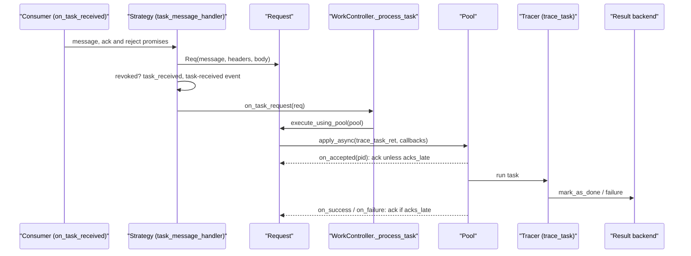

## Overview

This page follows one task message on the worker, from the moment the consumer hands it to the task's strategy until its result is stored and the message is acknowledged. Three objects carry it: the strategy (a closure built once per task type), the `Request` (one per message, living in the worker's main process), and the tracer (a function built once per task by `build_tracer`, running wherever the pool executes the task).

Sources: [celery/worker/strategy.py:99-131](repo://celery/worker/strategy.py#L99-L131), [celery/worker/request.py:67-90](repo://celery/worker/request.py#L67-L90), [celery/app/trace.py:344-370](repo://celery/app/trace.py#L344-L370)

How messages reach the strategy, and how ETA and rate-limited requests are held, is in [[The Consumer]]. What happens when the task raises, retries or times out is in [[Retries, Failures and Time Limits]].

Sources: [celery/worker/consumer/consumer.py:723-786](repo://celery/worker/consumer/consumer.py#L723-L786)

## The path of a message

Sources: [celery/worker/strategy.py:132-208](repo://celery/worker/strategy.py#L132-L208), [celery/worker/worker.py:223-231](repo://celery/worker/worker.py#L223-L231), [celery/worker/request.py:818-874](repo://celery/worker/request.py#L818-L874), [celery/worker/request.py:515-528](repo://celery/worker/request.py#L515-L528)

## The strategy

`Task.start_strategy` instantiates `Task.Strategy`, by default `celery.worker.strategy.default`. The strategy's docstring calls strategies "an optimization", which is why it reads everything it needs (the event dispatcher, the timer, the rate-limit bucket lookup, the revoked set) into local variables once, and builds a `Request` subclass for the task with `create_request_cls`.

Sources: [celery/app/task.py:520-521](repo://celery/app/task.py#L520-L521), [celery/worker/strategy.py:99-130](repo://celery/worker/strategy.py#L99-L130)

`task_message_handler(message, body, ack, reject, callbacks)` runs for each message:

Sources: [celery/worker/strategy.py:132-134](repo://celery/worker/strategy.py#L132-L134)

1. A protocol 2 message keeps its raw body and headers; the body is not decoded here. A hybrid message (headers plus an `args` key in the body) is converted with `hybrid_to_proto2`, and a protocol 1 body with `proto1_to_proto2`, both producing the v2 shape `(args, kwargs, embed)` and headers, and raising `InvalidTaskError` when arguments are missing or kwargs is not a mapping.
2. It creates the `Req` and, at INFO level, logs `Task ... received`.
3. If the request has an expiry, or its id is in the revoked set, it calls `req.revoked()` and stops if that returns true.
4. It sends the `task_received` signal and, when task events are on, a `task-received` event.
5. An ETA that cannot be converted to a timestamp rejects the message without requeue. A request with an ETA goes to the timer, and a rate-limited one to its bucket ([[The Consumer]]).
6. Otherwise it records the request as reserved, runs the `on_task_message` callbacks (the autoscaler uses one), and calls `consumer.on_task_request(req)`.

Sources: [celery/worker/strategy.py:25-97](repo://celery/worker/strategy.py#L25-L97), [celery/worker/strategy.py:132-208](repo://celery/worker/strategy.py#L132-L208)

## The Request

`Request.__init__` copies the headers into `_request_dict` and reads the id, the task name (the `shadow` name is used for display), root and parent ids, `timelimit`, `argsrepr` and `kwargsrepr`. It resolves `ignore_result` from the header or the task, parses `eta` and `expires` from ISO 8601 (raising `InvalidTaskError` on bad values) and makes them timezone-aware, and adds `delivery_info` (exchange, routing key, priority, redelivered), `reply_to`, `correlation_id` and `hostname` to the request dict. Properties such as `stamps`, `chord`, `errbacks` and `group` read from the request dict and the body's `embed` part.

Sources: [celery/worker/request.py:90-176](repo://celery/worker/request.py#L90-L176), [celery/worker/request.py:775-816](repo://celery/worker/request.py#L775-L816)

`revoked()` returns true, and discards the task, when the request has expired (`maybe_expire` adds its id to the revoked set), when its id is revoked, or when one of its stamps matches a revoked stamp ([[Stamping]]). Discarding calls `_announce_revoked`, which marks the request ready, sends a `task-revoked` event, stores `REVOKED` in the backend (for chord members this also triggers the chord hook), acknowledges the message and sends the `task_revoked` signal.

Sources: [celery/worker/request.py:408-414](repo://celery/worker/request.py#L408-L414), [celery/worker/request.py:457-509](repo://celery/worker/request.py#L457-L509)

## Handing the request to the pool

`WorkController._process_task` calls `req.execute_using_pool(pool)`, through the pool semaphore when one is used ([[Worker Startup and Bootsteps]]). The generated `execute_using_pool` checks `revoked()` once more (raising `TaskRevokedError`, which releases the semaphore slot) and calls `pool.apply_async` with:

Sources: [celery/worker/request.py:832-845](repo://celery/worker/request.py#L832-L845)

| Argument | Value |
| --- | --- |
| target | `fast_trace_task` when worker optimizations are on, else `trace_task_ret` |
| `args` | `(task name, task id, request dict, raw body, content type, content encoding)` |
| `accept_callback` | `on_accepted` |
| `timeout_callback` | `on_timeout` |
| `callback` / `error_callback` | `on_success` / `on_failure` |
| `timeout`, `soft_timeout` | The message's time limits, else the task's |
| `correlation_id` | The task id |

Sources: [celery/worker/worker.py:220-231](repo://celery/worker/worker.py#L220-L231), [celery/worker/request.py:818-853](repo://celery/worker/request.py#L818-L853)

Only these plain values cross into the pool process; the body is still serialized, so with the prefork pool the arguments are decoded in the child rather than in the main process. The `Request` stays in the main process and receives the pool's callbacks ([[Concurrency Pools]]).

Sources: [celery/app/trace.py:735-755](repo://celery/app/trace.py#L735-L755)

## Acknowledgement and worker state

`celery.worker.state` keeps module-level bookkeeping: `requests` by id, the weak sets `reserved_requests` and `active_requests`, `successful_requests` (a `LimitedSet` of recent successful ids, 1,000 by default), task counters, and the `revoked` `LimitedSet` (50,000 ids, expiring after three hours by default, both tunable through `CELERY_WORKER_REVOKES_MAX` and `CELERY_WORKER_REVOKE_EXPIRES`). `task_reserved`, `task_accepted` and `task_ready` move a request through these.

Sources: [celery/worker/state.py:29-84](repo://celery/worker/state.py#L29-L84), [celery/worker/state.py:96-137](repo://celery/worker/state.py#L96-L137)

When a pool process picks the job up, `on_accepted(pid, time_accepted)` records the pid and start time, marks the request active, acknowledges the message unless the task is `acks_late`, sends `task-started`, and applies a termination that was requested before the task started. The message is therefore acknowledged when execution begins by default, and only after execution with `acks_late`. `on_success` marks the request ready and successful, acknowledges if `acks_late`, and sends `task-succeeded` with the result and runtime; if the pool reports a failure through the success callback, it delegates to `on_failure`, re-raising `SystemExit` and `KeyboardInterrupt`.

Sources: [celery/worker/request.py:515-528](repo://celery/worker/request.py#L515-L528), [celery/worker/request.py:596-611](repo://celery/worker/request.py#L596-L611), [celery/worker/request.py:855-872](repo://celery/worker/request.py#L855-L872)

`acknowledge()` and `reject(requeue=False)` call the consumer's ack and reject promises only once per request, guarded by `acknowledged`; a rejection also sends `task-rejected`.

Sources: [celery/worker/request.py:730-740](repo://celery/worker/request.py#L730-L740)

## In the pool: trace_task_ret

`trace_task_ret` decodes the body with the message's content type against `accept_content` (or uses it as is if already decoded), merges `args`, `kwargs`, the hostname, `is_eager=False` and the `embed` fields (callbacks, errbacks, chain, chord) into the request dict, and calls `trace_task`, which builds the task's tracer on first use and runs it. It returns `(1, exception_info, runtime)` on failure and `(0, result_repr, runtime)` on success, the value the pool passes back to `on_success`.

Sources: [celery/app/trace.py:689-700](repo://celery/app/trace.py#L689-L700), [celery/app/trace.py:735-755](repo://celery/app/trace.py#L735-L755)

`fast_trace_task` does the same with the registry, accept list and hostname cached by `setup_worker_optimizations`, which the command-line worker runs at startup. That function also makes the app current and default for every thread, because new threads would otherwise "fall back to the default app, which then could be the wrong app", finalizes the app, and installs a guard for custom `Task.__call__` methods. If the cache is empty, as when a pool process was spawned rather than forked, it raises `RuntimeError` suggesting `--pool=solo` or `--pool=threads`.

Sources: [celery/app/trace.py:757-789](repo://celery/app/trace.py#L757-L789), [celery/app/trace.py:804-831](repo://celery/app/trace.py#L804-L831), [celery/apps/worker.py:94-96](repo://celery/apps/worker.py#L94-L96)

## The tracer

`build_tracer(name, task, ...)` returns the `trace_task(uuid, args, kwargs, request)` closure. It is built once per task by `Consumer.update_strategies` and stored on `task.__trace__`. When the task does not override `__call__`, it calls `task.run` directly; it looks up `before_start`, `on_success` and `after_return` only if the task overrides them, and captures the signal receiver lists so absent signals cost nothing.

Sources: [celery/app/trace.py:373-415](repo://celery/app/trace.py#L373-L415), [celery/worker/consumer/consumer.py:716-721](repo://celery/worker/consumer/consumer.py#L716-L721)

Each call proceeds as follows:

Sources: [celery/app/trace.py:475-489](repo://celery/app/trace.py#L475-L489)

1. Build a `Context` from the request (`called_directly=False`) and compute whether to publish the result: not when the request or task ignores results, and in eager mode only with `store_eager_result`.
2. Deduplication: with `acks_late`, `worker_deduplicate_successful_tasks` and a persistent backend, a redelivered message whose id is in `successful_requests` or whose stored state is `SUCCESS` is skipped. Its callbacks and chain are re-dispatched only if the stored result has no `children`, meaning they were never sent; a failure to do so raises `Reject(requeue=True)`.
3. Push the task and request on their stacks, send `task_prerun`, call the loader's `on_task_init`, and store `STARTED` with the pid and hostname when `track_started` is on.
4. Call `before_start`, then the task function.
5. On success, dispatch callbacks and the next chain step, then `backend.mark_as_done(...)`. Callbacks go first "so that result.children is populated". Several callbacks are sent as one group; a group callback is applied separately. The next chain step is `chain[-1]`, applied with `chain=chain[:-1]` ([[Signatures and Chains]]). An `EncodeError` while storing turns into a failure. Then call `on_success`, send `task_success` and log `Task ... succeeded in ...s`.
6. `Reject`, `Ignore`, `Retry` and other exceptions go to their handlers ([[Retries, Failures and Time Limits]]).
7. Call `after_return` unless the state is ignored or rejected; then, in `finally`, send `task_postrun`, pop the stacks, and outside eager mode call `backend.process_cleanup()` and the loader's `on_process_cleanup`.

Sources: [celery/app/trace.py:475-588](repo://celery/app/trace.py#L475-L588), [celery/app/trace.py:589-686](repo://celery/app/trace.py#L589-L686), [celery/app/trace.py:157-177](repo://celery/app/trace.py#L157-L177)

`_dispatch_callbacks_and_chain` documents that dispatch is not atomic: if callbacks succeed but the chain step fails, a redelivery may send the callbacks again, which it calls "acceptable under Celery's at-least-once delivery model".

Sources: [celery/app/trace.py:426-473](repo://celery/app/trace.py#L426-L473)

An exception raised outside the task body (in the tracer's own bookkeeping) is reported through `_signal_internal_error` and `report_internal_error`, which warns "Exception raised outside body" and still marks the task failed; in eager mode it is re-raised.

Sources: [celery/app/trace.py:672-735](repo://celery/app/trace.py#L672-L735), [celery/app/trace.py:791-801](repo://celery/app/trace.py#L791-L801)

## Running a task without the pool

`Request.execute()` runs the same tracer in the current process: it returns early if revoked, acknowledges first unless `acks_late`, calls `trace_task`, and afterwards rejects the message if the tracer returned failure info and acknowledges it otherwise. `Task.apply()` (eager execution) also goes through `build_tracer`, with `eager=True`, returning an `EagerResult` ([[Task States and AsyncResult]]).

Sources: [celery/worker/request.py:374-406](repo://celery/worker/request.py#L374-L406), [celery/app/task.py:869-951](repo://celery/app/task.py#L869-L951)
