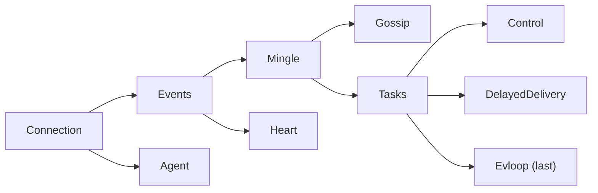

## Overview

The consumer is the part of the worker that talks to the broker. It owns the connection, declares and consumes the task queues, decides how many messages may be prefetched, holds ETA and rate-limited tasks until they are due, answers remote-control commands, and runs the event loop that ties these together. It is created by the worker's last bootstep ([[Worker Startup and Bootsteps]]) and is itself a blueprint of consumer steps.

Sources: [celery/worker/consumer/consumer.py:145-255](repo://celery/worker/consumer/consumer.py#L145-L255), [celery/worker/components.py:221-246](repo://celery/worker/components.py#L221-L246)

Every message it accepts is handed to the task's strategy and then, as a `Request`, to the worker's `process_task` callback; that path is followed in [[Task Execution Pipeline]].

Sources: [celery/worker/consumer/consumer.py:716-786](repo://celery/worker/consumer/consumer.py#L716-L786)

## The consumer blueprint

`Consumer.Blueprint` lists ten default steps, plus any in `app.steps['consumer']`. Their `requires` give this start order:

Sources: [celery/worker/consumer/consumer.py:166-182](repo://celery/worker/consumer/consumer.py#L166-L182)

Sources: [celery/worker/consumer/consumer.py:166-182](repo://celery/worker/consumer/consumer.py#L166-L182), [celery/worker/consumer/events.py:16-40](repo://celery/worker/consumer/events.py#L16-L40), [celery/worker/consumer/mingle.py:12-25](repo://celery/worker/consumer/mingle.py#L12-L25), [celery/worker/consumer/tasks.py:17-20](repo://celery/worker/consumer/tasks.py#L17-L20), [celery/worker/consumer/consumer.py:857-872](repo://celery/worker/consumer/consumer.py#L857-L872)

| Step | Enabled when | Does |
| --- | --- | --- |
| `Connection` | always | `c.connect()` and logs `Connected to <url>` |
| `Events` | task events, gossip or heartbeat on | Creates the event dispatcher on a write connection; flushes events buffered while disconnected |
| `Mingle` | not `--without-mingle`; amqp, redis or gcpubsub transport | Asks other workers `hello` at startup, syncs the logical clock and revoked ids |
| `Gossip` | not `--without-gossip`; amqp or redis | Consumes `worker.#` events to track other workers and run elections |
| `Heart` | not `--without-heartbeat` | Sends `worker-heartbeat` events on the timer |
| `Tasks` | always | Builds strategies and tracers, sets QoS, creates the task consumer |
| `Control` | `worker_enable_remote_control` and fanout exchanges supported | Starts the pidbox mailbox for remote control |
| `DelayedDelivery` | quorum queues detected | Declares native delayed-delivery exchanges and bindings |
| `Agent` | `worker_agent` set | Starts a `cell` actor agent on the connection |
| `Evloop` | always, last | Runs `c.loop(*c.loop_args())` |

Sources: [celery/worker/consumer/connection.py:13-40](repo://celery/worker/consumer/connection.py#L13-L40), [celery/worker/consumer/events.py:16-69](repo://celery/worker/consumer/events.py#L16-L69), [celery/worker/consumer/mingle.py:12-75](repo://celery/worker/consumer/mingle.py#L12-L75), [celery/worker/consumer/gossip.py:22-75](repo://celery/worker/consumer/gossip.py#L22-L75), [celery/worker/consumer/heart.py:10-36](repo://celery/worker/consumer/heart.py#L10-L36), [celery/worker/consumer/control.py:17-33](repo://celery/worker/consumer/control.py#L17-L33), [celery/worker/consumer/agent.py:10-20](repo://celery/worker/consumer/agent.py#L10-L20)

`DelayedDelivery` validates its configuration, then for each broker URL declares the delayed-delivery exchanges and queues (of `broker_native_delayed_delivery_queue_type`, `quorum` by default) and binds the application queues to them, retrying connection errors three times one second apart. A failure for one URL is logged; failure for all of them logs that native delayed delivery is unavailable. This is the worker side of the ETA routing described in [[Sending Tasks]].

Sources: [celery/worker/consumer/delayed_delivery.py:30-130](repo://celery/worker/consumer/delayed_delivery.py#L30-L130)

## Gossip and Mingle

`Mingle.sync` sends a `hello` inspect command with a one-second timeout, carrying this worker's revoked set, and for each other worker that replies, adjusts the app's Lamport clock to the reported clock and adds the reported revoked ids to its own. So a restarted worker learns about tasks revoked while it was down ([[Remote Control and Revocation]]).

Sources: [celery/worker/consumer/mingle.py:31-75](repo://celery/worker/consumer/mingle.py#L31-L75)

`Gossip` is a `ConsumerStep` that consumes worker events into an in-memory events `State` and every five seconds removes workers whose heartbeats stopped, calling `node_lost` handlers; it also calls `node_join` and `node_leave` handlers. It implements a small election protocol: `worker-elect` requests are pushed onto a heap ordered by Lamport clock, every alive worker acknowledges, and once all have acknowledged the worker at the top of the heap runs the action. The only built-in topic is `task`, which applies a signature, used by `Signature.election()` so exactly one worker sends a task.

Sources: [celery/worker/consumer/gossip.py:86-140](repo://celery/worker/consumer/gossip.py#L86-L140), [celery/worker/consumer/gossip.py:140-206](repo://celery/worker/consumer/gossip.py#L140-L206), [celery/canvas.py:788-798](repo://celery/canvas.py#L788-L798)

## Starting the task consumer

`Tasks.start` calls `c.update_strategies()`, which for every registered task asks `task.start_strategy(app, consumer)` for its message handler and pre-builds `task.__trace__` with `build_tracer`. It then decides whether QoS is global (per channel), sets the initial prefetch with `basic_qos`, creates the Kombu task consumer over `queues.consume_from` with the accepted content types ([[Routing and Queues]]), and wraps the prefetch value in a Kombu `QoS` object bounded by `worker_eta_task_limit`.

Sources: [celery/worker/consumer/tasks.py:21-62](repo://celery/worker/consumer/tasks.py#L21-L62), [celery/worker/consumer/consumer.py:716-721](repo://celery/worker/consumer/consumer.py#L716-L721), [celery/app/amqp.py:317-324](repo://celery/app/amqp.py#L317-L324)

The initial prefetch count is `concurrency * worker_prefetch_multiplier` (using the autoscaler maximum when set). With `worker_disable_prefetch` on a Redis broker, the channel's `can_consume` is patched to refuse new messages while as many requests are reserved as there are pool processes; other brokers log a warning and ignore it. QoS is global unless the connection reports that its QoS semantics match the AMQP spec, and is always per-consumer when quorum queues are detected ([[Routing and Queues]]).

Sources: [celery/worker/components.py:226-231](repo://celery/worker/components.py#L226-L231), [celery/worker/consumer/tasks.py:64-124](repo://celery/worker/consumer/tasks.py#L64-L124)

## Receiving a message

`create_task_handler` returns `on_task_received(message)`, set as the consumer's `on_message`. It reads the task name from `message.headers['task']` (protocol 2); for protocol 1 it decodes the body and takes `payload['task']`. Then:

Sources: [celery/worker/consumer/consumer.py:731-748](repo://celery/worker/consumer/consumer.py#L731-L748)

| Situation | Handling |
| --- | --- |
| Headers are not a mapping, or no task name | `on_unknown_message`: log, reject, send `task_rejected` |
| Body cannot be decoded | `on_decode_error`: log and acknowledge, "so it doesn't enter a loop" |
| Task name not registered | `on_unknown_task`: reject, store `NotRegistered` as the failure, send a `task-failed` event and `task_unknown` |
| `InvalidTaskError`, `ContentDisallowed` from the strategy | `on_invalid_task`: reject, send `task_rejected` |
| Otherwise | Call the strategy with the message, the v1 payload or `None`, ack and reject promises, and the `on_task_message` callbacks |

Sources: [celery/worker/consumer/consumer.py:516-530](repo://celery/worker/consumer/consumer.py#L516-L530), [celery/worker/consumer/consumer.py:672-714](repo://celery/worker/consumer/consumer.py#L672-L714), [celery/worker/consumer/consumer.py:723-786](repo://celery/worker/consumer/consumer.py#L723-L786)

The ack and reject promises call `message.ack_log_error` or `reject_log_error` through `call_soon_ack`. With the event loop, that schedules them on the hub; without it they run immediately, because, as the docstring explains, deferring them until the next drain added "50-400 ms of latency between every pair of tasks" with `acks_late` and a prefetch multiplier of 1. Other deferred callbacks use `call_soon`, which in the blocking loop queues them for `perform_pending_operations`.

Sources: [celery/worker/consumer/consumer.py:257-294](repo://celery/worker/consumer/consumer.py#L257-L294)

## ETA tasks and rate limits

A task with an ETA is not given to the pool when it arrives. The strategy raises the prefetch limit with `qos.increment_eventually()` (so the held message does not block delivery of others) and schedules `apply_eta_task` on the timer; when it fires, the request is reserved, handed to `on_task_request`, and the prefetch limit is lowered again.

Sources: [celery/worker/strategy.py:180-208](repo://celery/worker/strategy.py#L180-L208), [celery/worker/consumer/consumer.py:659-663](repo://celery/worker/consumer/consumer.py#L659-L663)

Each task type with a `rate_limit` gets a `TokenBucket` with capacity 1 in `task_buckets` (rebuilt by `reset_rate_limits`, and `None` when there is no limit or `worker_disable_rate_limits` is on). `_limit_task` adds the request to its bucket and `_schedule_bucket_request` moves requests to the pool while tokens are available; when a request must wait, it is put back at the head of the bucket to keep order and the timer is set for `bucket.expected_time(tokens)`. ETA tasks with a rate limit pass through `_limit_post_eta`, which also undoes the prefetch increase.

Sources: [celery/worker/consumer/consumer.py:296-364](repo://celery/worker/consumer/consumer.py#L296-L364), [celery/worker/strategy.py:196-205](repo://celery/worker/strategy.py#L196-L205)

`_update_prefetch_count(index)` recomputes the prefetch count after the pool grows or shrinks (from autoscaling or remote control), as `num_processes * prefetch_multiplier`.

Sources: [celery/worker/consumer/consumer.py:305-327](repo://celery/worker/consumer/consumer.py#L305-L327)

## The event loops

The consumer uses `asynloop` when the worker has a hub and `synloop` otherwise ([[Worker Startup and Bootsteps]] explains when the hub exists).

Sources: [celery/worker/consumer/consumer.py:233-235](repo://celery/worker/consumer/consumer.py#L233-L235)

`asynloop` installs the message handler, registers the worker and the consumer with the hub (pool file descriptors, timers, the autoscaler), starts consuming and calls `on_ready` (which fires `worker_ready`). On the first start it raises `WorkerLostError('Could not start worker processes')` if the pool's processes did not start. On AMQP it schedules one quick drain so prefetched messages are processed before the loop. Each iteration checks `maybe_shutdown()`, re-raises any AMQP heartbeat error from the timer, applies a pending QoS change only "when there's no more messages to read" so QoS calls are grouped and remote control is prioritized over tasks, and runs one step of the hub's loop. On an exception it resets the hub and clears its timer before re-raising, so stale timers from the old connection do not fire after reconnecting.

Sources: [celery/worker/loops.py:20-135](repo://celery/worker/loops.py#L20-L135)

`synloop`, the "fallback blocking event loop for transports that doesn't support AIO" and the one used with green pools, runs pending operations and then `connection.drain_events(timeout=2.0)` in a loop, with the same shutdown, heartbeat and QoS checks, and also resets the hub on error.

Sources: [celery/worker/loops.py:138-183](repo://celery/worker/loops.py#L138-L183)

## Connection loss and restart

`Consumer.start()` loops while the blueprint is not stopping. Each pass starts the blueprint; a recoverable error (connection errors, plus channel errors when `broker_channel_error_retry` is on) is caught. If retrying is disabled (`broker_connection_retry_on_startup` for the first connection when it is set, `broker_connection_retry` otherwise), the worker shuts down with `WorkerShutdown(1)`. Running out of file descriptors (`EMFILE`) terminates it. Otherwise it logs the error, calls `on_close()`, which clears reserved requests that are not active, pending rate-limit buckets and the pool's queues (their delivery tags are tied to the dead channel), and restarts the blueprint. `restart_state` limits this to five restarts per second before it logs "Frequent restarts detected" and sleeps.

Sources: [celery/worker/consumer/consumer.py:366-418](repo://celery/worker/consumer/consumer.py#L366-L418), [celery/worker/consumer/consumer.py:532-547](repo://celery/worker/consumer/consumer.py#L532-L547)

After a connection that had been up is lost, `on_connection_error_after_connected` collects and closes the broken connection with a socket timeout so cleanup cannot block. With `worker_cancel_long_running_tasks_on_connection_loss`, it cancels running `acks_late` tasks that are not yet acknowledged, since their messages will be redelivered; otherwise it warns that this will become the default. With `worker_enable_prefetch_count_reduction`, it lowers the prefetch count by the number of active tasks, so the worker does not fetch a full batch on top of the tasks still running, and restores it one step per acknowledged message until it reaches `num_processes * prefetch_multiplier`. The reduction is skipped with per-consumer QoS, where `basic.qos` updates would not reach the running consumer (issue #9512).

Sources: [celery/worker/consumer/consumer.py:419-491](repo://celery/worker/consumer/consumer.py#L419-L491), [celery/worker/consumer/consumer.py:788-815](repo://celery/worker/consumer/consumer.py#L788-L815)

`ensure_connected` wraps every connection: unless retries are disabled it calls Kombu's `ensure_connection` with `broker_connection_max_retries`, logging each attempt with the retry count and the failover target when one exists, and checking `maybe_shutdown` between attempts.

Sources: [celery/worker/consumer/consumer.py:549-622](repo://celery/worker/consumer/consumer.py#L549-L622)

During cold shutdown, `cancel_active_requests()` cancels every active request except `acks_late` tasks that are already acknowledged or already succeeded; for `acks_late` tasks it does not emit a retry signal, since the broker redelivers them.

Sources: [celery/worker/consumer/consumer.py:823-855](repo://celery/worker/consumer/consumer.py#L823-L855)
