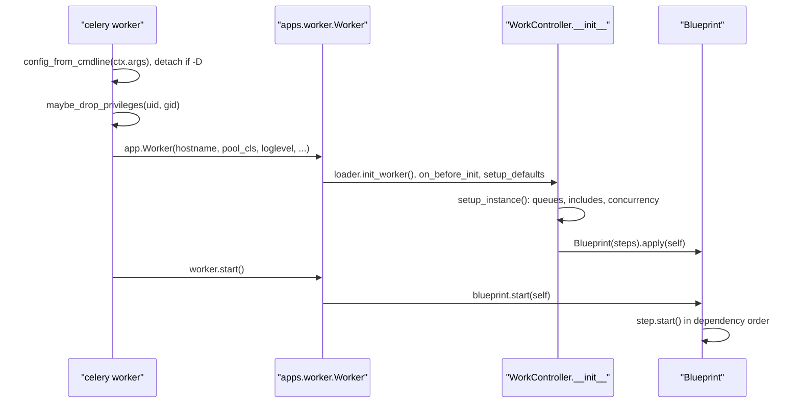

## Overview

A Celery worker is a `WorkController` whose parts are assembled by bootsteps: small classes that each create one component (the timer, the event loop hub, the execution pool, the consumer) and declare which other steps they need. The worker builds a dependency graph from the steps, starts them in order, and stops them in reverse. `celery.apps.worker.Worker` is the command-line flavour of the same controller, adding the banner, logging and signal handlers.

Sources: [celery/bootsteps.py:74-112](repo://celery/bootsteps.py#L74-L112), [celery/worker/worker.py:63-88](repo://celery/worker/worker.py#L63-L88), [celery/apps/worker.py:91-93](repo://celery/apps/worker.py#L91-L93)

This page follows the path from the `celery worker` command to a started worker and back to a stopped one. The last step it starts, the consumer, has its own blueprint described in [[The Consumer]]; the pool implementations are in [[Concurrency Pools]].

Sources: [celery/worker/components.py:221-246](repo://celery/worker/components.py#L221-L246)

## From command to WorkController

Sources: [celery/bin/worker.py:305-371](repo://celery/bin/worker.py#L305-L371), [celery/worker/worker.py:90-140](repo://celery/worker/worker.py#L90-L140), [celery/worker/worker.py:201-212](repo://celery/worker/worker.py#L201-L212)

The `worker` click command treats extra `key=value` arguments as worker settings (`config_from_cmdline(ctx.args, namespace='worker')`). With `-D`/`--detach` it re-executes `python -m celery ...` without the detach, uid and gid flags inside `platforms.detached` and returns ([[Multi and Daemonization]]). Otherwise it drops privileges if `--uid`/`--gid` were given, creates `app.Worker(...)` with the pidfile and state db names expanded per node, calls `start()`, and exits with the worker's `exitcode`. A `SecurityError` is printed and exits with status 1.

Sources: [celery/bin/worker.py:108-133](repo://celery/bin/worker.py#L108-L133), [celery/bin/worker.py:317-371](repo://celery/bin/worker.py#L317-L371)

## WorkController setup

`WorkController.__init__` stores the app and node name, calls `app.loader.init_worker()` (which imports the task modules, [[Configuration and Loaders]]), and runs `setup_defaults`, which fills each option from its argument or from the matching setting: `worker_concurrency`, `worker_pool`, `worker_consumer`, `worker_timer`, `worker_autoscaler`, `worker_state_db`, `beat_scheduler`, `task_time_limit`, `task_soft_time_limit`, `worker_max_tasks_per_child`, `worker_max_memory_per_child`, `worker_prefetch_multiplier`, `worker_disable_rate_limits` and others.

Sources: [celery/worker/worker.py:90-99](repo://celery/worker/worker.py#L90-L99), [celery/worker/worker.py:351-410](repo://celery/worker/worker.py#L351-L410)

`setup_instance` then selects the queues to consume (`-Q`, `-X`, worker-direct queues; see [[Routing and Queues]]), imports `--include` modules and records every task module in `include` so they are re-imported if the process is re-executed, defaults concurrency to the CPU count (or 2 when that is unknown), and decides whether to use the event loop: only when Kombu detects no green-thread environment, the transport supports asynchronous I/O, and the platform is not Windows. It sends `worker_init`, resolves the pool class by name, and builds the blueprint with the user's `app.steps['worker']`, applying it to itself.

Sources: [celery/worker/worker.py:101-140](repo://celery/worker/worker.py#L101-L140), [celery/worker/worker.py:167-193](repo://celery/worker/worker.py#L167-L193), [celery/worker/worker.py:239-242](repo://celery/worker/worker.py#L239-L242)

## Blueprints and steps

A `Blueprint` holds a set of step classes, its `default_steps` plus any passed in. `apply(parent)` loads them by name, adds every step named in `requires` (recursively), and builds a `DependencyGraph` whose topological sort is the boot order. The one step marked `last = True` (the worker's `Consumer`) is made to depend on every other step, so it always starts last. An unknown step name in `requires` raises `KeyError('unknown bootstep: ...')`. Each step is then instantiated with the parent and `include(parent)` is called.

Sources: [celery/bootsteps.py:203-262](repo://celery/bootsteps.py#L203-L262)

A `Step` subclass declares `requires`, an optional `label`, and `enabled` or an `include_if(parent)` predicate; its `__init__` runs when the blueprint is applied and may set attributes on the parent, and `create(parent)` builds the component. A `StartStopStep` keeps the created object in `obj`, appends itself to `parent.steps` when included, and forwards `start`, `stop` and `terminate` to `obj`. `ConsumerStep` is a start/stop step that opens a channel on the consumer's connection and starts the consumers returned by `get_consumers(channel)`, for adding custom message consumers to the worker's consumer blueprint. The `StepType` metaclass gives each step a `name` equal to its qualified class name, the key used in `requires`.

Sources: [celery/bootsteps.py:266-385](repo://celery/bootsteps.py#L266-L385), [celery/bootsteps.py:386-415](repo://celery/bootsteps.py#L386-L415)

`Blueprint.start(parent)` sets the state to `RUN`, calls `on_start`, and starts every step in `parent.steps`, counting how many have started. `send_all(parent, method, reverse=True)` calls a method on each step in reverse order, logging instead of raising errors when `propagate` is false. `stop(parent, terminate=False)` exits early if the blueprint never fully started, otherwise closes the steps, sends `stop` or `terminate` to all in reverse, calls `on_stopped`, and sets `shutdown_complete`.

Sources: [celery/bootsteps.py:113-201](repo://celery/bootsteps.py#L113-L201)

## Worker components

`WorkController.Blueprint` contains these default steps:

Sources: [celery/worker/worker.py:76-88](repo://celery/worker/worker.py#L76-L88)

| Step | Requires | Creates |
| --- | --- | --- |
| `Timer` | | `w.timer`: Kombu's timer when using the event loop, else the pool's `Timer` class (a thread) |
| `Hub` | `Timer` | The Kombu event loop `w.hub`, only when the event loop is used; replaces thread locks with dummy locks |
| `Pool` | `Hub` | The execution pool `w.pool`, with concurrency, time limits, max tasks and memory per child |
| `Beat` | | An embedded beat service, only with `-B`; refused for eventlet and gevent pools |
| `StateDB` | | Persistent revoked-task state, only with `--statedb`, saved at exit |
| `Autoscaler` | `Pool` | The autoscaler, only with `--autoscale` |
| `Consumer` | everything (`last`) | The consumer, with prefetch count `concurrency * prefetch_multiplier` |

Sources: [celery/worker/worker.py:76-88](repo://celery/worker/worker.py#L76-L88), [celery/worker/components.py:32-120](repo://celery/worker/components.py#L32-L120), [celery/worker/components.py:181-246](repo://celery/worker/components.py#L181-L246), [celery/worker/autoscale.py:31-54](repo://celery/worker/autoscale.py#L31-L54)

The `Pool` step parses `--autoscale max,min` into `max_concurrency` and `min_concurrency` and starts the pool at the minimum. Without the event loop or on Windows, the pool runs its own threads. With the event loop, it creates a `LaxBoundedSemaphore` sized to the pool and, when `worker_pool_putlocks` is on and the pool uses a semaphore, routes each task through it so the consumer does not hand the pool more work than it has processes. It warns when `worker_pool` names a green pool, because such pools must be selected with `-P` so their monkey patches are applied early. Finally it sets the join-will-block flag from the pool ([[Task States and AsyncResult]]).

Sources: [celery/worker/components.py:20-29](repo://celery/worker/components.py#L20-L29), [celery/worker/components.py:101-176](repo://celery/worker/components.py#L101-L176)

`WorkController` passes `process_task` to the consumer as its `on_task_request` callback; `_process_task` calls `req.execute_using_pool(self.pool)` and releases the semaphore slot if the request turns out to be revoked ([[Task Execution Pipeline]]).

Sources: [celery/worker/worker.py:220-231](repo://celery/worker/worker.py#L220-L231)

## The command-line Worker

`apps.worker.Worker` hooks into the controller's callbacks. `on_before_init` applies the tracer optimizations, sends `celeryd_init` (for per-node configuration), and checks that `pickle` content is not accepted while running as root. `on_after_init` reads the stdout redirection settings and colour options. `on_init_blueprint` sets up logging and finalizes the app.

Sources: [celery/apps/worker.py:91-126](repo://celery/apps/worker.py#L91-L126)

`on_start` creates the pidfile lock (from the base class), sends `celeryd_after_setup` (where queues can still be changed), purges queued messages when `--purge` is given, prints the banner (node name, version, broker, results backend, concurrency, task events, queues and, at debug level, the task list), sets the process title, installs signal handlers, redirects stdout and stderr to the logger, and warns about deprecated setting names unless the configuration comes from `django.conf:settings`. `on_consumer_ready` sends `worker_ready` and logs `<hostname> ready.`.

Sources: [celery/apps/worker.py:128-182](repo://celery/apps/worker.py#L128-L182), [celery/apps/worker.py:52-67](repo://celery/apps/worker.py#L52-L67), [celery/worker/worker.py:150-152](repo://celery/worker/worker.py#L150-L152)

## Signals and shutdown modes

`install_platform_tweaks` registers the signal handlers. Each shutdown handler, when run in the main process, calls its callback, prints `worker: <How> shutdown (MainProcess)`, sends `worker_shutting_down`, and sets `state.should_stop` (warm) or `state.should_terminate` (cold) to the exit code. The consumer's event loop calls `state.maybe_shutdown()` on every iteration, which raises `WorkerShutdown` or `WorkerTerminate`.

Sources: [celery/apps/worker.py:254-316](repo://celery/apps/worker.py#L254-L316), [celery/worker/state.py:73-93](repo://celery/worker/state.py#L73-L93), [celery/worker/loops.py:80-90](repo://celery/worker/loops.py#L80-L90)

| Signal | Effect |
| --- | --- |
| `SIGTERM` | Warm shutdown: stop consuming, wait for running tasks. With billiard's `REMAP_SIGTERM=SIGQUIT`, a cold shutdown instead |
| `SIGINT` (first) | Warm shutdown, and re-arms Ctrl+C for cold shutdown with a message to press it again |
| `SIGQUIT`, second `SIGINT` | Cold shutdown via `on_cold_shutdown` |
| `SIGINT`/`SIGQUIT` during soft shutdown | Cancel unacked requests, then hard shutdown on the next one |
| `SIGHUP` | Restart by re-executing the process, only when not attached to a terminal; on macOS only a warning |
| `SIGUSR1` | Print stack traces of all threads |
| `SIGUSR2` | Open a remote debugger, only when `CELERY_RDBSIG` is set |

Sources: [celery/apps/worker.py:369-466](repo://celery/apps/worker.py#L369-L466), [celery/apps/worker.py:338-367](repo://celery/apps/worker.py#L338-L367), [celery/apps/worker.py:469-523](repo://celery/apps/worker.py#L469-L523)

The cold shutdown callback first calls `wait_for_soft_shutdown()`. When `worker_soft_shutdown_timeout` is positive and tasks are running (or `worker_enable_soft_shutdown_on_idle` is set), the worker sleeps that long so short tasks can finish, which the docstring describes as a way to "requeue long-running tasks to be picked up by another worker". It then cancels the task consumer so requeued messages are not redelivered to itself, cancels all unacknowledged requests, sets `should_terminate`, and stops the pool. A hard shutdown raises `WorkerTerminate(EX_FAILURE)` immediately, for a worker that is stuck.

Sources: [celery/apps/worker.py:319-432](repo://celery/apps/worker.py#L319-L432), [celery/worker/worker.py:412-435](repo://celery/worker/worker.py#L412-L435), [celery/app/defaults.py:332-333](repo://celery/app/defaults.py#L332-L333)

`WorkController.start()` turns these exceptions into the two stop paths: `WorkerTerminate` calls `terminate()`, while any other exception, `SystemExit` and `KeyboardInterrupt` call `stop()` with the matching exit code. `stop()` (warm) closes the consumer and stops the blueprint; `terminate()` (cold) does the same with `terminate=True`, so pools kill their processes. Both skip the actual shutdown when called from a signal handler on a pool that is not signal-safe, and both run under a short default socket timeout. When the blueprint stops, `on_close` calls the loader's `shutdown_worker` hook and `on_stopped` stops the timer, shuts down the consumer and releases the pidfile; `worker_shutdown` is sent at the end of `stop()`.

Sources: [celery/worker/worker.py:154-212](repo://celery/worker/worker.py#L154-L212), [celery/worker/worker.py:244-267](repo://celery/worker/worker.py#L244-L267)
