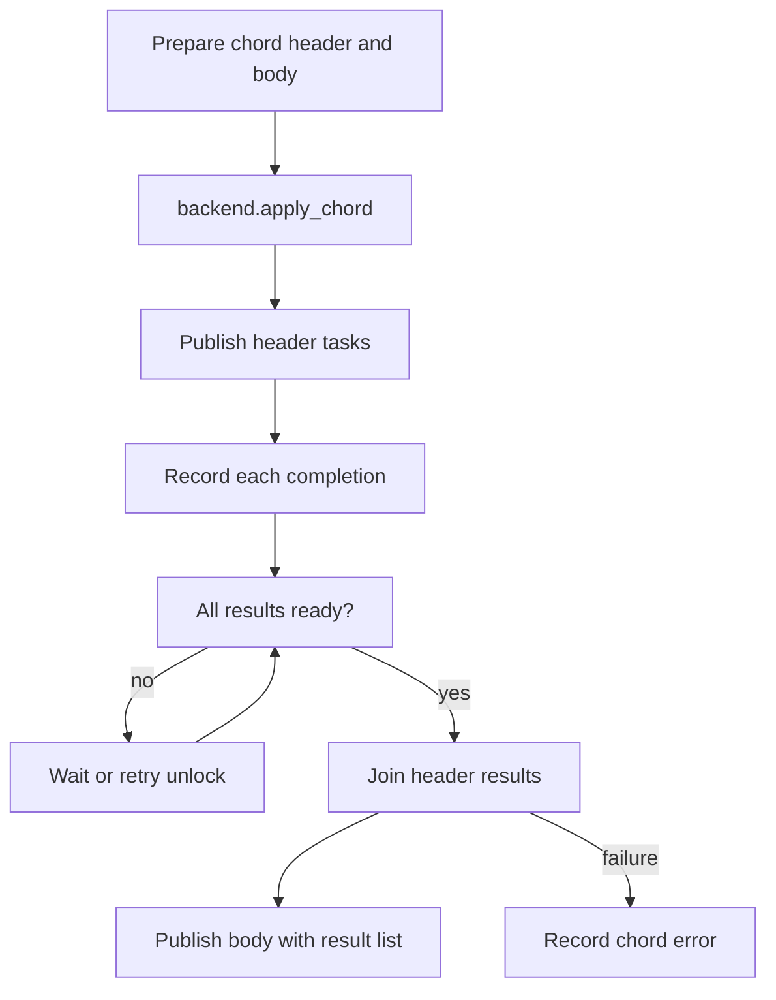

## Overview

Canvas represents task invocations as signatures and combines them into workflows. A `Signature` is a dictionary containing the task name, arguments, options and composition metadata, so it can travel through serializers with a restricted type set. The individual call still uses the task submission interface in [[Tasks and Retries]] and the broker path in [[Publishing and Routing]]. Composition determines which invocations are published and how their results connect.

Sources: [celery/canvas.py:233-241](repo://celery/canvas.py#L233-L241), [celery/canvas.py:323-354](repo://celery/canvas.py#L323-L354), [celery/canvas.py:370-401](repo://celery/canvas.py#L370-L401)

## Build and merge signatures

A signature can be created from a task or its name. Task `.signature()` accepts argument and option mappings, while `.s()` accepts ordinary positional and keyword arguments. `.set()` attaches execution options and returns the signature. The implementation stores positional arguments as a tuple and keeps an `immutable` flag alongside the options and subtask type.

Sources: [celery/canvas.py:243-278](repo://celery/canvas.py#L243-L278), [celery/canvas.py:323-345](repo://celery/canvas.py#L323-L345)

```pycon
>>> add.s(2, 2).set(countdown=10).set(expires=30).delay()
```

Sources: [celery/canvas.py:258-263](repo://celery/canvas.py#L258-L263)

Partial positional arguments are prepended to stored arguments; new keyword arguments override existing keys. An immutable signature keeps its args and kwargs unless merging is forced, while options can still be merged. Certain option keys and stamped headers are protected separately from argument immutability. `clone` copies options deeply so changing a clone's links does not alter its origin.

Sources: [celery/canvas.py:403-469](repo://celery/canvas.py#L403-L469)

`freeze` assigns a concrete task ID and returns a result handle without sending work. It also attaches supplied group, root, parent and chord metadata and a default reply destination. Its API warns against executing the same frozen signature twice because that produces two messages with the same task ID. Freezing prepares identity and dependency relationships; result retrieval is covered in [[Results and Backends]].

Sources: [celery/canvas.py:473-515](repo://celery/canvas.py#L473-L515)

## Sequence tasks with a chain

Chain construction supports both `chain(X, Y, Z)` and pipe composition. Preparation traverses tasks in reverse order, clones the first task with supplied partial arguments, expands nested chains and freezes result identities. Protocol v2 uses a reversed `chain` message field so a worker can take the next task from its end; the code explains that this avoids recursively linked task structures stressing pickle's stack.

Sources: [celery/canvas.py:1370-1382](repo://celery/canvas.py#L1370-L1382), [celery/canvas.py:1157-1188](repo://celery/canvas.py#L1157-L1188), [celery/canvas.py:1201-1213](repo://celery/canvas.py#L1201-L1213)

The chain publishes the first prepared task and normally returns the prepared final result. A single-task chain instead returns the actual submission result, preserving behavior such as a real group result's completion promise. On completion, the worker tracer publishes the next chain signature with the previous return value as an argument and the rest of the chain attached. Immutable signatures retain their own arguments under that merge rule.

Sources: [celery/canvas.py:1069-1092](repo://celery/canvas.py#L1069-L1092), [celery/app/trace.py:467-473](repo://celery/app/trace.py#L467-L473), [celery/canvas.py:439-443](repo://celery/canvas.py#L439-L443)

## Fan out with a group

`group.apply_async` prepares members with a common group ID, publishes their tasks, creates a completion barrier and returns `GroupResult`. Empty groups freeze without publishing, and eager mode uses local application. Group submission rejects a direct `link` and instructs callers to use a chord; a direct `link_error` must instead be placed on individual tasks. A group creates a collection of task results, rather than one body receiving the aggregate.

Sources: [celery/canvas.py:1616-1650](repo://celery/canvas.py#L1616-L1650)

Canvas distinguishes fan-out from map execution. `xmap` explicitly documents sequential execution inside one process, while groups represent parallel task invocations. The base map signature materializes the input iterable and submits the map task using the underlying task name for routing. Choose the composition according to that implemented execution shape, rather than assuming every collection construct creates independent broker tasks.

Sources: [celery/canvas.py:1385-1418](repo://celery/canvas.py#L1385-L1418)

## Synchronize with a chord

A chord has a header group and a body. It freezes the body and header, asks the backend to establish chord coordination, then publishes the header. For an empty header it immediately submits the body with an empty list because no header completion can trigger it. The body's result has the header result as its parent. During chain preparation, a group followed by another signature is automatically upgraded into a chord.

Sources: [celery/canvas.py:1215-1235](repo://celery/canvas.py#L1215-L1235), [celery/canvas.py:2250-2285](repo://celery/canvas.py#L2250-L2285)



Sources: [celery/canvas.py:2267-2285](repo://celery/canvas.py#L2267-L2285), [celery/app/builtins.py:56-97](repo://celery/app/builtins.py#L56-L97), [celery/backends/redis.py:593-669](repo://celery/backends/redis.py#L593-L669)

Backends without native chord support use `celery.chord_unlock`. It reconstructs the group results, retries while they are not ready, then joins with exception propagation enabled and submits the callback. A readiness-check error also retries. A failed join or callback publication invokes `chord_error_from_stack` with a chord error carrying the original cause.

Sources: [celery/app/builtins.py:37-97](repo://celery/app/builtins.py#L37-L97)

Redis coordinates completions with group keys and a pipeline, using a sorted set or list. Once the completion count matches the stored chord size plus adjustments, it restores a saved complex group or decodes collected simple results, publishes the callback and removes coordination keys. This backend dependency is why [[Results and Backends]] matters even when a client only wants a workflow's final result.

Sources: [celery/backends/redis.py:593-677](repo://celery/backends/redis.py#L593-L677)

## Replace and annotate workflow nodes

`Task.replace` replaces the current task with another signature while preserving the task ID and existing callbacks, errbacks and workflow metadata. It rejects an empty replacement chain and a signature already belonging to a chord. A replacement group is upgraded to a chord so callbacks can follow its body. Remaining original chain steps are appended with their existing identities, keeping previously constructed result objects connected.

Sources: [celery/app/task.py:1029-1095](repo://celery/app/task.py#L1029-L1095)

In asynchronous execution, the default `on_replace` submits the new signature and raises `Ignore`; eager execution applies it locally and retrieves its value. Signature `stamp` adds custom headers, stamps links and can delegate header selection to a visitor. Duplicate stamp handling can append values or replace them. Those stamps become message metadata on the [[Publishing and Routing]] path and can be targeted by [[Monitoring and Remote Control]].

Sources: [celery/app/task.py:1211-1227](repo://celery/app/task.py#L1211-L1227), [celery/canvas.py:614-634](repo://celery/canvas.py#L614-L634)
