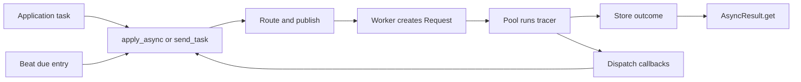

## Overview

Celery turns Python task calls into messages that workers execute. A `Celery` application supplies the task registry, configuration, broker-facing AMQP interface, result backend and control interface. Producers can submit tasks by name without importing their implementations; workers resolve names against their own registered tasks. [[Quickstart]] follows the repository's example across that process boundary.

Sources: [celery/app/base.py:311-318](repo://celery/app/base.py#L311-L318), [celery/app/base.py:846-895](repo://celery/app/base.py#L846-L895), [celery/worker/consumer/consumer.py:716-745](repo://celery/worker/consumer/consumer.py#L716-L745)

## Parts of the system

| Area | What it does | Page |
| --- | --- | --- |
| First task | Start the example worker and submit work | [[Quickstart]] |
| Application | Load configuration and register tasks | [[Applications and Configuration]] |
| Tasks | Invoke bodies and retry failures | [[Tasks and Retries]] |
| Publication | Resolve routes and publish messages | [[Publishing and Routing]] |
| Workflows | Compose callbacks, chains, groups and chords | [[Canvas Workflows]] |
| Outcomes | Wait for results through backend interfaces | [[Results and Backends]] |
| Worker | Assemble bootsteps and dispatch requests | [[Worker Lifecycle and Delivery]] |
| Execution | Select process, thread, inline or green pools | [[Concurrency Pools]] |
| Scheduling | Publish periodic entries when due | [[Periodic Scheduling]] |
| Operations | Observe workers and revoke work | [[Monitoring and Remote Control]] |
| Trust | Restrict serializers and authenticate messages | [[Message Security]] |

Sources: [examples/app/myapp.py:3-41](repo://examples/app/myapp.py#L3-L41), [celery/app/base.py:554-633](repo://celery/app/base.py#L554-L633), [celery/app/task.py:495-534](repo://celery/app/task.py#L495-L534), [celery/app/base.py:1006-1034](repo://celery/app/base.py#L1006-L1034), [celery/app/trace.py:426-473](repo://celery/app/trace.py#L426-L473), [celery/result.py:191-265](repo://celery/result.py#L191-L265), [celery/worker/worker.py:76-139](repo://celery/worker/worker.py#L76-L139), [celery/concurrency/__init__.py:11-43](repo://celery/concurrency/__init__.py#L11-L43), [celery/beat.py:326-364](repo://celery/beat.py#L326-L364), [celery/app/control.py:488-510](repo://celery/app/control.py#L488-L510), [celery/security/__init__.py:44-70](repo://celery/security/__init__.py#L44-L70)

## Follow a task

Sources: [celery/app/task.py:523-534](repo://celery/app/task.py#L523-L534), [celery/app/base.py:930-932](repo://celery/app/base.py#L930-L932), [celery/app/base.py:1006-1034](repo://celery/app/base.py#L1006-L1034), [celery/beat.py:393-410](repo://celery/beat.py#L393-L410), [celery/worker/strategy.py:145-208](repo://celery/worker/strategy.py#L145-L208), [celery/worker/request.py:341-369](repo://celery/worker/request.py#L341-L369), [celery/app/trace.py:619-627](repo://celery/app/trace.py#L619-L627), [celery/result.py:255-265](repo://celery/result.py#L255-L265)

The application creates a task class from a callable, assigns its `run` method and binds it to the app. [[Applications and Configuration]] explains when lazy decorators become registered tasks. `Task.delay` then forwards arguments to `apply_async`; [[Tasks and Retries]] explains this interface and the request context available during execution.

Sources: [celery/app/base.py:590-633](repo://celery/app/base.py#L590-L633), [celery/app/task.py:523-534](repo://celery/app/task.py#L523-L534)

`send_task` resolves destination options, creates a message and calls the producer. [[Publishing and Routing]] follows this publication boundary. Beat is another producer: due entries use task `apply_async` or application `send_task`, so [[Periodic Scheduling]] joins the same flow instead of executing task bodies itself.

Sources: [celery/app/base.py:930-932](repo://celery/app/base.py#L930-L932), [celery/app/base.py:1006-1034](repo://celery/app/base.py#L1006-L1034), [celery/beat.py:393-410](repo://celery/beat.py#L393-L410)

The receiving strategy constructs a request, checks revocation and expiration, and applies ETA or rate limiting before dispatch. [[Worker Lifecycle and Delivery]] follows those decisions. `Request.execute_using_pool` sends the tracer and completion callbacks into the execution pool; [[Concurrency Pools]] describes the implementations at that boundary.

Sources: [celery/worker/strategy.py:145-208](repo://celery/worker/strategy.py#L145-L208), [celery/worker/request.py:341-369](repo://celery/worker/request.py#L341-L369)

On success, the tracer dispatches callbacks and marks the result done. [[Results and Backends]] follows the stored outcome and the client's wait. [[Canvas Workflows]] follows the next task submissions, including the parent and root identifiers that the tracer propagates into callbacks and chain steps.

Sources: [celery/app/trace.py:426-473](repo://celery/app/trace.py#L426-L473), [celery/app/trace.py:619-627](repo://celery/app/trace.py#L619-L627), [celery/result.py:255-265](repo://celery/result.py#L255-L265)

## Design choices across boundaries

Task creation is deliberately lazy. A decorator can return a `PromiseProxy` and retain it in the pending queue, delaying task construction until first use or finalization. The code cautions against accessing proxy attributes when an application depends on deferred binding. Its finalization signal is explicitly the earliest point for inspecting the stable set of currently registered tasks. [[Applications and Configuration]] explains how configuration and registry initialization meet there.

Sources: [celery/app/base.py:333-338](repo://celery/app/base.py#L333-L338), [celery/app/base.py:536-570](repo://celery/app/base.py#L536-L570)

Worker strategies and tracers are prepared per registered task. The strategy implementation identifies this arrangement as an optimization, while the tracer explains that its execution function is intentionally unrolled for performance. That execution includes request setup, signals, result handling and cleanup around the task body. [[Tasks and Retries]] covers these hooks; [[Worker Lifecycle and Delivery]] covers their surrounding request lifecycle.

Sources: [celery/worker/consumer/consumer.py:716-721](repo://celery/worker/consumer/consumer.py#L716-L721), [celery/worker/strategy.py:103-108](repo://celery/worker/strategy.py#L103-L108), [celery/app/trace.py:483-486](repo://celery/app/trace.py#L483-L486), [celery/app/trace.py:649-672](repo://celery/app/trace.py#L649-L672)

Workflow dispatch and result persistence are separate operations. Callbacks are sent before marking the parent done so result metadata can include its children. The dispatch helper explicitly records that publication is not atomic: redelivery can dispatch already-sent callbacks again under Celery's at-least-once delivery model. [[Canvas Workflows]] and [[Worker Lifecycle and Delivery]] explain those composition and redelivery paths.

Sources: [celery/app/trace.py:426-438](repo://celery/app/trace.py#L426-L438), [celery/app/trace.py:610-627](repo://celery/app/trace.py#L610-L627)

Client waiting is separate from worker execution. `AsyncResult.get(timeout=...)` limits the client's wait without terminating the task, and its API guards against synchronous waits inside tasks. [[Results and Backends]] covers retrieving and forgetting result resources, while [[Monitoring and Remote Control]] covers revoke and terminate commands that influence execution.

Sources: [celery/result.py:191-247](repo://celery/result.py#L191-L247), [celery/app/control.py:488-510](repo://celery/app/control.py#L488-L510)

Authentication combines a send format with an enforced receive policy. Security setup requires both `task_serializer='auth'` and `accept_content=['auth']`; its error explains that signing without verification defeats the policy. [[Message Security]] follows that configuration through serializer registration and verification.

Sources: [celery/security/__init__.py:26-34](repo://celery/security/__init__.py#L26-L34), [celery/security/__init__.py:44-70](repo://celery/security/__init__.py#L44-L70)
