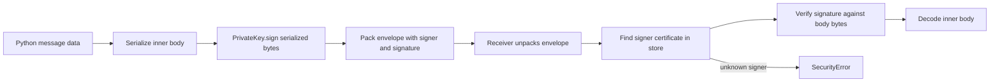

## Overview

Celery's security path combines serializer acceptance with an `auth` serializer that signs serialized message bodies and verifies them before decoding. The application exposes `setup_security`, while workers pass `accept_content` into task consumers. This policy surrounds the publication and receipt paths described in [[Publishing and Routing]] and [[Worker Lifecycle and Delivery]]. Result decoding and operational channels also have their own acceptance configuration.

Sources: [celery/app/base.py:750-780](repo://celery/app/base.py#L750-L780), [celery/app/amqp.py:317-324](repo://celery/app/amqp.py#L317-L324), [celery/security/serialization.py:31-58](repo://celery/security/serialization.py#L31-L58), [celery/backends/base.py:152-155](repo://celery/backends/base.py#L152-L155)

## Restrict accepted serializers

The default accepted task content is JSON, and task publication defaults to the JSON serializer. `TaskConsumer` uses `app.conf.accept_content` unless an explicit acceptance list is supplied. When a received task violates accepted content, the consumer's handler routes `ContentDisallowed` through invalid-task rejection. Setting a publication serializer and setting a receive acceptance policy are therefore two distinct configuration steps.

Sources: [celery/app/defaults.py:13-13](repo://celery/app/defaults.py#L13-L13), [celery/app/defaults.py:314-314](repo://celery/app/defaults.py#L314-L314), [celery/app/amqp.py:317-324](repo://celery/app/amqp.py#L317-L324), [celery/worker/consumer/consumer.py:710-714](repo://celery/worker/consumer/consumer.py#L710-L714), [celery/worker/consumer/consumer.py:781-784](repo://celery/worker/consumer/consumer.py#L781-L784)

`setup_security` disables insecure serializers through Kombu's registry before checking the authentication settings. The application's method explicitly describes serializer setup as global across application instances. `allowed_serializers` exempts named serializers or content types from disabling; it does not replace the separate `accept_content` requirement enforced by the auth setup function. [[Applications and Configuration]] explains when application configuration is loaded before these values are read.

Sources: [celery/app/base.py:750-776](repo://celery/app/base.py#L750-L776), [celery/security/__init__.py:44-56](repo://celery/security/__init__.py#L44-L56)

## Configure authenticated task messages

Security setup requires `task_serializer` to equal `auth` and `accept_content` to equal the list containing only `auth`. Otherwise it raises `ImproperlyConfigured`; the error explains that signing messages is ineffective when messages are not verified. It also requires private-key, local-certificate and certificate-store paths, either supplied as arguments or obtained from configuration. Importing the security module requires the `cryptography` library.

Sources: [celery/security/__init__.py:9-41](repo://celery/security/__init__.py#L9-L41), [celery/security/__init__.py:44-65](repo://celery/security/__init__.py#L44-L65)

| Configuration | Role in setup |
| --- | --- |
| `task_serializer` | Must select `auth` |
| `accept_content` | Must accept only `auth` for this setup path |
| `security_key` | Path read as the signing private key |
| `security_key_password` | Password passed to PEM private-key loading |
| `security_certificate` | Path read as the sender's certificate |
| `security_cert_store` | Directory or glob used to load verification certificates |
| `security_digest` | Configured digest when no explicit digest is supplied to the module helper |

Sources: [celery/security/__init__.py:54-70](repo://celery/security/__init__.py#L54-L70), [celery/security/key.py:15-25](repo://celery/security/key.py#L15-L25), [celery/security/certificate.py:103-113](repo://celery/security/certificate.py#L103-L113)

The public `app.setup_security` method defaults its digest to SHA-256 and its inner serializer to JSON, then forwards to the module helper. The helper opens key and certificate files, calls `register_auth` and sets the registry's default serializer to `auth`. Registration creates `PrivateKey`, `Certificate` and `FSCertStore` objects and registers the secure encoder and decoder with content type `application/data` and UTF-8 encoding.

Sources: [celery/app/base.py:750-780](repo://celery/app/base.py#L750-L780), [celery/security/__init__.py:58-70](repo://celery/security/__init__.py#L58-L70), [celery/security/serialization.py:80-90](repo://celery/security/serialization.py#L80-L90)

## Sign and verify before decoding

`SecureSerializer.serialize` first serializes the data with its inner serializer, converts the resulting body to bytes and signs those bytes. The comment explains the ordering: the recipient can verify the serialized body without decoding its contents first, avoiding flaws in the decoding step. The envelope stores the signer ID, signature, content type, content encoding and body using a separator and base64 encoding.

Sources: [celery/security/serialization.py:31-46](repo://celery/security/serialization.py#L31-L46), [celery/security/serialization.py:60-77](repo://celery/security/serialization.py#L60-L77)

Sources: [celery/security/serialization.py:31-77](repo://celery/security/serialization.py#L31-L77), [celery/security/certificate.py:86-91](repo://celery/security/certificate.py#L86-L91)

`deserialize` unpacks the envelope, selects the certificate by signer ID and verifies the body and signature. Only after verification does it call Kombu `loads` with the embedded content type and encoding, using `force=True`. The outer authenticated serializer therefore gates access to its inner decoding step. Serialization and unpack/verification exceptions are converted through the security error wrapper; cryptographic verification errors use the same `SecurityError` mechanism.

Sources: [celery/security/serialization.py:48-58](repo://celery/security/serialization.py#L48-L58), [celery/security/utils.py:19-28](repo://celery/security/utils.py#L19-L28), [celery/security/certificate.py:65-73](repo://celery/security/certificate.py#L65-L73)

## Load keys and verification certificates

Private keys are loaded from PEM data with an optional password and must be RSA keys. Certificates are also loaded from PEM data and must contain an RSA public key. Signing and verification both use RSA-PSS with MGF1, the selected digest and maximum salt length. Certificate identity combines its issuer string and serial number, which becomes the signer identifier carried in the envelope.

Sources: [celery/security/key.py:15-35](repo://celery/security/key.py#L15-L35), [celery/security/certificate.py:34-73](repo://celery/security/certificate.py#L34-L73)

`FSCertStore` expands a directory into a wildcard or uses a supplied glob, reads every matching certificate and rejects expired certificates during store construction. `CertStore` rejects duplicate identities and raises for an unknown signer lookup. The visible receive path looks up certificates from this loaded store; expiration checking is shown at store loading, so the code does not establish a fresh expiration check for each message.

Sources: [celery/security/certificate.py:44-46](repo://celery/security/certificate.py#L44-L46), [celery/security/certificate.py:86-113](repo://celery/security/certificate.py#L86-L113), [celery/security/serialization.py:48-58](repo://celery/security/serialization.py#L48-L58)

## Validate decoded result exceptions

Backends serialize ordinary exceptions into type, message and module fields when the serializer does not support exception objects directly. Reconstruction resolves an existing exception class or creates a fallback class, then verifies the resolved object is a class derived from `BaseException`. Otherwise it raises `SecurityError` before construction. The comment identifies the reason: without that guard, crafted backend metadata could select an arbitrary callable instead of an exception class.

Sources: [celery/backends/base.py:447-455](repo://celery/backends/base.py#L447-L455), [celery/backends/base.py:474-524](repo://celery/backends/base.py#L474-L524)

This check complements accepted result content; it is not the result backend's serializer selection itself. [[Results and Backends]] documents acceptance precedence and waiting behavior. Existing exception instances and dictionary-shaped failure metadata have distinct reconstruction branches, including a required exception-type field and a fallback plain exception if constructing the resolved type fails.

Sources: [celery/backends/base.py:152-155](repo://celery/backends/base.py#L152-L155), [celery/backends/base.py:457-479](repo://celery/backends/base.py#L457-L479), [celery/backends/base.py:518-526](repo://celery/backends/base.py#L518-L526)

## Coordinate transport and operational settings

Broker connections pass `broker_use_ssl` into Kombu independently of message signing. The auth implementation signs and base64-packs its serialized body; transport SSL is configured at the connection boundary. Control mailboxes use task serializer and accepted task content, while event dispatchers use `event_serializer`, which defaults to JSON. Event receivers default to accepting that event serializer and JSON. [[Monitoring and Remote Control]] follows those operational channels and their queue settings.

Sources: [celery/app/base.py:1102-1127](repo://celery/app/base.py#L1102-L1127), [celery/security/serialization.py:31-66](repo://celery/security/serialization.py#L31-L66), [celery/app/control.py:439-450](repo://celery/app/control.py#L439-L450), [celery/app/defaults.py:179-188](repo://celery/app/defaults.py#L179-L188), [celery/events/receiver.py:76-88](repo://celery/events/receiver.py#L76-L88)

The platform privilege check also considers accepted pickle content. On platforms with user/group information, it examines real and effective identities and privileged groups. The privileged-user path raises when pickle-compatible content is accepted without `C_FORCE_ROOT`; otherwise it emits a security warning. This is a startup safeguard associated with process privileges and deserialization, alongside the serializer and certificate checks above.

Sources: [celery/platforms.py:788-845](repo://celery/platforms.py#L788-L845)
