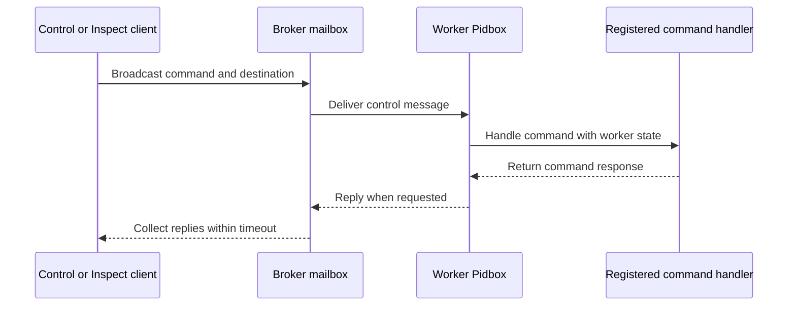

## Overview

Celery exposes two operational paths: events report worker and task activity, while remote control sends commands to worker mailboxes. `Inspect` is a request/reply client built on that control channel. These interfaces observe or modify the worker lifecycle described in [[Worker Lifecycle and Delivery]]; stored task outcomes remain the separate interface in [[Results and Backends]].

Sources: [celery/events/dispatcher.py:116-140](repo://celery/events/dispatcher.py#L116-L140), [celery/app/control.py:73-117](repo://celery/app/control.py#L73-L117), [celery/worker/pidbox.py:25-54](repo://celery/worker/pidbox.py#L25-L54)

## Inspect current worker state

`app.control.inspect()` creates an inspection client with destination, timeout, callback and reply-limit options. Its default timeout is one second. Each inspection calls `broadcast` with `reply=True`; replies are flattened by worker name. A single string destination returns that node's entry, while a pattern can filter the returned mapping. This is a bounded collection of worker responses, rather than a backend query for an individual task outcome.

Sources: [celery/app/control.py:82-117](repo://celery/app/control.py#L82-L117), [celery/app/control.py:457-460](repo://celery/app/control.py#L457-L460)

```pycon
>>> app.control.inspect().ping()
{'celery@node1': {'ok': 'pong'}, 'celery@node2': {'ok': 'pong'}}
```

Sources: [celery/app/control.py:276-280](repo://celery/app/control.py#L276-L280)

| Inspection | Worker-side meaning |
| --- | --- |
| `ping` | Returns an `ok` response containing `pong` |
| `stats` | Calls the worker controller's statistics interface |
| `scheduled` | Lists timer-held ETA/countdown requests |
| `reserved` | Lists reserved requests after removing active requests |
| `active` | Lists requests currently executing; supports safe request information |
| `active_queues` | Lists queues on the current task consumer |
| `revoked` | Lists remembered revoked task IDs |

Sources: [celery/worker/control.py:399-414](repo://celery/worker/control.py#L399-L414), [celery/worker/control.py:432-454](repo://celery/worker/control.py#L432-L454), [celery/worker/control.py:631-637](repo://celery/worker/control.py#L631-L637)

The scheduled inspection is the worker timer's waiting tasks, which can include tasks published with ETA or countdown. It does not enumerate Beat's periodic definitions. Those definitions and their persistence belong to [[Periodic Scheduling]]. The active and reserved sets describe the worker's local delivery stage, while result state retrieval follows [[Results and Backends]].

Sources: [celery/worker/control.py:411-441](repo://celery/worker/control.py#L411-L441), [celery/app/control.py:153-179](repo://celery/app/control.py#L153-L179)

## Follow a control command

`Control` creates a fanout mailbox using the configured control exchange, task serializer, accepted content and queue lifetime settings. It refuses mutually exclusive durable-and-exclusive queue configuration. `broadcast` accepts command arguments, optional destination names, reply timeout, reply limit and a per-reply callback, then acquires a broker connection and delegates to the mailbox. An empty destination broadcasts to all workers.

Sources: [celery/app/control.py:431-451](repo://celery/app/control.py#L431-L451), [celery/app/control.py:755-790](repo://celery/app/control.py#L755-L790)



Sources: [celery/app/control.py:107-117](repo://celery/app/control.py#L107-L117), [celery/app/control.py:755-790](repo://celery/app/control.py#L755-L790), [celery/worker/pidbox.py:25-54](repo://celery/worker/pidbox.py#L25-L54)

The worker control bootstep is included only when remote control is enabled and the transport supports fanout. It selects an ordinary or green pidbox according to the pool. `Pidbox` installs `Panel.data` as the handler registry and supplies application, hostname and consumer state. Unknown commands are logged; other handler errors are logged and reset the mailbox listener. Custom handlers can register through `control_command` or `inspect_command`, which also record command metadata and aliases.

Sources: [celery/worker/consumer/control.py:18-33](repo://celery/worker/consumer/control.py#L18-L33), [celery/worker/pidbox.py:25-65](repo://celery/worker/pidbox.py#L25-L65), [celery/worker/control.py:39-74](repo://celery/worker/control.py#L39-L74)

## Change runtime behavior

Revocation adds task IDs to the worker's revoked set and attempts to mark each result revoked, logging backend errors without abandoning the command. With `terminate=True`, it finds matching requests and asks their pool to terminate them. Stamped-header revocation records matching stamp values and can also terminate active matches. This connects the signature stamps from [[Canvas Workflows]] to worker execution controls; the available termination operation depends on the [[Concurrency Pools]] implementation.

Sources: [celery/worker/control.py:160-187](repo://celery/worker/control.py#L160-L187), [celery/worker/control.py:214-242](repo://celery/worker/control.py#L214-L242)

Rate-limit control validates the rate string, updates the registered task and resets consumer rate buckets; an unknown task returns an error response. Pool growth and shrinking adjust prefetch but refuse direct resizing when an autoscaler is active, directing the caller to change its range. Autoscale updates require an existing autoscaler, and pool restart requires `worker_pool_restarts`. [[Concurrency Pools]] explains the resizing and lifecycle capabilities behind these commands.

Sources: [celery/worker/control.py:259-292](repo://celery/worker/control.py#L259-L292), [celery/worker/control.py:545-589](repo://celery/worker/control.py#L545-L589)

`add_consumer` and `cancel_consumer` schedule queue changes through the consumer's `call_soon` interface. They change what the worker consumes; they do not rewrite producer routing rules. Use [[Publishing and Routing]] to align destinations with those subscriptions. The shutdown command raises `WorkerShutdown`, entering the worker's shutdown machinery rather than deleting all queued messages.

Sources: [celery/worker/control.py:592-596](repo://celery/worker/control.py#L592-L596), [celery/worker/control.py:610-628](repo://celery/worker/control.py#L610-L628)

## Publish and capture events

The event dispatcher builds events with hostname, PID, UTC offset and a logical clock, and routes event types by replacing hyphens with dots. It serializes using `event_serializer`. On publication failure it either raises or buffers the event, depending on `buffer_while_offline`. Worker event startup can carry the old dispatcher's buffer into its replacement and flush it after reconnecting.

Sources: [celery/events/dispatcher.py:58-80](repo://celery/events/dispatcher.py#L58-L80), [celery/events/dispatcher.py:135-162](repo://celery/events/dispatcher.py#L135-L162), [celery/worker/consumer/events.py:35-52](repo://celery/worker/consumer/events.py#L35-L52)

Task-event emission is grouped separately from worker events. The worker event bootstep can retain only the worker group when task events are disabled. Remote `enable_events` and `disable_events` modify task-group membership and return an error when no dispatcher exists. A heartbeat command requests an immediate `worker-heartbeat`. Publication-side sent events are another source of task lineage, described in [[Publishing and Routing]].

Sources: [celery/worker/consumer/events.py:20-31](repo://celery/worker/consumer/events.py#L20-L31), [celery/worker/control.py:345-376](repo://celery/worker/control.py#L345-L376)

`EventReceiver` creates a named event queue with routing pattern, TTL, expiration and exclusivity/durability options. It refuses a queue that is both exclusive and durable. Its consumer uses `no_ack=True` and dispatches each event to an exact-type handler or the wildcard handler. Capture can wake workers by broadcasting a heartbeat request; callers choose the handler that stores or processes each event.

Sources: [celery/events/receiver.py:36-111](repo://celery/events/receiver.py#L36-L111)

## Reconstruct an observed cluster

`State` maintains bounded LRU caches for workers and tasks, a task event heap and indexes by task type and worker. Its `event` method serializes updates with a mutex. Task event processing associates client-sent events with the client, other task events with a worker, and resolves parent/child relationships even when children arrive before parents. It limits the retained event heap, so the structure is an in-memory observation model with configured bounds.

Sources: [celery/events/state.py:407-435](repo://celery/events/state.py#L407-L435), [celery/events/state.py:501-503](repo://celery/events/state.py#L501-L503), [celery/events/state.py:575-641](repo://celery/events/state.py#L575-L641)

Task-state merging uses state precedence to handle observations that logically precede the current state, retaining only fields allowed by merge rules rather than blindly regressing state. Retry receives special handling in that comparison. Event receiver acceptance and control mailbox serialization also have their own configuration, so coordinate those settings with the trust policy in [[Message Security]] when monitoring authenticated task traffic.

Sources: [celery/events/state.py:305-332](repo://celery/events/state.py#L305-L332), [celery/events/receiver.py:76-88](repo://celery/events/receiver.py#L76-L88), [celery/app/control.py:439-450](repo://celery/app/control.py#L439-L450)
