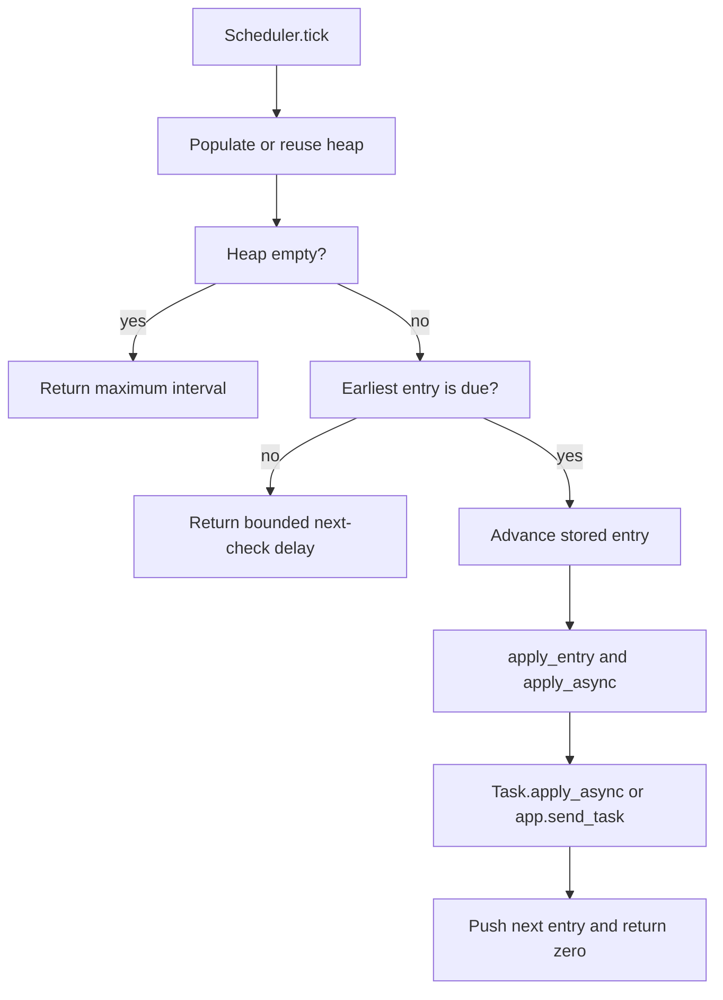

## Overview

Beat publishes task messages when periodic entries become due; workers execute those messages through the ordinary delivery path. A scheduler entry holds the task name, schedule, arguments, options, last scheduled time and run count. The publisher boundary is the same one described in [[Publishing and Routing]], so Beat's progress does not itself establish successful task execution.

Sources: [celery/beat.py:117-163](repo://celery/beat.py#L117-L163), [celery/beat.py:393-421](repo://celery/beat.py#L393-L421)

## Define periodic entries

`app.add_periodic_task` accepts a schedule and signature, derives an entry containing task name, args, kwargs and merged options, and adds it to `beat_schedule`. If the app is not configured it queues the entry for later configuration. The key is the supplied name or signature representation. Adding the same unnamed signature twice overwrites its previous entry; supply distinct names when separate schedules should coexist. [[Applications and Configuration]] covers the deferred configuration phase.

Sources: [celery/app/base.py:1295-1333](repo://celery/app/base.py#L1295-L1333)

The periodic example configures UTC, defines a printing task and registers a ten-second schedule from `on_after_configure`. The signature in this hook uses the invocation representation described in [[Canvas Workflows]]:

Sources: [examples/periodic-tasks/myapp.py:42-53](repo://examples/periodic-tasks/myapp.py#L42-L53)

```python
@app.on_after_configure.connect
def setup_periodic_tasks(sender, **kwargs):
    # Calls say('hello') every 10 seconds.
    sender.add_periodic_task(10.0, say.s('hello'), name='add every 10')
```

Sources: [examples/periodic-tasks/myapp.py:50-53](repo://examples/periodic-tasks/myapp.py#L50-L53)

`ScheduleEntry` normalizes its schedule through `maybe_schedule` and defaults `last_run_at` to the current schedule or application time. Advancing the entry produces another instance with the current scheduling time and an incremented count. Updating an existing entry changes only editable fields such as task, schedule, args, kwargs and options, preserving run history. That distinction lets persisted entries retain progress while their definitions change.

Sources: [celery/beat.py:117-163](repo://celery/beat.py#L117-L163)

## Choose a schedule type

| Type | Due-check behavior |
| --- | --- |
| Interval `schedule` | Compares aware current and last-run times with the configured interval, returning due status and seconds until another check |
| `crontab` | Expands minute, hour, weekday, day-of-month and month fields; computes the next matching time and can suppress missed runs beyond a starting deadline |
| `solar` | Uses an Ephem observer for the requested event and coordinates, validates location ranges and returns a due status plus next check |

Sources: [celery/schedules.py:125-173](repo://celery/schedules.py#L125-L173), [celery/schedules.py:401-414](repo://celery/schedules.py#L401-L414), [celery/schedules.py:641-688](repo://celery/schedules.py#L641-L688), [celery/schedules.py:792-818](repo://celery/schedules.py#L792-L818), [celery/schedules.py:863-878](repo://celery/schedules.py#L863-L878)

The due-check return value includes a suggested next check, not an execution reservation. The interval implementation explains that this saves CPU and influences precision; the scheduler's maximum loop interval takes precedence over a longer suggested delay. Crontab's `beat_cron_starting_deadline` prevents an old missed occurrence from becoming unexpectedly due after the deadline. Solar scheduling handles a day without sunrise or sunset by checking again after the next anti-transit.

Sources: [celery/schedules.py:138-166](repo://celery/schedules.py#L138-L166), [celery/schedules.py:661-688](repo://celery/schedules.py#L661-L688), [celery/schedules.py:851-861](repo://celery/schedules.py#L851-L861)

## Follow one scheduler tick

The scheduler builds a heap from entries and their next due checks, converting times into UTC timestamps. `tick` rebuilds the heap when the schedule changes. With no entries it returns the maximum interval; otherwise it examines the earliest entry. A due entry is removed, reserved, published and reinserted with its next time. One call executes at most one due publication and returns zero to request another immediate tick.

Sources: [celery/beat.py:300-364](repo://celery/beat.py#L300-L364)



Sources: [celery/beat.py:326-364](repo://celery/beat.py#L326-L364), [celery/beat.py:389-421](repo://celery/beat.py#L389-L421)

Reservation advances timestamps and run counts before attempting publication. The comment explicitly says this prevents endless scheduling if submission raises. `apply_async` evaluates entry arguments, uses a registered task's `apply_async` when present, or sends by name otherwise. It wraps submission errors in `SchedulingError` and updates the synchronization counter in `finally`. `apply_entry` logs publication errors instead of treating a failed message send as a successful worker result.

Sources: [celery/beat.py:279-290](repo://celery/beat.py#L279-L290), [celery/beat.py:389-421](repo://celery/beat.py#L389-L421)

## Persist scheduling progress

The default configured scheduler is `celery.beat:PersistentScheduler`, using `celerybeat-schedule` as its filename. Its storage is a `shelve` database. Startup opens the store and tests key access; corruption causes the scheduler to remove its known database files and reopen the store. It compares stored timezone and UTC settings with the application and clears persisted schedule data when those settings change.

Sources: [celery/app/defaults.py:73-80](repo://celery/app/defaults.py#L73-L80), [celery/beat.py:505-556](repo://celery/beat.py#L505-L556)

Persisted entries merge with `beat_schedule`: removed definitions are dropped, new definitions are added and existing entries update their editable fields. The store records Celery version, timezone and UTC mode, then synchronizes. `sync` delegates to the shelf and `close` synchronizes before closing it. Synchronization may be due after elapsed time or a configured number of task publications.

Sources: [celery/beat.py:381-387](repo://celery/beat.py#L381-L387), [celery/beat.py:458-470](repo://celery/beat.py#L458-L470), [celery/beat.py:557-565](repo://celery/beat.py#L557-L565), [celery/beat.py:599-605](repo://celery/beat.py#L599-L605)

The scheduler also installs a daily `celery.backend_cleanup` entry when results expire and the backend lacks automatic expiration. It schedules that task at 04:00 with a twelve-hour task expiration. This connects periodic maintenance to the backend-specific retention behavior described in [[Results and Backends]].

Sources: [celery/beat.py:268-277](repo://celery/beat.py#L268-L277)

## Run and extend Beat

The periodic example runs `python myapp.py worker -l INFO` in one terminal and `python myapp.py beat -l INFO` in another. Beat's CLI exposes schedule-file, scheduler-class, maximum-interval and logging options. The application starts its loader, optionally acquires a PID lock and creates a scheduler service. Use one scheduler for a schedule: the repository's periodic guide explains that multiple schedulers produce duplicate tasks because the centralized scheduler does not synchronize its schedule with locks.

Sources: [examples/periodic-tasks/myapp.py:3-12](repo://examples/periodic-tasks/myapp.py#L3-L12), [celery/bin/beat.py:19-49](repo://celery/bin/beat.py#L19-L49), [celery/apps/beat.py:78-101](repo://celery/apps/beat.py#L78-L101), [docs/userguide/periodic-tasks.rst:13-22](repo://docs/userguide/periodic-tasks.rst#L13-L22)

The service emits initialization signals, repeatedly calls `tick`, sleeps for positive returned delays and synchronizes when required. Keyboard interruption or exit sets shutdown state, and the final path closes the scheduler. A custom scheduler class can be resolved through `celery.beat_schedulers` and receives the application, schedule filename, maximum interval and lazy flag. Its tick and persistence behavior becomes responsible for honoring that service contract.

Sources: [celery/beat.py:633-679](repo://celery/beat.py#L633-L679)
