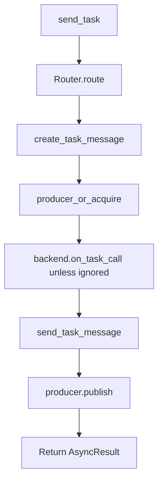

## Overview

`Celery.send_task` turns a task name and arguments into a broker publication and returns a result handle. It is the broker path used by the task interface in [[Tasks and Retries]], but it also supports names that are not registered locally. Routing determines the destination; message construction determines what workers receive. Worker-side dispatch continues in [[Worker Lifecycle and Delivery]].

Sources: [celery/app/base.py:846-895](repo://celery/app/base.py#L846-L895), [celery/app/base.py:1025-1034](repo://celery/app/base.py#L1025-L1034)

## Resolve submission defaults

`send_task` chooses an existing task ID or generates one and obtains the application's router. When `task_type` was not supplied, it checks the underlying registry without triggering finalization. A locally registered task can contribute non-`None` execution defaults, while explicit caller options override them. The comments explain why a call arriving from `Task.apply_async` skips this merge: that interface already merged its execution options.

Sources: [celery/app/base.py:863-909](repo://celery/app/base.py#L863-L909)

Time limits and expiration have an additional omitted-value distinction. If the caller omits `time_limit`, `soft_time_limit` or `expires`, `send_task` takes a merged task-level default. Explicit `None` clears the default. These values are removed from the options mapping before message construction to avoid duplicate keyword arguments. The router then receives the remaining options, task name, arguments and task type.

Sources: [celery/app/base.py:911-932](repo://celery/app/base.py#L911-L932)

## Match routes and queues

`task_routes` can contain mappings, lists of route pairs, import strings or router objects. `prepare` converts mapping forms into `MapRoute` and defers import-string resolution. `MapRoute` tries an exact task name first, then regular-expression or wildcard patterns in their stored order. Router lookup uses the first result that is not `None`; a callable receives task name, args, kwargs, options and the task type, while legacy routers can implement `route_for_task`.

Sources: [celery/app/routes.py:26-53](repo://celery/app/routes.py#L26-L53), [celery/app/routes.py:98-136](repo://celery/app/routes.py#L98-L136)

`Router.route` expands a named queue into its `Queue` object, merges the matched route with submission options, and falls back to `task_default_queue` when no queue is selected. Missing queue names raise `QueueNotFound` if the queue registry cannot resolve them. The registry can automatically create missing queues according to `task_create_missing_queues`, so whether a miss fails also depends on that configuration.

Sources: [celery/app/routes.py:66-96](repo://celery/app/routes.py#L66-L96), [celery/app/amqp.py:45-55](repo://celery/app/amqp.py#L45-L55), [celery/app/defaults.py:278-286](repo://celery/app/defaults.py#L278-L286)

Missing-queue construction uses the queue name as its routing key. It accepts classic or quorum types, sets `x-queue-type` for quorum, and can select an explicit exchange type. A worker's selected consumption subset is distinct from the queues retained for routing: `select` builds `_consume_from`, while other configured queues remain known. A producer naming a queue does not itself select which worker consumes it.

Sources: [celery/app/amqp.py:59-61](repo://celery/app/amqp.py#L59-L61), [celery/app/amqp.py:172-182](repo://celery/app/amqp.py#L172-L182), [celery/app/amqp.py:201-222](repo://celery/app/amqp.py#L201-L222)

## Build the task protocol

Protocol v2 is the configured default. Its constructor validates that args are a list or tuple and kwargs are a mapping. Countdown becomes an aware ETA, numeric expiration becomes an aware datetime, and ETA and expiration are serialized as ISO-format strings. The root ID defaults to the task ID. This creates scheduling metadata for the worker rather than running the body during publication.

Sources: [celery/app/defaults.py:295-295](repo://celery/app/defaults.py#L295-L295), [celery/app/amqp.py:326-368](repo://celery/app/amqp.py#L326-L368)

| Message component | Included data |
| --- | --- |
| Headers | Task name and ID, ETA, expiration, retries, hard/soft limits, group position, root/parent IDs, argument representations and stamps |
| Properties | Correlation ID and reply destination |
| Body | Positional args, keyword args, callbacks, errbacks, remaining chain and chord |
| Optional sent event | Task identity, lineage, argument representations and scheduling fields |

Sources: [celery/app/amqp.py:370-418](repo://celery/app/amqp.py#L370-L418)

When called inside a worker task, submission can inherit root and parent IDs from the current worker request and optionally its priority. Stamp values are included in message headers and then removed from generic publish options. These lineage fields connect publications to [[Canvas Workflows]] and the event stream in [[Monitoring and Remote Control]]. Serializer trust and signed payloads are covered by [[Message Security]].

Sources: [celery/app/base.py:994-1020](repo://celery/app/base.py#L994-L1020)

## Handle delayed delivery and expiration

For detected quorum queues, ETA/countdown publication checks the destination exchange type. A positive countdown on a supported exchange can be converted to a routing key for `celery_delayed_27`, a topic exchange. Direct exchanges instead trigger a warning that native delayed delivery is unsupported and that the task may block a worker process until ETA. This is a conditional broker path, separate from ordinary worker timer scheduling.

Sources: [celery/app/base.py:934-966](repo://celery/app/base.py#L934-L966)

Expiration is also expressed as broker expiration seconds. Datetime and string values are converted relative to application time; negative durations are logged and clamped to zero. The message retains its task expiration metadata too. These two representations let publication carry a transport expiration and an execution deadline rather than treating expiration as a client-side result timeout.

Sources: [celery/app/base.py:968-992](repo://celery/app/base.py#L968-L992), [celery/app/amqp.py:349-360](repo://celery/app/amqp.py#L349-L360), [celery/app/amqp.py:371-381](repo://celery/app/amqp.py#L371-L381)

## Publish through a producer

Sources: [celery/app/base.py:930-932](repo://celery/app/base.py#L930-L932), [celery/app/base.py:1006-1034](repo://celery/app/base.py#L1006-L1034), [celery/app/amqp.py:565-576](repo://celery/app/amqp.py#L565-L576)

The sender resolves queue strings, delivery mode and exchange type. For a direct exchange lacking an exchange or routing key, it uses the anonymous exchange and queue name; otherwise it obtains the queue exchange and routing key defaults. Unless explicitly supplied, a nonbroadcast queue is included in the declaration list. It sends `before_task_publish`, calls `producer.publish` with body, headers, properties, serializer, compression and retry policy, then sends `after_task_publish`.

Sources: [celery/app/amqp.py:521-579](repo://celery/app/amqp.py#L521-L579)

Write connections use `broker_write_url`, with transport, SSL, timeout and transport options passed into Kombu. A supplied producer is reused; otherwise `producer_or_acquire` borrows one with `broker_pool_acquire_timeout`. Pool exhaustion raises an `OperationalError` that identifies the configured pool limit and timeout. The sender merges custom publication retry policy into defaults; this retry concerns sending the message, whereas execution retry is described in [[Tasks and Retries]].

Sources: [celery/app/base.py:1051-1057](repo://celery/app/base.py#L1051-L1057), [celery/app/base.py:1102-1127](repo://celery/app/base.py#L1102-L1127), [celery/app/base.py:1162-1189](repo://celery/app/base.py#L1162-L1189), [celery/app/amqp.py:553-576](repo://celery/app/amqp.py#L553-L576)
