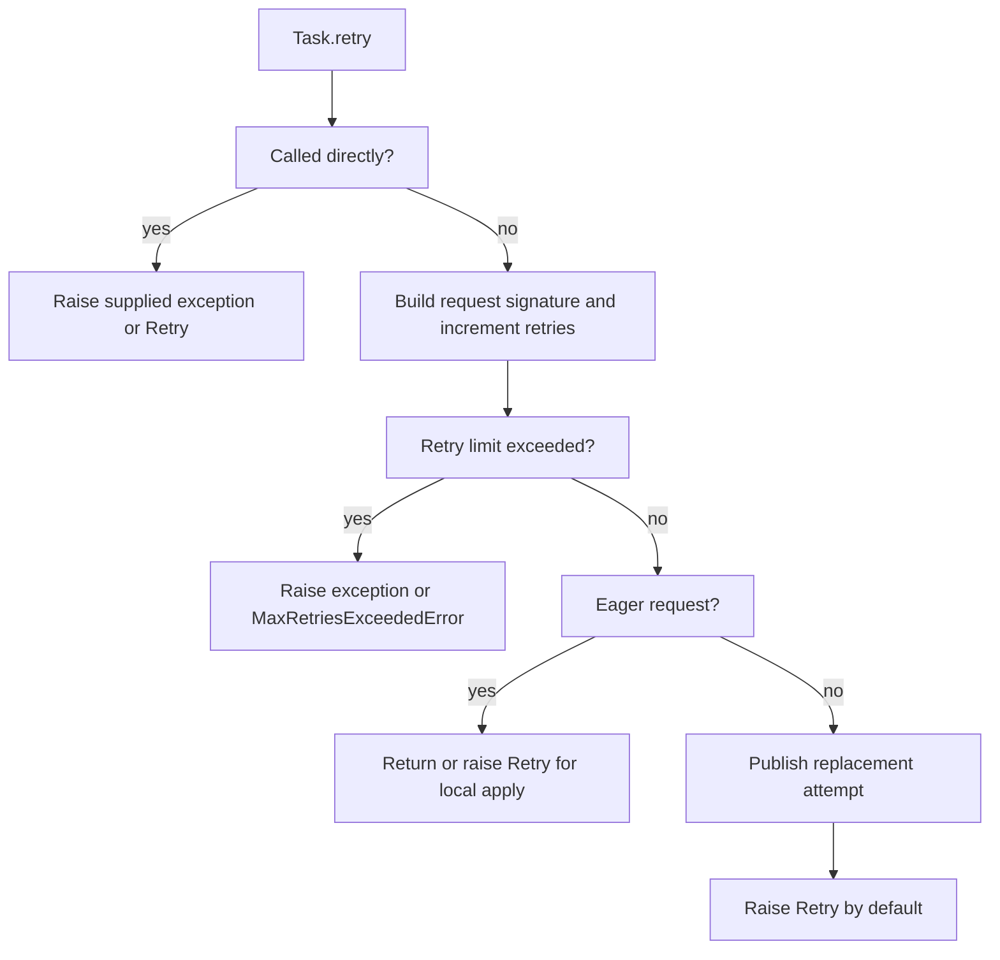

## Overview

A task is an application-bound object whose `run` method holds the work. [[Applications and Configuration]] explains how decorators create and register that object. This page follows the resulting invocation interface, request context and execution failure handling. Broker destinations belong to [[Publishing and Routing]]; acknowledgements and redelivery belong to [[Worker Lifecycle and Delivery]].

Sources: [celery/app/task.py:205-213](repo://celery/app/task.py#L205-L213), [celery/app/task.py:418-430](repo://celery/app/task.py#L418-L430), [celery/app/task.py:703-708](repo://celery/app/task.py#L703-L708)

## Choose an invocation path

| Interface | Execution behavior | Returned value |
| --- | --- | --- |
| `task(*args, **kwargs)` | Pushes a local request context and calls `run` in the caller | The body's return value |
| `task.apply(args, kwargs)` | Executes locally through an eager tracer | `EagerResult` |
| `task.delay(*args, **kwargs)` | Forwards to `apply_async(args, kwargs)` | The submission result |
| `task.apply_async(args, kwargs, **options)` | Publishes through `app.send_task`, unless eager mode is enabled | Usually `AsyncResult`, or an eager result |

Sources: [celery/app/task.py:495-502](repo://celery/app/task.py#L495-L502), [celery/app/task.py:523-538](repo://celery/app/task.py#L523-L538), [celery/app/task.py:682-708](repo://celery/app/task.py#L682-L708), [celery/app/task.py:869-883](repo://celery/app/task.py#L869-L883), [celery/app/task.py:938-951](repo://celery/app/task.py#L938-L951)

`apply_async` checks the task's configured soft and hard limits, invokes its argument checker when typing is enabled, and merges execution defaults with caller options. Explicit call options override task defaults. It adds `ignore_result` and priority defaults before choosing eager or broker execution. `delay` does not expose those extra execution options; use `apply_async` for countdown, expiration, queue or callback options.

Sources: [celery/app/task.py:523-526](repo://celery/app/task.py#L523-L526), [celery/app/task.py:545-580](repo://celery/app/task.py#L545-L580), [celery/app/task.py:659-680](repo://celery/app/task.py#L659-L680)

With `task_always_eager`, submission serializes and deserializes the arguments using the selected serializer, then calls `apply` under a denied-result-join context. This exercises local tracing and serialization but takes a different path from consuming a broker message. A direct application `send_task` call warns that eager mode has no effect on it. [[Quickstart]] uses a running worker to exercise actual submission and result delivery.

Sources: [celery/app/task.py:682-708](repo://celery/app/task.py#L682-L708), [celery/app/base.py:869-872](repo://celery/app/base.py#L869-L872)

## Request context and task defaults

Binding reads application configuration only for attributes still set to `None`, clears cached execution options and derives the typing default from `strict_typing`. The configured attributes include limits, started-state tracking, late acknowledgements and result policies. The bind path also initializes the request stack and applies annotations. An explicit task attribute can therefore remain distinct from the application's general default.

Sources: [celery/app/task.py:400-453](repo://celery/app/task.py#L400-L453)

`Task.request` context includes the task ID, args, kwargs, retry count, ETA, expiration, delivery information, callbacks, chain, chord, root and parent identifiers, headers and stamps. `Context.update` also normalizes a supplied `timelimit` pair into hard and soft fields and clears them when the supplied value is invalid. Context is execution-specific data; the tracer pushes it before running the body and removes it during cleanup.

Sources: [celery/app/task.py:75-149](repo://celery/app/task.py#L75-L149), [celery/app/trace.py:497-498](repo://celery/app/trace.py#L497-L498), [celery/app/trace.py:565-567](repo://celery/app/trace.py#L565-L567), [celery/app/trace.py:655-663](repo://celery/app/trace.py#L655-L663)

## Retry a failed execution

`retry` starts from the current request, increments its retry count and uses `default_retry_delay` if neither ETA nor countdown was supplied. It creates a signature from the request, retaining execution metadata such as the task ID, callbacks and workflow identifiers. `signature_from_request` also preserves priority and destination information, including the queue inferred from an anonymous-exchange delivery.

Sources: [celery/app/task.py:170-195](repo://celery/app/task.py#L170-L195), [celery/app/task.py:731-753](repo://celery/app/task.py#L731-L753), [celery/app/task.py:818-839](repo://celery/app/task.py#L818-L839)

Sources: [celery/app/task.py:818-867](repo://celery/app/task.py#L818-L867)

When the retry limit is exceeded, a supplied exception is raised; otherwise `MaxRetriesExceededError` includes the task arguments. In a worker execution, the new signature is submitted before `retry` raises the `Retry` control exception by default. A publication failure becomes `Reject(requeue=False)`. Setting `throw=False` returns the retry object instead, allowing the calling body to continue, so it changes how the tracer sees the original execution.

Sources: [celery/app/task.py:841-867](repo://celery/app/task.py#L841-L867)

The tracer handles `Retry` separately from ordinary failure. It can mark the backend state as `RETRY`, invokes `on_retry`, sends `task_retry` and logs the reason. In eager execution, `apply` detects a returned retry signature and recursively applies it with an increased retry count. [[Results and Backends]] explains how stored retry and terminal states appear to result clients.

Sources: [celery/app/trace.py:212-235](repo://celery/app/trace.py#L212-L235), [celery/app/trace.py:599-605](repo://celery/app/trace.py#L599-L605), [celery/app/task.py:938-951](repo://celery/app/task.py#L938-L951)

## Configure automatic retries

Autoretry wraps `run` only when `autoretry_for` is nonempty and no original-run wrapper exists. It passes through `Ignore`, `Retry` and exceptions matching `dont_autoretry_for`; only the configured retryable exception classes reach `task.retry`. With backoff enabled, it computes a countdown from the retry count, a factor of at least one, `retry_backoff_max` and `retry_jitter`. The defaults in this wrapper cap backoff at 600 seconds and enable jitter.

Sources: [celery/app/autoretry.py:8-66](repo://celery/app/autoretry.py#L8-L66)

## Trace completion and failure

Execution sends prerun signals, initializes the loader task context and optionally stores `STARTED`. It calls `before_start`, runs the body, and distinguishes `Reject`, `Ignore`, `Retry`, ordinary exceptions and other base exceptions. On ordinary failure, `TraceInfo` prepares exception information, calls `backend.mark_as_failure`, invokes `on_failure` and sends `task_failure`. Error storage depends on eager execution and ignore-result policies.

Sources: [celery/app/trace.py:188-204](repo://celery/app/trace.py#L188-L204), [celery/app/trace.py:242-270](repo://celery/app/trace.py#L242-L270), [celery/app/trace.py:569-609](repo://celery/app/trace.py#L569-L609)

On success, callback and chain publication precede result storage, then `on_success` and success signals run. For states outside the tracer's ignore set, it invokes `after_return`; `task_postrun` and request-stack cleanup happen in `finally`, followed by backend and loader cleanup outside eager mode. The callback flow continues in [[Canvas Workflows]], while the worker's pool callbacks decide acknowledgement behavior in [[Worker Lifecycle and Delivery]].

Sources: [celery/app/trace.py:610-672](repo://celery/app/trace.py#L610-L672)
