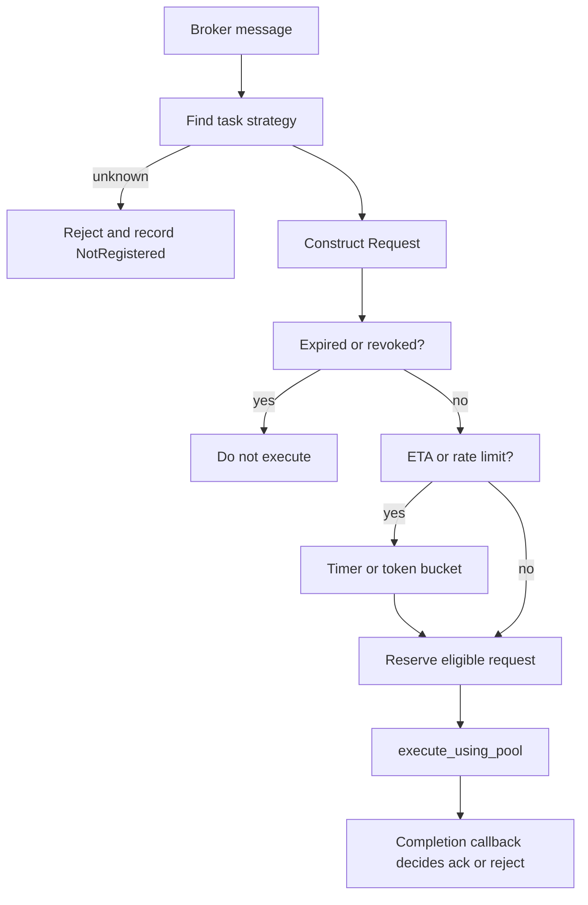

## Overview

`WorkController` assembles the worker, while its consumer receives task messages and dispatches requests into an execution pool. This is the receiving side of [[Publishing and Routing]]. Task bodies and lifecycle hooks execute through the tracer described in [[Tasks and Retries]]; the surrounding request decides when to acknowledge, reject or requeue the broker delivery.

Sources: [celery/worker/worker.py:76-139](repo://celery/worker/worker.py#L76-L139), [celery/worker/worker.py:223-231](repo://celery/worker/worker.py#L223-L231), [celery/worker/request.py:341-369](repo://celery/worker/request.py#L341-L369)

## Assemble and start bootsteps

Construction initializes the loader, applies worker defaults, selects queues and included modules, and chooses CPU count as concurrency when none was supplied, falling back to two if detection fails. It resolves the configured pool class and applies the worker blueprint. Its default components include the hub, pool, timer, state database, consumer, optional embedded Beat and autoscaler. [[Concurrency Pools]] describes the pool implementations; [[Periodic Scheduling]] describes Beat.

Sources: [celery/worker/worker.py:76-139](repo://celery/worker/worker.py#L76-L139)

Bootsteps are dependency-ordered components. Blueprint application instantiates the finalized step order and includes the steps in the parent; start calls each included step's `start`. Custom worker steps enter through `app.steps['worker']`. Dependencies are expanded recursively before constructing the dependency graph, so registration order alone does not describe the eventual startup order.

Sources: [celery/worker/worker.py:129-139](repo://celery/worker/worker.py#L129-L139), [celery/bootsteps.py:112-117](repo://celery/bootsteps.py#L112-L117), [celery/bootsteps.py:200-240](repo://celery/bootsteps.py#L200-L240)

The consumer has its own blueprint for connection, mingle, events, gossip, heartbeat, control, tasks, delayed delivery and the event loop. Its Tasks step builds task strategies, establishes broker QoS and constructs the task consumer. ETA tasks can be bounded through `worker_eta_task_limit`. `worker_disable_prefetch` is applied only for a Redis broker; another transport produces a warning and ignores that behavior.

Sources: [celery/worker/consumer/consumer.py:171-186](repo://celery/worker/consumer/consumer.py#L171-L186), [celery/worker/consumer/tasks.py:29-83](repo://celery/worker/consumer/tasks.py#L29-L83)

## Resolve and schedule a received message

For protocol v2, `create_task_handler` obtains the task name from message headers, deferring body decoding to the pool path. Older messages can be decoded to obtain the name from their payload. A missing strategy invokes unknown-task handling; invalid tasks or disallowed content invoke rejection handling. An unregistered task is rejected and recorded as `NotRegistered`, making task imports from [[Applications and Configuration]] part of successful worker startup.

Sources: [celery/worker/consumer/consumer.py:677-714](repo://celery/worker/consumer/consumer.py#L677-L714), [celery/worker/consumer/consumer.py:731-784](repo://celery/worker/consumer/consumer.py#L731-L784)

The strategy constructs a task-specific `Request`, logs receipt, checks expiration and revocation, and sends `task_received`. If event emission is enabled it also publishes `task-received` with identity, lineage and scheduling metadata. A request with ETA enters the timer; a rate-limited request enters its token bucket. Only an eligible immediate request is reserved and sent directly to the controller.

Sources: [celery/worker/strategy.py:126-208](repo://celery/worker/strategy.py#L126-L208)

Sources: [celery/worker/consumer/consumer.py:677-700](repo://celery/worker/consumer/consumer.py#L677-L700), [celery/worker/consumer/consumer.py:748-780](repo://celery/worker/consumer/consumer.py#L748-L780), [celery/worker/strategy.py:145-208](repo://celery/worker/strategy.py#L145-L208), [celery/worker/worker.py:223-231](repo://celery/worker/worker.py#L223-L231), [celery/worker/request.py:596-620](repo://celery/worker/request.py#L596-L620)

Rate limiting retains requests in bucket order when tokens are unavailable and schedules another bucket check with the timer. ETA dispatch reserves the request and adjusts QoS when it enters the execution path. A received task can therefore be known to the worker while still waiting for its ETA or rate allowance, independently of the result storage discussed in [[Results and Backends]].

Sources: [celery/worker/consumer/consumer.py:329-364](repo://celery/worker/consumer/consumer.py#L329-L364), [celery/worker/consumer/consumer.py:659-663](repo://celery/worker/consumer/consumer.py#L659-L663)

## Dispatch into the pool

`Request.execute_using_pool` checks revocation again, chooses the fast or ordinary trace entry and submits the task type, ID, request mapping and message body. It passes `on_accepted`, `on_timeout`, `on_success` and `on_failure` as pool callbacks, along with effective hard and soft limits. Pool acceptance records the worker PID and start time and marks the request active. The implementation of that execution capacity is described in [[Concurrency Pools]].

Sources: [celery/worker/request.py:341-369](repo://celery/worker/request.py#L341-L369), [celery/worker/request.py:515-523](repo://celery/worker/request.py#L515-L523)

## Acknowledge or requeue

| Condition | Request behavior |
| --- | --- |
| Pool accepts a task with `acks_late=False` | Acknowledge immediately |
| Successful completion with `acks_late=True` | Acknowledge after processing |
| `Retry` with late acknowledgement | Acknowledge this delivery and emit a retried event |
| `Ignore` | Acknowledge |
| `Reject` | Reject using the exception's requeue flag; terminal rejection also records failure |
| Lost worker with late acknowledgement and `reject_on_worker_lost` | Reject with requeue |
| Hard timeout with late acknowledgement | Acknowledge if `acks_on_timeout`; otherwise requeue |
| Other late-acknowledged failure | Acknowledge if `acks_on_failure`; otherwise reject without requeue |

Sources: [celery/worker/request.py:515-523](repo://celery/worker/request.py#L515-L523), [celery/worker/request.py:590-620](repo://celery/worker/request.py#L590-L620), [celery/worker/request.py:647-696](repo://celery/worker/request.py#L647-L696)

Late acknowledgement alone does not select requeue for every failure. The request distinguishes lost workers, timeout policy, ordinary exceptions and explicit control exceptions. It avoids recording a terminal failure when a lost-worker failure is requeued. Execution retry already publishes another attempt through the mechanism in [[Tasks and Retries]], while requeue asks the broker to deliver the current message again.

Sources: [celery/worker/request.py:674-711](repo://celery/worker/request.py#L674-L711), [celery/app/task.py:852-867](repo://celery/app/task.py#L852-L867)

A hard timeout records `TimeLimitExceeded`, invokes failure hooks and signals, and emits a failure event outside the special cold-shutdown path. Soft timeout handling logs the limit event. These request callbacks complement tracer hooks because a hard-stopped execution may not have completed its own normal cleanup or result path.

Sources: [celery/worker/request.py:529-594](repo://celery/worker/request.py#L529-L594)

## Recover the broker connection

Recoverable connection errors consult startup-specific or general broker retry configuration. With retry disabled, the consumer raises `WorkerShutdown`; too many open files triggers termination. Otherwise it closes consumer state and restarts its blueprint. Cleanup of an established broken connection uses a bounded socket timeout and explicitly closes the old connection before reconnecting, avoiding an indefinitely blocking cleanup call.

Sources: [celery/worker/consumer/consumer.py:383-438](repo://celery/worker/consumer/consumer.py#L383-L438)

When configured, connection loss cancels active late-acknowledged requests whose deliveries have not been acknowledged. Prefetch reduction is also conditional: per-consumer QoS skips the reduction because updates would not reach an already running consumer, while the global-QoS path reduces the count according to active requests. The acknowledgement and rejection promises participate in subsequent prefetch restoration.

Sources: [celery/worker/consumer/consumer.py:440-482](repo://celery/worker/consumer/consumer.py#L440-L482), [celery/worker/consumer/consumer.py:754-773](repo://celery/worker/consumer/consumer.py#L754-L773)

## Stop the worker

`WorkController.stop` performs warm shutdown and `terminate` performs cold shutdown. Both close consumption before stopping the blueprint, with pool signal-safety checks when invoked inside a signal handler. Blueprint shutdown closes components and stops or terminates steps in reverse order, then signals completion. Startup errors are logged and stop the worker with a failure exit code; keyboard interruption also enters the stop path. Remote runtime commands are covered in [[Monitoring and Remote Control]].

Sources: [celery/worker/worker.py:201-212](repo://celery/worker/worker.py#L201-L212), [celery/worker/worker.py:244-267](repo://celery/worker/worker.py#L244-L267), [celery/bootsteps.py:137-176](repo://celery/bootsteps.py#L137-L176)
