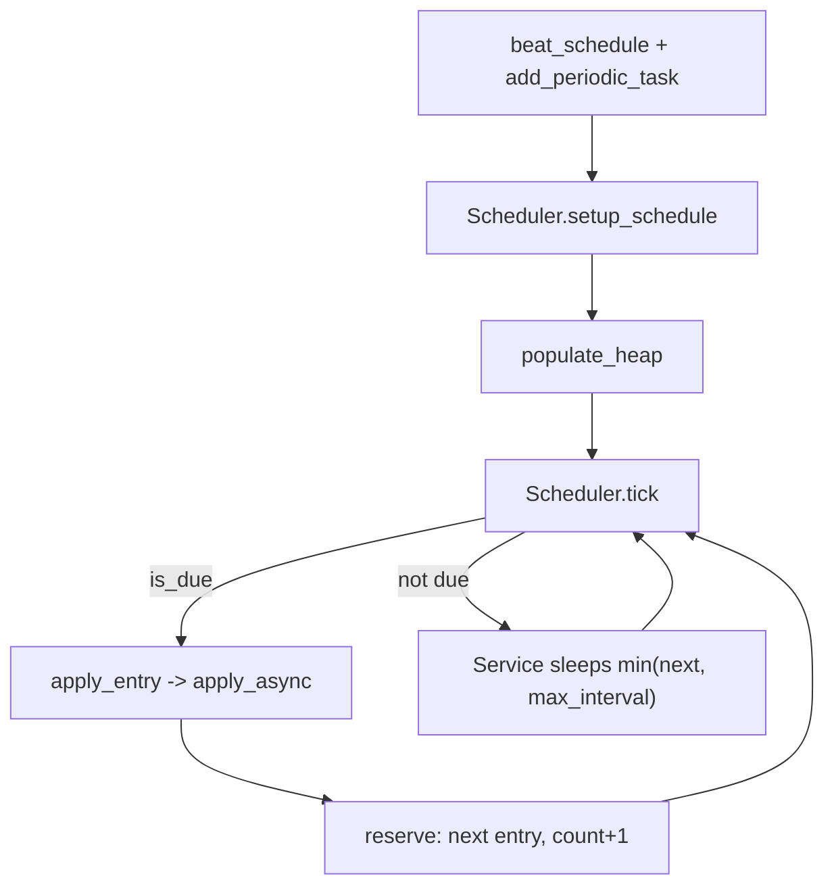

## Overview

Beat is a separate process that sends task messages when they are due. It never runs tasks: it keeps a schedule of entries, wakes up when the soonest entry is due, publishes that task through the same path as any other caller ([[Publishing Tasks]]) and goes back to sleep. The pieces are a schedule type that answers "is this due?" (`schedule`, `crontab`, `solar`), a `ScheduleEntry` that pairs a schedule with a task and remembers when it last ran, a `Scheduler` that keeps entries in a time-ordered heap, and a `Service` that loops on the scheduler.

Sources: [celery/schedules.py:65-110](repo://celery/schedules.py#L65-L110), [celery/beat.py:82-130](repo://celery/beat.py#L82-L130), [celery/beat.py:219-264](repo://celery/beat.py#L219-L264), [celery/beat.py:612-660](repo://celery/beat.py#L612-L660)

Sources: [celery/beat.py:279-290](repo://celery/beat.py#L279-L290), [celery/beat.py:326-364](repo://celery/beat.py#L326-L364), [celery/beat.py:633-655](repo://celery/beat.py#L633-L655)

## Defining the schedule

Entries come from the `beat_schedule` setting, a dict of name to a dict with `task`, `schedule`, and optionally `args`, `kwargs` and `options`. `app.add_periodic_task(schedule, sig, ...)` adds to the same dict, keyed by `name` or by the signature's repr. If the configuration is not loaded yet, the entry is queued in `_pending_periodic_tasks` and added when `_load_config` runs. An unnamed entry that reuses a key logs a warning that it shadowed an earlier one.

Sources: [celery/app/base.py:1295-1333](repo://celery/app/base.py#L1295-L1333), [celery/app/base.py:1268-1280](repo://celery/app/base.py#L1268-L1280)

`ScheduleEntry` stores `name`, `task`, `args`, `kwargs`, `options`, the `schedule`, `last_run_at` and `total_run_count`. Its constructor turns a number or `timedelta` into a `schedule` object with `maybe_schedule`, and `last_run_at` defaults to now. Calling `next()` on an entry returns a new entry of the same class with a refreshed `last_run_at` and the run count increased by one, which is how the scheduler advances state without mutating the old entry. Only the fields `task`, `schedule`, `args`, `kwargs` and `options` count for equality and for `update`, so a changed configuration is detected while run history is kept.

Sources: [celery/beat.py:82-200](repo://celery/beat.py#L82-L200), [celery/schedules.py:703-714](repo://celery/schedules.py#L703-L714)

Arguments may contain `BeatLazyFunc` values. `_evaluate_entry_args` and `_evaluate_entry_kwargs` call each one just before the task is sent, so a value such as the current time is computed per run, not once when the schedule is defined.

Sources: [celery/beat.py:50-80](repo://celery/beat.py#L50-L80), [celery/beat.py:201-217](repo://celery/beat.py#L201-L217)

## Schedule types

Every schedule implements `is_due(last_run_at)`, returning a `schedstate(is_due, next)` where `next` is the number of seconds until it should be checked again, and `remaining_estimate`, the time left until the next run. `BaseSchedule` provides `now()` (from a `nowfun` or the app clock), timezone helpers and equality on `nowfun`.

Sources: [celery/schedules.py:24](repo://celery/schedules.py#L24), [celery/schedules.py:65-110](repo://celery/schedules.py#L65-L110)

| Type | Defined by | How `is_due` decides |
| --- | --- | --- |
| `schedule` | `run_every` seconds or `timedelta`, optional `relative` | Remaining time is `run_every` since `last_run_at`; due when it is zero, then the next check is a full interval away |
| `crontab` | minute, hour, day of week, day of month, month of year | Computes the next matching time with cron semantics and reports remaining seconds |
| `solar` | solar `event`, `lat`, `lon` | Computes the next occurrence of the event at that location with the `ephem` library |

Sources: [celery/schedules.py:111-170](repo://celery/schedules.py#L111-L170), [celery/schedules.py:323-345](repo://celery/schedules.py#L323-L345), [celery/schedules.py:717-740](repo://celery/schedules.py#L717-L740), [celery/schedules.py:794-800](repo://celery/schedules.py#L794-L800), [celery/schedules.py:863-885](repo://celery/schedules.py#L863-L885)

`crontab.is_due` supports `beat_cron_starting_deadline`. When set, it looks for the most recent time the schedule should have run since `last_run_at`, and if that time is further in the past than the deadline in seconds, the entry is not due. This stops a beat that was down for a while from firing a stale cron slot on startup.

Sources: [celery/schedules.py:641-701](repo://celery/schedules.py#L641-L701)

## The tick loop

`Scheduler` keeps the entries in `schedule` and a heap of `(time, priority, entry)` tuples, `event_t`. `populate_heap` asks every entry `is_due()` and files it at the time `_when` returns, the current time plus the delay to its next run, with `adjust` subtracting a 10 ms drift so beat wakes slightly early. `tick` rebuilds the heap whenever `schedules_equal` finds the schedule changed (a new, removed or edited entry), so schedule changes made at runtime are picked up on the next tick.

Sources: [celery/beat.py:37](repo://celery/beat.py#L37), [celery/beat.py:292-324](repo://celery/beat.py#L292-L324), [celery/beat.py:366-380](repo://celery/beat.py#L366-L380)

Each `tick` runs at most one due entry:

Sources: [celery/beat.py:326-364](repo://celery/beat.py#L326-L364)

1. If the heap is empty it returns `max_interval`.
2. It looks at the entry at the top of the heap and asks `is_due`.
3. If due, it pops the event, checks that it was the one it peeked at, calls `reserve(entry)` to store `next(entry)` as the new entry in the schedule, calls `apply_entry`, pushes the new entry back with the time of its next run and returns `0` so the caller ticks again immediately.
4. If not due, it returns the time to wait, capped by `max_interval`.

Sources: [celery/beat.py:326-364](repo://celery/beat.py#L326-L364), [celery/beat.py:389-391](repo://celery/beat.py#L389-L391)

`max_interval` is the longest beat sleeps without rechecking the schedule. It comes from the argument, `beat_max_loop_interval` or the class default `DEFAULT_MAX_INTERVAL` of 300 seconds, so a schedule changed in a database is noticed at least that often.

Sources: [celery/beat.py:43](repo://celery/beat.py#L43), [celery/beat.py:252-266](repo://celery/beat.py#L252-L266)

## Sending the task

`apply_entry` logs the send and calls `apply_async(entry, advance=False)`, since `tick` has already advanced the entry. `Scheduler.apply_async` evaluates lazy arguments, then uses the registered task's `apply_async` with the entry's options and a producer, or `send_task` by name if the task is not registered in this process. This allows beat to schedule tasks that only the workers know. Any exception becomes a `SchedulingError`, and in `finally` the sync counter is incremented and the schedule is synced when due.

Sources: [celery/beat.py:279-290](repo://celery/beat.py#L279-L290), [celery/beat.py:393-421](repo://celery/beat.py#L393-L421)

The producer comes from `Scheduler.producer`, which opens a connection with `_ensure_connected`, retrying up to `broker_connection_max_retries` and logging each failure, and creates the producer with `auto_declare=False`.

Sources: [celery/beat.py:474-500](repo://celery/beat.py#L474-L500)

`install_default_entries` adds a daily `celery.backend_cleanup` entry (a `crontab('0', '4', '*')` with a 12-hour expiry) when `result_expires` is set and the backend does not expire results itself.

Sources: [celery/beat.py:268-277](repo://celery/beat.py#L268-L277)

## Keeping the schedule between runs

The base `Scheduler` is in-memory. `setup_schedule` installs the default entries and calls `merge_inplace(app.conf.beat_schedule)`, which drops entries that are no longer in the configuration, updates the editable fields of existing ones and creates new ones. `sync` is a no-op for it.

Sources: [celery/beat.py:423-440](repo://celery/beat.py#L423-L440), [celery/beat.py:458-472](repo://celery/beat.py#L458-L472)

`PersistentScheduler`, the default (`beat_scheduler` is `celery.beat:PersistentScheduler`), keeps the entries in a `shelve` file named by `beat_schedule_filename`, so `last_run_at` and run counts survive a restart and a task is not re-sent for a slot it already served. Opening the file is defensive: an unreadable file is deleted (all known suffixes, `.db`, `.dat`, `.bak` and `.dir`) and recreated, and a file from an older release missing the `__version__`, `tz` or `utc_enabled` fields is cleared.

Sources: [celery/beat.py:505-530](repo://celery/beat.py#L505-L530), [celery/beat.py:569-591](repo://celery/beat.py#L569-L591), [celery/app/defaults.py:70-80](repo://celery/app/defaults.py#L70-L80)

The stored schedule is reset when the configured timezone or the `enable_utc` setting differs from what was saved with it, because stored `last_run_at` values would be misread under a different zone. After merging the configured schedule and default entries it writes the version, timezone and UTC flag and calls `sync()`. The scheduler syncs again after `sync_every_tasks` tasks (from the `beat_sync_every` setting) or after `sync_every` seconds, 3 minutes by default, and at close.

Sources: [celery/beat.py:531-567](repo://celery/beat.py#L531-L567), [celery/beat.py:240-250](repo://celery/beat.py#L240-L250), [celery/beat.py:381-388](repo://celery/beat.py#L381-L388), [celery/beat.py:599-606](repo://celery/beat.py#L599-L606)

## The Service and running beat

`Service.start` sends `beat_init`, and in the embedded case `beat_embedded_init` and sets the process title, then loops until a shutdown event is set. Each turn calls `scheduler.tick()`; if the result is positive it sleeps that long and then syncs if due. On `KeyboardInterrupt` or `SystemExit` it sets the shutdown flag, and a `finally` always calls `sync`, which closes the scheduler. The scheduler class is resolved by `get_scheduler` through `symbol_by_name`, with aliases from the `celery.beat_schedulers` entry-point namespace.

Sources: [celery/beat.py:612-680](repo://celery/beat.py#L612-L680)

`celery beat` is the `Beat` class in `celery/apps/beat.py`. Its `run` prints the banner, initializes the loader and finalizes the app, sets the process title and calls `start_scheduler`, which creates the pidfile lock, builds the `Service`, sets up logging, applies `socket_timeout`, installs a `SIGTERM`/`SIGINT` handler that syncs the schedule before exiting, and calls `service.start()`.

Sources: [celery/apps/beat.py:78-134](repo://celery/apps/beat.py#L78-L134), [celery/apps/beat.py:155-160](repo://celery/apps/beat.py#L155-L160)

`EmbeddedService` is what `celery worker -B` uses. It returns a `_Process` (a multiprocessing `Process`) by default, or a `_Threaded` daemon thread when `thread=True` or multiprocessing is unavailable. The thread variant forces `max_interval=1` so it can stop quickly. The worker's `Beat` bootstep refuses this under eventlet or gevent ([[Worker Startup and Bootsteps]]).

Sources: [celery/beat.py:682-738](repo://celery/beat.py#L682-L738), [celery/worker/components.py:181-206](repo://celery/worker/components.py#L181-L206)
