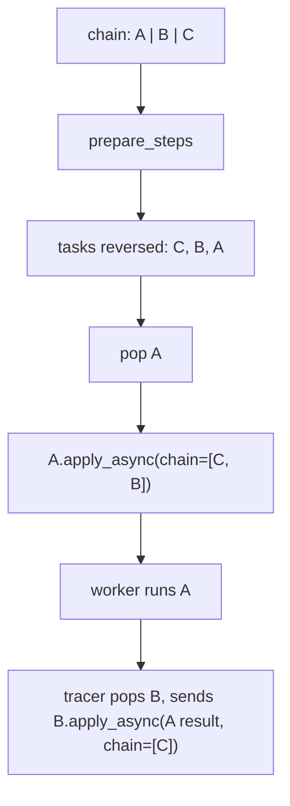

## Overview

The canvas is Celery's way of describing work as data. A `Signature` bundles a task name, arguments and execution options in a dict that can be serialized, stored, sent as a callback or composed with other signatures. A `chain` runs signatures one after another, passing each result to the next. Both are defined in `celery/canvas.py`, together with `group` and `chord`, which run signatures in parallel and are covered in [[Groups and Chords]].

Sources: [celery/canvas.py:233-296](repo://celery/canvas.py#L233-L296), [celery/canvas.py:935-958](repo://celery/canvas.py#L935-L958)

The central design point is that a chain is not run by the client step by step. The client turns the chain into a message for the first task and puts the remaining tasks in that message's `chain` field; the worker that finishes a task sends the next one, as part of the tracer's callback dispatch ([[Receiving and Executing Tasks]]).

Sources: [celery/canvas.py:1048-1094](repo://celery/canvas.py#L1048-L1094), [celery/app/trace.py:426-473](repo://celery/app/trace.py#L426-L473)

## Signature as a dict

`Signature` subclasses `dict`. Its constructor stores `task` (the name), `args`, `kwargs`, `options`, `subtask_type` and `immutable` as dict keys, and, when given a task object instead of a name, remembers it in `_type`. Because it is a dict it serializes with any serializer, and `getitem_property` exposes the keys as attributes such as `id`, `options` and `immutable`. The task is found with `_type`, or looked up in `app.tasks` by name.

Sources: [celery/canvas.py:323-345](repo://celery/canvas.py#L323-L345), [celery/canvas.py:836-875](repo://celery/canvas.py#L836-L875)

A signature is turned back into the right class by `from_dict`, which reads `subtask_type` and dispatches to the class registered under that name with `register_type`. This is how a dict arriving in a message becomes a `chain` or `chord` again. `signature()` and `maybe_signature()` are the helpers used everywhere to accept either an object or its dict form, and `maybe_signature` can bind the signature to an app and optionally clone it.

Sources: [celery/canvas.py:297-321](repo://celery/canvas.py#L297-L321), [celery/canvas.py:2395-2442](repo://celery/canvas.py#L2395-L2442)

Calling a signature has several forms:

Sources: [celery/canvas.py:347-401](repo://celery/canvas.py#L347-L401)

| Method | Effect |
| --- | --- |
| `sig(...)` | Calls the task directly in this process after merging the partial arguments |
| `sig.apply(...)` | Runs the task locally through `Task.apply` |
| `sig.apply_async(...)` / `sig.delay(...)` | Merges partial arguments and options and sends a message |

Sources: [celery/canvas.py:347-401](repo://celery/canvas.py#L347-L401)

`apply_async` resolves the target with the `_apply_async` property: the task's own `apply_async`, or `app.send_task` with the task name when the task is not registered locally. Options set to `None` are dropped before merging.

Sources: [celery/canvas.py:370-401](repo://celery/canvas.py#L370-L401), [celery/canvas.py:859-863](repo://celery/canvas.py#L859-L863)

## Partial arguments, cloning and freezing

`_merge` implements partial application. New positional arguments are prepended to the stored ones and new keyword arguments are merged over them. If the signature is `immutable` (created with `si()`), the stored args and kwargs are returned unchanged unless `force` is set. Options are merged with the new values overriding, except for `group_id` and any stamped header, which are never overridden once set.

Sources: [celery/canvas.py:294](repo://celery/canvas.py#L294), [celery/canvas.py:403-443](repo://celery/canvas.py#L403-L443)

`clone` makes a copy through `from_dict` with a deep copy of the options, so that links and headers set on the copy do not alter the original. `replace` clones and then replaces whichever of args, kwargs or options is given, and `set` updates the options in place and returns the signature for chaining.

Sources: [celery/canvas.py:445-471](repo://celery/canvas.py#L445-L471), [celery/canvas.py:524-552](repo://celery/canvas.py#L524-L552)

`freeze` fixes the signature's identity before it is sent. It stores a `task_id` in the options, using the existing one, else the given `_id`, else a new UUID, and also records `root_id`, `parent_id`, `group_id`, `group_index` and the chord body when provided. It sets `reply_to` to the app's `thread_oid` and returns an `AsyncResult` for the id without calling the task. Freezing is how a workflow knows every task's id, and so the result tree, before anything is published.

Sources: [celery/canvas.py:473-522](repo://celery/canvas.py#L473-L522)

## Links and error links

`link(callback)` appends to the `link` option, and `link_error(errback)` to `link_error`; `on_error` is a version of `link_error` that returns the original signature so it can be used inside an expression. Both go through `append_to_list_option`, which keeps a list in the options and ignores a duplicate. `flatten_links` returns the signature and the signatures it links to recursively.

Sources: [celery/canvas.py:685-757](repo://celery/canvas.py#L685-L757)

The callbacks travel in the message body's embed dict and are dispatched by the tracer after a successful run, as described in [[Receiving and Executing Tasks]]; error callbacks are called from the backend when a failure is stored ([[Retries, Failures and Acknowledgement]]).

Sources: [celery/app/amqp.py:399-406](repo://celery/app/amqp.py#L399-L406), [celery/backends/base.py:250-252](repo://celery/backends/base.py#L250-L252)

## The pipe operator

`Signature.__or__` implements `add.s(2, 2) | add.s(4)`. A task piped to a chain is concatenated in front of the chain's tasks, a group with one member is unrolled by `maybe_unroll_group`, a group piped after a task becomes a chain whose last step is the group, and any other signature produces a new `_chain`.

Sources: [celery/canvas.py:43-58](repo://celery/canvas.py#L43-L58), [celery/canvas.py:759-786](repo://celery/canvas.py#L759-L786)

`_chain.__or__` has a rule for each right-hand type:

Sources: [celery/canvas.py:960-1006](repo://celery/canvas.py#L960-L1006)

| Left | Right | Result |
| --- | --- | --- |
| chain | group | chain with the group appended; if the chain ends with a chord, the group is piped onto the chord body |
| chain | chain | chain of both, joined by reduction |
| chain ending in group | task | the group becomes a `chord` with the task as body |
| chain ending in chord | task | the task is piped onto the chord body |
| chain | other signature | chain with it appended |

Sources: [celery/canvas.py:960-1006](repo://celery/canvas.py#L960-L1006)

The `chain(...)` constructor reduces its arguments with the same operator, so `chain(X, Y, Z)` behaves exactly like `X | Y | Z`.

Sources: [celery/canvas.py:1322-1383](repo://celery/canvas.py#L1322-L1383)

`unchain_tasks` returns clones of the chain's tasks with the chain's `link` signatures attached to the last one and its `link_error` signatures attached to every one. This lets a chain-level errback fire whichever step fails.

Sources: [celery/canvas.py:1017-1034](repo://celery/canvas.py#L1017-L1034)

## Running a chain

`apply_async` sends the chain unless `task_always_eager` is on, where it applies it locally. Otherwise `run` calls `prepare_steps`, takes the first task (the last element of the reversed list), builds the options for it with `_prepare_chain_from_options` and calls its `apply_async`. When the chain has only one task, it returns the real result of that task. Otherwise it returns the result of the last task in the chain, from the frozen results of `prepare_steps`, whose `parent` links point back through the chain.

Sources: [celery/canvas.py:1036-1094](repo://celery/canvas.py#L1036-L1094)

`_prepare_chain_from_options` decides how the remaining tasks are passed. With `use_link` (protocol 1) it sets `chain` to `None`, because each task is linked to the next instead. Otherwise it sets the `chain` option to the remaining tasks, or concatenates them to an existing `chain` option. It uses a `ChainMap` and builds a new list rather than extending the old one, since the same options dictionary is shared by every task of a group and mutating it would leak one branch's remaining tasks into another.

Sources: [celery/canvas.py:877-933](repo://celery/canvas.py#L877-L933)

Sources: [celery/canvas.py:1048-1094](repo://celery/canvas.py#L1048-L1094), [celery/app/trace.py:463-473](repo://celery/app/trace.py#L463-L473)

## Preparing the steps

`prepare_steps` does the real work of turning nested canvas objects into a flat, ordered list of frozen tasks. It walks the steps in reverse, popping from the end, so that the list it builds is already in the order the worker needs: the worker simply takes `chain.pop()` for the next task. For each step:

Sources: [celery/canvas.py:1176-1292](repo://celery/canvas.py#L1176-L1292)

1. A dict is converted with `from_dict`. A group with one member is unrolled with `maybe_unroll_group`, and an empty group is skipped when other steps exist.
2. The first task gets the chain's partial `args` and `kwargs`, through `clone(args, kwargs)`, or by prepending the args when cloning is off.
3. A nested chain is spliced in: its tasks are pushed back onto the step stack, so `chain(a, chain(b, c))` becomes `chain(a, b, c)`.
4. A group that has a following step is upgraded to a `chord` whose body is the following task. The previous task and result are popped and replaced by the chord, built with the previous result's task id when it has one.
5. The last task is frozen with the chain's `last_task_id`, `group_id` and the chord body, so that the last task is the one that completes an enclosing group or chord. Other tasks are frozen with only the `root_id`.
6. Each task's result `parent` is set to the next result, so `AsyncResult.parent` walks back through the chain. With `use_link`, each task is also `link`ed to the previous step.
7. A chain-level `link_error` is added to each task, and also to the body of a chord so an error in the header reaches the errback.
8. For a chord step, the backend must support chords (`ensure_chords_allowed`), and the stored previous result is moved to the root of the chord's result tree, the header's group result.

Sources: [celery/canvas.py:1120-1160](repo://celery/canvas.py#L1120-L1160), [celery/canvas.py:1176-1292](repo://celery/canvas.py#L1176-L1292)

`freeze` for a chain calls `prepare_steps` with `clone=False` and stores the result in `_frozen`, returning the result of the first element, which is the last task of the chain. `apply` is the eager path: it applies each task in turn, feeding `last.get()` to the next and linking the results as parents.

Sources: [celery/canvas.py:1096-1105](repo://celery/canvas.py#L1096-L1105), [celery/canvas.py:1294-1303](repo://celery/canvas.py#L1294-L1303)

## Stamping

Stamping attaches extra headers to a whole workflow after it is built. `Signature.stamp(visitor, append_stamps, **headers)` first stamps the signature's links, asks the visitor's `on_signature` for headers, merges them and sets them as options. The `stamped_headers` option lists which keys are stamps; those stamps are copied into the message's `stamps` header when it is built ([[Publishing Tasks]]), and revocation by stamped header uses them ([[Remote Control and Revoking]]).

Sources: [celery/canvas.py:554-634](repo://celery/canvas.py#L554-L634), [celery/app/amqp.py:370-391](repo://celery/app/amqp.py#L370-L391)

`StampingVisitor` is the abstract base of a stamping strategy. It requires `on_signature` and offers hooks for the start and end of groups and chains, a chord's header and body, and callbacks and errbacks; each returns a dict of headers to add. Chains stamp every task through the same visitor: `_chain.stamp` calls `on_chain_start`, stamps its links and each task, then calls `on_chain_end`.

Sources: [celery/canvas.py:119-231](repo://celery/canvas.py#L119-L231), [celery/canvas.py:1107-1118](repo://celery/canvas.py#L1107-L1118)

`_stamp_headers` merges stamps from the explicit headers, the visitor and the signature's own options. With `append_stamps` false a duplicated stamp key takes the visitor's value, and with it true duplicates are combined into a list. When stamping links, `self_headers` is turned off so a callback does not inherit the stamps of the signature it is linked to.

Sources: [celery/canvas.py:554-612](repo://celery/canvas.py#L554-L612), [celery/canvas.py:636-683](repo://celery/canvas.py#L636-L683)
