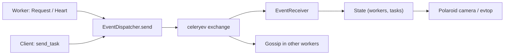

## Overview

Events are small messages that workers and clients publish to describe what is happening: a worker came online, a task was received, started or failed. They are separate from task messages and from remote control. They go to their own exchange, and anything that wants to monitor the cluster, such as `celery events`, a snapshot camera or the workers themselves, subscribes to that exchange. An event is a plain dict with a `type` such as `task-received`, where the part before the first dash is the group (`task`, `worker`).

Sources: [celery/events/event.py:11-43](repo://celery/events/event.py#L11-L43)

Sources: [celery/events/dispatcher.py:164-199](repo://celery/events/dispatcher.py#L164-L199), [celery/events/receiver.py:23-35](repo://celery/events/receiver.py#L23-L35), [celery/events/state.py:398-440](repo://celery/events/state.py#L398-L440)

## The event exchange

Events use a topic exchange named `celeryev`, built by `get_exchange`. On the `redis` and `gcpubsub` transports, where topic routing is not supported, the exchange type is changed to `fanout`. The routing key is the event type with dashes turned into dots, so `task-started` is published as `task.started`, which lets a receiver subscribe to `task.#` or `worker.#`.

Sources: [celery/events/event.py:11-15](repo://celery/events/event.py#L11-L15), [celery/events/event.py:46-63](repo://celery/events/event.py#L46-L63), [celery/events/dispatcher.py:116-141](repo://celery/events/dispatcher.py#L116-L141)

`Event(type, **fields)` just returns the fields dict with `type` and a `timestamp` set, and `group_from` returns the part of the type before the first dash.

Sources: [celery/events/event.py:18-43](repo://celery/events/event.py#L18-L43)

## Sending events

`EventDispatcher` publishes events. Its constructor takes a connection or channel, the hostname, whether it is `enabled`, an optional set of `groups` to send, and the buffering options. It disables itself on the `sql` transport (`DISABLED_TRANSPORTS`) and creates a producer when enabled. `enable` and `disable` run the `on_enabled` and `on_disabled` callbacks, which is how the heartbeat starts and stops along with the dispatcher.

Sources: [celery/events/dispatcher.py:19-115](repo://celery/events/dispatcher.py#L19-L115)

`send(type, **fields)` first filters by group: if the dispatcher was created with `groups` and the event's group is not among them, it returns without sending. This is how a worker started without task events still sends `worker-*` events, and how `enable_events` can add the `task` group later. Events whose group is in `buffer_group` are stored in a per-group list and flushed when the list reaches `buffer_limit` (24 by default) or through the `on_send_buffered` callback. All others go straight to `publish`.

Sources: [celery/events/dispatcher.py:164-199](repo://celery/events/dispatcher.py#L164-L199)

`publish` creates the event with the next value of the app's logical clock (`clock.forward()`, skipped for `blind` events), the hostname, pid and the UTC offset, and publishes it under the topic routing key, holding the dispatcher's mutex. If publishing fails and `buffer_while_offline` is on, the event is appended to an outbound buffer instead of raising. `flush` later republishes the buffered events, and grouped events as one `<group>.multi` message with a list of events.

Sources: [celery/events/dispatcher.py:116-163](repo://celery/events/dispatcher.py#L116-L163), [celery/events/dispatcher.py:201-218](repo://celery/events/dispatcher.py#L201-L218)

## Events in the worker

The `Events` consumer step builds the worker's dispatcher on the consumer's write connection. If task events are off, it restricts the dispatcher to the `worker` group. It buffers `task` events only when the event loop is in use, and when the connection is restarted it creates a new dispatcher, copies the old buffer into it, flushes it and points the reserved requests at the new dispatcher. The step is enabled when any of task events, gossip or heartbeats is wanted.

Sources: [celery/worker/consumer/events.py:15-71](repo://celery/worker/consumer/events.py#L15-L71)

Task events come from three places. The strategy sends `task-received` as soon as it builds the `Request`; `Request` sends `task-started`, `task-succeeded`, `task-failed`, `task-retried`, `task-revoked`, `task-rejected` and `task-cancelled` at the matching points described in [[Retries, Failures and Acknowledgement]]; and a client that has `task_send_sent_event` on publishes `task-sent` right after publishing a task message ([[Publishing Tasks]]).

Sources: [celery/worker/strategy.py:165-177](repo://celery/worker/strategy.py#L165-L177), [celery/worker/request.py:511-527](repo://celery/worker/request.py#L511-L527), [celery/app/amqp.py:593-604](repo://celery/app/amqp.py#L593-L604)

## Heartbeats

The `Heart` step starts a `Heart` helper that sends `worker-online` when it starts, then `worker-heartbeat` every `interval` seconds (2 by default) through the timer, and `worker-offline` when it stops. Each heartbeat carries the frequency, the number of active requests, the total processed count, the load average and the software identity. This is separate from AMQP protocol heartbeats, which the docstring of the step points out.

Sources: [celery/worker/consumer/heart.py:8-36](repo://celery/worker/consumer/heart.py#L8-L36), [celery/worker/heartbeat.py:14-61](repo://celery/worker/heartbeat.py#L14-L61)

## Receiving events

`EventReceiver` is a kombu `ConsumerMixin` that consumes the events exchange. It declares a queue named `<event_queue_prefix>.<node_id>` bound with routing key `#` by default, and the queue options come from the `event_queue_ttl`, `event_queue_expires`, `event_queue_exclusive` and `event_queue_durable` settings. It rejects a queue that is both exclusive and durable. A message that is a list is treated as a batch of events, so the `<group>.multi` messages from the dispatcher are unpacked.

Sources: [celery/events/receiver.py:23-79](repo://celery/events/receiver.py#L23-L79), [celery/events/receiver.py:140-146](repo://celery/events/receiver.py#L140-L146)

For each event, `event_from_message` merges clocks: a `task-sent` event from a client is given the receiver's own clock plus a skew, because clients never synchronize clocks, and other events adjust the local clock to the event's value, or take the next local tick when they have none. It then adjusts the timestamp by the sender's UTC offset and records `local_received`. `process` calls the handler registered for the event type, or the `*` handler. `capture` loops forever consuming, and on startup `wakeup_workers` broadcasts the `heartbeat` control command, so monitors learn about existing workers immediately ([[Remote Control and Revoking]]).

Sources: [celery/events/receiver.py:80-139](repo://celery/events/receiver.py#L80-L139)

## Tracking cluster state

`State` turns the event stream into an in-memory model of the cluster. It keeps `workers` and `tasks` as LRU caches (5,000 workers and 10,000 tasks by default), indexes of tasks by type and by worker, and a time-ordered heap of task events. `event(event)` takes a mutex and calls a dispatcher function built once by `_create_dispatcher`.

Sources: [celery/events/state.py:398-450](repo://celery/events/state.py#L398-L450), [celery/events/state.py:501-512](repo://celery/events/state.py#L501-L512)

The dispatcher function splits the type at the first dash into group and subject. A `worker` event finds or creates the `Worker` record and passes the event to its handler; `online` or a new worker calls `on_node_join`, and `offline` calls `on_node_leave` and removes the worker. A `task` event finds or creates a `Task`, attaches the worker (or the client for `task-sent`), pushes a time-tuple on the heap in clock order, applies the event to the task, adds new tasks to the by-type and by-worker indexes, and links a task to its parent through `parent_id`, holding a task whose parent has not arrived yet in `_tasks_to_resolve`.

Sources: [celery/events/state.py:520-635](repo://celery/events/state.py#L520-L635)

`Worker.event` appends each heartbeat's receive time to `heartbeats`, keeping at most four, and warns when the drift between the local receive time and the event time exceeds `HEARTBEAT_DRIFT_MAX` (16 seconds). A worker is `alive` when the current time is before its last heartbeat plus `freq` plus the expire window (`HEARTBEAT_EXPIRE_WINDOW`, 200 seconds); an `offline` event clears the heartbeats.

Sources: [celery/events/state.py:48-52](repo://celery/events/state.py#L48-L52), [celery/events/state.py:149-241](repo://celery/events/state.py#L149-L241)

`Task.event` maps the event type to a state and handles events that arrive out of order. If the new state logically precedes the current one (using state precedence), it is not applied, except for the fields listed in `merge_rules` for that state, so a late `task-received` can still fill in the name and arguments without moving the task back. Retry is exempt from the precedence check.

Sources: [celery/events/state.py:243-333](repo://celery/events/state.py#L243-L333)

## Snapshots and the command line

`Polaroid` is a camera that periodically captures a frozen copy of the state. `install` schedules `capture` every `freq` seconds, and `capture` freezes the state while running `shutter`, which sends a `shutter_signal` and calls the `on_shutter` hook, subject to an optional `maxrate` token bucket. A second timer runs `cleanup` every `cleanup_freq` seconds (hourly by default). Subclasses implement `on_shutter` to save, print or ship the state.

Sources: [celery/events/snapshot.py:24-76](repo://celery/events/snapshot.py#L24-L76)

`evcam` is the function behind `celery events --camera`. It creates a `State`, instantiates the camera class with it, installs the camera and runs a receiver with the state's `event` as the `*` handler, capturing until interrupted and cancelling the camera in a `finally`. The `celery events` command dispatches to `evdump`, `evcam` or the curses `evtop` monitor ([[Command Line Interface]]).

Sources: [celery/events/snapshot.py:86-111](repo://celery/events/snapshot.py#L86-L111), [celery/bin/events.py:18-47](repo://celery/bin/events.py#L18-L47), [celery/bin/events.py:83-98](repo://celery/bin/events.py#L83-L98)

## Gossip between workers

`Gossip` lets workers watch each other through the same event stream. It is a consumer step, enabled unless `without_gossip` is given and only on the `amqp` and `redis` transports, and it requires `Mingle`. It keeps its own `State` with `max_tasks_in_memory=1`, so it tracks workers but not tasks, and subscribes to `worker.#` events through a `Receiver` whose messages expire after the heartbeat interval (`queue_ttl`).

Sources: [celery/worker/consumer/gossip.py:23-76](repo://celery/worker/consumer/gossip.py#L23-L76), [celery/worker/consumer/gossip.py:171-206](repo://celery/worker/consumer/gossip.py#L171-L206)

A periodic timer (`interval`, 5 seconds by default) calls `periodic`, which finds workers whose heartbeats have expired, calls `on_node_lost` for each and drops them from the state. The `node_join`, `node_leave` and `node_lost` handler sets let other components react, and errors from a handler are logged and ignored.

Sources: [celery/worker/consumer/gossip.py:136-170](repo://celery/worker/consumer/gossip.py#L136-L170)

Gossip also runs a simple election, triggered by the `election` control command. `election` records an empty reply list for the id and sends a `worker-elect` event. Every worker that receives it pushes `(clock, hostname.pid, topic, action)` onto a heap for that election id and sends `worker-elect-ack`. When the initiating worker has acknowledgements from all workers it sees as alive, it sorts the heap with the logical clock, and the entry that comes back names the leader. If the leader is itself, it runs the handler for the topic. The only built-in topic is `task`, which publishes the signature given as the action.

Sources: [celery/worker/consumer/gossip.py:77-135](repo://celery/worker/consumer/gossip.py#L77-L135), [celery/worker/control.py:331-342](repo://celery/worker/control.py#L331-L342), [celery/app/control.py:480-486](repo://celery/app/control.py#L480-L486)
