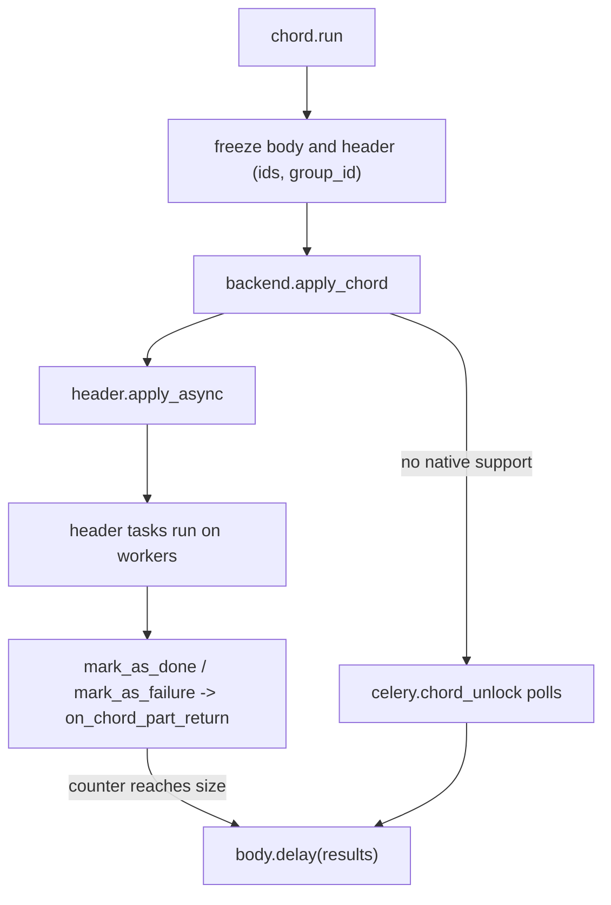

## Overview

A `group` publishes several tasks at once and returns a `GroupResult` that tracks them. A `chord` is a group, its header, plus a callback, its body, that must run after every header task has finished and receives the list of their return values. The group part is a client-side fan-out; the chord part needs something to notice the last header task finishing, and that is done by the result backend, either through an atomic counter or by polling. Basic signature handling is on [[Signatures and Chains]], and result storage is on [[Result Backends]].

Sources: [celery/canvas.py:1580-1593](repo://celery/canvas.py#L1580-L1593), [celery/canvas.py:2064-2072](repo://celery/canvas.py#L2064-L2072)

Sources: [celery/canvas.py:2226-2286](repo://celery/canvas.py#L2226-L2286), [celery/backends/base.py:864-867](repo://celery/backends/base.py#L864-L867), [celery/backends/base.py:180-186](repo://celery/backends/base.py#L180-L186)

## Running a group

`group.apply_async` rejects `link` and `link_error` with `TypeError`: callbacks belong on individual tasks, or on a chord. Under `task_always_eager` it applies locally, and an empty group just freezes. Otherwise it calls `_freeze_gid`, which takes the group's `task_id` option as the group id (or a new UUID) and returns it with the root id, prepares and applies the tasks with a barrier, and returns `GroupResult(group_id, results, ready_barrier=p)`.

Sources: [celery/canvas.py:1616-1650](repo://celery/canvas.py#L1616-L1650), [celery/canvas.py:1827-1837](repo://celery/canvas.py#L1827-L1837)

`_prepared` yields `(task, result, group_id)` for every task. It clones each signature so the originals are untouched, converts serialized signatures with `from_dict`, flattens nested groups by recursing, prepends partial arguments to non-immutable tasks and freezes each task with its `group_id` and `group_index`. `_apply_tasks` then publishes each one on a single producer with `add_to_parent=False`, adds each result to the barrier so the group becomes ready when all have, and yields the results.

Sources: [celery/canvas.py:1714-1761](repo://celery/canvas.py#L1714-L1761), [celery/canvas.py:1763-1825](repo://celery/canvas.py#L1763-L1825)

While publishing, `_apply_tasks` also counts how many results the group will produce. It adds `_chord._descend(sig)` for each task, which counts a plain signature as 1, a nested group as the sum of its tasks, a chain as the size of its last non-empty step and a chord as the size of its body. When the group is a chord header and the last task is reached, it calls `backend.set_chord_size(group_id, chord_size)`. The loop looks one task ahead to know when it is at the end, without consuming a generator.

Sources: [celery/canvas.py:1763-1825](repo://celery/canvas.py#L1763-L1825), [celery/canvas.py:2191-2224](repo://celery/canvas.py#L2191-L2224)

`group.freeze` returns a `GroupResult` without sending anything. `_freeze_group_tasks` records the group id, root and parent ids and chord, and then freezes the tasks. For a lazy (`regen`) task generator it uses `itertools.tee` to freeze one copy and keep the other unexhausted; otherwise it flattens nested groups early so a chord gets the right result instances.

Sources: [celery/canvas.py:1839-1912](repo://celery/canvas.py#L1839-L1912), [celery/canvas.py:1913-1947](repo://celery/canvas.py#L1913-L1947)

`group | task` builds a `chord(group, body=task)`, except that piping an empty group returns the group itself.

Sources: [celery/canvas.py:1598-1607](repo://celery/canvas.py#L1598-L1607)

## Running a chord

`chord(header, body)` stores `header` (converted to a group by `_maybe_group`) and `body` in the signature's kwargs and sets the subtask type to `chord`. `chord | task` attaches the task to the body as `body | task`, so a chord never becomes a chain.

Sources: [celery/canvas.py:2064-2092](repo://celery/canvas.py#L2064-L2092)

`chord.freeze` freezes the header group first, with the chord body attached as the `chord` option of every header task. It then freezes the body. If the body is itself a chain, the first result in its parent line without a parent becomes a child of the header result, so the result tree runs header, then body.

Sources: [celery/canvas.py:2094-2125](repo://celery/canvas.py#L2094-L2125)

`chord.run` is where everything is sequenced:

Sources: [celery/canvas.py:2226-2286](repo://celery/canvas.py#L2226-L2286)

1. It takes `group_id` from the header's `task_id` (or a new UUID) and generates the body's task id.
2. It freezes the body, then removes `chain`, `chord` and `task_id` from the options, because a chain or chord must not be passed down to header tasks, which would break deeply nested chords.
3. It freezes the header tasks with `chord=body` and gets back `(group_id, results)`.
4. If the header has tasks, it calls `backend.apply_chord(...)` with those frozen results, **before** publishing the header, then publishes the header with `header.apply_async`.
5. If the header is empty, nothing could ever trigger the body, so it calls `body.delay([])` itself.
6. It returns the body's result with its `parent` set to the header's result.

Sources: [celery/canvas.py:2226-2286](repo://celery/canvas.py#L2226-L2286)

`apply_async` clones the body with the call's options, defaults the header to a group, runs it eagerly under `task_always_eager` and otherwise calls `run`. The eager `apply` runs the header, takes its `.get()` and applies the body to the result list. The `celery.chord` builtin task rebuilds a chord from serialized arguments for backward compatibility.

Sources: [celery/canvas.py:2153-2189](repo://celery/canvas.py#L2153-L2189), [celery/app/builtins.py:166-186](repo://celery/app/builtins.py#L166-L186)

## Detecting that the header has finished

### Choosing the mechanism

Each header task carries the chord body in its message, so when a header task completes, the backend method `on_chord_part_return(request, state, result)` runs. `mark_as_done` calls it for a task whose request has a `chord`, and `mark_as_failure` does the same on failure. Which implementation answers depends on the backend:

Sources: [celery/backends/base.py:180-199](repo://celery/backends/base.py#L180-L199)

| Backend | Mechanism |
| --- | --- |
| Redis | Stores each result in a sorted set (or list), compares its size with the chord size, then fires the body |
| Key/value backends with `implements_incr` | Increments a counter key and compares it to the size |
| Everything else | `apply_chord` schedules the polling task `celery.chord_unlock` |
| RPC and disabled backend | `ensure_chords_allowed` raises `NotImplementedError` |

Sources: [celery/backends/base.py:180-186](repo://celery/backends/base.py#L180-L186), [celery/backends/base.py:196-199](repo://celery/backends/base.py#L196-L199), [celery/backends/base.py:969-978](repo://celery/backends/base.py#L969-L978), [celery/backends/rpc.py:214-215](repo://celery/backends/rpc.py#L214-L215), [celery/backends/base.py:1263-1273](repo://celery/backends/base.py#L1263-L1273)

### Counting with Redis

`RedisBackend.on_chord_part_return` uses three keys for the group, `.j` (the results), `.t` (extra tasks added later) and `.s` (the chord size). In one pipeline it adds the encoded result `[1, tid, state, result]` to `.j`, ordered by `group_index`, and reads the count together with `.t` and `.s`, and sets the expiry on all three. The chord is complete when the number of results equals the stored size plus the value of `.t`.

Sources: [celery/backends/redis.py:593-625](repo://celery/backends/redis.py#L593-L625)

On completion it either restores a saved `GroupResult` and joins it, which keeps nested structure, or decodes the stored results directly. That fast path is why `apply_chord` only saves the header `GroupResult` when one of its members is itself a group result. The decoded list goes to `callback.delay(resl)`, and the three keys are deleted in a `finally`. A dependency that failed raises `ChordError` when its stored result is unpacked, and any error in this section ends in `chord_error_from_stack`.

Sources: [celery/backends/redis.py:573-583](repo://celery/backends/redis.py#L573-L583), [celery/backends/redis.py:626-684](repo://celery/backends/redis.py#L626-L684), [celery/backends/redis.py:556-568](repo://celery/backends/redis.py#L556-L568)

A task can add members to its chord while it runs. `Task.add_to_chord` copies the group id, index, chord and root id onto the new signature and calls `backend.add_to_chord`, which on Redis increments the `.t` counter. Other backends raise `NotImplementedError`.

Sources: [celery/app/task.py:1097-1119](repo://celery/app/task.py#L1097-L1119), [celery/backends/redis.py:554-555](repo://celery/backends/redis.py#L554-L555), [celery/backends/base.py:829-830](repo://celery/backends/base.py#L829-L830)

### Counting with an increment

For a generic key/value backend that sets `implements_incr`, `BaseKeyValueStoreBackend` swaps `apply_chord` for `_apply_chord_incr`, which saves the header group result. `on_chord_part_return` increments the chord key and compares it with `request.chord['chord_size']`, falling back to the number of dependencies. At equality it joins the group (natively if the result supports it) with `propagate=True`, calls `callback.delay(ret)` and always deletes the group result and counter. A group that cannot be restored goes to `chord_error_from_stack`, and a counter above the size only logs a warning.

Sources: [celery/backends/base.py:975-978](repo://celery/backends/base.py#L975-L978), [celery/backends/base.py:1183-1257](repo://celery/backends/base.py#L1183-L1257)

### Polling with chord_unlock

If a backend has no counter, `Backend.apply_chord` calls `fallback_chord_unlock`, which sends the `celery.chord_unlock` task with the group id, the body and the serialized header results. The task is routed to the body's queue (or the default route) with the body's priority, and starts after a `countdown`.

Sources: [celery/backends/base.py:838-867](repo://celery/backends/base.py#L838-L867)

`unlock_chord` rebuilds a `GroupResult` from the serialized results and checks `deps.ready()`. If not ready it calls `self.retry(countdown=interval, ...)` and tries again, forever, because the task has `max_retries=None` and the default delay `result_chord_retry_interval`. Once ready it joins the results with `propagate=True` and sends `callback.delay(ret)`; on a failed dependency or a failed callback publish, it builds a chord error and calls `backend.chord_error_from_stack`.

Sources: [celery/app/builtins.py:37-98](repo://celery/app/builtins.py#L37-L98)

## When a header or body task fails

`chord_error_from_stack(callback, exc)` makes the chord body fail instead of waiting forever. It looks up the callback task's backend, and for a group body delegates to `_handle_group_chord_error`, which freezes the group, revokes the group's tasks, calls the error callbacks for each and marks each task, and the group itself, as failed. For an ordinary body it ensures the body has a task id, builds a fake request carrying the body's `link_error` signatures, calls those errbacks and stores a failure for the body's id with `fail_from_current_stack`.

Sources: [celery/backends/base.py:325-358](repo://celery/backends/base.py#L325-L358), [celery/backends/base.py:360-426](repo://celery/backends/base.py#L360-L426)

`mark_as_failure` is where failures inside a chain nested in a chord are carried to the chord. It stores the failure for the task, calls `on_chord_part_return` if the request is itself part of a chord, and then walks `request.chain`, the remaining tasks of the chain. For each one it rebuilds a context, stores the failure for its id when the state is one of `PROPAGATE_STATES`, and calls `on_chord_part_return` if it is a member of a chord. This is what stops the last element of a chain, which controls completion of the chain, from staying pending.

Sources: [celery/backends/base.py:188-237](repo://celery/backends/base.py#L188-L237)

A chain step that is a `chord` completes only when its body does, and the enclosing chord waits on the body's result, not the step's own id. So when a chain element's `subtask_type` is `chord`, `mark_as_failure` appends that chord's body to the queue of elements to process, which makes the failure reach the result the outer chord polls.

Sources: [celery/backends/base.py:238-249](repo://celery/backends/base.py#L238-L249)

After the chain walk, error callbacks are called if `call_errbacks` is set and the request has errbacks.

Sources: [celery/backends/base.py:250-252](repo://celery/backends/base.py#L250-L252)

During `prepare_steps`, a chain's `link_error` is copied to the body of every chord in it so that the body has errbacks to call when `chord_error_from_stack` runs ([[Signatures and Chains]]).

Sources: [celery/canvas.py:1266-1274](repo://celery/canvas.py#L1266-L1274)
