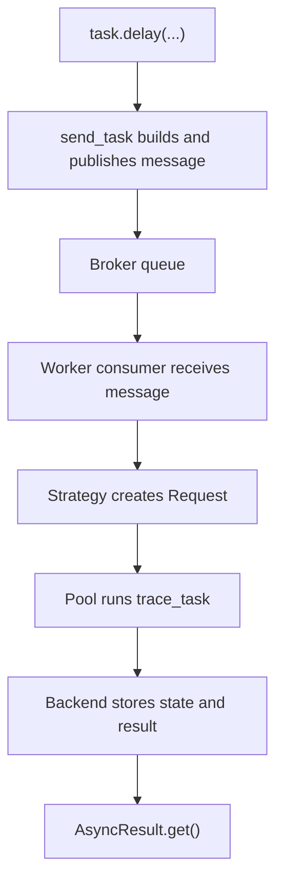

## Overview

Celery is a distributed task queue. A client calls a task function, Celery turns the call into a message and publishes it to a broker through kombu, a worker consumes the message and runs the function in a pool, and the outcome is written to a result backend that the client can poll. A separate scheduler process, beat, sends messages on a timetable.

Sources: [celery/app/task.py:683-708](repo://celery/app/task.py#L683-L708), [celery/worker/request.py:374-406](repo://celery/worker/request.py#L374-L406), [celery/beat.py:326-364](repo://celery/beat.py#L326-L364)

Everything hangs off one object, the `Celery` application. It holds the task registry, the lazily loaded configuration, the AMQP helper that builds messages, the result backend, the event dispatcher and the control interface. The worker, beat and the command line all start from an app instance.

Sources: [celery/app/base.py:343-435](repo://celery/app/base.py#L343-L435)

## The parts

| Area | What it does | Page |
| --- | --- | --- |
| App and configuration | Creates tasks, loads and finalizes settings | [[The Celery App and Configuration]] |
| Publishing | Routes a call and builds the protocol v2 message | [[Publishing Tasks]] |
| Worker startup | Assembles the worker from bootsteps | [[Worker Startup and Bootsteps]] |
| Task execution | Turns a message into a traced call in the pool | [[Receiving and Executing Tasks]] |
| Failure handling | Retries, rejection, late acknowledgement | [[Retries, Failures and Acknowledgement]] |
| Pools | prefork, solo, threads, eventlet, gevent | [[Execution Pools]] |
| Canvas | Signatures, chains | [[Signatures and Chains]] |
| Parallel canvas | Groups and chords | [[Groups and Chords]] |
| Result storage | Backends that keep state and return values | [[Result Backends]] |
| Result handles | `AsyncResult` and `GroupResult` on the client | [[AsyncResult and GroupResult]] |
| Beat | Periodic task scheduler | [[Beat: Periodic Task Scheduler]] |
| Remote control | Broadcast commands such as revoke | [[Remote Control and Revoking]] |
| Events | Monitoring stream and cluster state | [[Events and Monitoring]] |
| CLI | The `celery` command | [[Command Line Interface]] |
| Signing | Authenticated message serializer | [[Message Signing]] |

Sources: [celery/app/base.py:1535-1612](repo://celery/app/base.py#L1535-L1612), [celery/worker/worker.py:76-87](repo://celery/worker/worker.py#L76-L87)

New readers can start with [[Quickstart]].

Sources: [celery/app/base.py:515-523](repo://celery/app/base.py#L515-L523)

## The life of a task

Sources: [celery/app/task.py:683-708](repo://celery/app/task.py#L683-L708), [celery/worker/strategy.py:93-209](repo://celery/worker/strategy.py#L93-L209), [celery/app/trace.py:539-590](repo://celery/app/trace.py#L539-L590)

1. `Task.apply_async` merges options and hands the call to `Celery.send_task`, which routes it and publishes the message ([[Publishing Tasks]]).
2. The worker's consumer step receives the message, finds the strategy registered for the task name and builds a `Request` ([[Receiving and Executing Tasks]]).
3. The `Request` is sent to the pool, where the tracer runs the task body and writes the state to the backend ([[Execution Pools]], [[Result Backends]]).
4. When the task fails, retries or is rejected, the worker decides whether to acknowledge, requeue or record a failure ([[Retries, Failures and Acknowledgement]]).
5. The client reads the outcome through an `AsyncResult` ([[AsyncResult and GroupResult]]).

Sources: [celery/app/base.py:1018-1042](repo://celery/app/base.py#L1018-L1042), [celery/worker/request.py:341-372](repo://celery/worker/request.py#L341-L372)

## Design decisions that cut across the parts

**Tasks are created lazily and the app finalizes on first use.** `@app.task` returns a `PromiseProxy` and queues it on `_pending` unless the app is already finalized; `finalize` later evaluates every pending proxy under a mutex. This lets a module define tasks before the configuration exists.

Sources: [celery/app/base.py:557-575](repo://celery/app/base.py#L557-L575), [celery/app/base.py:657-677](repo://celery/app/base.py#L657-L677)

**The message header carries the task's identity and metadata.** `AMQP.as_task_v2` puts the task name, id, eta, expiry, retries, time limits and workflow ids in `headers`, while the body holds only the arguments and the embedded callbacks, errbacks, chain and chord. The worker can therefore route and revoke a task without deserializing its arguments.

Sources: [celery/app/amqp.py:371-418](repo://celery/app/amqp.py#L371-L418)

**Delivery is at-least-once, and acknowledgement timing is a task option.** `Request.execute` acknowledges the message before running unless the task sets `acks_late`, in which case acknowledgement is deferred until the outcome is known.

Sources: [celery/worker/request.py:374-406](repo://celery/worker/request.py#L374-L406)

**Pools, backends and schedulers are named by alias and resolved with `symbol_by_name`.** Pool aliases, backend aliases and the beat scheduler class are all looked up through string names, so third parties can supply their own implementation.

Sources: [celery/concurrency/__init__.py:11-43](repo://celery/concurrency/__init__.py#L11-L43), [celery/app/backends.py:15-62](repo://celery/app/backends.py#L15-L62), [celery/beat.py:666-676](repo://celery/beat.py#L666-L676)

**The worker is a graph of bootsteps.** `WorkController` declares its default steps as dotted names and a `Blueprint` orders them by their `requires` declarations, so features such as the embedded beat or autoscaler are optional steps rather than special cases.

Sources: [celery/worker/worker.py:76-87](repo://celery/worker/worker.py#L76-L87), [celery/bootsteps.py:186-250](repo://celery/bootsteps.py#L186-L250)
