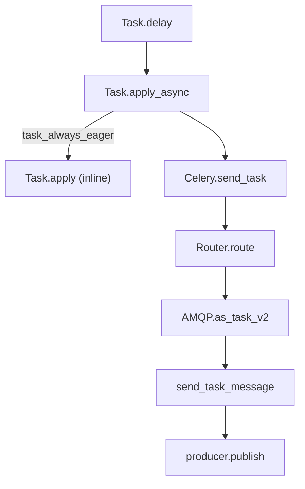

## Overview

Calling a task does not run it. `Task.delay` becomes `Task.apply_async`, which merges the task's default execution options with the caller's and then either runs the task inline (eager mode) or calls `Celery.send_task`. `send_task` routes the call to a queue, converts relative times to absolute ones, asks `AMQP` to build a protocol v2 message, and publishes it through a pooled producer. The caller receives an `AsyncResult` for the task id it generated.

Sources: [celery/app/task.py:523-534](repo://celery/app/task.py#L523-L534), [celery/app/task.py:659-708](repo://celery/app/task.py#L659-L708)



Sources: [celery/app/task.py:683-708](repo://celery/app/task.py#L683-L708), [celery/app/base.py:931-1030](repo://celery/app/base.py#L931-L1030), [celery/app/amqp.py:506-575](repo://celery/app/amqp.py#L506-L575)

## From delay to send_task

`apply_async` first rejects a task whose `soft_time_limit` exceeds its `time_limit` with `ValueError`. If the task has typing enabled it checks the arguments against the function's signature (`__header__`) before any message exists, so a wrong call fails in the caller. It then computes the shadow name, merges options, and sets `ignore_result` and `priority` defaults from the task.

Sources: [celery/app/task.py:659-681](repo://celery/app/task.py#L659-L681)

The merge is `dict(preopts, **options)`: the task's cached `_get_exec_options()` (queue, routing key, exchange, priority, expires, serializer, delivery mode, compression, time limits, plus the deprecated immediate and mandatory flags) is the base and call-site keyword arguments override it.

Sources: [celery/app/task.py:32-36](repo://celery/app/task.py#L32-L36), [celery/app/task.py:675-677](repo://celery/app/task.py#L675-L677), [celery/app/task.py:1256-1259](repo://celery/app/task.py#L1256-L1259)

Under `task_always_eager`, `apply_async` serializes the arguments and deserializes them again, using the producer's serializer or `task_serializer`, so that eager runs fail on arguments that a real broker round trip would also reject. It then calls `Task.apply` inside `denied_join_result()`. Otherwise it calls `app.send_task` with the task name, `task_type=self` and the result class.

Sources: [celery/app/task.py:683-708](repo://celery/app/task.py#L683-L708)

## What send_task does

`send_task` is also the public way to call a task by name when the function is not importable, such as one defined in another service. It generates `task_id = uuid()` when none is given and warns with `AlwaysEagerIgnored` if `task_always_eager` is set, because eager mode has no effect here.

Sources: [celery/app/base.py:846-873](repo://celery/app/base.py#L846-L873)

When the caller passes no `task_type`, it looks the name up in `self._tasks` directly rather than through `app.tasks`, so that sending does not finalize the app, and merges that task's non-`None` execution options under the explicit ones. It then resolves `time_limit`, `soft_time_limit` and `expires`: an explicit argument, even `None`, beats the task-level default.

Sources: [celery/app/base.py:875-929](repo://celery/app/base.py#L875-L929)

The next steps run in this order:

Sources: [celery/app/base.py:931-1016](repo://celery/app/base.py#L931-L1016)

1. `router.route(options, route_name or name, args, kwargs, task_type)` fills in `queue`, `exchange` and `routing_key`.
2. If `eta` or `countdown` is set and quorum queues with a non-direct exchange are detected, the call is redirected to the `celery_delayed_27` topic exchange with a delay-encoded routing key; with a direct exchange it logs a warning that the worker may block until the ETA.
3. `expires` is converted from a datetime, ISO string or number to seconds and stored as `options["expiration"]`; a negative value is clamped to 0 with a warning.
4. A missing `root_id` or `parent_id` is inherited from `current_worker_task`, and `task_inherit_parent_priority` can copy the parent's priority.
5. `amqp.create_task_message` builds the message.

Sources: [celery/app/base.py:931-1016](repo://celery/app/base.py#L931-L1016)

Publishing happens in `producer_or_acquire`, which takes a producer from the pool with `broker_pool_acquire_timeout` and raises `OperationalError` naming `broker_pool_limit` when none is free. Inside it, `backend.on_task_call(P, task_id)` runs first unless the result is ignored, so a backend such as RPC can prepare its reply queue before the task can possibly finish. Then `send_task_message` publishes. The returned result object has `ignored` set, and unless `add_to_parent` is false the result is added to the current worker task's trail.

Sources: [celery/app/base.py:1018-1042](repo://celery/app/base.py#L1018-L1042), [celery/app/base.py:1162-1190](repo://celery/app/base.py#L1162-L1190)

## Routing

`Router.route` first expands the `queue` option (a name is looked up in `Queues`, and an unknown name raises `QueueNotFound`). If `task_routes` produced any router, `lookup_route` asks each in order and the first non-`None` answer is merged under the caller's options with `lpmerge`, so explicit options win. If no queue ended up selected, `task_default_queue` is used.

Sources: [celery/app/routes.py:57-115](repo://celery/app/routes.py#L57-L115)

`task_routes` entries are normalised by `prepare`: a mapping or list becomes a `MapRoute`, a string becomes a lazily imported router, and anything else is used as is. A router is called as `router(task, args, kwargs, options, task=task_type)`; the pre-4.0 `route_for_task` interface is still honoured.

Sources: [celery/app/routes.py:22-136](repo://celery/app/routes.py#L22-L136)

`MapRoute` looks the task name up in an exact-match dict first, then tries patterns in insertion order. A key containing `*` is translated with `fnmatch.translate` and a compiled regex key is used directly. A value that is not dict-like is treated as a queue name.

Sources: [celery/app/routes.py:22-54](repo://celery/app/routes.py#L22-L54)

The `Queues` mapping behind it creates queues on demand when `task_create_missing_queues` is on: `__missing__` calls `new_missing`, which builds a `Queue` named after the key, with the quorum queue argument when configured, and raises `KeyError` otherwise. `select` and `deselect` define the subset a worker consumes from (the `-Q` option) without removing the others from routing.

Sources: [celery/app/amqp.py:99-102](repo://celery/app/amqp.py#L99-L102), [celery/app/amqp.py:159-224](repo://celery/app/amqp.py#L159-L224)

A change to `task_routes` at runtime flushes the route table and builds a new router through `_handle_conf_update`.

Sources: [celery/app/amqp.py:308-315](repo://celery/app/amqp.py#L308-L315), [celery/app/amqp.py:659-663](repo://celery/app/amqp.py#L659-L663)

## The protocol v2 message

`create_task_message` is whichever builder `task_protocol` selects; the default is `as_task_v2`. It validates that `args` is a list or tuple and `kwargs` a mapping, turns `countdown` into an absolute ETA and a numeric `expires` into a timestamp (both made timezone-aware), and renders them as ISO strings. It also computes the `argsrepr` and `kwargsrepr` strings, truncated by `saferepr`, so monitors never need the real arguments.

Sources: [celery/app/amqp.py:265-267](repo://celery/app/amqp.py#L265-L267), [celery/app/amqp.py:326-368](repo://celery/app/amqp.py#L326-L368)

The identity and scheduling data go in the message headers, and the body is a three-tuple of args, kwargs and an embed dict:

Sources: [celery/app/amqp.py:371-406](repo://celery/app/amqp.py#L371-L406)

```python
headers = {
    'lang': 'py',
    'task': name,
    'id': task_id,
    ...
    'timelimit': [time_limit, soft_time_limit],
    'root_id': root_id,
    'parent_id': parent_id,
    ...
}
```

Sources: [celery/app/amqp.py:371-391](repo://celery/app/amqp.py#L371-L391)

```python
body=(
    args, kwargs, {
        'callbacks': callbacks,
        'errbacks': errbacks,
        'chain': chain,
        'chord': chord,
    },
),
```

Sources: [celery/app/amqp.py:399-406](repo://celery/app/amqp.py#L399-L406)

`correlation_id` is the task id and `reply_to` is the caller's `thread_oid` (the id a reply-based backend listens on). If `task_send_sent_event` is enabled the message also carries a `sent_event` payload for monitors. Stamps (see [[Signatures and Chains]]) are copied from the options into `headers['stamps']`.

Sources: [celery/app/amqp.py:370-418](repo://celery/app/amqp.py#L370-L418)

When no `root_id` is passed, the message uses the task's own id as the root, so the first task of a workflow is its own root.

Sources: [celery/app/amqp.py:366-368](repo://celery/app/amqp.py#L366-L368)

## Publishing the message

`send_task_message` is created once per `AMQP` instance by `_create_task_sender`, which captures the retry settings, default serializer, compression and the publish signals. For each message it picks a queue (the default queue when neither queue nor exchange is given), takes the delivery mode from the queue's exchange, and defaults `exchange_type` to `direct`.

Sources: [celery/app/amqp.py:485-542](repo://celery/app/amqp.py#L485-L542)

Direct exchanges are published through the anonymous exchange: when `exchange` or `routing_key` is missing and the type is direct, `exchange` becomes `''` and `routing_key` the queue name. Otherwise the exchange and routing key come from the queue. Unless the queue is a `Broadcast`, it is passed in `declare` so the queue exists before publishing.

Sources: [celery/app/amqp.py:543-553](repo://celery/app/amqp.py#L543-L553)

The sender then runs `before_task_publish` receivers, calls `producer.publish` with the body, serializer, compression, retry policy and headers, and runs `after_task_publish` receivers. The deprecated `task_sent` signal is still sent when it has receivers, and a `task-sent` event is published when the message carries one.

Sources: [celery/app/amqp.py:555-604](repo://celery/app/amqp.py#L555-L604)
