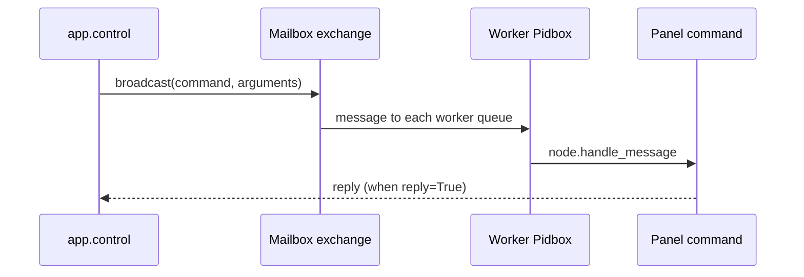

## Overview

Remote control lets a client send commands to running workers, such as "revoke this task", "change this rate limit" or "grow the pool", and optionally collect their replies. It does not use the task queues. Commands travel over a broker fanout exchange, called the mailbox, to which every worker has a private queue, so one broadcast reaches all workers, or a named subset. The client side is `app.control` and `app.control.inspect()` in `celery/app/control.py`; the worker side is the `Pidbox` node that receives each message and the `Panel` registry of command functions in `celery/worker/control.py`.

Sources: [celery/app/control.py:426-452](repo://celery/app/control.py#L426-L452), [celery/worker/pidbox.py:20-50](repo://celery/worker/pidbox.py#L20-L50), [celery/worker/control.py:39-76](repo://celery/worker/control.py#L39-L76)

Sources: [celery/app/control.py:755-790](repo://celery/app/control.py#L755-L790), [celery/worker/pidbox.py:39-50](repo://celery/worker/pidbox.py#L39-L50)

## The client

`Control.__init__` creates a kombu `Mailbox` on the `control_exchange` with a fanout exchange, the accepted content types and the task serializer, and with the TTL, expiry, exclusive and durable options from the `control_queue_*` settings. It raises `ImproperlyConfigured` if the control queue is configured both durable and exclusive, since an exclusive queue is deleted automatically.

Sources: [celery/app/control.py:426-452](repo://celery/app/control.py#L426-L452)

Every client method calls `broadcast(command, arguments, destination, reply, timeout, ...)`, which acquires a connection and sends through the mailbox. `destination` limits the command to named workers, and `pattern` with `matcher` selects workers by a custom match. For example, `revoke` broadcasts `'revoke'` with `task_id`, `terminate` and `signal`, and `terminate` is `revoke(..., terminate=True)`. The same shape is used for `rate_limit`, `time_limit`, `pool_grow`, `pool_shrink`, `autoscale`, `add_consumer`, `cancel_consumer`, `enable_events`, `shutdown` and the others.

Sources: [celery/app/control.py:488-558](repo://celery/app/control.py#L488-L558), [celery/app/control.py:755-790](repo://celery/app/control.py#L755-L790)

`Inspect` is the read-only counterpart. Each of its methods (`active`, `scheduled`, `reserved`, `stats`, `registered`, `ping`, `active_queues`, `conf`, `query_task` and others) calls `_request`, which broadcasts with `reply=True` and a timeout, and `_prepare` flattens the list of per-worker replies into a dict keyed by node name. When a single destination is given as a string, only that worker's reply is returned, and with a `pattern` only matching nodes are kept.

Sources: [celery/app/control.py:73-118](repo://celery/app/control.py#L73-L118), [celery/app/control.py:38-60](repo://celery/app/control.py#L38-L60)

`purge` is the one control method that does not use the mailbox: it opens a task consumer on the broker and discards every waiting message, returning the count.

Sources: [celery/app/control.py:462-478](repo://celery/app/control.py#L462-L478)

## The worker side

The `Control` consumer step starts a `Pidbox` only when `worker_enable_remote_control` is on and the broker supports fanout exchanges. It requires the `Tasks` step, so commands are accepted only after task consumption is set up. It selects `gPidbox`, the greenlet variant, when the pool is green.

Sources: [celery/worker/consumer/control.py:11-33](repo://celery/worker/consumer/control.py#L11-L33)

`Pidbox.__init__` creates a mailbox `Node` named after the worker's hostname, with the `Panel.data` command table as its handlers and a state object holding the app, hostname and consumer. `start` opens a channel and listens with `on_message` as the callback. For each message `on_message` advances the logical clock, since remote clients usually have no valid clock, and calls `node.handle_message`. An unknown command logs `No such control command`, and any other exception is logged and resets the node by stopping and restarting it. The greenlet `gPidbox` runs the same logic in a spawned loop that drains events with a one-second timeout and re-creates its channel when `reset` was requested.

Sources: [celery/worker/pidbox.py:20-81](repo://celery/worker/pidbox.py#L20-L81), [celery/worker/pidbox.py:83-126](repo://celery/worker/pidbox.py#L83-L126)

## Registering commands

`Panel` is a global registry. `control_command(**kw)` and `inspect_command(**kw)` register a function by its name under `Panel.data`, with an optional `alias`, and record metadata in `Panel.meta`: the type (`control` or `inspect`), whether it is `visible`, a default reply timeout, a help line from the docstring, a signature and argument types. Commands receive the shared `state` first and return a dict, with `ok(...)` and `nok(...)` building the `{'ok': ...}` and `{'error': ...}` replies.

Sources: [celery/worker/control.py:25-76](repo://celery/worker/control.py#L25-L76)

Adding a command is therefore a matter of decorating a function in a module the worker imports. `ping` is registered with `default_timeout=0.2` and answers `ok('pong')`, and `hello` is hidden (`visible=False`) because it is used by startup sync, not by users.

Sources: [celery/worker/control.py:381-403](repo://celery/worker/control.py#L381-L403)

## Built-in commands

| Command | Type | What it does |
| --- | --- | --- |
| `revoke`, `revoke_by_stamped_headers`, `terminate` | control | Stop a task, or tasks with matching stamps, from running |
| `rate_limit` | control | Changes a task type's `rate_limit`, then calls `consumer.reset_rate_limits()` |
| `time_limit` | control | Sets `soft_time_limit` and `time_limit` on a task type |
| `pool_grow`, `pool_shrink`, `pool_restart`, `autoscale` | control | Resize or restart the pool, or change autoscale bounds |
| `add_consumer`, `cancel_consumer` | control | Start or stop consuming a queue by name |
| `enable_events`, `disable_events`, `heartbeat` | control | Toggle task events, or send a heartbeat now |
| `shutdown`, `election` | control | Raise `WorkerShutdown`; start a gossip election |
| `active`, `reserved`, `scheduled`, `revoked`, `registered`, `query_task` | inspect | List tasks by state |
| `stats`, `conf`, `report`, `ping`, `clock`, `active_queues` | inspect | Worker information |

Sources: [celery/worker/control.py:79-122](repo://celery/worker/control.py#L79-L122), [celery/worker/control.py:255-323](repo://celery/worker/control.py#L255-L323), [celery/worker/control.py:344-460](repo://celery/worker/control.py#L344-L460), [celery/worker/control.py:541-637](repo://celery/worker/control.py#L541-L637)

`pool_grow` and `pool_shrink` refuse to act when an autoscaler is running and return `nok(...)` telling the caller to adjust the autoscale range instead; `autoscale` calls `autoscaler.update(max, min)` or raises if autoscale is off. `pool_restart` requires `worker_pool_restarts` to be enabled. `add_consumer` and `cancel_consumer` schedule the queue change with `consumer.call_soon`, so it happens on the event loop.

Sources: [celery/worker/control.py:541-600](repo://celery/worker/control.py#L541-L600), [celery/worker/control.py:601-629](repo://celery/worker/control.py#L601-L629)

## Revoking a task

Revoking a task does two things on the worker that receives the command. `revoke` calls `_revoke`, which adds the ids to `worker_state.revoked`, a `LimitedSet` capped at 50,000 ids (`CELERY_WORKER_REVOKES_MAX`) that expire after 10,800 seconds. It also marks each id `REVOKED` in the result backend, with a warning instead of an error if the backend call fails. When `terminate` is set, it looks up the matching active requests and calls `request.terminate(pool, signal=...)` on each, and replies with the ids it terminated, or `terminate: tasks unknown` if none was running.

Sources: [celery/worker/control.py:134-153](repo://celery/worker/control.py#L134-L153), [celery/worker/control.py:214-243](repo://celery/worker/control.py#L214-L243), [celery/worker/state.py:34-45](repo://celery/worker/state.py#L34-L45), [celery/worker/state.py:64-70](repo://celery/worker/state.py#L64-L70)

The revoked set takes effect when a message is received and again when it is about to execute. The strategy checks `req.revoked()` for any request that has an expiry or whose id is in the set, and `execute_using_pool` checks again and raises `TaskRevokedError`. `Request.revoked` is true if the request was already revoked, has expired (`maybe_expire` adds the id to the set), is in the revoked ids, or carries a stamp matching a revoked stamp. For a match it logs `Discarding revoked task`, calls `_announce_revoked` and returns true.

Sources: [celery/worker/strategy.py:162-164](repo://celery/worker/strategy.py#L162-L164), [celery/worker/request.py:341-352](repo://celery/worker/request.py#L341-L352), [celery/worker/request.py:408-414](repo://celery/worker/request.py#L408-L414), [celery/worker/request.py:470-509](repo://celery/worker/request.py#L470-L509)

`Request.terminate` kills the pool process with a signal if the job has started, and otherwise remembers `(pool, signal)` in `_terminate_on_ack` so it can be killed as soon as the pool accepts it. A terminated task is then announced as revoked rather than as a failure ([[Retries, Failures and Acknowledgement]]).

Sources: [celery/worker/request.py:416-427](repo://celery/worker/request.py#L416-L427), [celery/worker/request.py:515-527](repo://celery/worker/request.py#L515-L527)

## Revoking by stamp

`revoke_by_stamped_headers` takes a mapping of stamp names to values, and a list of `key=value` strings is converted to one. It appends the values to `worker_state.revoked_stamps[header]`, so later messages whose `stamps` header contains any of them are discarded by `Request.revoked`. With `terminate` set it walks the active requests, terminating those whose stamps intersect the revoked values, and replies with the matched mapping. The client method also collects any task ids returned in the replies and calls `revoke` on them. Stamps are applied with the canvas stamping API ([[Signatures and Chains]]).

Sources: [celery/worker/control.py:156-212](repo://celery/worker/control.py#L156-L212), [celery/app/control.py:512-546](repo://celery/app/control.py#L512-L546), [celery/worker/request.py:476-499](repo://celery/worker/request.py#L476-L499)

## Revoked state across restarts and workers

Revoked ids exist only in memory, so two mechanisms spread and keep them. With `--statedb`, the `Persistent` class saves the revoked set and the logical clock to a shelve file, compressed with zlib, at exit (`StateDB` registers `save` with `atexit`), and merges them back on start, purging expired items. A worker that starts later learns about existing revokes from its peers through the `Mingle` step, below.

Sources: [celery/worker/state.py:190-288](repo://celery/worker/state.py#L190-L288), [celery/worker/components.py:208-219](repo://celery/worker/components.py#L208-L219)

## Mingle: syncing at startup

`Mingle` runs when the consumer starts, or restarts. It is enabled unless `without_mingle` is given, and only on the `amqp`, `redis` and `gcpubsub` transports. `sync` broadcasts the `hello` inspect command with its own hostname and revoked ids, with a one-second timeout, removes its own reply, and for each reply from another node adjusts the logical clock and merges the node's revoked ids into its own set. When nobody answers it logs `mingle: all alone`.

Sources: [celery/worker/consumer/mingle.py:15-76](repo://celery/worker/consumer/mingle.py#L15-L76)

On the answering side, the `hello` command updates the revoked set with the caller's ids, purges expired entries so it never sends stale revokes, and replies with its own revoked ids and a forwarded clock. A worker that missed a revoke while it was down can therefore pick it up from any peer.

Sources: [celery/worker/control.py:381-397](repo://celery/worker/control.py#L381-L397)

The logical clock handled here, a `LamportClock` on the app, orders events across workers; the event stream that carries it is described in [[Events and Monitoring]].

Sources: [celery/app/base.py:353](repo://celery/app/base.py#L353), [celery/worker/pidbox.py:39-44](repo://celery/worker/pidbox.py#L39-L44)
