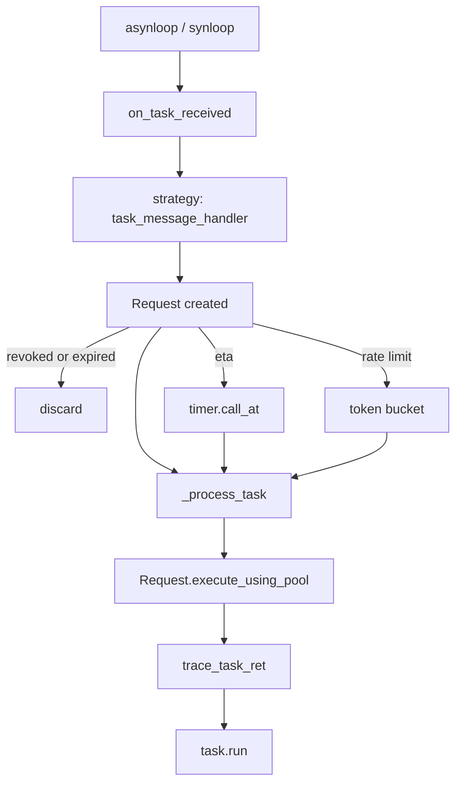

## Overview

Once the consumer has started (see [[Worker Startup and Bootsteps]]), every message goes through the same path: the event loop hands it to `on_task_received`, a per-task strategy builds a `Request`, the request waits for its ETA or rate limit if it has one, and then it is sent to the pool where `trace_task_ret` deserializes the arguments and runs the task body under a tracer. The tracer sends the signals, dispatches callbacks and stores the result in the backend. The strategy and tracer are written as closures with their dependencies bound as local names, because they run once per task.

Sources: [celery/worker/consumer/consumer.py:723-786](repo://celery/worker/consumer/consumer.py#L723-L786), [celery/worker/strategy.py:99-132](repo://celery/worker/strategy.py#L99-L132), [celery/app/trace.py:344-420](repo://celery/app/trace.py#L344-L420)

Sources: [celery/worker/strategy.py:132-208](repo://celery/worker/strategy.py#L132-L208), [celery/worker/worker.py:223-231](repo://celery/worker/worker.py#L223-L231)

## The event loop

`asynloop` is used with a transport that supports asynchronous I/O. It creates the message handler with `obj.create_task_handler()`, sets it as `consumer.on_message`, registers the worker and consumer with the hub, and calls `consumer.consume()`. On the first start it raises `WorkerLostError('Could not start worker processes')` if the pool did not start. It then runs `hub.create_loop()` and repeatedly calls `next(loop)`, checking `maybe_shutdown()` and the AMQP heartbeat error each turn. QoS is updated only when `qos.prev != qos.value`, and only between loop turns, which batches QoS calls and means remote control commands are handled before task messages.

Sources: [celery/worker/loops.py:50-100](repo://celery/worker/loops.py#L50-L100)

If the loop raises, `asynloop` resets the hub and clears the hub's timer queue before re-raising, so stale timers and file descriptors from the dead connection cannot fire after the consumer reconnects. A graceful exit does not reset them, so heartbeats keep running while the pool drains.

Sources: [celery/worker/loops.py:101-130](repo://celery/worker/loops.py#L101-L130)

`synloop` is the blocking fallback for transports without asynchronous support. Each cycle updates QoS, runs `perform_pending_operations()` and calls `connection.drain_events(timeout=2.0)`, ignoring socket timeouts.

Sources: [celery/worker/loops.py:133-170](repo://celery/worker/loops.py#L133-L170)

## Decoding the message and choosing a strategy

`on_task_received` reads the task name from `message.headers['task']` (protocol 2). When the header is missing it decodes the body and reads `payload['task']` (protocol 1). A message with neither goes to `on_unknown_message`, and an undecodable one to `on_decode_error`. The handler then looks the name up in `self.strategies`; an unregistered name calls `on_unknown_task`.

Sources: [celery/worker/consumer/consumer.py:731-758](repo://celery/worker/consumer/consumer.py#L731-L758)

Strategies are built by `update_strategies`, which runs when the `Tasks` step starts: for every registered task it calls `task.start_strategy(app, consumer)` and builds the tracer with `build_tracer`, storing it as `task.__trace__`.

Sources: [celery/worker/consumer/consumer.py:716-721](repo://celery/worker/consumer/consumer.py#L716-L721)

The handler wraps `message.ack_log_error` and `message.reject_log_error` in promises that run through `call_soon_ack`, which executes the acknowledgement immediately rather than waiting for the next loop turn, then calls the strategy. `InvalidTaskError` and `ContentDisallowed` from the strategy go to `on_invalid_task`, and `DecodeError` to `on_decode_error`.

Sources: [celery/worker/consumer/consumer.py:758-786](repo://celery/worker/consumer/consumer.py#L758-L786), [celery/worker/consumer/consumer.py:264-286](repo://celery/worker/consumer/consumer.py#L264-L286)

## The default strategy

`default(task, app, consumer)` runs once per task type. It binds the event dispatcher, the timer, rate-limit helpers and `Req = create_request_cls(...)`, a `Request` subclass specialised for this task and pool. The returned `task_message_handler` runs for every message:

Sources: [celery/worker/strategy.py:99-132](repo://celery/worker/strategy.py#L99-L132)

1. For a protocol 2 message the body is used as is and decoding is deferred to the pool. Messages with a protocol 1 body or an `args` key in the payload are converted with `proto1_to_proto2` or `hybrid_to_proto2`.
2. It builds `Req(message, on_ack=ack, on_reject=reject, ...)`.
3. If the request has an expiry or its id is in the revoked set and `req.revoked()` is true, the message is dropped.
4. It sends `task_received` and, if the task sends events, a `task-received` event.
5. It converts the ETA to a system timestamp. An unconvertible ETA logs an error and rejects without requeue.
6. With rate limits enabled, it looks up the task's token bucket.
7. It then takes one of four routes.

Sources: [celery/worker/strategy.py:132-208](repo://celery/worker/strategy.py#L132-L208)

Sources: [celery/worker/strategy.py:25-97](repo://celery/worker/strategy.py#L25-L97), [celery/worker/strategy.py:99-193](repo://celery/worker/strategy.py#L99-L193)

The four routes are decided by `eta` and `bucket`:

| ETA | Rate limit | Action |
| --- | --- | --- |
| yes | yes | `call_at(eta, limit_post_eta, ...)`, then queued in the bucket |
| yes | no | `call_at(eta, apply_eta_task, ...)` |
| no | yes | `limit_task(req, bucket, 1)` |
| no | no | `task_reserved(req)`, run `on_task_message` callbacks, `handle(req)` |

Sources: [celery/worker/strategy.py:190-208](repo://celery/worker/strategy.py#L190-L208)

An ETA task is held by the worker's timer, not requeued, and each one calls `qos.increment_eventually()` so the prefetch limit grows to cover it; `apply_eta_task` reserves the request, hands it on and calls `qos.decrement_eventually()`. A held ETA task stays unacknowledged, which is why `worker_eta_task_limit` bounds the prefetch growth.

Sources: [celery/worker/strategy.py:194-201](repo://celery/worker/strategy.py#L194-L201), [celery/worker/consumer/consumer.py:659-663](repo://celery/worker/consumer/consumer.py#L659-L663), [celery/worker/consumer/tasks.py:54-57](repo://celery/worker/consumer/tasks.py#L54-L57)

Rate limiting uses a `TokenBucket` per task name with capacity 1, built from `task.rate_limit` in `bucket_for_task` and rebuilt by `reset_rate_limits`. `_limit_task` appends the request to the bucket and `_schedule_bucket_request` pops requests while tokens exist; when tokens run out it puts the request back at the head, keeping order, and schedules itself again after `bucket.expected_time(tokens)`.

Sources: [celery/worker/consumer/consumer.py:296-303](repo://celery/worker/consumer/consumer.py#L296-L303), [celery/worker/consumer/consumer.py:329-362](repo://celery/worker/consumer/consumer.py#L329-L362)

## The Request

`Request.__init__` copies the message headers into `_request_dict`, so the headers written by [[Publishing Tasks]] become the request context. It takes the id, task name (the `shadow` name when there is one), `root_id`, `parent_id`, `timelimit` and the arg/kwarg representations, resolves `ignore_result` from the header or the task, and parses `eta` and `expires` from ISO 8601, raising `InvalidTaskError` for unparsable values. It adds the delivery information (exchange, routing key, priority, `redelivered`) and takes `args` and `kwargs` from the message payload by reference to avoid copying large arguments.

Sources: [celery/worker/request.py:90-176](repo://celery/worker/request.py#L90-L176)

`task_reserved` records the request in the module-level `requests` map and `reserved_requests`, and `task_accepted` later adds it to `active_requests` and increments the per-name counters. `task_ready` removes it from all of them and, on success, adds the id to `successful_requests`. These collections are what remote `inspect` commands report and what the connection-loss logic reads.

Sources: [celery/worker/state.py:96-134](repo://celery/worker/state.py#L96-L134), [celery/worker/state.py:49-62](repo://celery/worker/state.py#L49-L62)

## Sending the request to the pool

The controller's `_process_task` calls `req.execute_using_pool(self.pool)`, and releases its semaphore slot if the task turns out to be revoked. `execute_using_pool` checks `revoked()` again, which raises `TaskRevokedError`, and then calls `pool.apply_async` with `trace_task_ret` or `fast_trace_task`, the raw request dict and body, and the content type and encoding. It also registers callbacks for the pool's events: `accept_callback` for when a pool process picks the job up, `timeout_callback`, `callback` for the result and `error_callback`, along with the soft and hard time limits (the request's, falling back to the task's). The pool is described in [[Execution Pools]].

Sources: [celery/worker/worker.py:223-231](repo://celery/worker/worker.py#L223-L231), [celery/worker/request.py:341-372](repo://celery/worker/request.py#L341-L372), [celery/worker/request.py:818-853](repo://celery/worker/request.py#L818-L853)

The pool process decodes the arguments. `trace_task_ret` loads the body with the configured `accept_content` and puts `args`, `kwargs`, hostname and the embedded callbacks, errbacks, chain and chord into the request dict, then runs the tracer and returns `(1, R, T)` on an internal failure or `(0, Rstr, T)` otherwise. `fast_trace_task` does the same with a precomputed registry, accepted content types and hostname held in `_localized`, and raises a `RuntimeError` suggesting `--pool=solo` or `--pool=threads` if that registry was never filled, as happens in a spawned rather than forked process.

Sources: [celery/app/trace.py:735-789](repo://celery/app/trace.py#L735-L789)

`setup_worker_optimizations` runs from `Worker.on_init_blueprint`, before the blueprint is created. It protects `Task.__call__` from stack corruption, makes the app current and default, finalizes it, fills `_localized` and sets `app.use_fast_trace_task = True`.

Sources: [celery/app/trace.py:804-832](repo://celery/app/trace.py#L804-L832), [celery/apps/worker.py:122-126](repo://celery/apps/worker.py#L122-L126)

## The tracer

`build_tracer` returns a `trace_task(uuid, args, kwargs, request)` function for one task. It runs `task.run` directly unless the task defines its own `__call__`, and it finds out once, not per call, which optional hooks (`before_start`, `on_success`, `after_return`) the task overrides. Inside, the steps are:

Sources: [celery/app/trace.py:344-420](repo://celery/app/trace.py#L344-L420)

1. Build a `Context` from the request, and decide `ignore_result` and whether to track the `STARTED` state.
2. If acks are late, deduplication is enabled and the message was redelivered, check whether the task already succeeded and skip it (the failure side of this is in [[Retries, Failures and Acknowledgement]]).
3. Push the task and request on their stacks, send `task_prerun`, call the loader's `on_task_init`, and optionally store `STARTED`.
4. Call `before_start`, then `fun(*args, **kwargs)`.
5. On success, dispatch the callbacks and the next chain step, and only then call `backend.mark_as_done`, so `result.children` is populated before the result is stored.
6. Call `on_success`, send `task_success`, and log the result.
7. In a `finally`, call `after_return` (unless the state is ignored), send `task_postrun`, pop the stacks and run the backend's and loader's process cleanup.

Sources: [celery/app/trace.py:344-420](repo://celery/app/trace.py#L344-L420), [celery/app/trace.py:475-535](repo://celery/app/trace.py#L475-L535), [celery/app/trace.py:564-669](repo://celery/app/trace.py#L564-L669)

Callback and chain dispatch is shared with the deduplication path in `_dispatch_callbacks_and_chain`. With several callbacks, groups are applied separately and the plain signatures are wrapped in one `group`; with one callback it is applied directly. The remaining chain is passed on as the `chain` of the last signature in it, with the return value as the first argument. Dispatch is not atomic: the code notes that a redelivery can resend callbacks that were already sent.

Sources: [celery/app/trace.py:426-473](repo://celery/app/trace.py#L426-L473)

The exception handlers inside `trace_task` map task outcomes to states: `Reject` and `Ignore` become `REJECTED` and `IGNORED`, `Retry` goes through `on_error` with the `RETRY` state and no errbacks, and any other `Exception` goes through `on_error` as `FAILURE`. An `EncodeError` while storing a result is handled as a failure. An exception outside the task body is reported through `report_internal_error`. The handling behind these states is on [[Retries, Failures and Acknowledgement]].

Sources: [celery/app/trace.py:586-639](repo://celery/app/trace.py#L586-L639), [celery/app/trace.py:672-686](repo://celery/app/trace.py#L672-L686)
