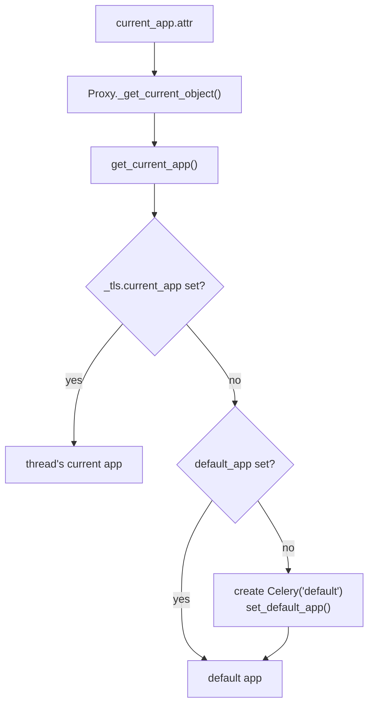
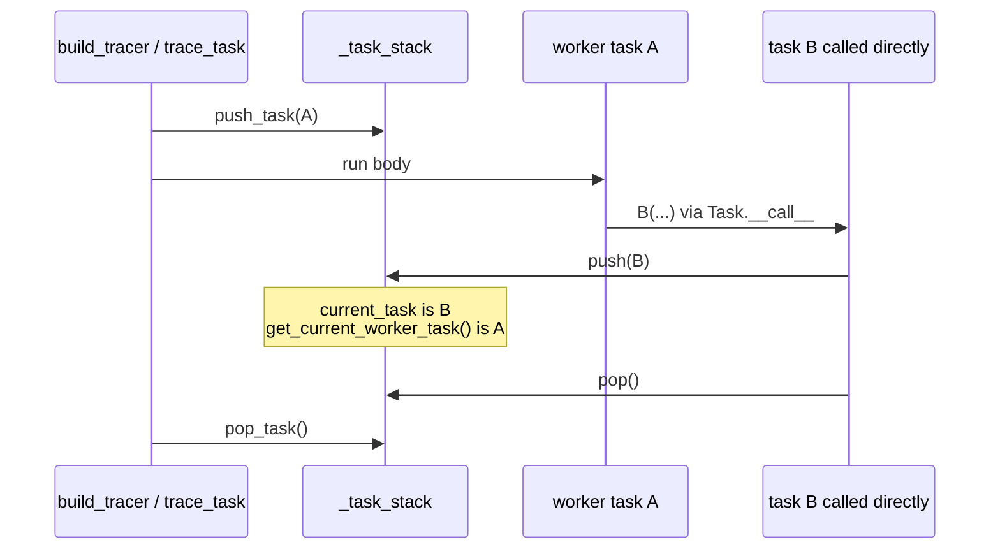
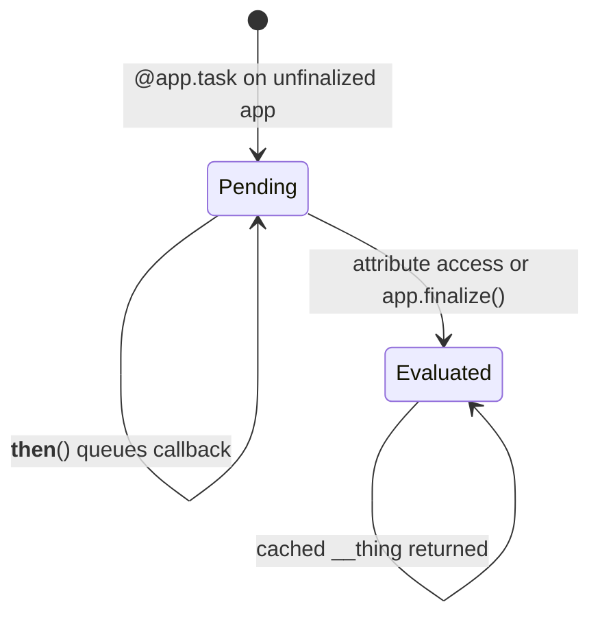

## Overview

Celery lets code refer to "the app" and "the running task" without passing them around. Two small modules make that possible: `celery._state` holds the process-wide and thread-local state (default app, current app, the stack of executing tasks, the set of live apps and the finalize callbacks), and `celery.local` provides the `Proxy` and `PromiseProxy` objects that stand in for those values until they are touched. The module docstring marks `celery._state` as internal; user code reaches it through `celery.current_app`, `celery.current_task` and `celery.app`.

Sources: [celery/_state.py:1-41](repo://celery/_state.py#L1-L41), [celery/local.py:1-18](repo://celery/local.py#L1-L18)

`celery.local` is imported first by `celery/__init__.py` because it "shall not load any third party modules": the top-level `celery` package itself is rebuilt as a lazy module with `local.recreate_module`, so `import celery` stays cheap and `celery.Celery` only imports `celery.app` on first access. [[The Celery Application]] describes the app object these helpers point at, and [[Task Execution and Tracing]] shows where the worker pushes tasks onto the stack.

Sources: [celery/__init__.py:15-16](repo://celery/__init__.py#L15-L16), [celery/__init__.py:155-180](repo://celery/__init__.py#L155-L180)

## Current and default app

### Resolution order

There are two app slots. `default_app` is a module global shared by every thread; `_tls.current_app` lives on a `threading.local` subclass, so each thread may have its own current app. `get_current_app()` returns the thread's current app if set, otherwise the default app, creating a fallback app named `'default'` on first use (with no fixups, `set_as_current=False`, and the loader taken from `CELERY_LOADER` or `'default'`).

Sources: [celery/_state.py:64-104](repo://celery/_state.py#L64-L104)

```python
def _get_current_app():
    if default_app is None:
        #: creates the global fallback app instance.
        from celery.app.base import Celery
        set_default_app(Celery(
            'default', fixups=[], set_as_current=False,
            loader=os.environ.get('CELERY_LOADER') or 'default',
        ))
    return _tls.current_app or default_app
```

Sources: [celery/_state.py:92-100](repo://celery/_state.py#L92-L100)

A `Celery` instance writes itself into these slots. Its constructor calls `self.set_current()` when `set_as_current` is true (the default), so the most recently created app becomes current for the creating thread, and it always ends with `_register_app(self)`. `app.set_current()` wraps `_set_current_app`, and `app.set_default()` wraps `set_default_app`. `app.close()` calls `_deregister_app`.

Sources: [celery/app/base.py:415-416](repo://celery/app/base.py#L415-L416), [celery/app/base.py:433-458](repo://celery/app/base.py#L433-L458), [celery/app/base.py:465-478](repo://celery/app/base.py#L465-L478)

In a prefork worker child, `process_initializer` makes the worker's app both current and default before finalizing it, so any code in the child that resolves `current_app` gets the worker's app rather than a stray fallback.

Sources: [celery/concurrency/prefork.py:40-73](repo://celery/concurrency/prefork.py#L40-L73)



Sources: [celery/_state.py:92-142](repo://celery/_state.py#L92-L142), [celery/local.py:97-111](repo://celery/local.py#L97-L111)

### Public helpers

| Name | Defined in | What it returns or does |
| --- | --- | --- |
| `current_app` | `celery._state` | `Proxy(get_current_app)`: re-resolved on every access |
| `current_task` | `celery._state` | `Proxy(get_current_task)`: top of the task stack or `None` |
| `default_app` | `celery.app` | `Proxy(lambda: _state.default_app)` |
| `set_default_app(app)` | `celery._state` | Replaces the global `default_app` |
| `app_or_default(app=None)` | `celery._state`, re-exported by `celery.app` | `app` if given, else `get_current_app()` |
| `get_current_worker_task()` | `celery._state` | Innermost task on the stack that the worker applied |

Sources: [celery/_state.py:86-160](repo://celery/_state.py#L86-L160), [celery/app/__init__.py:1-16](repo://celery/app/__init__.py#L1-L16)

### Debugging app leaks

Library code is expected to take an explicit `app` and fall back with `app_or_default`. Three environment variables, read at import time, expose code that silently falls back to the implicit app instead.

Sources: [celery/_state.py:26-31](repo://celery/_state.py#L26-L31), [celery/_state.py:157-160](repo://celery/_state.py#L157-L160)

| Variable | Effect |
| --- | --- |
| `C_STRICT_APP` | `get_current_app()` raises `RuntimeError('USES CURRENT APP')` |
| `C_WARN_APP` | `get_current_app()` prints `-- USES CURRENT_APP` and a stack trace to stderr, then resolves normally |
| `CELERY_TRACE_APP` | Calls `enable_trace()`, so `app_or_default` becomes `_app_or_default_trace` |

Sources: [celery/_state.py:107-118](repo://celery/_state.py#L107-L118), [celery/_state.py:182-197](repo://celery/_state.py#L182-L197)

`_app_or_default_trace` prints a stack trace whenever it falls back to the thread's current app. With no current app it raises `Exception('DEFAULT APP')` in the main process (or when billiard is missing), and only in a pool child prints a trace and returns `default_app`. `disable_trace()` restores the plain `_app_or_default`.

Sources: [celery/_state.py:157-191](repo://celery/_state.py#L157-L191)

> [!WARNING]
> `enable_trace()` and `disable_trace()` rebind the global `celery._state.app_or_default`. Modules that already ran `from celery._state import app_or_default` (such as `celery.app`) keep the function bound at import time, so set `CELERY_TRACE_APP` before Celery is imported to trace every call site.

Sources: [celery/_state.py:182-197](repo://celery/_state.py#L182-L197), [celery/app/__init__.py:3](repo://celery/app/__init__.py#L3-L3)

## Live apps and finalize callbacks

`_apps` is a `weakref.WeakSet` of every constructed app, so registration never keeps an app alive. `_get_active_apps()` exposes it to `shared_task`.

Sources: [celery/_state.py:33-34](repo://celery/_state.py#L33-L34), [celery/_state.py:145-154](repo://celery/_state.py#L145-L154)

`_on_app_finalizers` is a global set of callbacks run against every app when it is finalized. `connect_on_app_finalize(callback)` adds one and returns it, so it doubles as a decorator; `_announce_app_finalized(app)` iterates over a copy of the set, so a callback may register further callbacks without breaking the loop. Built-in tasks and shared tasks are both created this way.

Sources: [celery/_state.py:36-52](repo://celery/_state.py#L36-L52)

`Celery.finalize()` calls `_announce_app_finalized(self)` under `_finalize_mutex`, then drains `self._pending` through `maybe_evaluate`, binds every registered task to the app and sends `on_after_finalize`.

Sources: [celery/app/base.py:657-677](repo://celery/app/base.py#L657-L677)

`shared_task` relies on all three pieces. It registers a finalize callback so unfinalized and future apps build their own copy of the task, adds the task directly to every app in `_get_active_apps()` that is already finalized, and returns a `Proxy(task_by_cons)` that looks the task up in `get_current_app().tasks` on each access. The same decorated function therefore resolves to a different task object depending on which app is current. [[Defining Tasks]] covers the decorator options.

Sources: [celery/app/__init__.py:24-76](repo://celery/app/__init__.py#L24-L76)

## Task stack

`_task_stack` is a `LocalStack` from `celery.utils.threads`: per-thread (or per-greenlet) storage with `push`, `pop`, `top` and `stack`. `push_current_task` and `pop_current_task` are aliases for its methods, and `get_current_task()` returns `_task_stack.top`. When `USE_FAST_LOCALS` is set, `LocalStack` is `_FastLocalStack`, a plain `threading.local` holding a list.

Sources: [celery/_state.py:71-83](repo://celery/_state.py#L71-L83), [celery/_state.py:121-123](repo://celery/_state.py#L121-L123), [celery/utils/threads.py:308-336](repo://celery/utils/threads.py#L308-L336)

Two code paths push onto the stack. Calling a task object directly (`Task.__call__`) pushes the task and a request, runs `run`, and pops both in a `finally`. The worker's tracer pushes the task and its request before the prerun signal and pops them after postrun. Nested calls inside a task body therefore stack on top of the worker-applied task.

Sources: [celery/app/task.py:495-502](repo://celery/app/task.py#L495-L502), [celery/app/trace.py:403-406](repo://celery/app/trace.py#L403-L406), [celery/app/trace.py:563-567](repo://celery/app/trace.py#L563-L567), [celery/app/trace.py:654-663](repo://celery/app/trace.py#L654-L663)



Sources: [celery/app/task.py:495-502](repo://celery/app/task.py#L495-L502), [celery/app/trace.py:563-567](repo://celery/app/trace.py#L563-L567), [celery/_state.py:121-135](repo://celery/_state.py#L121-L135)

`get_current_worker_task()` walks the stack from the top and returns the first task whose `request.called_directly` is false, which separates the message the worker is executing from tasks invoked in-process through `__call__` or `apply`.

Sources: [celery/_state.py:126-135](repo://celery/_state.py#L126-L135)

The module also keeps `_task_join_will_block`, a flag read by `task_join_will_block()`. The worker sets it from the pool's `task_join_will_block` attribute (true by default, false for the eventlet and gevent pools), and prefork children set it to true. `celery.result.assert_will_not_block()` raises `RuntimeError` with "Never call result.get() within a task!" when it is set; `allow_join_result()` and `denied_join_result()` temporarily override it. [[Task Results]] explains when that check runs.

Sources: [celery/_state.py:40-61](repo://celery/_state.py#L40-L61), [celery/worker/components.py:171](repo://celery/worker/components.py#L171-L171), [celery/concurrency/prefork.py:48](repo://celery/concurrency/prefork.py#L48-L48), [celery/result.py:30-59](repo://celery/result.py#L30-L59)

## Proxy

`Proxy(local, args=None, kwargs=None, name=None, __doc__=None)` stores a callable and its arguments in name-mangled slots (`_Proxy__local`, `_Proxy__args`, `_Proxy__kwargs`) using `object.__setattr__`, because its own `__setattr__` is forwarded. `_get_current_object()` calls `local(*args, **kwargs)` on every access; objects that carry `__release_local__` (werkzeug-style locals) are read by attribute name instead.

Sources: [celery/local.py:52-111](repo://celery/local.py#L52-L111)

Almost every dunder method is forwarded to the resolved object: attribute get/set/delete, item access, comparisons, `__hash__`, `__call__`, `__len__`, `__iter__`, arithmetic operators, conversions, the context manager protocol and `__reduce__`. `__class__` is a property returning the target's class, so `isinstance(current_app, Celery)` holds. `__repr__`, `__bool__`, `__dir__` and `__dict__` catch `RuntimeError` so an unbound proxy reports `<... unbound>`, `False` or `[]` instead of failing.

Sources: [celery/local.py:90-160](repo://celery/local.py#L90-L160), [celery/local.py:161-279](repo://celery/local.py#L161-L279)

`__name__`, `__qualname__`, `__module__` and `__doc__` need to be strings when read from the `Proxy` class but forwarded when read from an instance. `_default_cls_attr` builds a `str` subclass with a `__get__` that returns itself on class access and calls the getter on instance access; a `name` passed to the constructor is stored as `__custom_name__` and overrides the forwarded name.

Sources: [celery/local.py:21-38](repo://celery/local.py#L21-L38), [celery/local.py:68-88](repo://celery/local.py#L68-L88)

## PromiseProxy and maybe_evaluate

`PromiseProxy` evaluates its target once and then caches it. `_get_current_object()` returns the cached `__thing` slot or calls `__evaluate__()`, which resolves through `Proxy._get_current_object`, stores the result, deletes the stored callable and arguments, and runs any callbacks queued with `__then__` before returning.

Sources: [celery/local.py:282-350](repo://celery/local.py#L282-L350)

| Method | Behaviour |
| --- | --- |
| `__evaluated__()` | `True` once `__thing` is set |
| `__then__(fun, *args, **kwargs)` | Calls `fun` now if evaluated, else appends it to a `__pending__` deque run by `__evaluate__` |
| `__maybe_evaluate__()` | Same as `_get_current_object()` |
| `__evaluate__()` | Resolves, caches, cleans up slots, drains `__pending__` |

Sources: [celery/local.py:297-350](repo://celery/local.py#L297-L350)

`maybe_evaluate(obj)` calls `obj.__maybe_evaluate__()` and returns `obj` unchanged when that attribute is missing, so callers can drain queues that mix promises and plain values.

Sources: [celery/local.py:353-358](repo://celery/local.py#L353-L358)

`@app.task` uses this to defer task creation. When the app is not finalized and `lazy` is true, the decorator returns `PromiseProxy(self._task_from_fun, (fun,), opts, __doc__=fun.__doc__)` and appends it to `app._pending`; `finalize()` later calls `maybe_evaluate` on each pending entry. Touching any attribute of the decorated name before then evaluates it early. The configuration path does the same: `_load_config` passes each `_pending_defaults` callable's result through `maybe_evaluate` before `add_defaults`.

Sources: [celery/app/base.py:554-572](repo://celery/app/base.py#L554-L572), [celery/app/base.py:657-677](repo://celery/app/base.py#L657-L677), [celery/app/base.py:1268-1271](repo://celery/app/base.py#L1268-L1271)



Sources: [celery/local.py:291-350](repo://celery/local.py#L291-L350), [celery/app/base.py:564-569](repo://celery/app/base.py#L564-L569)

> [!NOTE]
> When Celery runs with execv (`USING_EXECV`) and `lazy` is not disabled, `app.task` delegates to `shared_task(..., lazy=False)` so the module-level name always resolves through the current app's registry.

Sources: [celery/app/base.py:545-552](repo://celery/app/base.py#L545-L552)

## Lazy package module

### recreate_module and LazyModule

At the end of `celery/__init__.py`, `local.recreate_module(__name__, by_module=..., **attrs)` replaces `sys.modules['celery']` with an instance of a fresh `LazyModule` subclass. Plain values (version info, `maybe_patch_concurrency`, `local`) are copied into the new module's `__dict__`; public names are listed per source module in `by_module`.

Sources: [celery/__init__.py:155-180](repo://celery/__init__.py#L155-L180)

| Public name | Imported from on first access |
| --- | --- |
| `Celery`, `bugreport`, `shared_task` | `celery.app` |
| `Task` | `celery.app.task` |
| `current_app`, `current_task` | `celery._state` |
| `Signature`, `chain`, `chord`, `chunks`, `group`, `signature`, `maybe_signature`, `subtask`, `xmap`, `xstarmap` | `celery.canvas` |
| `uuid` | `celery.utils` |

Sources: [celery/__init__.py:157-169](repo://celery/__init__.py#L157-L169)

`recreate_module` inverts `by_module` with `get_origins` into a name-to-module map, computes `__all__` from compat modules, origins, direct entries and plain attrs, and builds the module class through `create_module`, which registers the instance in `sys.modules` and copies the old module's `__spec__`. `LazyModule.__getattr__` only runs for names not yet in the module dict: it imports the origin module and copies every name that module provides onto the lazy module with `setattr`, so later lookups are ordinary attribute reads. `__dir__` hides deprecated names, and `__reduce__` pickles the module as `import_module(name)`.

Sources: [celery/local.py:454-523](repo://celery/local.py#L454-L523), [celery/local.py:541-545](repo://celery/local.py#L541-L545)

### Compatibility modules and helpers

`COMPAT_MODULES['celery']` describes old submodules (`celery.execute`, `celery.log`, `celery.messaging`, `celery.registry`) that are generated at runtime. `get_compat_module` turns each string entry into `Proxy(getappattr, (path,))`, and `getappattr` resolves the dotted path on `current_app` with `_rgetattr`, so `celery.execute.send_task` is the current app's `send_task`.

Sources: [celery/local.py:384-416](repo://celery/local.py#L384-L416), [celery/local.py:526-538](repo://celery/local.py#L526-L538)

`class_property` is a descriptor that wraps getter and setter in `classmethod`, letting a class expose a computed attribute that works on both the class and its instances. `try_import(module, default=None)` returns the imported module or `default` on `ImportError`.

Sources: [celery/local.py:419-447](repo://celery/local.py#L419-L447), [celery/local.py:41-49](repo://celery/local.py#L41-L49)

The `STATICA_HACK` block in `celery/__init__.py` imports the same names eagerly inside an `if` that is always false at runtime: the flag is reset through `globals()` so static analyzers and IDEs see the symbols while the interpreter never runs those imports.

Sources: [celery/__init__.py:69-82](repo://celery/__init__.py#L69-L82)
