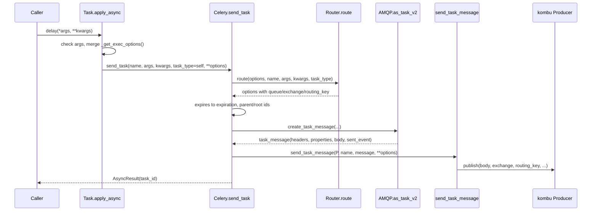

## Overview

Calling a task never runs its body in the caller's process (unless eager mode is on). It builds a task message, publishes it to the broker, and returns an `AsyncResult` for the task id. `Task.delay` and `Task.apply_async` sit on the task object. `Celery.send_task` does the publishing and works with a bare task name, so a client can send tasks whose code it does not import. The `AMQP` object at `app.amqp` turns the call into a `task_message` and hands it to a kombu `Producer` taken from a pool.

Sources: [celery/app/task.py:523-534](repo://celery/app/task.py#L523-L534), [celery/app/base.py:846-862](repo://celery/app/base.py#L846-L862), [celery/app/amqp.py:225-271](repo://celery/app/amqp.py#L225-L271)

Routing (which queue and exchange a task goes to) is covered in [[Task Routing and Queues]]. Countdowns on RabbitMQ quorum queues follow a separate publishing path, described in [[Delayed Delivery with Quorum Queues]]. The worker side of the message is in [[Consumer and Message Handling]].

Sources: [celery/app/base.py:930-966](repo://celery/app/base.py#L930-L966)

## Entry points

| Call | Defined in | What it does |
| --- | --- | --- |
| `task.delay(*args, **kwargs)` | `Task.delay` | Calls `apply_async(args, kwargs)`. Takes no execution options. |
| `task.apply_async(args, kwargs, **options)` | `Task.apply_async` | Checks the arguments, merges task options, then calls `app.send_task` or, in eager mode, `Task.apply`. |
| `app.send_task(name, args, kwargs, **options)` | `Celery.send_task` | Routes, builds the message, publishes it and returns the result object. Accepts any task name, registered or not. |
| `task.apply(args, kwargs)` | `Task.apply` | Runs the task in the calling process and returns an `EagerResult`. |
| `sig.delay()` / `sig.apply_async()` | `Signature` in `celery/canvas.py` | Merges partial args and options into the signature, then calls the task's `apply_async`. |

Sources: [celery/app/task.py:523-536](repo://celery/app/task.py#L523-L536), [celery/app/task.py:869-882](repo://celery/app/task.py#L869-L882), [celery/app/base.py:846-862](repo://celery/app/base.py#L846-L862), [celery/canvas.py:352-398](repo://celery/canvas.py#L352-L398)

## Call flow



Sources: [celery/app/task.py:659-708](repo://celery/app/task.py#L659-L708), [celery/app/base.py:930-1041](repo://celery/app/base.py#L930-L1041), [celery/app/amqp.py:506-606](repo://celery/app/amqp.py#L506-L606)

## Option merging in apply_async

### Checks before sending

`apply_async` first raises `ValueError` when the task's `soft_time_limit` is greater than its `time_limit`. When `typing` is on, it calls the task's `__header__` with the given arguments, so a wrong number of arguments raises `TypeError` in the caller instead of failing in the worker. It then works out the `shadow` name (the name shown in logs and monitoring) from `shadow_name()`.

Sources: [celery/app/task.py:659-673](repo://celery/app/task.py#L659-L673)

### Task-level defaults

The execution options declared on the task class are read by `extract_exec_options`, a `mattrgetter` over a fixed list of attribute names. A missing attribute becomes `None`. `_get_exec_options` caches the result on the task instance in `_exec_options`.

Sources: [celery/app/task.py:31-36](repo://celery/app/task.py#L31-L36), [celery/app/task.py:1256-1259](repo://celery/app/task.py#L1256-L1259), [celery/utils/functional.py:154-160](repo://celery/utils/functional.py#L154-L160)

```python
extract_exec_options = mattrgetter(
    'queue', 'routing_key', 'exchange', 'priority', 'expires',
    'serializer', 'delivery_mode', 'compression', 'time_limit',
    'soft_time_limit', 'immediate', 'mandatory',  # imm+man is deprecated
)
```

Sources: [celery/app/task.py:31-36](repo://celery/app/task.py#L31-L36)

Several of these attributes are filled from configuration when the task is bound to an app, through `from_config`: `serializer` comes from `task_serializer`, `priority` from `task_default_priority`, and the time limits from `task_time_limit` and `task_soft_time_limit`.

Sources: [celery/app/task.py:396-411](repo://celery/app/task.py#L396-L411)

### Merge order

Options passed to the call override task-level defaults (`dict(preopts, **options)`). `ignore_result` and `priority` are then filled only if the caller left them out. The merged options go to `app.send_task` with `task_type=self` and `result_cls=self.AsyncResult`.

Sources: [celery/app/task.py:675-680](repo://celery/app/task.py#L675-L680), [celery/app/task.py:702-708](repo://celery/app/task.py#L702-L708)

```python
        preopts = self._get_exec_options()
        options = dict(preopts, **options) if options else preopts

        options.setdefault('ignore_result', self.ignore_result)
        if self.priority:
            options.setdefault('priority', self.priority)
```

Sources: [celery/app/task.py:675-680](repo://celery/app/task.py#L675-L680), [celery/app/task.py:702-708](repo://celery/app/task.py#L702-L708)

### Options in send_task by name

When `send_task` is called without a `task_type` (a plain call by name), it looks the name up in the local registry `self._tasks`, using the registry directly so that the app is not finalized. If the task is found, its exec options with non-`None` values are merged under the caller's options. When `task_type` is given, as `apply_async` does, this step is skipped: the options were already merged, and merging them again would override explicit values.

Sources: [celery/app/base.py:874-907](repo://celery/app/base.py#L874-L907)

`time_limit`, `soft_time_limit` and `expires` are also explicit parameters of `create_task_message`, so `send_task` pops them out of `options`. The `_OMITTED` sentinel tells "argument not given" apart from an explicit `None`. An explicit `None` clears any task-level default.

Sources: [celery/app/base.py:60-60](repo://celery/app/base.py#L60-L60), [celery/app/base.py:909-930](repo://celery/app/base.py#L909-L930)

## The send_task pipeline

`send_task` publishes the message in this order:

Sources: [celery/app/base.py:863-873](repo://celery/app/base.py#L863-L873), [celery/app/base.py:930-1041](repo://celery/app/base.py#L930-L1041)

1. Generate `task_id` with `uuid()` if none was given, and warn with `AlwaysEagerIgnored` if `task_always_eager` is set: `send_task` always publishes.
2. Pop `ignore_result` and call `router.route(options, route_name or name, args, kwargs, task_type)`, which fills in `queue`, `exchange` and `routing_key` (see [[Task Routing and Queues]]).
3. If `eta` or `countdown` is set and quorum queues are detected, rewrite the exchange and routing key for native delayed delivery.
4. Turn `expires` into a relative `expiration` in seconds, the per-message TTL property.
5. Fill `root_id` and `parent_id` from `current_worker_task` when called inside a running task. If `task_inherit_parent_priority` is set, copy the parent's priority.
6. Build the message with `amqp.create_task_message`, then remove the stamp keys from `options` so they are not sent as message properties.
7. Acquire a producer, call `backend.on_task_call(P, task_id)` unless the result is ignored, and publish with `amqp.send_task_message`.
8. Build the result with `result_cls or self.AsyncResult`, set `result.ignored`, and add it to the parent task's trail when `add_to_parent` is true.

Sources: [celery/app/base.py:863-873](repo://celery/app/base.py#L863-L873), [celery/app/base.py:930-1041](repo://celery/app/base.py#L930-L1041)

> [!NOTE]
> `send_task` reuses the caller's `connection` by wrapping it in `amqp.Producer(connection, auto_declare=False)`. Without a connection or producer, it acquires one from the pool.

Sources: [celery/app/base.py:1022-1028](repo://celery/app/base.py#L1022-L1028)

## Countdown, ETA and expires

`send_task` converts `expires` to seconds from `self.now()`. It accepts a `datetime`, an ISO 8601 string or a number. A negative value is logged as a warning and set to `0`. RabbitMQ then drops the message on arrival at the queue unless a consumer takes it at once.

Sources: [celery/app/base.py:968-992](repo://celery/app/base.py#L968-L992)

`as_task_v2` then turns the times into absolute ISO 8601 header values. A `countdown` becomes `eta = now + countdown` in the app timezone. A numeric `expires` becomes an absolute datetime the same way. Values that are already strings pass through, so a retried task keeps its original `expires`. `_verify_seconds` rejects values below `INT_MIN`.

Sources: [celery/app/amqp.py:342-360](repo://celery/app/amqp.py#L342-L360), [celery/app/amqp.py:480-483](repo://celery/app/amqp.py#L480-L483)

```python
        if countdown:  # convert countdown to ETA
            self._verify_seconds(countdown, 'countdown')
            now = now or self.app.now()
            timezone = timezone or self.app.timezone
            eta = maybe_make_aware(
                now + timedelta(seconds=countdown), tz=timezone,
            )
```

Sources: [celery/app/amqp.py:342-360](repo://celery/app/amqp.py#L342-L360), [celery/app/amqp.py:480-483](repo://celery/app/amqp.py#L480-L483)

The broker delivers an ETA task right away. The worker holds it until the ETA and discards it if it has expired. With quorum queues and a non-direct exchange, `send_task` instead publishes to the `celery_delayed_27` topic exchange with a routing key from `calculate_routing_key`, so the broker holds the message. With a direct exchange it logs a warning and publishes normally.

Sources: [celery/app/base.py:934-966](repo://celery/app/base.py#L934-L966)

## Message format

### The task_message tuple

`create_task_message` is a cached property that picks the builder for `task_protocol`: `as_task_v1` or `as_task_v2` (the default, protocol 2). Both return the same namedtuple:

Sources: [celery/app/amqp.py:32-33](repo://celery/app/amqp.py#L32-L33), [celery/app/amqp.py:257-268](repo://celery/app/amqp.py#L257-L268), [celery/app/defaults.py:295-295](repo://celery/app/defaults.py#L295-L295)

```python
task_message = namedtuple('task_message',
                          ('headers', 'properties', 'body', 'sent_event'))
```

Sources: [celery/app/amqp.py:32-33](repo://celery/app/amqp.py#L32-L33), [celery/app/amqp.py:257-268](repo://celery/app/amqp.py#L257-L268), [celery/app/defaults.py:295-295](repo://celery/app/defaults.py#L295-L295)

### Protocol 2 headers

`as_task_v2` raises `TypeError` unless `args` is a list or tuple and `kwargs` is a mapping. Task metadata goes into the AMQP headers, so a worker can route, rate-limit or reject a message without deserializing the body:

Sources: [celery/app/amqp.py:326-392](repo://celery/app/amqp.py#L326-L392), [celery/app/amqp.py:250-255](repo://celery/app/amqp.py#L250-L255)

| Header | Value |
| --- | --- |
| `lang` | Always `'py'`. |
| `task`, `id` | Task name and task id. |
| `shadow` | Display name from `shadow_name()`, or `None`. |
| `eta`, `expires` | ISO 8601 strings, or `None`. |
| `group`, `group_index` | Group id and position, when sent as part of a group. |
| `retries` | Retry count (`0` for a first call). |
| `timelimit` | `[time_limit, soft_time_limit]`. |
| `root_id`, `parent_id` | Workflow ids. `root_id` defaults to the task's own id. |
| `argsrepr`, `kwargsrepr` | `saferepr` of the args, cut to `argsrepr_maxsize` / `kwargsrepr_maxsize` (1024). |
| `origin` | `anon_nodename()` of the sender, unless given. |
| `ignore_result` | Whether the worker should skip storing the result. |
| `replaced_task_nesting` | Depth of `Task.replace` chains. |
| `stamped_headers`, `stamps` | Stamp names and their values from the options (see [[Canvas: Signatures and Workflows]]). |

Sources: [celery/app/amqp.py:326-392](repo://celery/app/amqp.py#L326-L392), [celery/app/amqp.py:250-255](repo://celery/app/amqp.py#L250-L255)

### Protocol 2 body, properties and sent event

The body is a three-tuple: positional args, keyword args, and an "embed" dict with the workflow links (`callbacks`, `errbacks`, `chain`, `chord`). The properties set `correlation_id` to the task id and `reply_to` to the caller's `thread_oid`, used by RPC result backends. `sent_event` holds the `task-sent` event payload only when `task_send_sent_event` is on.

Sources: [celery/app/amqp.py:393-418](repo://celery/app/amqp.py#L393-L418), [celery/app/base.py:1007-1016](repo://celery/app/base.py#L1007-L1016)

```python
            body=(
                args, kwargs, {
                    'callbacks': callbacks,
                    'errbacks': errbacks,
                    'chain': chain,
                    'chord': chord,
                },
            ),
```

Sources: [celery/app/amqp.py:393-418](repo://celery/app/amqp.py#L393-L418), [celery/app/base.py:1007-1016](repo://celery/app/base.py#L1007-L1016)

### Protocol 1

`as_task_v1` leaves the headers empty and puts everything, including `task`, `id`, `utc` and `taskset`, into a body dict. It has no `root_id`/`parent_id`, shadow or stamping fields. It remains for workers that only understand the old format.

Sources: [celery/app/amqp.py:420-478](repo://celery/app/amqp.py#L420-L478)

## Publishing with send_task_message

`send_task_message` is a closure built once by `_create_task_sender`. It reads the configuration (retry policy, default delivery mode, serializer, compressor, default exchange and routing key) and the signal receiver lists ahead of time, so each publish skips those lookups.

Sources: [celery/app/amqp.py:485-505](repo://celery/app/amqp.py#L485-L505)

For each message it:

Sources: [celery/app/amqp.py:506-606](repo://celery/app/amqp.py#L506-L606)

1. Merges extra `headers` into the message headers and passes leftover keyword arguments on as message properties (for example `expiration` and `priority`).
2. Resolves the queue: with neither `queue` nor `exchange` it uses `amqp.default_queue`, and a queue name is looked up in `amqp.queues`.
3. Takes `delivery_mode` from the queue's exchange, falling back to `task_default_delivery_mode` (2, persistent).
4. For a direct exchange without both exchange and routing key, publishes to the default exchange `''` with the queue name as routing key. Otherwise uses the queue's exchange and routing key, falling back to `task_default_exchange` and `task_default_routing_key`.
5. Declares the target queue on publish (`declare=[queue]`), except for `Broadcast` queues.
6. Merges `retry_policy` over `task_publish_retry_policy`, then calls `producer.publish` with the serializer and compression.
7. Sends `before_task_publish` and `after_task_publish` (and the deprecated `task_sent`), then the `task-sent` event if requested.

Sources: [celery/app/amqp.py:506-606](repo://celery/app/amqp.py#L506-L606)

```python
            ret = producer.publish(
                body,
                exchange=exchange,
                routing_key=routing_key,
                serializer=serializer or default_serializer,
                compression=compression or default_compressor,
                retry=retry, retry_policy=_rp,
                delivery_mode=delivery_mode, declare=declare,
                headers=headers2,
                timeout=timeout, confirm_timeout=confirm_timeout,
                **properties
            )
```

Sources: [celery/app/amqp.py:565-576](repo://celery/app/amqp.py#L565-L576)

The signals are only sent when receivers are connected (`if before_receivers:`), so an app without handlers pays nothing for them. [[Signals]] covers the receiver arguments. The `task-sent` event is published through the same producer with `evd.publish`, after the queue, exchange and routing key are added.

Sources: [celery/app/amqp.py:558-604](repo://celery/app/amqp.py#L558-L604)

## Serialization and compression

Only the body is serialized. The serializer is the call's `serializer` option, else the task's `serializer` attribute (set from `task_serializer`, default `json`), else `task_serializer` again inside `send_task_message`. Compression works the same way with `task_compression`, which has no default. kombu does the encoding in `Producer.publish`. The worker only accepts content types listed in `accept_content`.

Sources: [celery/app/amqp.py:503-504](repo://celery/app/amqp.py#L503-L504), [celery/app/defaults.py:67-67](repo://celery/app/defaults.py#L67-L67), [celery/app/defaults.py:277-277](repo://celery/app/defaults.py#L277-L277), [celery/app/defaults.py:314-314](repo://celery/app/defaults.py#L314-L314)

## Producer and connection pools

`app.producer_pool` proxies `amqp.producer_pool`: a kombu `pools.producers` entry for `connection_for_write()` (the `broker_write_url`, or the broker URL). Its limit comes from `app.pool.limit`, which is set from `broker_pool_limit` (default 10). This connection pool is unrelated to the worker's concurrency pool.

Sources: [celery/app/amqp.py:635-642](repo://celery/app/amqp.py#L635-L642), [celery/app/base.py:1488-1501](repo://celery/app/base.py#L1488-L1501), [celery/app/base.py:1611-1613](repo://celery/app/base.py#L1611-L1613), [celery/app/base.py:1051-1057](repo://celery/app/base.py#L1051-L1057)

`producer_or_acquire(producer)` returns a `FallbackContext`: it yields the given producer unchanged, or acquires one from the pool and releases it on exit. `_acquire_producer` blocks for up to `broker_pool_acquire_timeout` seconds (default `None`, wait forever). On kombu's `LimitExceeded` it raises an `OperationalError` that names both settings.

Sources: [celery/app/base.py:1161-1191](repo://celery/app/base.py#L1161-L1191), [celery/app/defaults.py:99-100](repo://celery/app/defaults.py#L99-L100)

## Eager mode

When `task_always_eager` is set, `apply_async` does not publish. It runs the task in the calling process:

Sources: [celery/app/task.py:682-701](repo://celery/app/task.py#L682-L701), [celery/result.py:52-59](repo://celery/result.py#L52-L59)

1. It acquires a producer only to pick the serializer: the `serializer` option, the producer's serializer, or `task_serializer`.
2. It serializes `(args, kwargs)` and deserializes them again. Arguments that cannot be serialized fail here the way they would in production, and the task gets copies, not the caller's objects.
3. Inside `denied_join_result()` it calls `Task.apply` with a new task id. Calling `.get()` on a result inside the eager task then raises instead of deadlocking.

Sources: [celery/app/task.py:682-701](repo://celery/app/task.py#L682-L701), [celery/result.py:52-59](repo://celery/result.py#L52-L59)

`Task.apply` builds a request dict with `is_eager: True` and the parent/root ids taken from the task stack. It then runs the task through `build_tracer(..., eager=True, propagate=throw)`. `throw` defaults to `task_eager_propagates`, so exceptions are captured in the result unless that setting is on. A `Retry` that carries a signature re-applies the task with `retries + 1`. The return value is an `EagerResult`.

Sources: [celery/app/task.py:869-951](repo://celery/app/task.py#L869-L951)

> [!WARNING]
> `task_always_eager` only affects `Task.apply_async` and `delay`. `app.send_task` ignores it, warns with `AlwaysEagerIgnored`, and still publishes to the broker.

Sources: [celery/app/base.py:869-872](repo://celery/app/base.py#L869-L872)

## Configuration

| Setting | Default | Effect on calling |
| --- | --- | --- |
| `task_protocol` | `2` | Selects `as_task_v2` or `as_task_v1`. |
| `task_serializer` | `'json'` | Default body serializer. |
| `task_compression` | `None` | Default body compression. |
| `task_publish_retry` | `True` | Retry publishing on connection errors. |
| `task_publish_retry_policy` | `max_retries` 3, `interval_start` 0, `interval_max` 1, `interval_step` 0.2 | Base retry policy; a per-call `retry_policy` is merged over it. |
| `task_default_delivery_mode` | `2` | Persistent messages unless the exchange sets otherwise. |
| `task_send_sent_event` | `False` | Build and publish the `task-sent` event. |
| `task_inherit_parent_priority` | `False` | Child tasks inherit the parent's delivery priority. |
| `task_always_eager` | `False` | Run `apply_async` calls locally. |
| `task_eager_propagates` | `False` | Re-raise exceptions from eager tasks. |
| `broker_pool_limit` | `10` | Size of the connection and producer pools. |
| `broker_pool_acquire_timeout` | `None` | Seconds to wait for a free producer. |

Sources: [celery/app/defaults.py:265-320](repo://celery/app/defaults.py#L265-L320), [celery/app/defaults.py:99-100](repo://celery/app/defaults.py#L99-L100)

## Errors

| Error | Raised when |
| --- | --- |
| `ValueError('soft_time_limit must be less than or equal to time_limit')` | The task's soft limit is above its hard limit (checked in `apply_async`). |
| `TypeError` | Arguments don't match the task signature (`typing` on), or `args`/`kwargs` are not a sequence/mapping in `as_task_v2`. |
| `ValueError` (`countdown is out of range`, `expires is out of range`) | `countdown` or a numeric `expires` is below `INT_MIN`. |
| `QueueNotFound` | A named queue is missing from `task_queues` and missing queues are not created. |
| `OperationalError` | No producer was free within `broker_pool_acquire_timeout`, or the broker connection failed (kombu errors are re-raised as library errors). |

Sources: [celery/app/task.py:659-668](repo://celery/app/task.py#L659-L668), [celery/app/amqp.py:337-341](repo://celery/app/amqp.py#L337-L341), [celery/app/amqp.py:480-483](repo://celery/app/amqp.py#L480-L483), [celery/app/routes.py:78-96](repo://celery/app/routes.py#L78-L96), [celery/app/base.py:1161-1173](repo://celery/app/base.py#L1161-L1173), [celery/app/base.py:1025-1029](repo://celery/app/base.py#L1025-L1029)
