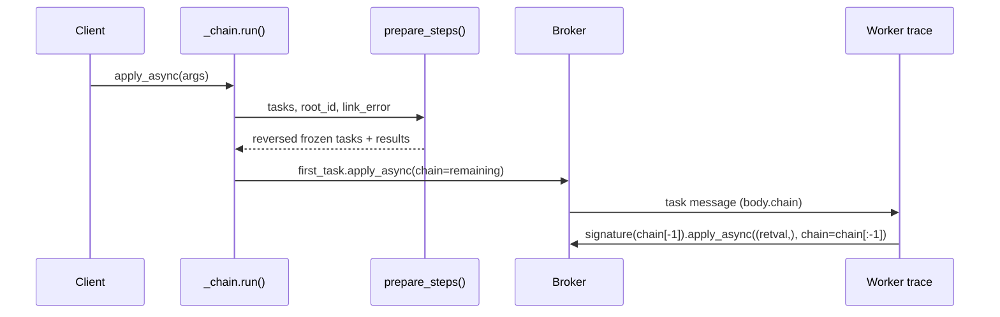
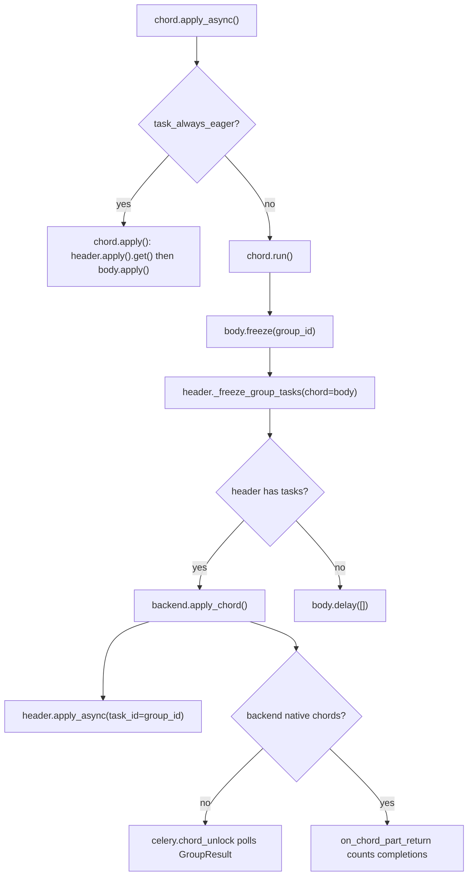

## Overview

The canvas lets a client describe work as data instead of calling a task right away. A `Signature` wraps one task invocation (task name, args, kwargs, execution options) in a plain `dict` so it survives serialization and can travel inside another task message as a callback. The primitives built on it (`chain`, `group`, `chord`, `chunks`, `xmap`, `xstarmap`) compose signatures into workflows, and all of them are exported from `celery` rather than from `celery.canvas`.

Sources: [celery/canvas.py:1-40](repo://celery/canvas.py#L1-L40)

A workflow is resolved on the client: canvas code freezes task ids, wires `link`, `link_error`, `chain` and `chord` options, and publishes plain task messages through the normal path described in [[Calling Tasks and Message Protocol]]. The worker only follows those options when a task finishes (see [[Task Execution and Tracing]]); results come back as `AsyncResult` and `GroupResult` objects ([[Task Results]]). A few helper tasks registered on every app (`celery.map`, `celery.starmap`, `celery.chunks`, `celery.chord_unlock`, `celery.accumulate`) run the parts that must execute on a worker.

Sources: [celery/app/builtins.py:1-10](repo://celery/app/builtins.py#L1-L10), [celery/app/trace.py:426-473](repo://celery/app/trace.py#L426-L473)

## Signatures

### Creating a signature

`Signature` subclasses `dict` and stores five keys: `task`, `args`, `kwargs`, `options` and `subtask_type`, plus the `immutable` flag. Passing a task object instead of a name keeps the object in `_type` so `sig.type` does not need a registry lookup; any extra keyword arguments go into `options`. Passing a dict copies it as-is, which is how a signature is rebuilt after deserialization.

Sources: [celery/canvas.py:323-345](repo://celery/canvas.py#L323-L345), [celery/canvas.py:865-875](repo://celery/canvas.py#L865-L875)

The usual way to build one is from a task. `Task.s()` takes star arguments, `Task.si()` produces an immutable signature that ignores the parent result, and `map`, `starmap` and `chunks` wrap `self.s()` in the matching canvas class.

Sources: [celery/app/task.py:962-1001](repo://celery/app/task.py#L962-L1001)

```python
    def s(self, *args, **kwargs):
        """Create signature.

        Shortcut for ``.s(*a, **k) -> .signature(a, k)``.
        """
        return self.signature(args, kwargs)

    def si(self, *args, **kwargs):
        """Create immutable signature.

        Shortcut for ``.si(*a, **k) -> .signature(a, k, immutable=True)``.
        """
        return self.signature(args, kwargs, immutable=True)
```

Sources: [celery/app/task.py:974-986](repo://celery/app/task.py#L974-L986)

### Serialization and subtypes

Each canvas class registers itself in `Signature.TYPES` with the `register_type` decorator, keyed by name (`chain`, `group`, `chord`, `xmap`, `xstarmap`, `chunks`). `Signature.from_dict` reads `subtask_type` from the dict and hands off to the registered class's own `from_dict`, so a nested workflow comes back with the right types. `signature()` clones an existing signature or calls `from_dict` on a dict; `maybe_signature()` does the same but passes `None` through and can rebind the app. `subtask` and `maybe_subtask` are kept as old aliases.

Sources: [celery/canvas.py:290-321](repo://celery/canvas.py#L290-L321), [celery/canvas.py:2395-2442](repo://celery/canvas.py#L2395-L2442)

`__reduce__` pickles a signature as `signature(dict(self))`, and `__json__` returns the plain dict, so the task type is resolved again on the far side and never stored in the message.

Sources: [celery/canvas.py:816-830](repo://celery/canvas.py#L816-L830)

### Partial arguments and immutability

`_merge` combines the stored values with values given at call time. Positional arguments given later are **prepended** to the stored args (a callback receives the parent result as its first argument), kwargs are merged, and options are overlaid. Two kinds of options never change: keys in `_IMMUTABLE_OPTIONS` (`group_id`, `stamped_headers`) and every key named in the signature's own `stamped_headers`. An immutable signature keeps its args and kwargs and merges only options, unless `force=True`.

Sources: [celery/canvas.py:294-294](repo://celery/canvas.py#L294-L294), [celery/canvas.py:403-443](repo://celery/canvas.py#L403-L443)

| Method | Effect |
| --- | --- |
| `clone(args, kwargs, **opts)` / `partial` | New signature with merged values; options are deep-copied so links on the original are not modified. |
| `replace(args, kwargs, options)` | Clone, then overwrite any section that is not `None`. |
| `set(immutable=None, **options)` | Update options in place and return `self` for chaining. |
| `set_immutable(flag)` | Toggle the `immutable` key. |
| `__call__(*args, **kwargs)` | Run the task body in the current process. |
| `delay(*args, **kwargs)` | `apply_async(args, kwargs)`. |
| `apply(...)` | Run locally through `Task.apply`. |
| `~sig` | `apply_async().get()`. |

Sources: [celery/canvas.py:347-368](repo://celery/canvas.py#L347-L368), [celery/canvas.py:445-471](repo://celery/canvas.py#L445-L471), [celery/canvas.py:524-552](repo://celery/canvas.py#L524-L552), [celery/canvas.py:820-821](repo://celery/canvas.py#L820-L821)

### Sending a signature

`apply_async` drops options set to `None`, merges call-time values only when there are any, and calls `_apply_async`. That cached property is `self.type.apply_async` when the task is registered locally; when the name is unknown (a `KeyError` from `app.tasks`), it falls back to `app.send_task` with the task name, so a client can call tasks it has never imported. `AsyncResult` falls back to `app.AsyncResult` the same way.

Sources: [celery/canvas.py:370-401](repo://celery/canvas.py#L370-L401), [celery/canvas.py:850-863](repo://celery/canvas.py#L850-L863)

### Freezing

`freeze` gives a signature its final identity before it is sent: it reuses `options['task_id']` or writes a new UUID there, sets `root_id`, `parent_id`, `group_id` (only if not already set), `chord` and `group_index` when given, defaults `reply_to` to `app.thread_oid`, and returns the `AsyncResult` for that id. A frozen signature must be sent only once, because a second send produces another message with the same task id. Every composite primitive freezes its members first so it can return a result tree before any message is published.

Sources: [celery/canvas.py:473-522](repo://celery/canvas.py#L473-L522)

## Callbacks and error callbacks

`link` and `link_error` append a signature to the `link` or `link_error` option list (converting a single value to a list and skipping duplicates) and return the **argument**, which suits `functools.reduce`. `on_error` calls `link_error` but returns `self`, so `add.s(2, 2).on_error(errback.s()).delay()` sends `add`. `flatten_links` walks the `link` tree recursively.

Sources: [celery/canvas.py:685-757](repo://celery/canvas.py#L685-L757)

These options are published as the `callbacks` and `errbacks` fields of the message body, next to `chain` and `chord`. When the task succeeds the worker applies each callback with the return value as the first argument; several callbacks are grouped into one `group` apply, and group callbacks are applied separately.

Sources: [celery/app/amqp.py:393-406](repo://celery/app/amqp.py#L393-L406), [celery/app/trace.py:426-473](repo://celery/app/trace.py#L426-L473)

The composite types redefine linking because "the task finished" means something different for each:

Sources: [celery/canvas.py:1017-1034](repo://celery/canvas.py#L1017-L1034), [celery/canvas.py:1691-1712](repo://celery/canvas.py#L1691-L1712), [celery/canvas.py:2298-2341](repo://celery/canvas.py#L2298-L2341)

| Primitive | `link(sig)` | `link_error(sig)` |
| --- | --- | --- |
| `Signature` | Appends to `options['link']`. | Appends to `options['link_error']`. |
| `chain` | Stored on the chain; `unchain_tasks` moves it to the last task. | Stored on the chain; `unchain_tasks` copies it to every task. |
| `group` | Attached to the **first** task only, cloned and made immutable (it can fire before siblings finish). | Cloned onto every child, so it may run more than once. |
| `chord` | Attached to the body. | Attached to the body; also to every header task when `task_allow_error_cb_on_chord_header` is true (otherwise a `CPendingDeprecationWarning`); nested chords in the header link themselves. |

Sources: [celery/canvas.py:1017-1034](repo://celery/canvas.py#L1017-L1034), [celery/canvas.py:1691-1712](repo://celery/canvas.py#L1691-L1712), [celery/canvas.py:2298-2341](repo://celery/canvas.py#L2298-L2341)

> [!WARNING]
> `group.apply_async` refuses `link` and `link_error` keyword arguments with `TypeError`: a success callback for a whole group must be a chord, and error callbacks go on the individual tasks.

Sources: [celery/canvas.py:1616-1624](repo://celery/canvas.py#L1616-L1624)

## Composition operators

`|` builds workflows and normalises them as it goes. `Signature.__or__` turns `task | task` into a `_chain`, splices `task | chain`, and unrolls a one-member group first. `_chain.__or__` adds more rewrites: a chain ending in a group followed by a task becomes a chord, and a chain ending in a chord absorbs the following task into the chord body. `group | task` always becomes `chord(group, body=task)`, and `chord | task` pipes the task onto the body. `__ior__` is overridden because Python 3.9 made `|=` the dict merge operator.

Sources: [celery/canvas.py:759-786](repo://celery/canvas.py#L759-L786), [celery/canvas.py:960-1006](repo://celery/canvas.py#L960-L1006), [celery/canvas.py:1598-1607](repo://celery/canvas.py#L1598-L1607), [celery/canvas.py:2077-2092](repo://celery/canvas.py#L2077-L2092)

| Left | Right | Result |
| --- | --- | --- |
| task | task | `chain(a, b)` |
| task | chain | chain with `a` prepended |
| chain | chain | tasks of the right chain reduced onto the left |
| chain ending in group | task | chain whose last item is `chord(group, task)` |
| chain ending in chord | task | chain whose chord body gets the task piped onto it |
| group | task or group | `chord(group, body=other)` (an empty right-hand group returns the left group) |
| chord | task | chord whose body gets the task piped onto it |

Sources: [celery/canvas.py:759-780](repo://celery/canvas.py#L759-L780), [celery/canvas.py:960-1006](repo://celery/canvas.py#L960-L1006), [celery/canvas.py:1598-1607](repo://celery/canvas.py#L1598-L1607), [celery/canvas.py:2077-2092](repo://celery/canvas.py#L2077-L2092)

## Chains

### Building a chain

`_chain` is a signature for the pseudo-task `celery.chain` whose `kwargs['tasks']` holds the steps; a single list argument is wrapped in `regen` so generators work. The public `chain` subclass overrides `__new__` so `chain(a, b, c)` is computed as `reduce(operator.or_, tasks, _chain())`, which gives it the same rewrites as `a | b | c`.

Sources: [celery/canvas.py:934-958](repo://celery/canvas.py#L934-L958), [celery/canvas.py:1371-1382](repo://celery/canvas.py#L1371-L1382)

### Running a chain

`_chain.apply_async` short-circuits to `apply` (each step run locally with the previous result) when `task_always_eager` is set; otherwise it calls `run` with the chain options merged in. `run` prepends partial args unless the chain is immutable, calls `prepare_steps`, and publishes only the **first** step. The rest of the steps travel in that message's `chain` option, built by `_prepare_chain_from_options`. That helper returns a `ChainMap` and never mutates `options['chain']`, because groups share one options dict across their members and an in-place extend leaked steps between them (issue #5354).

Sources: [celery/canvas.py:1036-1091](repo://celery/canvas.py#L1036-L1091), [celery/canvas.py:877-931](repo://celery/canvas.py#L877-L931), [celery/canvas.py:1294-1302](repo://celery/canvas.py#L1294-L1302)



Sources: [celery/canvas.py:1048-1091](repo://celery/canvas.py#L1048-L1091), [celery/app/trace.py:467-473](repo://celery/app/trace.py#L467-L473)

### prepare_steps

`prepare_steps` walks the steps from the **end** with a `deque`, so the list it returns is reversed and the worker can take the next step with `chain[-1]` and pass on `chain[:-1]`. For each step it:

Sources: [celery/canvas.py:1166-1192](repo://celery/canvas.py#L1166-L1192)

1. Converts dicts with `from_dict` and unrolls one-member groups; empty groups in the middle of a chain are skipped.
2. Clones the step, giving the partial args to the first step only.
3. Splices a nested chain by extending the deque with its tasks.
4. Upgrades a group that is followed by a step into `chord(group, body=prev_task)`, reusing the next step's frozen task id when it has one.
5. Freezes the step. Only the last step receives `last_task_id`, `group_id`, `chord` and `group_index`, so an enclosing group or chord synchronises on the chain's final task.
6. Links the previous step with `task.link(prev_task)` when protocol 1 or `use_link` is in use, and sets `prev_res.parent` so the result tree can be walked with `.parent`.
7. Applies every `link_error` to the step, and also to the body of a chord step for `chord_error_from_stack`.
8. For a chord step, calls `app.backend.ensure_chords_allowed()` and moves `prev_res` to the top of the body's result chain.

Sources: [celery/canvas.py:1120-1180](repo://celery/canvas.py#L1120-L1180), [celery/canvas.py:1181-1292](repo://celery/canvas.py#L1181-L1292)

`_chain.freeze` runs the same `prepare_steps` with `clone=False`, keeps the output in `_frozen`, and returns `results[0]`, the result of the last task. `self.id` is set to that task's id.

Sources: [celery/canvas.py:1096-1105](repo://celery/canvas.py#L1096-L1105), [celery/canvas.py:1290-1292](repo://celery/canvas.py#L1290-L1292)

## Groups

### Group construction

`group` stores its members in `kwargs['tasks']`. A single argument is treated as the iterable of tasks (a lone signature is cloned into a list), and any non-`regen` iterable is wrapped in `regen` so generator input is consumed lazily. `_maybe_group` performs the same normalisation for chord headers.

Sources: [celery/canvas.py:1580-1596](repo://celery/canvas.py#L1580-L1596), [celery/canvas.py:1475-1489](repo://celery/canvas.py#L1475-L1489)

### Applying a group

`group.apply_async` follows these steps:

Sources: [celery/canvas.py:1616-1650](repo://celery/canvas.py#L1616-L1650)

1. `_freeze_gid` merges options (keeping immutable ones) and turns `task_id` into the `group_id`, so members do not all get the same id.
2. `_prepared` clones each member, recursively flattens nested groups, prepends partial args to mutable members, and freezes each one with `group_id`, `root_id` and its `group_index`.
3. `_apply_tasks` publishes every member on one producer from `producer_or_acquire`. It reads the iterator one step ahead with `itertools.tee`, so at the last member it can call `backend.set_chord_size(group_id, chord_size)` without exhausting a generator first. The size is summed with `_chord._descend`.
4. Each result is added to a `vine.barrier`, and a `GroupResult(group_id, results, ready_barrier=p)` is returned. Inside a worker task the result is also added to the parent's trail.

Sources: [celery/canvas.py:1616-1650](repo://celery/canvas.py#L1616-L1650), [celery/canvas.py:1714-1761](repo://celery/canvas.py#L1714-L1761), [celery/canvas.py:1763-1837](repo://celery/canvas.py#L1763-L1837)

An empty group returns `self.freeze()` without publishing anything. A group whose only result is itself a `GroupResult` (the `group(A.s() | group(B.s(), C.s()))` case) returns that inner result.

Sources: [celery/canvas.py:1625-1646](repo://celery/canvas.py#L1625-L1646)

### Freezing a group

`group.freeze` returns `GroupResult(*_freeze_group_tasks(...))`. When the tasks are a generator it tees them into two clones: one is frozen lazily for results and the other replaces `self.tasks`, so freezing never consumes the generator. Otherwise `_freeze_unroll` flattens nested groups with a stack and freezes each leaf with a running `group_index`.

Sources: [celery/canvas.py:1839-1947](repo://celery/canvas.py#L1839-L1947)

## Chords

### Header, body and freezing

`_chord` (exported as `chord`) keeps the header group in `kwargs['header']` and the callback in `kwargs['body']`. Calling the chord with a body (`chord(header)(body)`) passes it through `apply_async` kwargs. `freeze` wraps the header in a group, freezes it with `chord=self.body`, freezes the body with the outer ids, and then sets the header `GroupResult` as `parent` on the first result in the body's chain that has no parent. It raises `RuntimeError('Recursive result parents')` if it finds a cycle.

Sources: [celery/canvas.py:2064-2125](repo://celery/canvas.py#L2064-L2125), [celery/canvas.py:2386-2392](repo://celery/canvas.py#L2386-L2392)

### Running a chord

`apply_async` clones the body with the call options, runs `apply` in eager mode (header results passed as the body's single argument), and otherwise calls `run`. `run` freezes the body with the header's `group_id`, removes `chain`, `chord` and `task_id` from the header options (issue #3771 and nested chords), freezes the header tasks with `chord=body`, and then hands the work to the result backend.

Sources: [celery/canvas.py:2153-2189](repo://celery/canvas.py#L2153-L2189), [celery/canvas.py:2226-2286](repo://celery/canvas.py#L2226-L2286)



Sources: [celery/canvas.py:2153-2189](repo://celery/canvas.py#L2153-L2189), [celery/canvas.py:2226-2286](repo://celery/canvas.py#L2226-L2286), [celery/backends/base.py:838-867](repo://celery/backends/base.py#L838-L867), [celery/backends/base.py:1183-1192](repo://celery/backends/base.py#L1183-L1192)

The base backend's `apply_chord` calls `fallback_chord_unlock`, which sends `celery.chord_unlock` to the body's queue (or the routed queue for the body name). Backends that support atomic counters (`implements_incr`) instead save the header result in `_apply_chord_incr` and fire the body from `on_chord_part_return`. The chord size these backends compare against comes from `_descend`: a group counts each member, a chain counts its last non-empty element, a nested chord counts its body, and a plain signature counts as 1. See [[Result Backends]].

Sources: [celery/backends/base.py:838-867](repo://celery/backends/base.py#L838-L867), [celery/backends/base.py:1183-1192](repo://celery/backends/base.py#L1183-L1192), [celery/canvas.py:2191-2224](repo://celery/canvas.py#L2191-L2224)

> [!NOTE]
> An empty header never triggers the body through the backend, so `run` calls `body.delay([])` directly and returns a `GroupResult` built from the frozen (empty) header.

Sources: [celery/canvas.py:2278-2286](repo://celery/canvas.py#L2278-L2286)

### Chord settings

| Setting | Default | Used by |
| --- | --- | --- |
| `result_chord_retry_interval` | `1.0` | Default retry delay of `celery.chord_unlock` between polls. |
| `result_chord_join_timeout` | `3.0` | Timeout for joining header results in `celery.chord_unlock`. |
| `task_allow_error_cb_on_chord_header` | `False` | Whether `chord.link_error` also links header tasks. |
| `task_protocol` | `2` | Protocol 1 makes chains use `link` instead of the `chain` message field. |

Sources: [celery/app/defaults.py:224-225](repo://celery/app/defaults.py#L224-L225), [celery/app/defaults.py:295-295](repo://celery/app/defaults.py#L295-L295), [celery/app/defaults.py:323-323](repo://celery/app/defaults.py#L323-L323), [celery/app/builtins.py:47-81](repo://celery/app/builtins.py#L47-L81)

## Map and chunk primitives

`xmap` and `xstarmap` derive from `_basemap`: an immutable signature for `celery.map` or `celery.starmap` whose kwargs hold the target `task` and the iterable `it`. `apply_async` turns the iterable into a list and routes the message as if it were the target task (`route_name=task_name_from(...)`). The worker then calls the task body **sequentially in one process**, so these are not parallel like `group`.

Sources: [celery/canvas.py:1385-1433](repo://celery/canvas.py#L1385-L1433), [celery/app/builtins.py:101-120](repo://celery/app/builtins.py#L101-L120)

`chunks(task, it, n)` splits the iterable into parts of size `n`. `chunks.group()` builds a `group` of one `xstarmap` per part, so the parts run in parallel while items within a part run in sequence. `apply_async` publishes that group, routed by the target task name. The `celery.chunks` built-in task calls `chunks.apply_chunks` for the same split on a worker.

Sources: [celery/canvas.py:1436-1472](repo://celery/canvas.py#L1436-L1472), [celery/app/builtins.py:123-130](repo://celery/app/builtins.py#L123-L130)

## Built-in tasks

Every function in `celery/app/builtins.py` is registered with `connect_on_app_finalize`, so each app gets these tasks when it is finalized. All are declared `shared=False, lazy=False`.

Sources: [celery/app/builtins.py:12-98](repo://celery/app/builtins.py#L12-L98), [celery/app/builtins.py:101-186](repo://celery/app/builtins.py#L101-L186)

| Task name | Purpose |
| --- | --- |
| `celery.backend_cleanup` | Calls `app.backend.cleanup()` to delete expired results (scheduled daily by beat when the backend needs it). |
| `celery.accumulate` | Used by `Task.replace` when replacing a task with a group; returns `args`, or `args[index]`. |
| `celery.chord_unlock` | Polls a header `GroupResult` (bound, `max_retries=None`, retries with `countdown=interval`), joins it, and calls `callback.delay(ret)`. Join or callback failures go to `backend.chord_error_from_stack`. |
| `celery.map` / `celery.starmap` | Run `task(item)` / `task(*item)` for each item. |
| `celery.chunks` | Calls `chunks.apply_chunks(task, it, n)`. |
| `celery.group`, `celery.chain`, `celery.chord` | Kept for backwards compatibility. `celery.chain` raises `NotImplementedError`; `celery.chord` rebuilds the header group and calls `_chord.run`. |

Sources: [celery/app/builtins.py:12-98](repo://celery/app/builtins.py#L12-L98), [celery/app/builtins.py:101-186](repo://celery/app/builtins.py#L101-L186)

## Stamping

### The visitor API

Stamping (added in 5.3) attaches custom headers to every signature in a workflow. `StampingVisitor` is an abstract base whose hooks each return a dict of stamps for one kind of node. Only `on_signature` is abstract (the other hooks return empty stamps by default); the default `on_chord_header_start` delegates to `on_group_start` on the header.

Sources: [celery/canvas.py:119-230](repo://celery/canvas.py#L119-L230)

| Hook | Called for |
| --- | --- |
| `on_signature(sig, **headers)` | Every simple signature. |
| `on_group_start` / `on_group_end` | A group, before and after its members. |
| `on_chain_start` / `on_chain_end` | A chain, before and after its tasks. |
| `on_chord_header_start` / `on_chord_header_end` | A chord's header. |
| `on_chord_body(sig, **headers)` | A chord's body, before it is stamped. |
| `on_callback` / `on_errback` | Each `link` / `link_error` signature. |

Sources: [celery/canvas.py:125-230](repo://celery/canvas.py#L125-L230)

### How stamps are applied

`Signature.stamp(visitor, append_stamps, **headers)` first stamps its links through `stamp_links` (with `self_headers=False`, so callbacks do not copy the parent's own stamps), then asks the visitor for `on_signature` stamps, merges them with `_stamp_headers`, and stores the result with `set(**headers)`. `_stamp_headers` keeps a `stamped_headers` list of stamp names and merges dicts with `_merge_dictionaries`: with `append_stamps=True` duplicate stamps are collected into lists, otherwise the visitor's value wins.

Sources: [celery/canvas.py:554-634](repo://celery/canvas.py#L554-L634), [celery/canvas.py:636-683](repo://celery/canvas.py#L636-L683), [celery/canvas.py:74-116](repo://celery/canvas.py#L74-L116)

`_chain.stamp`, `group.stamp` and `chord.stamp` call the start hook, stamp their links and recurse into members, then call the end hook. Generator-backed groups and headers are stamped lazily with `regen.map(_stamp_regen_task)`. The chord stamps its body after `on_chord_body`.

Sources: [celery/canvas.py:1107-1118](repo://celery/canvas.py#L1107-L1118), [celery/canvas.py:1668-1689](repo://celery/canvas.py#L1668-L1689), [celery/canvas.py:2127-2151](repo://celery/canvas.py#L2127-L2151)

When the message is built, `as_task_v2` copies each name in `stamped_headers` from the options into a `stamps` header next to `stamped_headers`, and `send_task` removes those keys from the publish options. Because `stamped_headers` and every stamp named in it are immutable in `_merge`, later option merges during freezing cannot overwrite a stamp.

Sources: [celery/app/amqp.py:370-390](repo://celery/app/amqp.py#L370-L390), [celery/app/base.py:1018-1020](repo://celery/app/base.py#L1018-L1020), [celery/canvas.py:403-443](repo://celery/canvas.py#L403-L443)

The user guide's example visitor gives every task in a workflow a `monitoring_id` stamp. If a hook's return value has no `stamped_headers` key, `_stamp_headers` treats every returned key as a stamp.

Sources: [docs/userguide/canvas.rst:1295-1325](repo://docs/userguide/canvas.rst#L1295-L1325), [celery/canvas.py:588-596](repo://celery/canvas.py#L588-L596)

```python
class MonitoringIdStampingVisitor(StampingVisitor):
    def on_signature(self, sig, **headers) -> dict:
        return {'monitoring_id': uuid4().hex}
```

Sources: [docs/userguide/canvas.rst:1303-1305](repo://docs/userguide/canvas.rst#L1303-L1305)
