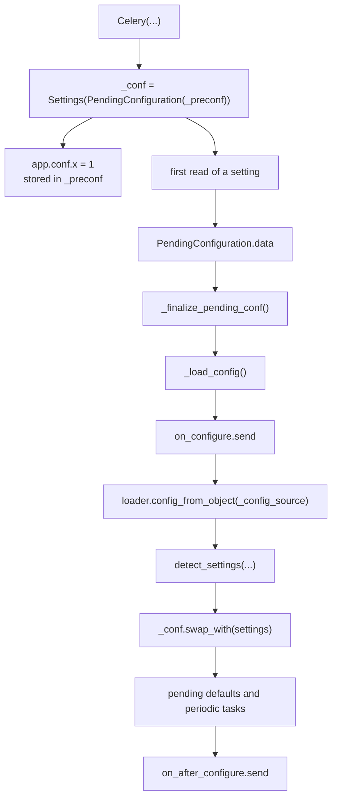
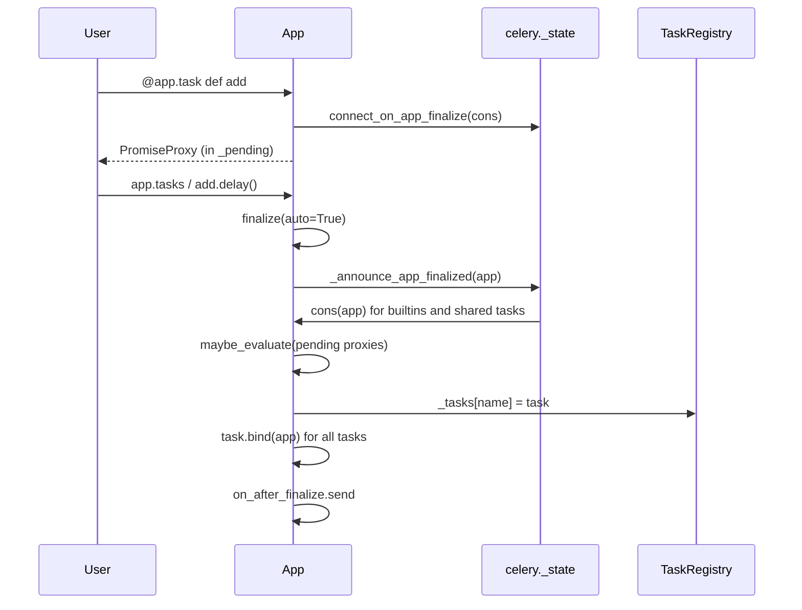

## Overview

Every Celery program starts with an instance of `celery.Celery`, the application. The app owns the configuration, the task registry, and lazily created factories for everything else: the AMQP layer, the result backend, the loader, logging, events and remote control. Celery keeps no global configuration, so several apps can live in one process, each with its own broker and settings. A task is always bound to the app that created it.

Sources: [celery/app/base.py:252-287](repo://celery/app/base.py#L252-L287), [celery/app/base.py:1534-1609](repo://celery/app/base.py#L1534-L1609)

Construction is cheap on purpose. `Celery()` reads no configuration, imports no task modules and opens no broker connection. Settings are loaded the first time `app.conf` is read (see [[Configuration]]), task decorators are evaluated at finalization, and components are built on first attribute access. The thread-local "current app" and the proxies behind that laziness are described in [[App State, Proxies and Lazy Objects]].

Sources: [celery/app/base.py:343-434](repo://celery/app/base.py#L343-L434)

## Construction

### Constructor arguments

`Celery.__init__` stores class names, not instances, for each pluggable component. Arguments that are really settings (`broker`, `backend`, `include` and any extra keyword argument) go into `_preconf` through `__autoset` and are applied when configuration is loaded.

Sources: [celery/app/base.py:343-401](repo://celery/app/base.py#L343-L401), [celery/app/base.py:447-450](repo://celery/app/base.py#L447-L450)

| Argument | Default | Purpose |
| --- | --- | --- |
| `main` | `None` | Name of the main module. Replaces `__main__` in generated task names. |
| `broker` | `None` | Stored as the `broker_url` setting. |
| `backend` | `None` | Stored as the `result_backend` setting (URL, alias or class). |
| `include` | `None` | Stored as `include`: modules every worker imports. |
| `loader` | `CELERY_LOADER` env, `loader_cls`, or `celery.loaders.app:AppLoader` | Loader class or alias. |
| `amqp`, `events`, `log`, `control` | `celery.app.amqp:AMQP`, `celery.app.events:Events`, `celery.app.log:Logging`, `celery.app.control:Control` | Component classes, instantiated lazily. |
| `tasks` | `celery.app.registry:TaskRegistry` | A registry instance, or a mapping used to seed a new registry. |
| `task_cls` | `celery.app.task:Task` | Base class for tasks created by `@app.task`. |
| `config_source` | `None` | Object or module name loaded by `config_from_object` at configure time. |
| `changes` | `None` | Initial settings dict (used when unpickling). |
| `fixups` | `BUILTIN_FIXUPS` (`celery.fixups.django:fixup`) | Fix-up plug-ins, each called with the app. |
| `namespace` | `None` | Setting prefix, e.g. `'CELERY'` to read `CELERY_BROKER_URL` from Django settings. |
| `set_as_current` | `True` | Make this app the current app for the thread. |
| `autofinalize` | `True` | If `False`, using the registry before `finalize()` raises `RuntimeError`. |
| `strict_typing` | `True` | Check call arguments against the task signature. |
| `**kwargs` | | Any other setting, e.g. `task_acks_late=True`. |

Sources: [celery/app/base.py:309-318](repo://celery/app/base.py#L309-L318), [celery/app/base.py:343-413](repo://celery/app/base.py#L343-L413), [celery/app/base.py:436-442](repo://celery/app/base.py#L436-L442), [celery/app/base.py:82-84](repo://celery/app/base.py#L82-L84)

### What `__init__` does

The constructor works in this order:

Sources: [celery/app/base.py:343-348](repo://celery/app/base.py#L343-L348)

1. It creates a `threading.local`, a `LamportClock` and empty deques for pending tasks, pending defaults and pending periodic tasks.
2. It wraps the registry: anything that is not already a `TaskRegistry` is passed to `registry_cls`.
3. It wraps `_preconf` in a `PendingConfiguration` inside a `Settings` view, with key converters `_old_key_to_new` / `_new_key_to_old`.
4. It instantiates every fixup and keeps the instances in `_fixups`.
5. If `set_as_current` is true, it calls `set_current()`.
6. It creates the `on_configure`, `on_after_configure`, `on_after_finalize` and `on_after_fork` signals.
7. It calls the `on_init()` hook and registers the app in the global weak set of live apps with `_register_app`.

Sources: [celery/app/base.py:350-434](repo://celery/app/base.py#L350-L434)

> [!TIP]
> Subclass `Celery` and override `on_init()` for set-up that must run on every instance, or set class attributes such as `task_cls`. A subclass with a `task_cls` attribute is detected as a custom task class (`_custom_task_cls_used`).

Sources: [celery/app/base.py:360-366](repo://celery/app/base.py#L360-L366), [celery/app/base.py:444-445](repo://celery/app/base.py#L444-L445)

## Configuration loading

### Lazy `conf` and `PendingConfiguration`

Until the app is configured, `app._conf` is a `Settings` whose first layer is a `PendingConfiguration`. Writes (`app.conf.x = ...`, `update`, `setdefault`) and `in` checks go straight to the `_preconf` dict without triggering a load. Any read goes through the `data` cached property, which calls `_finalize_pending_conf`, which calls `_load_config()`.

Sources: [celery/app/base.py:208-249](repo://celery/app/base.py#L208-L249), [celery/app/base.py:1230-1245](repo://celery/app/base.py#L1230-L1245), [celery/app/base.py:1565-1574](repo://celery/app/base.py#L1565-L1574)

`_load_config` does the following:

Sources: [celery/app/base.py:1247-1247](repo://celery/app/base.py#L1247-L1247)

1. It sends `on_configure`.
2. If a `_config_source` was given, it asks the loader to import it with `loader.config_from_object`.
3. It sets `configured = True`.
4. It runs `detect_settings(prepare_config(loader.conf), _preconf, ...)`. This merges the user settings with the defaults and picks the old (uppercase) or new (lowercase) naming scheme. `prepare_config` runs `find_deprecated_settings` first.
5. It swaps the result into the existing `Settings` object in place, so references to `app.conf` taken earlier stay valid.
6. It applies pending `add_defaults` callables and pending `add_periodic_task` entries.
7. It sends `on_after_configure` with `source=self._conf`.

Sources: [celery/app/base.py:1193-1195](repo://celery/app/base.py#L1193-L1195), [celery/app/base.py:1247-1280](repo://celery/app/base.py#L1247-L1280)



Sources: [celery/app/base.py:208-249](repo://celery/app/base.py#L208-L249), [celery/app/base.py:1230-1280](repo://celery/app/base.py#L1230-L1280)

> [!WARNING]
> An `AttributeError` raised while loading the configuration is re-raised as `ModuleNotFoundError`. `UserDict` attribute lookup would otherwise swallow it and turn it into a confusing `RecursionError`. If you see `ModuleNotFoundError` from `app.conf`, check the config module for attribute errors too.

Sources: [celery/app/base.py:1237-1243](repo://celery/app/base.py#L1237-L1243)

### Configuration methods

| Method | Behavior |
| --- | --- |
| `config_from_object(obj, silent=False, force=False, namespace=None)` | Records `obj` (an object or a dotted module name) as `_config_source` and sets `namespace`. It is lazy unless `force=True` or the app is already configured. In that case `_conf` is reset and `loader.config_from_object` runs now. |
| `config_from_envvar(variable_name, silent=False, force=False)` | Reads a module name from the environment variable and delegates to `config_from_object`. If the variable is unset it raises `ImproperlyConfigured` (`ERR_ENVVAR_NOT_SET`), or returns `False` when `silent`. |
| `config_from_cmdline(argv, namespace='celery')` | Parses `name=value` pairs with `loader.cmdline_config_parser` and updates `conf`. |
| `add_defaults(fun)` | Adds a dict, or a callable returning one, as a lower-priority defaults layer. It is deferred until configure time unless the app is already configured. |
| `conf` setter | Replaces the settings object. |

Sources: [celery/app/base.py:679-748](repo://celery/app/base.py#L679-L748), [celery/app/base.py:87-96](repo://celery/app/base.py#L87-L96), [celery/app/base.py:1572-1574](repo://celery/app/base.py#L1572-L1574)

```python
app = Celery('proj')
app.config_from_object('proj.celeryconfig')       # lazy
app.config_from_envvar('CELERY_CONFIG_MODULE')    # module name from env
app.conf.update(task_serializer='json')           # goes into _preconf
```

Sources: [celery/app/base.py:703-743](repo://celery/app/base.py#L703-L743)

## Tasks and the registry

### The `task` decorator

`@app.task` and `@app.task(**opts)` both end up in `inner_create_task_cls`, which accepts `shared`, `filter` and `lazy` on top of the task options:

Sources: [celery/app/base.py:554-557](repo://celery/app/base.py#L554-L557)

1. If `shared` (the default) is set, a constructor `cons(app)` is registered with `connect_on_app_finalize`, so every app finalized later also gets the task.
2. If the app is already finalized, or `lazy=False`, the task is created immediately through `_task_from_fun`. Otherwise a `PromiseProxy` wrapping `_task_from_fun` is returned and appended to `app._pending`.
3. An optional `filter` callable is applied to the result.

Sources: [celery/app/base.py:515-585](repo://celery/app/base.py#L515-L585)

Passing a non-callable single positional argument raises `TypeError('argument 1 to @task() must be a callable')`. When the worker was started through `execv` (`FORKED_BY_MULTIPROCESSING` set), the decorator falls back to `shared_task(lazy=False)`. This keeps `add.request` pointing at the current app's task instance.

Sources: [celery/app/base.py:545-552](repo://celery/app/base.py#L545-L552), [celery/app/base.py:577-585](repo://celery/app/base.py#L577-L585), [celery/app/base.py:85-85](repo://celery/app/base.py#L85-L85)

`_task_from_fun` builds the task class with `type()`. The class takes `base` (default `app.Task`) as its parent and sets `app`, `name`, `run` (the function, wrapped in `staticmethod` unless `bind=True`), `__header__` (the signature checker from `head_from_fun`), `__wrapped__` and any extra options as class attributes. It then instantiates the class, stores it in `_tasks`, calls `task.bind(app)` and applies `add_autoretry_behaviour`. A name already in the registry returns the existing task, so decorating twice is idempotent. With `pydantic=True` the function is wrapped first to validate arguments and dump return values. Task options are covered in [[Defining Tasks]].

Sources: [celery/app/base.py:587-633](repo://celery/app/base.py#L587-L633)

Task names come from `gen_task_name(app, name, module)`. The name is `module.function`, but when the module is `__main__` (or the multiprocessing main file) and `app.main` is set, `app.main` replaces the module part. That is why `Celery('tasks')` names a script's function `tasks.add`.

Sources: [celery/app/base.py:654-655](repo://celery/app/base.py#L654-L655), [celery/utils/imports.py:122-141](repo://celery/utils/imports.py#L122-L141)

### `shared_task`

`celery.shared_task` is for reusable libraries that must not import a concrete app. It registers a finalize callback that creates the task in every future app, creates it immediately in every live app that is already finalized, and returns a `Proxy` that looks the task up in `current_app.tasks` on each access.

Sources: [celery/app/__init__.py:24-76](repo://celery/app/__init__.py#L24-L76)

### `TaskRegistry`

`TaskRegistry` is a `dict` of name to task instance. `__missing__` raises `NotRegistered`. `register()` requires a `name`, instantiates classes and adds autoretry behaviour. `unregister()` accepts a name or a task and raises `NotRegistered` if it is absent. `app.register_task(task)` is the compatibility path for class-based tasks: it generates a missing name, binds the task and stores it.

Sources: [celery/app/registry.py:12-58](repo://celery/app/registry.py#L12-L58), [celery/app/base.py:635-652](repo://celery/app/base.py#L635-L652)

> [!NOTE]
> `app.tasks` is a cached property that calls `finalize(auto=True)` before returning the registry. Reading it therefore evaluates every pending task decorator. `send_task` deliberately reads `app._tasks` instead, so it can send by name without finalizing the app.

Sources: [celery/app/base.py:1601-1609](repo://celery/app/base.py#L1601-L1609), [celery/app/base.py:881-896](repo://celery/app/base.py#L881-L896)

## Finalization

`finalize()` runs once under `_finalize_mutex`. It sets `finalized = True`, then runs `_announce_app_finalized(app)`, which calls every callback registered with `connect_on_app_finalize`. These callbacks are the shared tasks and the built-in tasks from `celery/app/builtins.py`, such as `celery.backend_cleanup`, `celery.accumulate`, `celery.chord_unlock` and `celery.map`. Next it drains `_pending` with `maybe_evaluate`, which creates each lazily declared task. Finally it rebinds every task in the registry to the app and sends `on_after_finalize`.

Sources: [celery/app/base.py:657-677](repo://celery/app/base.py#L657-L677), [celery/_state.py:43-52](repo://celery/_state.py#L43-L52), [celery/app/builtins.py:12-110](repo://celery/app/builtins.py#L12-L110)



Sources: [celery/app/base.py:554-575](repo://celery/app/base.py#L554-L575), [celery/app/base.py:657-677](repo://celery/app/base.py#L657-L677), [celery/_state.py:43-52](repo://celery/_state.py#L43-L52)

With `autofinalize=False`, both `finalize(auto=True)` and `_task_from_fun` on an unfinalized app raise `RuntimeError('Contract breach: app not finalized')`. Use it to catch code that touches tasks before the app is fully set up.

Sources: [celery/app/base.py:602-603](repo://celery/app/base.py#L602-L603), [celery/app/base.py:663-666](repo://celery/app/base.py#L663-L666)

## Autodiscovery

`autodiscover_tasks(packages=None, related_name='tasks', force=False)` imports `<package>.tasks` for each package. It is lazy by default: it connects a `starpromise` to the `import_modules` signal for this app, so discovery happens when the loader imports the default modules (in the worker, or `celery report`). `force=True` runs it now. `packages` may be a callable, evaluated at discovery time. With no packages, the list comes from fixups that implement `autodiscover_tasks()`, which is how the Django fixup finds tasks in installed apps (see [[Django Integration]]). The actual import is done by `loader.autodiscover_tasks`.

Sources: [celery/app/base.py:782-844](repo://celery/app/base.py#L782-L844), [celery/bin/celery.py:166-172](repo://celery/bin/celery.py#L166-L172)

```python
app = Celery('proj')
app.autodiscover_tasks(['proj.orders', 'proj.billing'])
# imports proj.orders.tasks and proj.billing.tasks on import_modules
```

Sources: [celery/app/base.py:791-826](repo://celery/app/base.py#L791-L826)

## Sending tasks by name

`app.send_task(name, args, kwargs, **options)` publishes a task message without having the task's code. Use it to call tasks that live in another code base. It accepts the same options as `Task.apply_async`, plus `result_cls`, and returns an `AsyncResult`. `task_always_eager` has no effect on it and only produces an `AlwaysEagerIgnored` warning. If the name is registered locally, that task's execution options are merged in as defaults, and explicit `time_limit`, `soft_time_limit` and `expires` arguments win over them. An explicit `None` clears the task-level value. The rest of the pipeline is described in [[Calling Tasks and Message Protocol]]: routing, quorum-queue delayed delivery, expiry, parent and root ids, message creation and the backend's `on_task_call`.

Sources: [celery/app/base.py:846-930](repo://celery/app/base.py#L846-L930), [celery/app/base.py:1007-1041](repo://celery/app/base.py#L1007-L1041)

```python
result = app.send_task('tasks.add', args=(2, 2), countdown=10)
result.get(timeout=30)
```

Sources: [celery/app/base.py:846-862](repo://celery/app/base.py#L846-L862)

## Default and current app

Each thread has a current app, and the process has a default app. `app.set_current()` sets the thread-local current app (done automatically unless `set_as_current=False`). `app.set_default()` sets the process-wide default via `set_default_app`. When neither exists, `get_current_app()` creates a fallback app named `default` with no fixups and the `default` loader, or `CELERY_LOADER`. `celery.current_app` is a `Proxy` over `get_current_app`, and `celery.app.default_app` is a `Proxy` over the default app.

Sources: [celery/app/base.py:452-458](repo://celery/app/base.py#L452-L458), [celery/_state.py:86-104](repo://celery/_state.py#L86-L104), [celery/_state.py:138-142](repo://celery/_state.py#L138-L142), [celery/app/__init__.py:15-16](repo://celery/app/__init__.py#L15-L16)

`app.current_task` returns the top of the task stack. `app.current_worker_task` returns the innermost task that the worker executed, skipping tasks called directly. `send_task` uses `current_worker_task` to fill in `parent_id` and `root_id`.

Sources: [celery/app/base.py:1502-1514](repo://celery/app/base.py#L1502-L1514), [celery/_state.py:121-135](repo://celery/_state.py#L121-L135), [celery/app/base.py:994-1004](repo://celery/app/base.py#L994-L1004)

## Lazy components

| Attribute | Built from | Notes |
| --- | --- | --- |
| `app.amqp` | `instantiate(amqp_cls, app=self)` | Queues, router, message creation. See [[Task Routing and Queues]]. |
| `app.backend` | `backends.by_url(backend_cls or conf.result_backend)` | Cached per app if `thread_safe`, else per thread. See [[Result Backends]]. |
| `app.loader` | `get_loader_cls(loader_cls)(app=self)` | See [[Configuration]]. |
| `app.log` | `instantiate(log_cls, app=self)` | See [[Logging]]. |
| `app.events`, `app.control` | `instantiate(events_cls / control_cls)` | See [[Events and Monitoring]] and [[Remote Control and Inspection]]. |
| `app.pool` | `kombu.pools.connections[connection_for_write()]` | Broker connection pool, limited by `broker_pool_limit`. It is not the worker pool. |
| `app.Task`, `app.AsyncResult`, `app.GroupResult`, `app.Worker`, `app.WorkController`, `app.Beat` | `subclass_with_self(...)` | Subclasses whose `app` attribute is bound to this app. |
| `app.timezone` | `timezone` setting, else UTC if `enable_utc`, else local | Used by `app.now()`. |

Sources: [celery/app/base.py:1430-1500](repo://celery/app/base.py#L1430-L1500), [celery/app/base.py:1534-1632](repo://celery/app/base.py#L1534-L1632), [celery/app/base.py:1197-1200](repo://celery/app/base.py#L1197-L1200), [celery/app/base.py:1224-1228](repo://celery/app/base.py#L1224-L1228)

`subclass_with_self(Class, attribute='app', reverse=...)` creates `type(name, (Class,), {attribute: self, ...})`. Unless `keep_reduce` is set, it also adds a `__reduce__` that pickles as `_unpickle_appattr(reverse, args)`, which rebuilds the object from the current app on the other side. `app.Task` is created with `attribute='_app'`, `keep_reduce=True` and `abstract=True`.

Sources: [celery/app/base.py:1335-1375](repo://celery/app/base.py#L1335-L1375), [celery/app/base.py:111-115](repo://celery/app/base.py#L111-L115)

## Connections

`connection_for_write()` and `connection_for_read()` build a `kombu.Connection` from `broker_write_url` / `broker_read_url`, which both fall back to `broker_url`, plus the `broker_*` settings for credentials, SSL, transport options and timeouts. `connection_or_acquire()` and `producer_or_acquire()` are context managers that reuse a connection or producer you pass in, or acquire one from the pool. If the pool stays exhausted for `broker_pool_acquire_timeout`, they raise `OperationalError` with a hint to raise `broker_pool_limit`.

Sources: [celery/app/base.py:1043-1057](repo://celery/app/base.py#L1043-L1057), [celery/app/base.py:1102-1189](repo://celery/app/base.py#L1102-L1189)

## Lifecycle, pickling and fork

- `with Celery(set_as_current=False) as app:` calls `close()` on exit. That drops the connection pool and deregisters the app.
- `app.start(argv)` runs the `celery` command with this app as the default `--app`. `app.worker_main(argv)` does the same but requires `worker` in `argv` and raises `ValueError` without it.
- On the first use of `app.pool`, the app registers `_after_fork_cleanup_app` with `multiprocessing.register_after_fork`. In child processes, `_after_fork` resets the connection and producer pools and sends `on_after_fork`.
- Apps pickle through `__reduce_keys__`. This produces a keyword dict (`main`, `changes`, `loader`, `backend`, `amqp`, `events`, `log`, `control`, `fixups`, `config_source`, `task_cls`, `namespace`) that `_unpickle_app_v2` passes back to the class with `set_as_current=False`. Only configuration changes travel, never the defaults. Subclasses that override `__reduce_args__` use the old positional `AppPickler` protocol instead.

Sources: [celery/app/base.py:466-513](repo://celery/app/base.py#L466-L513), [celery/app/base.py:460-464](repo://celery/app/base.py#L460-L464), [celery/app/base.py:1282-1288](repo://celery/app/base.py#L1282-L1288), [celery/app/base.py:1382-1428](repo://celery/app/base.py#L1382-L1428), [celery/app/utils.py:289-324](repo://celery/app/utils.py#L289-L324)

## Periodic tasks and signals

`add_periodic_task(schedule, sig, args, kwargs, name=None, **opts)` turns a signature into a `beat_schedule` entry keyed by `name` or `repr(sig)`. Before configuration the entry is queued in `_pending_periodic_tasks` and applied by `_load_config`. Adding an unnamed entry with the same key logs a "shadowed a previous unnamed periodic task" warning. A common pattern is to call it from an `on_after_configure` handler. See [[Periodic Tasks with Beat]].

Sources: [celery/app/base.py:1295-1333](repo://celery/app/base.py#L1295-L1333), [celery/app/base.py:1273-1279](repo://celery/app/base.py#L1273-L1279)

| App signal | Sent when |
| --- | --- |
| `on_configure` | At the start of `_load_config`, before the config source is read. |
| `on_after_configure` | After settings are merged, with `source=app.conf`. |
| `on_after_finalize` | After all pending tasks are evaluated and bound. |
| `on_after_fork` | In a child process, from `_after_fork`. |

Sources: [celery/app/base.py:327-341](repo://celery/app/base.py#L327-L341), [celery/app/base.py:418-427](repo://celery/app/base.py#L418-L427)

Process-wide signals such as `worker_init` and `task_prerun` are described in [[Signals]].

Sources: [celery/signals.py:46-49](repo://celery/signals.py#L46-L49), [celery/signals.py:108-108](repo://celery/signals.py#L108-L108)
