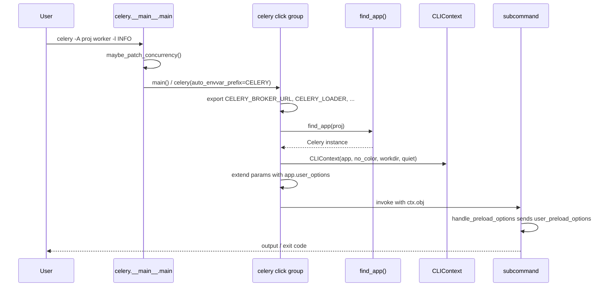
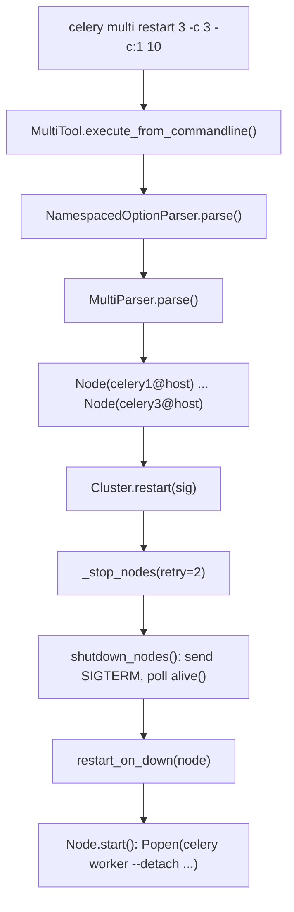

## Overview

The `celery` program is the single command-line entry point for running and operating Celery: it starts workers and beat, sends tasks, talks to running workers, and administers the broker. It is a [click](https://click.palletsprojects.com/) group defined in `celery/bin/celery.py`. Each subcommand lives in its own module under `celery/bin/`, and the classes that run long-lived programs live under `celery/apps/` (`Worker`, `Beat`, and the `multi` cluster model).

Sources: [celery/bin/celery.py:1-30](repo://celery/bin/celery.py#L1-L30), [setup.py:155-159](repo://setup.py#L155-L159)

The console script `celery` points at `celery.__main__:main`. That function applies eventlet or gevent monkey patches before anything else is imported (unless the command is `multi`, which only spawns other processes), then calls `celery.bin.celery.main()`, which invokes the click group with `auto_envvar_prefix="CELERY"`.

Sources: [celery/__main__.py:10-15](repo://celery/__main__.py#L10-L15), [celery/__init__.py:123-147](repo://celery/__init__.py#L123-L147), [celery/bin/celery.py:220-227](repo://celery/bin/celery.py#L220-L227)

Sources: [celery/__main__.py:10-15](repo://celery/__main__.py#L10-L15), [celery/bin/celery.py:112-163](repo://celery/bin/celery.py#L112-L163), [celery/bin/base.py:143-160](repo://celery/bin/base.py#L143-L160)

## Global options

The group callback handles options that apply to every subcommand. They must come before the subcommand name (`celery -A proj worker`, not `celery worker -A proj`). The patched `NoSuchOption.show` prints an explicit "support for this usage was removed in Celery 5.0" message when `-A`/`--app` is given after the subcommand.

Sources: [celery/bin/celery.py:193-217](repo://celery/bin/celery.py#L193-L217)

| Option | Env var | Effect in `celery()` |
| --- | --- | --- |
| `-A`, `--app` | `APP` | Loaded with `find_app()` (type `click.UNPROCESSED` so a `Celery` object can also be passed in-process) |
| `-b`, `--broker` | `BROKER_URL` | Exported as `CELERY_BROKER_URL` |
| `--result-backend` | `RESULT_BACKEND` | Exported as `CELERY_RESULT_BACKEND` |
| `--loader` | `LOADER` | Exported as `CELERY_LOADER` |
| `--config` | `CONFIG_MODULE` | Exported as `CELERY_CONFIG_MODULE` |
| `--workdir` | | Eager callback runs `os.chdir()` before the app is imported |
| `-C`, `--no-color` | `NO_COLOR` | Stored on `CLIContext.no_color` |
| `-q`, `--quiet` | | Stored on `CLIContext.quiet` |
| `--version` | | Prints `VERSION_BANNER` and exits |
| `--skip-checks` | `SKIP_CHECKS` | Exports `CELERY_SKIP_CHECKS=true` (skips Django checks) |

Sources: [celery/bin/celery.py:55-133](repo://celery/bin/celery.py#L55-L133)

Because `main()` passes `auto_envvar_prefix="CELERY"` and the options declare `envvar=` names, click reads them from the environment as well. The options export environment variables rather than touching `app.conf` because the default app and loaders read these variables when they are configured, which happens later and lazily.

Sources: [celery/bin/celery.py:123-133](repo://celery/bin/celery.py#L123-L133), [celery/bin/celery.py:220-227](repo://celery/bin/celery.py#L220-L227)

## App loading and CLIContext

`find_app(name)` resolves `module:attr` with `symbol_by_name`, importing from the current directory. For a bare module it tries `module.app`, then `module.celery`, then `module.celery` as a submodule when `module` is a package, and finally any `Celery` instance among the module's attributes. The group turns failures into three distinct messages: module not found, error while importing (with the traceback), and missing attribute.

Sources: [celery/app/utils.py:378-414](repo://celery/app/utils.py#L378-L414), [celery/bin/celery.py:32-43](repo://celery/bin/celery.py#L32-L43), [celery/bin/celery.py:135-152](repo://celery/bin/celery.py#L135-L152)

The loaded app is wrapped in a `CLIContext` and stored as `ctx.obj`; every subcommand reaches the app through `ctx.obj.app`. With no `-A`, `CLIContext` falls back to `get_current_app()`. It also provides colour-aware output helpers (`style`, `secho`, `echo`, `error`), `OK`/`ERROR` labels, `pretty()` for rendering remote-control replies (lists, `ok`/`error` dicts, JSON highlighted with pygments when available), and `say_chat()` for the `->`/`<-` request/reply display.

Sources: [celery/bin/base.py:22-121](repo://celery/bin/base.py#L22-L121), [celery/bin/celery.py:154-155](repo://celery/bin/celery.py#L154-L155)

## Commands

| Command | Defined in | Purpose |
| --- | --- | --- |
| `worker` | `celery/bin/worker.py` | Start a worker (`app.Worker`) |
| `beat` | `celery/bin/beat.py` | Start the periodic task scheduler (`app.Beat`) |
| `call` | `celery/bin/call.py` | Send a task by name |
| `inspect`, `control`, `status` | `celery/bin/control.py` | Remote control and ping |
| `purge` | `celery/bin/purge.py` | Delete all messages from task queues |
| `result` | `celery/bin/result.py` | Print a task result or traceback |
| `events` | `celery/bin/events.py` | Curses monitor, event dump, snapshot camera |
| `shell` | `celery/bin/shell.py` | REPL with app and canvas symbols |
| `multi` | `celery/bin/multi.py`, `celery/apps/multi.py` | Start/stop/restart many detached workers |
| `migrate` | `celery/bin/migrate.py` | Move messages between brokers |
| `graph bootsteps`, `graph workers` | `celery/bin/graph.py` | Emit Graphviz dot graphs |
| `list bindings` | `celery/bin/list.py` | List queue bindings on the broker |
| `logtool` | `celery/bin/logtool.py` | Analyse worker log files |
| `upgrade settings` | `celery/bin/upgrade.py` | Rewrite 3.x setting names to the 4.x style |
| `amqp` | `celery/bin/amqp.py` | AMQP administration commands |
| `report` | `celery/bin/celery.py` | Print `app.bugreport()` |

Sources: [celery/bin/celery.py:166-191](repo://celery/bin/celery.py#L166-L191)

## Base classes and option types

### CeleryCommand and CeleryOption

`CeleryOption` adds two keyword arguments to `click.Option`. `help_group` controls which section of `--help` the option appears in. `default_value_from_context` reads the default from `ctx.obj` at runtime. `CeleryCommand.format_options()` groups help records by `help_group`, putting options without one under "Options", which is why `celery worker --help` shows sections such as "Worker Options", "Pool Options" and "Embedded Beat Options".

Sources: [celery/bin/base.py:163-194](repo://celery/bin/base.py#L163-L194)

### CeleryDaemonCommand and DaemonOption

`CeleryDaemonCommand` (used by `worker`, `beat` and `events`) appends six `DaemonOption`s: `--logfile/-f`, `--pidfile`, `--uid`, `--gid`, `--umask` and `--executable`. A `DaemonOption`'s callback falls back to the setting named after the command, `<command>_<option>`. For example, `worker_pidfile` or `beat_logfile` from `app.conf` is used when the flag is absent.

Sources: [celery/bin/base.py:197-227](repo://celery/bin/base.py#L197-L227)

### Parameter types

| Instance | Class | Converts |
| --- | --- | --- |
| `COMMA_SEPARATED_LIST` | `CommaSeparatedList` | `"a,b"` to a list via `text.str_to_list` |
| `JSON_ARRAY` | `JsonArray` | JSON text that must decode to a list |
| `JSON_OBJECT` | `JsonObject` | JSON text that must decode to a dict |
| `ISO8601` | `ISO8601DateTime` | ISO 8601 string via `maybe_iso8601` |
| `ISO8601_OR_FLOAT` | `ISO8601DateTimeOrFloat` | Float seconds, else ISO 8601 |
| `LOG_LEVEL` | `LogLevel` | Case-insensitive level name to a numeric level via `mlevel` |

Sources: [celery/bin/base.py:230-329](repo://celery/bin/base.py#L230-L329)

`celery/bin/worker.py` adds its own types: `CeleryBeat` for `-B` (fails on Windows), `WorkersPool` (choices from `concurrency.get_available_pool_names()`, and a CLI default of `prefork` yields to the `worker_pool` setting), `Hostname` (expands `%h`, `%n`, `%d`) and `Autoscale` (`max,min` or a single `max`, returned as a sorted `(max, min)` tuple).

Sources: [celery/bin/worker.py:22-103](repo://celery/bin/worker.py#L22-L103)

### Preload options and errors

`handle_preload_options` wraps every subcommand. It collects the values of the app's `user_options['preload']` options and sends the `user_preload_options` signal before the command body runs. `handle_remote_command_error()` re-raises click errors unchanged and turns broker `OperationalError`s and other failures into `CeleryCommandException` with exit code `EX_UNAVAILABLE` (69).

Sources: [celery/bin/base.py:123-160](repo://celery/bin/base.py#L123-L160), [celery/exceptions.py:307-312](repo://celery/exceptions.py#L307-L312)

## Subcommand reference

### worker

`worker` parses worker, pool, queue, feature and embedded-beat options. Extra `key=value` arguments go to `app.config_from_cmdline(ctx.args, namespace='worker')`. With `-D/--detach` it strips `--detach`, `-D`, `--uid` and `--gid` from `sys.argv` and re-executes `python -m celery ...` inside `platforms.detached()`. Otherwise it drops privileges, builds `app.Worker(...)` with node-formatted pidfile and statedb paths, starts it, and exits with `worker.exitcode`. A `SecurityError` is printed and exits with code 1. See [[Worker Architecture and Bootsteps]].

Sources: [celery/bin/worker.py:108-133](repo://celery/bin/worker.py#L108-L133), [celery/bin/worker.py:136-250](repo://celery/bin/worker.py#L136-L250), [celery/bin/worker.py:307-371](repo://celery/bin/worker.py#L307-L371)

### beat

`beat` takes `--detach`, `-s/--schedule`, `-S/--scheduler`, `--max-interval` and `-l/--loglevel`, then runs `app.Beat(...).run()`, inside `detached()` when `--detach` is given. See [[Periodic Tasks with Beat]].

Sources: [celery/bin/beat.py:10-72](repo://celery/bin/beat.py#L10-L72)

### call

`call NAME` sends a task with `app.send_task`, so the task does not need to be importable locally, and prints the task id. `-a/--args` and `-k/--kwargs` take JSON, and `--eta`, `--countdown`, `--expires`, `--serializer` (default `json`), `--queue`, `--exchange` and `--routing-key` map directly to the matching `send_task` options.

Sources: [celery/bin/call.py:8-71](repo://celery/bin/call.py#L8-L71)

### inspect, control and status

`inspect COMMAND` and `control COMMAND` look the command up in `Panel.meta` (the registry of worker remote-control commands) and filter by `type` and `visible`. `--list` prints the available commands with their signatures. Positional extra arguments are converted with the types declared in `meta.args` by `_compile_arguments()`, and any surplus goes to `meta.variadic`. `inspect` calls `app.control.inspect(...)._request(command, **arguments)`, while `control` calls `app.control.broadcast(command, reply=True, arguments=...)`. `status` is `inspect().ping()` plus a "N nodes online" count. All three accept `-t/--timeout` (default 1.0 s), `-d/--destination` and `-j/--json`, and raise `CeleryCommandException` ("No nodes replied within time constraint", `EX_UNAVAILABLE`) when no worker answers. See [[Remote Control and Inspection]].

Sources: [celery/bin/control.py:16-104](repo://celery/bin/control.py#L16-L104), [celery/bin/control.py:107-208](repo://celery/bin/control.py#L107-L208), [celery/bin/control.py:211-262](repo://celery/bin/control.py#L211-L262)

### purge and result

`purge` computes the queue names from `-Q` (default: every queue in `app.amqp.queues`) minus `-X`, asks for confirmation unless `-f` is given, and calls `queue_purge` on each queue over one `connection_for_write()`, ignoring channel errors. `result TASK_ID` builds an `AsyncResult` (or the task's own `AsyncResult` class with `-t`) and prints `get()`, or the traceback with `--traceback`.

Sources: [celery/bin/purge.py:8-70](repo://celery/bin/purge.py#L8-L70), [celery/bin/result.py:7-30](repo://celery/bin/result.py#L7-L30)

### events

`events` dispatches to one of three tools, each setting its own process title: `--dump` runs `celery.events.dumper.evdump`, `--camera` runs `celery.events.snapshot.evcam` (with `--frequency`, `--maxrate`, and optional `--detach`), and the default runs the curses monitor `evtop`, failing with a usage error when `_curses` is missing. See [[Events and Monitoring]].

Sources: [celery/bin/events.py:12-98](repo://celery/bin/events.py#L12-L98)

### shell

`shell` imports the default task modules and starts a REPL whose locals contain `app`/`celery`, `Task`, the canvas primitives (`chord`, `group`, `chain`, `chunks`, `xmap`, `xstarmap`, `subtask`, `signature`) and every non-builtin registered task (unless `-T`). `--ipython`, `--bpython` and `--python` force a specific shell. `--eventlet`/`--gevent` import the pool module first so its patches apply.

Sources: [celery/bin/shell.py:82-173](repo://celery/bin/shell.py#L82-L173)

### migrate, list, graph, logtool, upgrade, amqp, report

| Command | Behaviour |
| --- | --- |
| `migrate SOURCE DESTINATION` | Calls `celery.contrib.migrate.migrate_tasks(Connection(source), Connection(destination), ...)` with `--limit`, `--timeout`, `--ack-messages`, `--tasks`, `--queues`, `--forever` |
| `list bindings` | Declares the task consumer and prints `conn.manager.get_bindings()`; transports without a manager raise "Your transport cannot list bindings." |
| `graph bootsteps` | Dumps the worker and/or consumer blueprint graph as dot |
| `graph workers` | Builds a broker/backend/worker/thread dependency graph from `inspect().stats()` (or `nodes=`/`threads=` arguments) |
| `logtool stats/traces/errors/incomplete/debug` | `Audit` parses log lines with regexes for "Received" and "Task" records |
| `upgrade settings FILE` | Rewrites old setting names using `defaults._TO_NEW_KEY`, backing up to `.orig` unless `--no-backup` |
| `amqp ...` | `AMQPContext` opens a connection; subcommands `exchange.declare`, `exchange.delete`, `queue.bind`, `queue.declare`, `queue.delete`, `queue.purge`, `basic.get`, `basic.publish`, `basic.ack` |
| `report` | Imports default modules and prints `app.bugreport()` |

Sources: [celery/bin/migrate.py:9-63](repo://celery/bin/migrate.py#L9-L63), [celery/bin/list.py:7-38](repo://celery/bin/list.py#L7-L38), [celery/bin/graph.py:11-35](repo://celery/bin/graph.py#L11-L35), [celery/bin/graph.py:152-203](repo://celery/bin/graph.py#L152-L203), [celery/bin/logtool.py:12-110](repo://celery/bin/logtool.py#L12-L110), [celery/bin/logtool.py:113-157](repo://celery/bin/logtool.py#L113-L157), [celery/bin/upgrade.py:55-91](repo://celery/bin/upgrade.py#L55-L91), [celery/bin/amqp.py:22-73](repo://celery/bin/amqp.py#L22-L73), [celery/bin/celery.py:166-172](repo://celery/bin/celery.py#L166-L172)

## celery multi

### MultiTool

`multi` is a click command that ignores unknown options and hands raw arguments to `MultiTool`. It reorders `sys.argv` so that everything from `multi` onward comes first, followed by the global options. `MultiTool` then strips the reserved flags `--nosplash`, `--quiet`/`-q`, `--verbose` and `--no-color`, and dispatches to `start`, `show`, `stop`, `stopwait` (alias `stop_verify`), `restart`, `kill`, `names`, `expand`, `get` or `help`.

Sources: [celery/bin/multi.py:118-136](repo://celery/bin/multi.py#L118-L136), [celery/bin/multi.py:226-287](repo://celery/bin/multi.py#L226-L287), [celery/bin/multi.py:463-480](repo://celery/bin/multi.py#L463-L480)

The `using_cluster` and `using_cluster_and_sig` decorators parse the remaining argv into a `Cluster`. For stop-type commands they also find the signal: a trailing `-9`-style number or `-NAME`, defaulting to `SIGTERM`. `MultiTool.Cluster()` wires every lifecycle callback (`on_node_start`, `on_send_signal`, `on_child_failure`, ...) to terminal output.

Sources: [celery/bin/multi.py:152-167](repo://celery/bin/multi.py#L152-L167), [celery/bin/multi.py:289-393](repo://celery/bin/multi.py#L289-L393)

### Parsing nodes and namespaced options

`NamespacedOptionParser` splits argv into positional `values` (node names or a count), global `options`, per-node `namespaces` from the `-opt:ns value` syntax (`-c:1 10`, `-Q:image,video q`), and `passthrough` text after `--`. `MultiParser.parse()` then:
1. Pops `--cmd`, `--append`, `--hostname`/`-n`, `--prefix`, `--suffix` and `--range-prefix`.
2. Turns a single numeric value `N` into names `1..N` with `range_prefix` (default `celery`).
3. Resolves numeric namespaces to node names by index (`_update_ns_opts`) and expands `a,b` and `1-3` namespaces (`_update_ns_ranges`).
4. Builds one `Node` per name with `p.optmerge(namespace, options)`, so per-node options override global ones.

Sources: [celery/apps/multi.py:70-119](repo://celery/apps/multi.py#L70-L119), [celery/apps/multi.py:285-364](repo://celery/apps/multi.py#L285-L364)

### Node and Cluster

`Node` defaults its command to `-m celery worker --detach` and fills in `-n name`, `--pidfile=/var/run/celery/%n.pid`, `--logfile=/var/log/celery/%n%I.log` and `--executable=sys.executable`. `_setdefaultopt` creates the pid and log directories when they are missing. `_prepare_argv()` moves global options (`-A`, `-b`, `--result-backend`, `--loader`, `--config`, `--workdir`, `-C`, `-q`) before the subcommand, because Celery 5 only accepts them there, and expands `%n`, `%h`, `%d` and `%N` in every value. `start()` runs the command with `Popen` and waits for it. Since the worker detaches, this returns once the daemon has forked.

Sources: [celery/apps/multi.py:122-233](repo://celery/apps/multi.py#L122-L233)

`Node.pid` reads the pidfile through `Pidfile.read_pid()`, and `send(sig)` calls `os.kill`, treating `ESRCH` as "already gone". `Cluster.shutdown_nodes()` signals every node with a pid, then, when `retry` is set (as in `stopwait` and `restart`), polls `alive()` (signal 0) and sleeps `retry` seconds per round until every node has exited. `restart()` passes `restart_on_down` as the `on_down` callback, so each node is started again as soon as it is confirmed down.

Sources: [celery/apps/multi.py:192-207](repo://celery/apps/multi.py#L192-L207), [celery/apps/multi.py:246-265](repo://celery/apps/multi.py#L246-L265), [celery/apps/multi.py:406-496](repo://celery/apps/multi.py#L406-L496)

Sources: [celery/bin/multi.py:262-309](repo://celery/bin/multi.py#L262-L309), [celery/apps/multi.py:297-328](repo://celery/apps/multi.py#L297-L328), [celery/apps/multi.py:431-483](repo://celery/apps/multi.py#L431-L483)

> [!NOTE]
> `multi` persists nothing. `restart` and `stop` must be given the same node names and `--pidfile` template as `start`, because the pidfile is the only link to the running processes.

Sources: [celery/bin/multi.py:21-27](repo://celery/bin/multi.py#L21-L27), [celery/apps/multi.py:246-262](repo://celery/apps/multi.py#L246-L262)

## Extending the CLI

Third-party packages add subcommands through the `celery.commands` entry-point group. The group is loaded with `importlib.metadata.entry_points` (with fallbacks for older Python versions) and attached by `click_plugins.with_plugins`. `DYMGroup` from `click_didyoumean` suggests close matches for mistyped commands.

Sources: [celery/bin/celery.py:46-56](repo://celery/bin/celery.py#L46-L56)

Applications can add options to built-in commands through `app.user_options`, a `defaultdict(set)` keyed by command. The group callback appends `user_options['worker']`, `['beat']` and `['events']` to those commands, and appends `user_options['preload']` to every command. The values of preload options reach handlers of the `user_preload_options` signal (see [[Signals]]).

Sources: [celery/app/base.py:369-369](repo://celery/app/base.py#L369-L369), [celery/bin/celery.py:157-163](repo://celery/bin/celery.py#L157-L163), [celery/bin/base.py:143-160](repo://celery/bin/base.py#L143-L160)

Extra `key=value` arguments after `worker` or `beat` are configuration overrides parsed by `loader.cmdline_config_parser()`. A leading `.` or `_` selects the command's default namespace (`worker` for the worker). Values are typed from the matching setting's `Option` type, and list, tuple and dict settings are parsed as JSON.

Sources: [celery/loaders/base.py:161-190](repo://celery/loaders/base.py#L161-L190), [celery/app/base.py:745-748](repo://celery/app/base.py#L745-L748), [celery/bin/worker.py:328-335](repo://celery/bin/worker.py#L328-L335)
