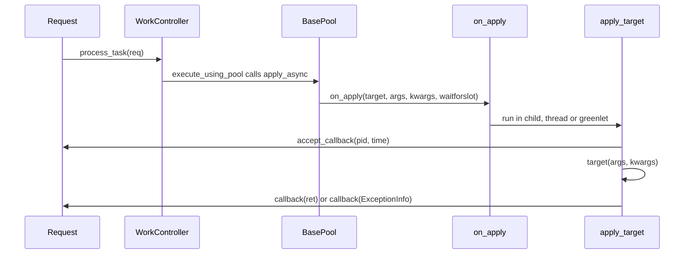
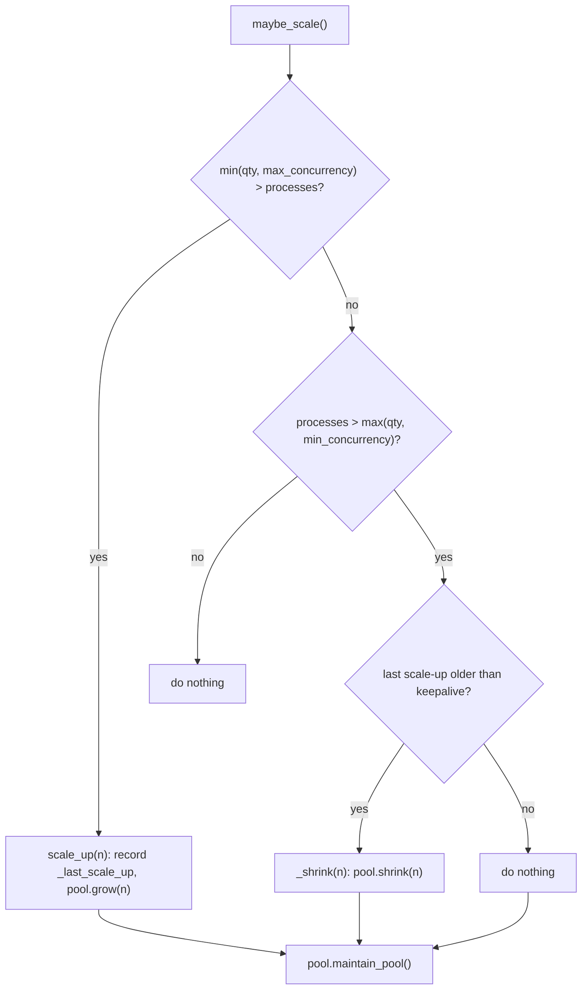

## Overview

A Celery worker receives task messages in one place (the consumer) but runs them in an execution pool. The pool decides what a unit of concurrency is: a forked child process (`prefork`), a green thread (`eventlet`, `gevent`), an OS thread (`threads`) or the worker's own main thread (`solo`). Every implementation is a subclass of `BasePool`, so the rest of the worker only calls `apply_async`, `grow`, `shrink`, `terminate_job` and the start/stop hooks.

Sources: [celery/concurrency/base.py:47-156](repo://celery/concurrency/base.py#L47-L156), [celery/concurrency/base.py:158-180](repo://celery/concurrency/base.py#L158-L180)

The worker resolves the pool class by name in `WorkController.__init__` through `get_implementation`, and the `Pool` bootstep instantiates it during startup (see [[Worker Architecture and Bootsteps]]). The optional `Autoscaler` bootstep sits on top of the pool and grows or shrinks it between a minimum and maximum size based on how many tasks are reserved. Tasks handed to the pool run through the tracer described in [[Task Execution and Tracing]].

Sources: [celery/worker/worker.py:76-92](repo://celery/worker/worker.py#L76-L92), [celery/worker/worker.py:128-135](repo://celery/worker/worker.py#L128-L135), [celery/worker/autoscale.py:31-58](repo://celery/worker/autoscale.py#L31-L58)

## Pool selection

### Aliases and get_implementation

`celery/concurrency/__init__.py` maps short pool names to `module:Class` paths. `get_implementation` passes the name through kombu's `symbol_by_name` with `ALIASES` as the alias table, so a full dotted path to a custom `BasePool` subclass also works. The `threads` alias is only registered when `concurrent.futures` imports, and `custom` points at whatever the `CELERY_CUSTOM_WORKER_POOL` environment variable names.

Sources: [celery/concurrency/__init__.py:11-48](repo://celery/concurrency/__init__.py#L11-L48)

```python
ALIASES = {
    'prefork': 'celery.concurrency.prefork:TaskPool',
    'eventlet': 'celery.concurrency.eventlet:TaskPool',
    'gevent': 'celery.concurrency.gevent:TaskPool',
    'solo': 'celery.concurrency.solo:TaskPool',
    'processes': 'celery.concurrency.prefork:TaskPool',  # XXX compat alias
}
```

Sources: [celery/concurrency/__init__.py:11-17](repo://celery/concurrency/__init__.py#L11-L17)

| Alias | Class | Unit of concurrency | `grow`/`shrink` | `terminate_job` | Notes |
| --- | --- | --- | --- | --- | --- |
| `prefork` (default), `processes` | `celery.concurrency.prefork:TaskPool` | Child process (billiard) | Yes, proxied to billiard | Yes, signals the child | `uses_semaphore = True`; uses `AsynPool` when the worker runs the event loop |
| `eventlet` | `celery.concurrency.eventlet:TaskPool` | Eventlet green thread | Yes, `GreenPool.resize` | Yes, kills the greenlet | `is_green = True`, custom greenlet `Timer` |
| `gevent` | `celery.concurrency.gevent:TaskPool` | gevent greenlet | Yes, adjusts the pool semaphore | Yes, `gevent.kill` | Supports a per-task `timeout` via `gevent.Timeout` |
| `threads` | `celery.concurrency.thread:TaskPool` | OS thread (`ThreadPoolExecutor`) | No | No | Registered only if `concurrent.futures` is importable |
| `solo` | `celery.concurrency.solo:TaskPool` | Main worker thread, inline | No | No | `limit` forced to 1 |
| `custom` | Value of `CELERY_CUSTOM_WORKER_POOL` | Defined by the class | Defined by the class | Defined by the class | Out-of-tree pools |

Sources: [celery/concurrency/__init__.py:11-38](repo://celery/concurrency/__init__.py#L11-L38), [celery/concurrency/prefork.py:95-126](repo://celery/concurrency/prefork.py#L95-L126), [celery/concurrency/eventlet.py:88-151](repo://celery/concurrency/eventlet.py#L88-L151), [celery/concurrency/gevent.py:85-141](repo://celery/concurrency/gevent.py#L85-L141), [celery/concurrency/thread.py:30-56](repo://celery/concurrency/thread.py#L30-L56), [celery/concurrency/solo.py:11-20](repo://celery/concurrency/solo.py#L11-L20)

### Command line and settings

`celery worker -P/--pool` defaults to `prefork` and is validated by the `WorkersPool` click type, whose choices come from `get_available_pool_names()`. When the CLI value is the default `prefork` but `worker_pool` is configured, the configured pool wins. `-c/--concurrency` falls back to `worker_concurrency`, and `WorkController` uses `cpu_count()` (or 2 if it cannot be determined) when neither is set.

Sources: [celery/bin/worker.py:34-62](repo://celery/bin/worker.py#L34-L62), [celery/bin/worker.py:194-211](repo://celery/bin/worker.py#L194-L211), [celery/worker/worker.py:108-113](repo://celery/worker/worker.py#L108-L113)

Green pools need their monkey patches applied before anything imports sockets or threads. `maybe_patch_concurrency` scans `sys.argv` for `-P`/`--pool` and runs `eventlet.monkey_patch()` or `gevent.monkey.patch_all()` immediately. Because only the command-line option is seen this early, the `Pool` bootstep warns with `W_POOL_SETTING` when `worker_pool` itself names `eventlet` or `gevent`.

Sources: [celery/__init__.py:107-152](repo://celery/__init__.py#L107-L152), [celery/worker/components.py:18-29](repo://celery/worker/components.py#L18-L29), [celery/worker/components.py:141-142](repo://celery/worker/components.py#L141-L142)

| Setting | CLI option | Default | Effect |
| --- | --- | --- | --- |
| `worker_pool` | `-P`, `--pool` | `'prefork'` | Pool alias or class path |
| `worker_concurrency` | `-c`, `--concurrency` | `None` (CPU count) | Initial pool size (`limit`) |
| `worker_autoscaler` | none | `'celery.worker.autoscale:Autoscaler'` | Autoscaler class |
| none | `--autoscale` | off | `max,min` pool size range |
| `worker_max_tasks_per_child` | `--max-tasks-per-child` | `None` | Recycle a prefork child after N tasks |
| `worker_max_memory_per_child` | `--max-memory-per-child` | `None` | Recycle a prefork child above a resident memory limit (KiB) |
| `worker_pool_putlocks` | none | `True` | Block `apply_async` until a slot is free |
| `worker_pool_restarts` | none | `False` | Allow the `pool_restart` remote command |
| `worker_proc_alive_timeout` | none | `4.0` | Seconds a new prefork child has to report `WORKER_UP` |
| none | `-O`, `--optimization` | `default` | `fair` selects the fair scheduling strategy in `AsynPool` |

Sources: [celery/app/defaults.py:325-356](repo://celery/app/defaults.py#L325-L356), [celery/worker/worker.py:371-410](repo://celery/worker/worker.py#L371-L410), [celery/bin/worker.py:169-175](repo://celery/bin/worker.py#L169-L175), [celery/bin/worker.py:285-288](repo://celery/bin/worker.py#L285-L288)

## The Pool bootstep

`celery.worker.components.Pool` requires the `Hub` step, so the event loop exists before the pool is built. Its `__init__` parses the `autoscale` option (a `"max,min"` string or a pair) into `w.max_concurrency` and `w.min_concurrency`; without autoscaling, `min_concurrency` is the configured concurrency.

Sources: [celery/worker/components.py:101-128](repo://celery/worker/components.py#L101-L128)

`create` decides whether the pool runs "threaded" (`not w.use_eventloop or IS_WINDOWS`). The worker uses the event loop only when the environment is not patched by a green library, the broker transport is asynchronous (AMQP, Redis) and the platform is not Windows. In event-loop mode the step creates a `LaxBoundedSemaphore` sized to the pool, and if `worker_pool_putlocks` is on and the pool class sets `uses_semaphore`, `w.process_task` becomes `_process_task_sem`, which acquires a slot before calling `req.execute_using_pool(self.pool)`.

Sources: [celery/worker/components.py:138-153](repo://celery/worker/components.py#L138-L153), [celery/worker/worker.py:220-231](repo://celery/worker/worker.py#L220-L231), [celery/worker/worker.py:239-242](repo://celery/worker/worker.py#L239-L242)

```python
        pool = w.pool = self.instantiate(
            w.pool_cls, w.min_concurrency,
            initargs=(w.app, w.hostname),
            maxtasksperchild=w.max_tasks_per_child,
            max_memory_per_child=w.max_memory_per_child,
            timeout=w.time_limit,
            soft_timeout=w.soft_time_limit,
            putlocks=w.pool_putlocks and threaded,
            lost_worker_timeout=w.worker_lost_wait,
            threads=threaded,
            max_restarts=max_restarts,
            allow_restart=allow_restart,
            forking_enable=True,
            semaphore=semaphore,
            sched_strategy=self.optimization,
            app=w.app,
        )
        _set_task_join_will_block(pool.task_join_will_block)
        return pool
```

Sources: [celery/worker/components.py:154-172](repo://celery/worker/components.py#L154-L172)

Every keyword not consumed by `BasePool.__init__` lands in `self.options`; only the prefork pool forwards them to billiard. `_set_task_join_will_block` records whether `result.get()` inside a task would block the pool, which is false for the green pools. On shutdown the step's `close` and `terminate` delegate to `pool.close()` and `pool.terminate()`, and `register_with_event_loop` hands the hub to the pool.

Sources: [celery/concurrency/base.py:73-80](repo://celery/concurrency/base.py#L73-L80), [celery/worker/components.py:130-136](repo://celery/worker/components.py#L130-L136), [celery/worker/components.py:174-178](repo://celery/worker/components.py#L174-L178)

## BasePool interface

### Lifecycle and state

`BasePool` keeps a `_state` of `RUN`, `CLOSE` or `TERMINATE`. The public methods `start`, `stop`, `close` and `terminate` set the state and call the `on_*` hooks that subclasses override; `active` is `_state == RUN`. `start` also caches whether debug logging is enabled so `apply_async` can skip formatting the arguments.

Sources: [celery/concurrency/base.py:120-138](repo://celery/concurrency/base.py#L120-L138), [celery/concurrency/base.py:174-176](repo://celery/concurrency/base.py#L174-L176)

| Attribute | Default | Meaning |
| --- | --- | --- |
| `signal_safe` | `True` | Pool can be shut down from inside a signal handler |
| `is_green` | `False` | Pool uses greenlets |
| `uses_semaphore` | `False` | Worker should gate `apply_async` with the semaphore (prefork only) |
| `task_join_will_block` | `True` | Waiting on a result inside a task blocks a slot |
| `body_can_be_buffer` | `False` | Message body may be passed as a buffer without copying |
| `Timer` | `timer2.Timer` | Timer class used when the worker does not run the event loop |

Sources: [celery/concurrency/base.py:50-71](repo://celery/concurrency/base.py#L50-L71)

### apply_async and apply_target

`BasePool.apply_async` normalises `args`/`kwargs`, logs at debug level, and calls `on_apply` with `waitforslot=self.putlocks` and `callbacks_propagate`. For prefork `on_apply` is billiard's `apply_async`; the thread, eventlet, gevent and solo pools call the module-level `apply_target` in their own execution context.

Sources: [celery/concurrency/base.py:140-156](repo://celery/concurrency/base.py#L140-L156)

`apply_target` calls `accept_callback(pid, time)` first so the request learns which worker picked it up, runs the target, and passes the return value to `callback`. Ordinary exceptions, and `WorkerShutdown`/`WorkerTerminate`, propagate. Any other `BaseException` (for example `SystemExit` raised by the task) is converted into a `WorkerLostError` and reported to `callback` as an `ExceptionInfo`, so a task cannot silently kill a thread or greenlet.

Sources: [celery/concurrency/base.py:22-44](repo://celery/concurrency/base.py#L22-L44)



Sources: [celery/worker/worker.py:220-231](repo://celery/worker/worker.py#L220-L231), [celery/concurrency/base.py:22-44](repo://celery/concurrency/base.py#L22-L44), [celery/concurrency/base.py:140-156](repo://celery/concurrency/base.py#L140-L156), [celery/concurrency/thread.py:45-56](repo://celery/concurrency/thread.py#L45-L56)

## Prefork pool

### TaskPool and billiard

`prefork.TaskPool.on_start` picks billiard's blocking `Pool` when the `threads` option is true (no event loop) and `AsynPool` otherwise. It creates the pool with `process_initializer` as the child initializer, `process_destructor` as the exit hook, timeouts enabled and `worker_proc_alive_timeout`, then binds `on_apply`, `maintain_pool`, `terminate_job`, `grow`, `shrink` and `flush` directly to the billiard pool's methods to avoid an extra call layer.

Sources: [celery/concurrency/prefork.py:95-126](repo://celery/concurrency/prefork.py#L95-L126)

`on_stop` closes the pool and joins it. If a kombu hub exists, it first starts a daemon thread named `prefork-timer-shutdown` that calls `hub.fire_timers()` every 0.5 seconds, so broker heartbeats keep flowing while long tasks drain. `on_terminate` calls billiard's `terminate()` instead. `_get_info` reports child PIDs, `max-tasks-per-child`, the soft and hard timeouts and `AsynPool`'s write statistics, which is what `celery inspect stats` shows under `pool`.

Sources: [celery/concurrency/prefork.py:142-212](repo://celery/concurrency/prefork.py#L142-L212)

### process_initializer

Each child process runs `process_initializer(app, hostname)` before it accepts work. The steps, in order:

Sources: [celery/concurrency/prefork.py:41-46](repo://celery/concurrency/prefork.py#L41-L46), [celery/concurrency/prefork.py:112-118](repo://celery/concurrency/prefork.py#L112-L118)

1. Ask the OS to `SIGKILL` the child if the parent dies (`set_pdeathsig`) and mark that joining a result will block.
2. Reset `SIGTERM`, `SIGHUP`, `SIGTTIN`, `SIGTTOU`, `SIGUSR1` to their defaults and ignore `SIGINT` (plus the remapped term signal), so the parent alone handles shutdown.
3. Set the process title, run `app.loader.init_worker()` and `init_worker_process()`, and set up logging again from the `CELERY_LOG_*` environment variables.
4. If the child was started by `execv` (`FORKED_BY_MULTIPROCESSING`), call `trace.setup_worker_optimizations`; otherwise make the app current and default, finalize it and share the task registry with `trace`.
5. Rebuild `task.__trace__` for every registered task with `build_tracer`, reset worker state and send `worker_process_init`.

Sources: [celery/concurrency/prefork.py:26-82](repo://celery/concurrency/prefork.py#L26-L82)

When a child exits, `process_destructor` sends `worker_process_shutdown` with the PID and exit code (see [[Signals]]).

Sources: [celery/concurrency/prefork.py:85-92](repo://celery/concurrency/prefork.py#L85-L92)

### AsynPool

`AsynPool` (in `celery/concurrency/asynpool.py`) is a non-blocking subclass of billiard's `Pool` that the worker's event loop drives directly instead of using helper threads. The module docstring lists its three jobs: keep child processes running, send jobs and receive results, and shut down safely.

Sources: [celery/concurrency/asynpool.py:1-14](repo://celery/concurrency/asynpool.py#L1-L14), [celery/concurrency/asynpool.py:414-421](repo://celery/concurrency/asynpool.py#L414-L421)

At construction it pre-creates one queue triple per process with `create_process_queues`: a non-blocking-write `inq`, a non-blocking-read `outq` and, if `synack` is enabled, a `synq`. It keeps file-descriptor-to-process maps, the `outbound_buffer` of jobs waiting to be written, and sets of busy workers and active writers. Each child's `Worker.on_loop_start` puts a `WORKER_UP` message on its `outq`; the `ResultHandler` routes that to `on_process_alive`, and a child that does not report within `_proc_alive_timeout` is terminated.

Sources: [celery/concurrency/asynpool.py:428-488](repo://celery/concurrency/asynpool.py#L428-L488), [celery/concurrency/asynpool.py:243-261](repo://celery/concurrency/asynpool.py#L243-L261), [celery/concurrency/asynpool.py:656-661](repo://celery/concurrency/asynpool.py#L656-L661), [celery/concurrency/asynpool.py:1153-1169](repo://celery/concurrency/asynpool.py#L1153-L1169)

`register_with_event_loop` wires the pool into the hub: result-queue readers call `handle_result_event`, each child's sentinel fd calls `maintain_pool` when the process exits, time-limit and write handlers are created, `maintain_pool` runs every 5 seconds via `timers`, and `on_poll_start` is added to `hub.on_tick` only once even if the consumer restarts.

Sources: [celery/concurrency/asynpool.py:522-547](repo://celery/concurrency/asynpool.py#L522-L547), [celery/concurrency/asynpool.py:1415-1417](repo://celery/concurrency/asynpool.py#L1415-L1417)

`-O fair` maps to `SCHED_STRATEGY_FAIR`. In `on_poll_start`, the fair strategy only registers inqueue fds for writing while some child is idle (`len(busy_workers) < len(all_inqueues)`), and `schedule_writes` skips busy children, so a long task does not get further jobs queued behind it in its pipe. The `fcfs`/`fast` strategy writes whenever the outbound buffer is non-empty.

Sources: [celery/concurrency/asynpool.py:77-87](repo://celery/concurrency/asynpool.py#L77-L87), [celery/concurrency/asynpool.py:770-788](repo://celery/concurrency/asynpool.py#L770-L788), [celery/concurrency/asynpool.py:804-830](repo://celery/concurrency/asynpool.py#L804-L830)

> [!NOTE]
> The module docstring says `asynpool` "will be moved soon, so don't use it directly". Treat `AsynPool` as an internal detail of the prefork pool.

Sources: [celery/concurrency/asynpool.py:1-7](repo://celery/concurrency/asynpool.py#L1-L7)

## Green, thread and solo pools

### eventlet and gevent

Both green pools set `signal_safe = False`, `is_green = True` and `task_join_will_block = False`, and provide their own `Timer` that schedules entries with `spawn_after` / `Greenlet.spawn_later` instead of a timer thread. `on_start` builds a `GreenPool` or `gevent.pool.Pool` of `limit` size; `on_apply` wraps the target in `_make_killable_target` (which turns `GreenletExit` into a `(False, None, None)` result), spawns it, and stores the greenlet in `_pool_map` under `id(greenlet)`, the same value `getpid` returns inside it. `terminate_job` looks the greenlet up by that id and kills it, which is how revoke with `terminate=True` works on these pools.

Sources: [celery/concurrency/eventlet.py:36-85](repo://celery/concurrency/eventlet.py#L36-L85), [celery/concurrency/eventlet.py:88-181](repo://celery/concurrency/eventlet.py#L88-L181), [celery/concurrency/gevent.py:85-166](repo://celery/concurrency/gevent.py#L85-L166)

The two green pools differ in signals, resizing and timeouts:

Sources: [celery/concurrency/eventlet.py:110-145](repo://celery/concurrency/eventlet.py#L110-L145), [celery/concurrency/gevent.py:107-134](repo://celery/concurrency/gevent.py#L107-L134)

- eventlet sends the `eventlet_pool_started`, `eventlet_pool_apply`, `eventlet_pool_preshutdown` and `eventlet_pool_postshutdown` signals, and resizes with `GreenPool.resize`.
- eventlet warns at import time if `billiard`, `celery` or `kombu` modules were imported before patching.
- gevent grows and shrinks by adjusting `_pool._semaphore.counter` and `_pool.size`, and when a `timeout` is set it runs the task through `apply_timeout`, which wraps it in `gevent.Timeout` and calls `timeout_callback(False, timeout)` on expiry.

Sources: [celery/concurrency/eventlet.py:14-26](repo://celery/concurrency/eventlet.py#L14-L26), [celery/concurrency/eventlet.py:110-145](repo://celery/concurrency/eventlet.py#L110-L145), [celery/concurrency/gevent.py:28-39](repo://celery/concurrency/gevent.py#L28-L39), [celery/concurrency/gevent.py:116-134](repo://celery/concurrency/gevent.py#L116-L134)

### threads and solo

The `threads` pool wraps a `concurrent.futures.ThreadPoolExecutor(max_workers=limit)`. `on_apply` submits `apply_target` and returns an `ApplyResult` around the future; `on_stop` shuts the executor down with `cancel_futures=True`. It defines neither `grow`/`shrink` nor `terminate_job`, so autoscaling and terminate-on-revoke are not available.

Sources: [celery/concurrency/thread.py:21-64](repo://celery/concurrency/thread.py#L21-L64)

The `solo` pool sets `on_apply = apply_target` and `limit = 1`, so each task runs synchronously in the worker's own thread and the consumer stops reading messages until it finishes. It sends `worker_process_init` from its constructor because there is no child process to do it.

Sources: [celery/concurrency/solo.py:11-31](repo://celery/concurrency/solo.py#L11-L31)

## Autoscaling

### WorkerComponent

`celery.worker.autoscale.WorkerComponent` is a conditional `StartStopStep` in the worker blueprint that requires `Pool` and is enabled only when `w.autoscale` is set (by `--autoscale`). `create` instantiates `w.autoscaler_cls` (`worker_autoscaler`) with the pool and the concurrency bounds. With the event loop, it passes a `DummyLock` as the mutex and returns `None`, so no thread is started; `register_with_event_loop` instead adds `maybe_scale` to `consumer.on_task_message` and schedules it every `keepalive` seconds on the hub. Without the event loop the returned `Autoscaler` is a `bgThread` that the step starts and stops, and its `body` calls `maybe_scale` once a second under the lock.

Sources: [celery/worker/autoscale.py:31-81](repo://celery/worker/autoscale.py#L31-L81)

The `--autoscale` value is parsed by the `Autoscale` click type: one integer means `(n, 0)`, two integers are sorted so the larger is the maximum regardless of order.

Sources: [celery/bin/worker.py:75-97](repo://celery/bin/worker.py#L75-L97)

### Scaling decision

`_maybe_scale` compares the number of reserved requests (`qty = len(state.reserved_requests)`) with the current process count (`pool.num_processes`):

Sources: [celery/worker/autoscale.py:83-96](repo://celery/worker/autoscale.py#L83-L96), [celery/worker/autoscale.py:148-154](repo://celery/worker/autoscale.py#L148-L154)



Sources: [celery/worker/autoscale.py:83-131](repo://celery/worker/autoscale.py#L83-L131)

Scale-down is damped by `keepalive`, which defaults to 30 seconds and can be changed with the `AUTOSCALE_KEEPALIVE` environment variable: the pool shrinks only if the last scale-up happened more than `keepalive` seconds ago. Because `_maybe_scale` returns `True` whenever it attempts a scale-down, `maintain_pool` still runs even when the keepalive check stops the shrink. A `ValueError` from `pool.shrink` (all processes busy) is logged at debug level and ignored; any other exception is logged as an error.

Sources: [celery/worker/autoscale.py:28-28](repo://celery/worker/autoscale.py#L28-L28), [celery/worker/autoscale.py:111-131](repo://celery/worker/autoscale.py#L111-L131)

### Runtime changes

`Autoscaler.update(max, min)` changes the bounds under the mutex, shrinking or growing immediately if the current size falls outside them, and adjusts the consumer's prefetch count by the change in `max` through `_update_consumer_prefetch_count`. `info()` returns `max`, `min`, `current` and `qty` for `inspect stats`.

Sources: [celery/worker/autoscale.py:98-146](repo://celery/worker/autoscale.py#L98-L146)

The `autoscale` remote control command calls `update` and fails with `Autoscale not enabled` when there is no autoscaler. `pool_grow` and `pool_shrink` resize the pool and the prefetch count directly, but refuse to run while an autoscaler is active, and `pool_restart` requires `worker_pool_restarts`. See [[Remote Control and Inspection]] for how these commands are sent.

Sources: [celery/worker/control.py:545-589](repo://celery/worker/control.py#L545-L589)

> [!WARNING]
> Autoscaling needs `grow` and `shrink` on the pool. `prefork`, `eventlet` and `gevent` provide them; `threads` and `solo` do not, so with `--autoscale` on those pools the first scale-up raises `AttributeError` from `_grow` (a failed `_shrink` is only logged).

Sources: [celery/worker/autoscale.py:120-131](repo://celery/worker/autoscale.py#L120-L131), [celery/concurrency/thread.py:30-64](repo://celery/concurrency/thread.py#L30-L64), [celery/concurrency/solo.py:11-31](repo://celery/concurrency/solo.py#L11-L31)

## Writing a custom pool

A custom pool subclasses `BasePool` and implements at least `on_apply` (calling `apply_target` or an equivalent so `accept_callback` and `callback` fire). Override `on_start`/`on_stop`/`on_terminate` for resources, `grow`/`shrink` for autoscaling, `terminate_job` for revoke with terminate, `_get_info` for `inspect stats`, and set the class flags (`is_green`, `signal_safe`, `task_join_will_block`) to match its threading model. Select it with `-P package.module:MyPool`, or set `CELERY_CUSTOM_WORKER_POOL=package.module:MyPool` and pass `-P custom`.

Sources: [celery/concurrency/base.py:47-156](repo://celery/concurrency/base.py#L47-L156), [celery/concurrency/base.py:158-180](repo://celery/concurrency/base.py#L158-L180), [celery/concurrency/__init__.py:26-43](repo://celery/concurrency/__init__.py#L26-L43), [celery/bin/worker.py:43-62](repo://celery/bin/worker.py#L43-L62)
