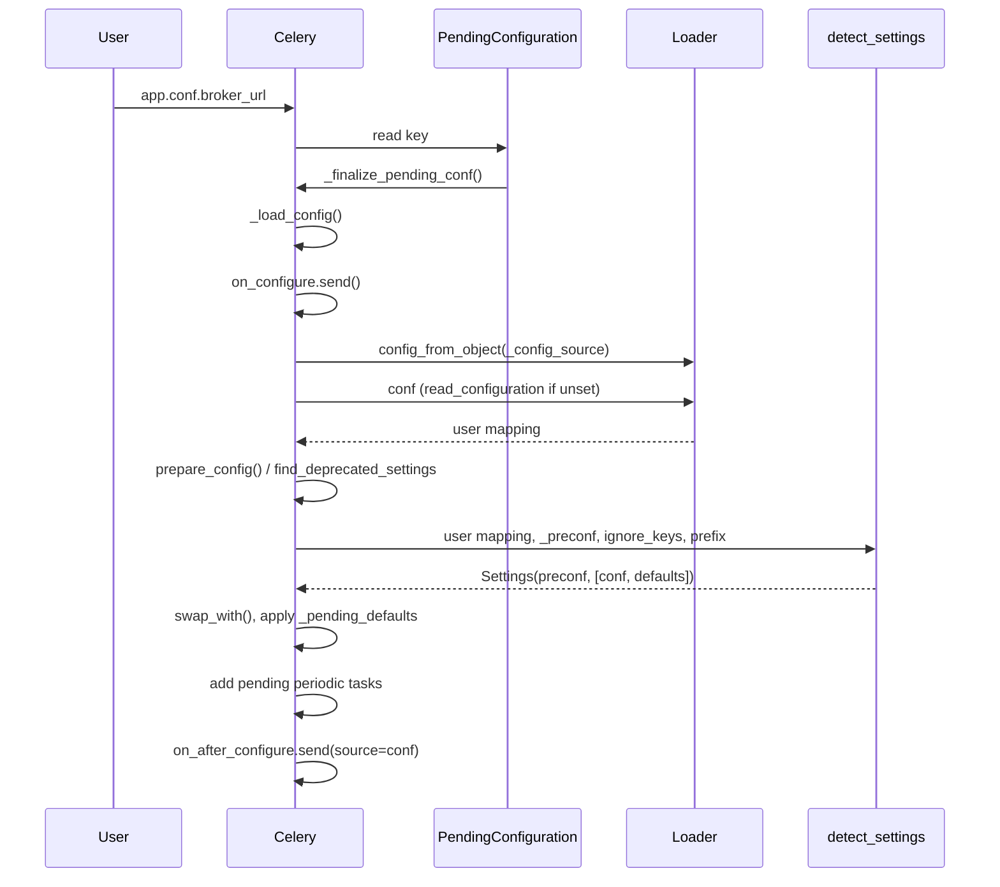
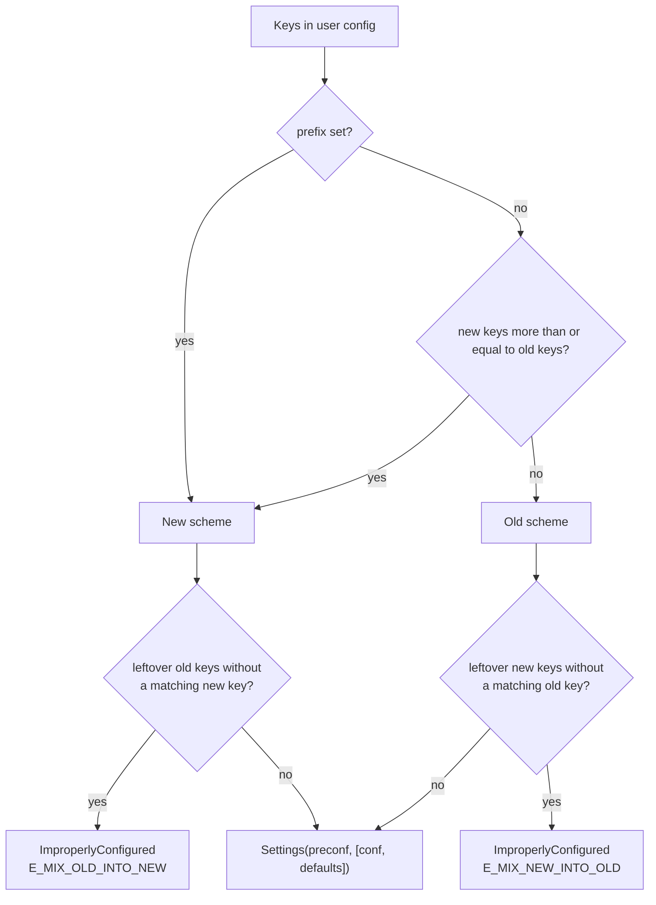

## Overview

Every behaviour of a Celery app (which broker to talk to, how results are stored, how many processes a worker forks, where beat keeps its schedule) is driven by a setting. Celery declares all settings once, with their types and defaults, in `celery/app/defaults.py`; the app reads user values through a loader, merges them over those defaults in a `Settings` view, and exposes the result as `app.conf`. Configuration is lazy: nothing is read until the first key is accessed, so an app can be created at import time and configured later. How the app object itself is built is covered in [[The Celery Application]].

Sources: [celery/app/defaults.py:1-27](repo://celery/app/defaults.py#L1-L27), [celery/app/base.py:1566-1575](repo://celery/app/base.py#L1566-L1575)

The same machinery supports two naming schemes: the lowercase names introduced in Celery 4 (`broker_url`, `task_acks_late`) and the older uppercase names (`BROKER_URL`, `CELERY_ACKS_LATE`). `detect_settings` decides which scheme a configuration source uses and refuses a mix of both.

Sources: [celery/app/utils.py:42-62](repo://celery/app/utils.py#L42-L62), [celery/app/utils.py:232-286](repo://celery/app/utils.py#L232-L286)

## Declaring settings

### Option and Namespace

An `Option` records one setting: its `default`, a `type` name (`'string'` unless given), and optional metadata such as `old` (the legacy names), `deprecate_by`, `remove_by` and `alt`. `to_python` converts a raw string through `typemap`, which is how values passed on the command line become ints, floats or booleans (`'bool'` maps to `strtobool`).

Sources: [celery/app/defaults.py:42-63](repo://celery/app/defaults.py#L42-L63)

```python
class Option:
    """Describes a Celery configuration option."""

    alt = None
    deprecate_by = None
    remove_by = None
    old = set()
    typemap = {'string': str, 'int': int, 'float': float, 'any': lambda v: v,
               'bool': strtobool, 'dict': dict, 'tuple': tuple}
```

Sources: [celery/app/defaults.py:42-51](repo://celery/app/defaults.py#L42-L51)

`Namespace(__old__=None, **options)` simply returns its keyword arguments as a dict, so `NAMESPACES` is a nested dict of `Option` objects. When `__old__` is given, every option in the namespace that has no explicit `old` set receives the legacy names formatted from the template: `OLD_NS` is `celery_{0}`, `OLD_NS_BEAT` is `celerybeat_{0}`, `OLD_NS_WORKER` is `celeryd_{0}`, and `old_ns('celery_result')` builds `celery_result_{0}`.

Sources: [celery/app/defaults.py:23-40](repo://celery/app/defaults.py#L23-L40)

### The NAMESPACES tree

`NAMESPACES` holds a few top-level options (`accept_content`, `result_accept_content`, `enable_utc`, `imports`, `include`, `timezone`) followed by one nested namespace per area. The flattened setting name is the namespace and the key joined by `_`, so `broker=Namespace(url=...)` declares `broker_url`.

Sources: [celery/app/defaults.py:66-72](repo://celery/app/defaults.py#L66-L72)

| Namespace | Covers | Legacy prefix |
| --- | --- | --- |
| `beat` | Scheduler class, schedule, schedule file | `CELERYBEAT_` |
| `broker` | Connection URL(s), transport, retries, heartbeats, pool | none (uppercase of new name, e.g. `BROKER_URL`) |
| `cache`, `cassandra`, `s3`, `azureblockblob`, `gcs`, `couchbase`, `arangodb`, `mongodb`, `cosmosdbsql`, `redis`, `elasticsearch`, `database` | Options for the matching [[Result Backends]] | varies, e.g. `CELERY_CACHE_`, `CELERY_REDIS_` |
| `control` | Remote control reply queues and exchange | none |
| `event` | Event queue TTL/expiry, serializer, exchange | `CELERY_EVENT_` |
| `result` | Result backend URL, serializer, expiry, chord timing, backend retries | `CELERY_RESULT_` |
| `security` | Certificate, key and digest for [[Message Signing (Security)]] | `CELERY_SECURITY_` |
| `task` | Serializer, routing defaults, acks, time limits, eager mode | `CELERY_` |
| `worker` | Pool, concurrency, prefetch, logging, consumer class | `CELERYD_` |

Sources: [celery/app/defaults.py:73-178](repo://celery/app/defaults.py#L73-L178), [celery/app/defaults.py:179-264](repo://celery/app/defaults.py#L179-L264), [celery/app/defaults.py:265-375](repo://celery/app/defaults.py#L265-L375)

### Flattening into lookup tables

`flatten` walks the tree breadth-first with a `deque`, extending the prefix with `key + '_'` whenever it meets a nested dict, and yields whatever the `keyfilter` returns for each leaf. The default `_flatten_keys` yields `(name, option)`; `_to_compat` yields `(OLD_NAME, new_name, option)` triples, using the uppercased `old` templates when present or the uppercased new name otherwise.

Sources: [celery/app/defaults.py:378-400](repo://celery/app/defaults.py#L378-L400)

At import time the module builds every table the rest of Celery uses: `DEFAULTS` (new name to default), `_OLD_DEFAULTS` (old name to default), `_TO_OLD_KEY` and `_TO_NEW_KEY` (bidirectional name maps), and the key sets `SETTING_KEYS` and `_OLD_SETTING_KEYS`.

Sources: [celery/app/defaults.py:403-413](repo://celery/app/defaults.py#L403-L413)

### Finding an option by name

`find(name, namespace='celery')` is memoized and resolves a bare option name to a `searchresult(namespace, key, type)`. It first tries the requested namespace, then scans every namespace (returning the whole namespace dict if the name matches a namespace itself), and finally falls back to `DEFAULTS[name.lower()]`, which raises `KeyError` for an unknown name. `Settings.find_option` and `find_value_for_key` are thin wrappers around it.

Sources: [celery/app/defaults.py:427-447](repo://celery/app/defaults.py#L427-L447), [celery/app/utils.py:141-170](repo://celery/app/utils.py#L141-L170)

`find_deprecated_settings` warns, through `celery.utils.deprecated.warn`, for any option carrying `deprecate_by` or `remove_by` that the user has set; `task_acks_on_failure_or_timeout` is the example in the tree, pointing to `task_acks_on_failure` and `task_acks_on_timeout`. `Celery.prepare_config` runs it on the loader's configuration before merging.

Sources: [celery/app/defaults.py:416-424](repo://celery/app/defaults.py#L416-L424), [celery/app/defaults.py:265-276](repo://celery/app/defaults.py#L265-L276), [celery/app/base.py:1193-1195](repo://celery/app/base.py#L1193-L1195)

## How app.conf is loaded

### Pending configuration

`Celery.__init__` stores constructor shortcuts (`broker`, `backend`, `include`, and any extra keyword arguments) into `_preconf` through `__autoset`, remembering their names in `_preconf_set_by_auto`. It then wraps `_preconf` in a `PendingConfiguration` inside a `Settings` view, using the app's `namespace` as prefix and `_old_key_to_new`/`_new_key_to_old` as key translators.

Sources: [celery/app/base.py:392-407](repo://celery/app/base.py#L392-L407), [celery/app/base.py:446-450](repo://celery/app/base.py#L446-L450)

`PendingConfiguration` forwards writes (`__setitem__`, `update`, `setdefault`, `clear`) and `in` checks to the raw `_preconf` dict, so `app.conf.update(...)` before configuration costs nothing. Any read goes through its `data` cached property, which calls the callback `_finalize_pending_conf` and triggers the real load. That method also turns an `AttributeError` raised during loading into `ModuleNotFoundError`, because `UserDict` would otherwise swallow it and recurse.

Sources: [celery/app/base.py:208-249](repo://celery/app/base.py#L208-L249), [celery/app/base.py:1230-1245](repo://celery/app/base.py#L1230-L1245)

### Loading sequence



Sources: [celery/app/base.py:1247-1280](repo://celery/app/base.py#L1247-L1280), [celery/loaders/base.py:231-236](repo://celery/loaders/base.py#L231-L236)

`_load_config` fires `on_configure`, passes any recorded config source to the loader, marks the app `configured`, and calls `detect_settings` with the loader's mapping and `_preconf`. If `app.conf` was already referenced it calls `swap_with` so existing references see the finalized values. It then drains `_pending_defaults` (filled by `add_defaults`) and `_pending_periodic_tasks`, and finally sends `on_after_configure` with the settings as `source`.

Sources: [celery/app/base.py:1247-1280](repo://celery/app/base.py#L1247-L1280), [celery/utils/collections.py:428-438](repo://celery/utils/collections.py#L428-L438)

### config_from_object, config_from_envvar and add_defaults

`config_from_object(obj, silent=False, force=False, namespace=None)` only records `_config_source` and the namespace; the module is imported when configuration is first read. Pass `force=True`, or call it after the app is already configured, to reload immediately: `_conf` is reset and the loader imports the object at once. `config_from_envvar(variable_name)` reads a module name from the environment and delegates to `config_from_object`, raising `ImproperlyConfigured` when the variable is empty unless `silent=True`.

Sources: [celery/app/base.py:703-743](repo://celery/app/base.py#L703-L743), [celery/app/base.py:87-94](repo://celery/app/base.py#L87-L94)

`add_defaults(fun)` adds a mapping, or a callable returning one, as an extra defaults layer. Before configuration it is queued and evaluated lazily; afterwards it is applied directly to `_conf`. Unlike `conf.update`, the mapping is not copied and not sent to child processes, so it must be re-added at import time.

Sources: [celery/app/base.py:679-701](repo://celery/app/base.py#L679-L701)

The Django example reads settings from the Django settings object with a `CELERY` prefix, so `CELERY_BROKER_URL` in `settings.py` becomes `broker_url`.

Sources: [examples/django/proj/celery.py:10-14](repo://examples/django/proj/celery.py#L10-L14)

```python
app.config_from_object('django.conf:settings', namespace='CELERY')
```

Sources: [examples/django/proj/celery.py:8-17](repo://examples/django/proj/celery.py#L8-L17)

### Settings from the command line

`celery --config MODULE` and `--loader NAME` set `CELERY_CONFIG_MODULE` and `CELERY_LOADER`; `--broker` and `--result-backend` set `CELERY_BROKER_URL` and `CELERY_RESULT_BACKEND`. Extra `key=value` arguments after `celery worker` or `celery beat` go through `app.config_from_cmdline`, with the worker using `namespace='worker'`. See [[Command Line Interface]].

Sources: [celery/bin/celery.py:123-132](repo://celery/bin/celery.py#L123-L132), [celery/bin/worker.py:327-335](repo://celery/bin/worker.py#L327-L335), [celery/bin/beat.py:52-58](repo://celery/bin/beat.py#L52-L58), [celery/app/base.py:745-748](repo://celery/app/base.py#L745-L748)

`BaseLoader.cmdline_config_parser` splits each argument on the first `=`, lowercases the key and turns dots into underscores. A key starting with `_` (or `.`) uses the default namespace; otherwise the text before the first `_` is the namespace. A value written as `(type)value` is cast through `Option.typemap` plus `json` (with `tuple`, `list` and `dict` forced through `json.loads`); without a cast the declared `Option.to_python` converts it, and a conversion error is re-raised as `ValueError` naming the key.

Sources: [celery/loaders/base.py:161-206](repo://celery/loaders/base.py#L161-L206)

```bash
celery -A proj worker worker.prefetch_multiplier=1 'task.acks_late=(bool)true'
```

Sources: [celery/loaders/base.py:175-205](repo://celery/loaders/base.py#L175-L205)

## The Settings object

### Lookup rules

`Settings` extends `ConfigurationView`, a chain of mappings: the user's changes first, then the defaults layers. `__getitem__` tries the prefixed key (when the app has a `namespace`), the plain key, then each key translator, so `app.conf.CELERY_ACKS_LATE` and `app.conf.task_acks_late` reach the same value. Writes always go to the `changes` map.

Sources: [celery/utils/collections.py:353-405](repo://celery/utils/collections.py#L353-L405)

A handful of properties compute values instead of reading one key. Environment variables win over the configuration for the broker and backend URLs, and several defaults fall back to related settings.

Sources: [celery/app/utils.py:84-131](repo://celery/app/utils.py#L84-L131)

| Property | Resolution order |
| --- | --- |
| `broker_url` | `CELERY_BROKER_URL` env, `broker_url`, `broker_host` |
| `broker_read_url` | `CELERY_BROKER_READ_URL` env, `broker_read_url`, `broker_url` |
| `broker_write_url` | `CELERY_BROKER_WRITE_URL` env, `broker_write_url`, `broker_url` |
| `result_backend` | `CELERY_RESULT_BACKEND` env, `result_backend`, `CELERY_RESULT_BACKEND` |
| `task_default_exchange` | `task_default_exchange`, `task_default_queue` |
| `task_default_routing_key` | `task_default_routing_key`, `task_default_queue` |
| `timezone` | `timezone`, Django's `TIME_ZONE` |

Sources: [celery/app/utils.py:84-131](repo://celery/app/utils.py#L84-L131)

### Inspecting the configuration

`without_defaults()` returns a `Settings` over every map except the last (the defaults), which `value_set_for(key)` uses to tell whether the user set a key. `table()` and `humanize()` render the settings for `celery report` and bug reports; by default they pass through `filter_hidden_settings`, which masks any key matching `HIDDEN_SETTINGS` (`API`, `TOKEN`, `KEY`, `SECRET`, `PASS`, `DATABASE` and similar). `finalize()` forces a pending configuration to load by reading a bogus key.

Sources: [celery/app/utils.py:133-195](repo://celery/app/utils.py#L133-L195), [celery/app/utils.py:37-40](repo://celery/app/utils.py#L37-L40)

## Old and new setting names

### detect_settings

`detect_settings` compares the keys of the user's source (minus `ignore_keys`, which are the constructor shortcuts) against `SETTING_KEYS` and `_OLD_SETTING_KEYS`. The majority scheme wins: if there are more old names than new, the old scheme (`_old_settings_info`) is used, otherwise the new one. A `prefix` (the app `namespace`) always forces the new scheme.

Sources: [celery/app/utils.py:232-266](repo://celery/app/utils.py#L232-L266), [celery/app/utils.py:220-229](repo://celery/app/utils.py#L220-L229)



Sources: [celery/app/utils.py:246-286](repo://celery/app/utils.py#L246-L286)

Keys of the minority scheme are tolerated only when the user also supplied their counterpart (for example both `result_expires` and `CELERY_TASK_RESULT_EXPIRES`); every other leftover raises `ImproperlyConfigured` listing each rename as `OLD -> new` (or the reverse). The chosen scheme's defaults (`DEFAULTS` or `_OLD_DEFAULTS`) are deep-copied, `_preconf` keys are converted to that scheme and laid over them, and the old keys found are stored as `deprecated_settings`.

Sources: [celery/app/utils.py:268-286](repo://celery/app/utils.py#L268-L286)

`Settings.maybe_warn_deprecated_settings` then emits one deprecation warning per old key, naming its new equivalent from `_TO_NEW_KEY` and announcing removal in 6.0.0.

Sources: [celery/app/utils.py:197-209](repo://celery/app/utils.py#L197-L209)

### Name mapping examples

| New name | Old name |
| --- | --- |
| `broker_url` | `BROKER_URL` |
| `result_backend` | `CELERY_RESULT_BACKEND` |
| `result_expires` | `CELERY_TASK_RESULT_EXPIRES` |
| `task_serializer` | `CELERY_TASK_SERIALIZER` |
| `task_acks_late` | `CELERY_ACKS_LATE` |
| `task_eager_propagates` | `CELERY_EAGER_PROPAGATES_EXCEPTIONS` |
| `task_time_limit` | `CELERYD_TASK_TIME_LIMIT` |
| `worker_concurrency` | `CELERYD_CONCURRENCY` |
| `worker_send_task_events` | `CELERY_SEND_EVENTS` |
| `beat_schedule` | `CELERYBEAT_SCHEDULE` |
| `database_url` | `CELERY_RESULT_DBURI` |

Sources: [celery/app/defaults.py:73-108](repo://celery/app/defaults.py#L73-L108), [celery/app/defaults.py:205-265](repo://celery/app/defaults.py#L205-L265), [celery/app/defaults.py:283-374](repo://celery/app/defaults.py#L283-L374)

## Loaders

### Choosing a loader

A loader decides where configuration comes from and hooks worker lifecycle events. `get_loader_cls` resolves a name or alias (`app` or `default`) with `symbol_by_name`, importing from the current directory. An app's loader is `CELERY_LOADER` from the environment, then the class attribute `loader_cls`, then `celery.loaders.app:AppLoader`; the fallback default app instead uses `CELERY_LOADER` or `default`. The `loader` cached property instantiates it with the app.

Sources: [celery/loaders/__init__.py:10-18](repo://celery/loaders/__init__.py#L10-L18), [celery/app/base.py:436-442](repo://celery/app/base.py#L436-L442), [celery/_state.py:92-99](repo://celery/_state.py#L92-L99), [celery/app/base.py:1586-1589](repo://celery/app/base.py#L1586-L1589)

| Loader | Class | read_configuration |
| --- | --- | --- |
| `app` | `AppLoader` | Inherited from `BaseLoader`: imports `CELERY_CONFIG_MODULE` only if set, else returns `None` |
| `default` | `Loader` | Imports `CELERY_CONFIG_MODULE` or `celeryconfig`; missing module gives an empty mapping (warns `NotConfigured` when `C_WNOCONF` is set) |

Sources: [celery/loaders/app.py:1-8](repo://celery/loaders/app.py#L1-L8), [celery/loaders/default.py:13-44](repo://celery/loaders/default.py#L13-L44), [celery/loaders/base.py:208-216](repo://celery/loaders/base.py#L208-L216)

### BaseLoader

`BaseLoader.conf` reads configuration on first access via `read_configuration`, unless `config_from_object` already set `_conf`. `config_from_object` accepts an object or a dotted string; `_smart_import` treats `module:attr` as a symbol, otherwise tries the string as a module and falls back to module plus attribute. The object is wrapped with `force_mapping`, and an `override_backends` key replaces the loader's backend aliases.

Sources: [celery/loaders/base.py:119-145](repo://celery/loaders/base.py#L119-L145), [celery/loaders/base.py:231-236](repo://celery/loaders/base.py#L231-L236)

`_import_config_module` validates the name with `find_module` first: a name ending in `.py` gets the hint "Did you mean ..." with the suffix stripped, and any other invalid name raises `NotAPackage` with `CONFIG_INVALID_NAME`.

Sources: [celery/loaders/base.py:21-28](repo://celery/loaders/base.py#L21-L28), [celery/loaders/base.py:147-159](repo://celery/loaders/base.py#L147-L159)

### Worker hooks and task modules

The loader also owns task-module imports. `init_worker` runs once, sending the `import_modules` signal (re-raising any exception a receiver returned, since logging is not set up yet) and importing `default_modules`, which is `builtin_modules` plus the `imports` and `include` settings. Subclasses override `on_worker_init`, `on_worker_shutdown`, `on_worker_process_init`, `on_task_init` and `on_process_cleanup`.

Sources: [celery/loaders/base.py:59-117](repo://celery/loaders/base.py#L59-L117), [celery/loaders/base.py:223-229](repo://celery/loaders/base.py#L223-L229)

`autodiscover_tasks` imports `<package>.<related_name>` (default `tasks`) for each package, guarded by `_RACE_PROTECTION` against re-entry. `find_related_module` returns `None` when the candidate module itself is missing but re-raises a `ModuleNotFoundError` coming from a nested import, so typos inside a tasks module still surface.

Sources: [celery/loaders/base.py:218-221](repo://celery/loaders/base.py#L218-L221), [celery/loaders/base.py:239-278](repo://celery/loaders/base.py#L239-L278)

## Key settings

### General

| Setting | Default | Notes |
| --- | --- | --- |
| `accept_content` | `('json',)` | Content types the worker accepts |
| `result_accept_content` | `None` | Falls back to `accept_content` when unset |
| `enable_utc` | `True` | With no `timezone`, selects UTC; otherwise local time |
| `timezone` | unset | Resolved by `app.timezone` |
| `imports` / `include` | `()` | Modules imported by the worker loader |

Sources: [celery/app/defaults.py:66-72](repo://celery/app/defaults.py#L66-L72), [celery/app/base.py:1619-1632](repo://celery/app/base.py#L1619-L1632)

### Broker

| Setting | Default | Notes |
| --- | --- | --- |
| `broker_url` | `None` | Also `broker_read_url` / `broker_write_url` |
| `broker_transport_options` | `{}` | Passed to kombu transport |
| `broker_connection_timeout` | `4` | Seconds |
| `broker_connection_retry` | `True` | Retry lost connections |
| `broker_connection_retry_on_startup` | `None` | Retry the first connection |
| `broker_connection_max_retries` | `100` | |
| `broker_channel_error_retry` | `False` | |
| `broker_heartbeat` | `120` | `broker_heartbeat_checkrate` is `3.0` |
| `broker_pool_limit` | `10` | Producer connection pool size |
| `broker_use_ssl` | `False` | |
| `broker_native_delayed_delivery_queue_type` | `'quorum'` | See [[Delayed Delivery with Quorum Queues]] |

Sources: [celery/app/defaults.py:83-108](repo://celery/app/defaults.py#L83-L108)

### Results

| Setting | Default | Notes |
| --- | --- | --- |
| `result_backend` | unset | See [[Result Backends]] |
| `result_serializer` | `'json'` | |
| `result_expires` | `timedelta(days=1)` | |
| `result_extended` | `False` | Store task name, args and more |
| `result_cache_max` | `-1` | |
| `result_chord_join_timeout` | `3.0` | `result_chord_retry_interval` is `1.0` |
| `result_backend_always_retry` | `False` | With `result_backend_max_retries` (`inf`) and sleep bounds 10 ms to 10000 ms |

Sources: [celery/app/defaults.py:205-230](repo://celery/app/defaults.py#L205-L230)

### Tasks

| Setting | Default | Notes |
| --- | --- | --- |
| `task_serializer` | `'json'` | |
| `task_protocol` | `2` | See [[Calling Tasks and Message Protocol]] |
| `task_default_queue` | `'celery'` | Exchange and routing key fall back to it |
| `task_default_exchange_type` | `'direct'` | |
| `task_queues` / `task_routes` | unset | See [[Task Routing and Queues]] |
| `task_create_missing_queues` | `True` | |
| `task_acks_late` | `False` | |
| `task_always_eager` | `False` | `task_eager_propagates` is `False` |
| `task_ignore_result` | `False` | |
| `task_track_started` | `False` | |
| `task_time_limit` / `task_soft_time_limit` | unset | Seconds |
| `task_publish_retry` | `True` | Policy: `max_retries` 3, `interval_start` 0, `interval_max` 1, `interval_step` 0.2 |
| `task_send_sent_event` | `False` | |

Sources: [celery/app/defaults.py:265-324](repo://celery/app/defaults.py#L265-L324)

### Worker

| Setting | Default | Notes |
| --- | --- | --- |
| `worker_pool` | `'prefork'` | See [[Concurrency Pools and Autoscaling]] |
| `worker_concurrency` | `None` | |
| `worker_prefetch_multiplier` | `4` | |
| `worker_disable_prefetch` | `False` | |
| `worker_max_tasks_per_child` / `worker_max_memory_per_child` | unset | |
| `worker_consumer` | `'celery.worker.consumer:Consumer'` | |
| `worker_autoscaler` | `'celery.worker.autoscale:Autoscaler'` | |
| `worker_send_task_events` | `False` | See [[Events and Monitoring]] |
| `worker_enable_remote_control` | `True` | |
| `worker_hijack_root_logger` | `True` | See [[Logging]] |
| `worker_redirect_stdouts` | `True` | Level `'WARNING'` |
| `worker_soft_shutdown_timeout` | `0.0` | |
| `worker_detect_quorum_queues` | `True` | |

Sources: [celery/app/defaults.py:325-374](repo://celery/app/defaults.py#L325-L374)

### Beat

| Setting | Default | Notes |
| --- | --- | --- |
| `beat_scheduler` | `'celery.beat:PersistentScheduler'` | See [[Periodic Tasks with Beat]] |
| `beat_schedule` | `{}` | |
| `beat_schedule_filename` | `'celerybeat-schedule'` | |
| `beat_max_loop_interval` | `0` | |
| `beat_sync_every` | `0` | |
| `beat_cron_starting_deadline` | `None` | |

Sources: [celery/app/defaults.py:73-82](repo://celery/app/defaults.py#L73-L82)
