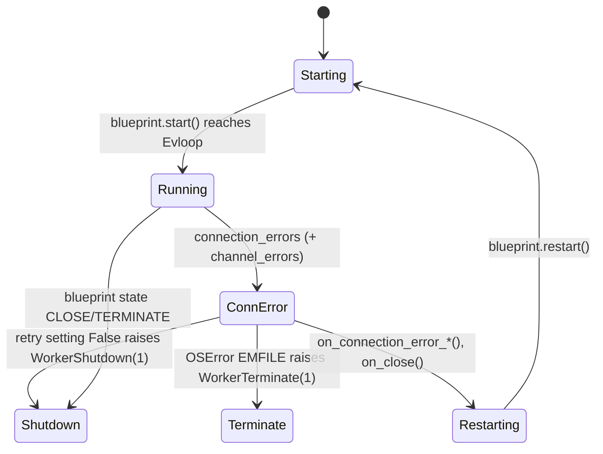
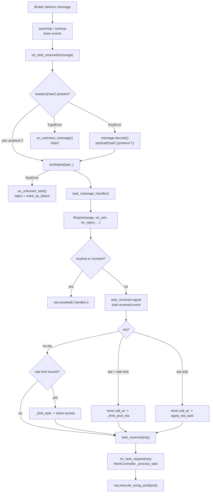

## Overview

The consumer is the part of the worker that talks to the broker. It keeps the connection alive, receives task messages, turns each one into a `Request`, and hands it to the pool through the worker's `process_task` callback. The `Consumer` class in `celery/worker/consumer/consumer.py` is itself driven by a bootsteps blueprint, so the connection, events, remote control and task consumer are separate steps that are started, stopped and restarted together whenever the broker connection is lost.

Sources: [celery/worker/consumer/consumer.py:145-255](repo://celery/worker/consumer/consumer.py#L145-L255)

The worker creates the consumer from its own `Consumer` bootstep, the last step of the worker blueprint described in [[Worker Architecture and Bootsteps]]. It passes `w.process_task` as `on_task_request`, the pool, the timer, the hub and an initial prefetch count of `concurrency * prefetch_multiplier` (or `max_concurrency * prefetch_multiplier` when autoscaling).

Sources: [celery/worker/components.py:221-246](repo://celery/worker/components.py#L221-L246), [celery/worker/worker.py:220-231](repo://celery/worker/worker.py#L220-L231)

## Consumer blueprint

### Default steps

`Consumer.Blueprint` lists the steps by import path. The blueprint orders them by their `requires` dependencies, and `Evloop` sets `last = True` so the event loop always starts after everything else is ready. Extra steps registered in `app.steps['consumer']` are added when the blueprint is built in `__init__`.

Sources: [celery/worker/consumer/consumer.py:250-255](repo://celery/worker/consumer/consumer.py#L250-L255), [celery/worker/consumer/consumer.py:857-866](repo://celery/worker/consumer/consumer.py#L857-L866)

```python
        default_steps = [
            'celery.worker.consumer.connection:Connection',
            'celery.worker.consumer.mingle:Mingle',
            'celery.worker.consumer.events:Events',
            'celery.worker.consumer.gossip:Gossip',
            'celery.worker.consumer.heart:Heart',
            'celery.worker.consumer.control:Control',
            'celery.worker.consumer.tasks:Tasks',
            'celery.worker.consumer.delayed_delivery:DelayedDelivery',
            'celery.worker.consumer.consumer:Evloop',
            'celery.worker.consumer.agent:Agent',
        ]
```

Sources: [celery/worker/consumer/consumer.py:175-186](repo://celery/worker/consumer/consumer.py#L175-L186)

### What each step does

| Step | Requires | Enabled when | What it sets up |
| --- | --- | --- | --- |
| `Connection` | none | always | `c.connection = c.connect()`; on shutdown closes it and sets it to `None` so the green pidbox thread exits |
| `Events` | `Connection` | task events, gossip or heartbeat enabled | `c.event_dispatcher` on a separate write connection; re-sends events buffered while the connection was down |
| `Mingle` | `Events` | not `--without-mingle` and transport is `amqp`, `redis` or `gcpubsub` | sends `hello` to other workers, syncs the logical clock and the revoked-task set |
| `Gossip` | `Mingle` | not `--without-gossip` and transport is `amqp` or `redis` | a `ConsumerStep` that consumes `worker.#` events, tracks other workers and runs leader elections |
| `Heart` | `Events` | not `--without-heartbeat` | `c.heart`, a `celery.worker.heartbeat.Heart` sending `worker-heartbeat` events on the timer |
| `Tasks` | `Mingle` | always | strategies, initial `basic_qos`, `c.task_consumer` and `c.qos` |
| `Control` | `Tasks` | `worker_enable_remote_control` and the transport supports `fanout` | `Pidbox`, or `gPidbox` for green pools |
| `DelayedDelivery` | `Tasks` | quorum queues detected | native delayed delivery exchanges and bindings |
| `Evloop` | none, `last = True` | always | runs `c.loop(*c.loop_args())` |
| `Agent` | `Connection` | `worker_agent` is set | instantiates a `cell` actor agent as `c.agent` |

Sources: [celery/worker/consumer/connection.py:13-45](repo://celery/worker/consumer/connection.py#L13-L45), [celery/worker/consumer/events.py:15-71](repo://celery/worker/consumer/events.py#L15-L71), [celery/worker/consumer/mingle.py:13-76](repo://celery/worker/consumer/mingle.py#L13-L76), [celery/worker/consumer/gossip.py:23-80](repo://celery/worker/consumer/gossip.py#L23-L80), [celery/worker/consumer/heart.py:10-36](repo://celery/worker/consumer/heart.py#L10-L36), [celery/worker/consumer/tasks.py:20-57](repo://celery/worker/consumer/tasks.py#L20-L57), [celery/worker/consumer/control.py:18-33](repo://celery/worker/consumer/control.py#L18-L33), [celery/worker/consumer/delayed_delivery.py:39-66](repo://celery/worker/consumer/delayed_delivery.py#L39-L66), [celery/worker/consumer/agent.py:9-21](repo://celery/worker/consumer/agent.py#L9-L21)

The remote control commands served by `Control` are described in [[Remote Control and Inspection]], and the events sent through `c.event_dispatcher` in [[Events and Monitoring]]. Delayed delivery has its own page, [[Delayed Delivery with Quorum Queues]].

Sources: [celery/worker/consumer/control.py:1-33](repo://celery/worker/consumer/control.py#L1-L33), [celery/worker/consumer/heart.py:10-36](repo://celery/worker/consumer/heart.py#L10-L36)

### Mingle and Gossip

`Mingle.send_hello` calls `app.control.inspect(timeout=1.0).hello(...)` with the worker's own revoked set, drops its own reply, then for every neighbour calls `sync_with_node`, which adjusts `app.clock` and merges the neighbour's revoked ids into `controller.state.revoked`. A failing neighbour is logged and skipped so one bad reply cannot stop startup.

Sources: [celery/worker/consumer/mingle.py:39-76](repo://celery/worker/consumer/mingle.py#L39-L76)

`Gossip.get_consumers` registers a periodic timer and builds an event `Receiver` bound to `worker.#` with a queue TTL equal to `heartbeat_interval`. `on_message` dispatches `worker.elect` and `worker.elect.ack` to the election handlers, ignores `task.*` routing keys, feeds other workers' events into a local `State`, and only forwards the clock for its own events. `periodic` removes workers whose heartbeat expired and calls the `node_lost` handlers.

Sources: [celery/worker/consumer/gossip.py:156-206](repo://celery/worker/consumer/gossip.py#L156-L206), [celery/worker/consumer/gossip.py:81-134](repo://celery/worker/consumer/gossip.py#L81-L134)

## Start loop and connection recovery

### Restarting the blueprint

`Consumer.start` loops until the blueprint reaches `CLOSE` or `TERMINATE`. Each pass calls `blueprint.start(self)`, which runs every step and finally blocks in `Evloop`. When a recoverable error escapes, the consumer logs it, calls `on_close()` to drop state tied to the dead channel, and calls `blueprint.restart(self)` before the next pass. Restarts are counted with billiard's `restart_state(maxR=5, maxT=1)`, so more than five restarts in a second logs "Frequent restarts detected" and sleeps one second.

Sources: [celery/worker/consumer/consumer.py:366-407](repo://celery/worker/consumer/consumer.py#L366-L407)



Sources: [celery/worker/consumer/consumer.py:366-413](repo://celery/worker/consumer/consumer.py#L366-L413)

### Which errors are recoverable

The set of recoverable exceptions is `conninfo.connection_errors`, plus `channel_errors` when `broker_channel_error_retry` is enabled. The setting that decides whether to retry is chosen by `_get_connection_retry_type`: `broker_connection_retry_on_startup` for a failure on the first attempt (if it is set), otherwise `broker_connection_retry`. With retries disabled the worker raises `WorkerShutdown(1)` so the main process shuts down cleanly. Running out of file descriptors (`errno.EMFILE`) always raises `WorkerTerminate(1)`.

Sources: [celery/worker/consumer/consumer.py:377-413](repo://celery/worker/consumer/consumer.py#L377-L413)

### Handling a lost connection

`on_connection_error_after_connected` runs when a connection had been established. It calls `connection.collect(socket_timeout=COLLECT_SOCKET_TIMEOUT)` (5 seconds) so cleanup cannot hang on a dead socket, then closes the connection and sets `c.connection` to `None` before reconnecting. If `worker_cancel_long_running_tasks_on_connection_loss` is on, active `acks_late` requests that are not yet acknowledged are cancelled, because their delivery tag belongs to the dead channel and the broker will redeliver them; otherwise a `CPendingDeprecationWarning` announces that this becomes the default in Celery 6.0.

Sources: [celery/worker/consumer/consumer.py:65-68](repo://celery/worker/consumer/consumer.py#L65-L68), [celery/worker/consumer/consumer.py:419-450](repo://celery/worker/consumer/consumer.py#L419-L450), [celery/worker/consumer/consumer.py:123-134](repo://celery/worker/consumer/consumer.py#L123-L134)

`on_close` clears what cannot be acked on the new channel: the worker semaphore, pending rate-limit buckets, reserved requests that are not active, and the pool's buffered work via `pool.flush()`.

Sources: [celery/worker/consumer/consumer.py:532-547](repo://celery/worker/consumer/consumer.py#L532-L547)

### Connecting with retries

`connect()` opens the read connection with the AMQP heartbeat and, when a hub exists, registers the transport with the event loop. `ensure_connected` either calls `conn.connect()` once (retries disabled) or `conn.ensure_connection(_error_handler, broker_connection_max_retries, callback=maybe_shutdown)`. The error handler logs "Trying again in N seconds... (retries/max)" or "Will retry using next failover" when an alternate URL exists. On success `first_connection_attempt` becomes `False` and the retry counter resets.

Sources: [celery/worker/consumer/consumer.py:549-622](repo://celery/worker/consumer/consumer.py#L549-L622)

> [!NOTE]
> When `broker_connection_retry_on_startup` is unset (`None`), the startup decision still falls back to `broker_connection_retry` and a pending-deprecation warning is emitted. Set `broker_connection_retry_on_startup` explicitly to control startup retries.

Sources: [celery/worker/consumer/consumer.py:585-608](repo://celery/worker/consumer/consumer.py#L585-L608)

## Receiving a task message

### Message flow

The diagram follows one message from the broker to the pool.

Sources: [celery/worker/consumer/consumer.py:723-786](repo://celery/worker/consumer/consumer.py#L723-L786)



Sources: [celery/worker/consumer/consumer.py:723-786](repo://celery/worker/consumer/consumer.py#L723-L786), [celery/worker/strategy.py:132-209](repo://celery/worker/strategy.py#L132-L209), [celery/worker/consumer/consumer.py:329-364](repo://celery/worker/consumer/consumer.py#L329-L364), [celery/worker/consumer/consumer.py:659-663](repo://celery/worker/consumer/consumer.py#L659-L663), [celery/worker/worker.py:223-231](repo://celery/worker/worker.py#L223-L231)

### on_task_received

`create_task_handler` builds a closure over `self.strategies` and the error callbacks. Protocol 2 keeps the task name in `message.headers['task']` and leaves the body undecoded so deserialization happens in the pool; a `KeyError` falls back to protocol 1, decoding the body and reading `payload['task']`. The closure wraps `message.ack_log_error` and `message.reject_log_error` in `promise` objects run through `call_soon_ack`, then calls the strategy with `(message, payload, ack, reject, callbacks)`. `InvalidTaskError` and `ContentDisallowed` go to `on_invalid_task`, and `DecodeError` to `on_decode_error`.

Sources: [celery/worker/consumer/consumer.py:723-786](repo://celery/worker/consumer/consumer.py#L723-L786)

`call_soon_ack` runs the ack immediately when there is no hub. In `synloop` the ordinary `call_soon` queues work in `_pending_operations`, drained only at the next loop iteration, which with `acks_late` and a prefetch multiplier of 1 delayed the next delivery by 50-400 ms. Other callbacks still use the deferred path to stay greenlet-safe.

Sources: [celery/worker/consumer/consumer.py:257-294](repo://celery/worker/consumer/consumer.py#L257-L294)

### Strategies

`update_strategies` runs when the `Tasks` step starts. For every registered task it stores `task.start_strategy(app, consumer)` in `consumer.strategies` and builds `task.__trace__` with `build_tracer`. `Task.start_strategy` instantiates `Task.Strategy`, which defaults to `celery.worker.strategy:default`, so a task class can replace the strategy by setting that attribute.

Sources: [celery/worker/consumer/consumer.py:716-721](repo://celery/worker/consumer/consumer.py#L716-L721), [celery/app/task.py:222-225](repo://celery/app/task.py#L222-L225), [celery/app/task.py:520-521](repo://celery/app/task.py#L520-L521)

`strategy.default` does its lookups once per task type: event dispatcher, `timer.call_at`, the rate-limit bucket getter, the `on_task_request` handler, the revoked set, and a request class built by `create_request_cls(Request, task, pool, hostname, eventer)`. It returns `task_message_handler`, which runs once per message. How the request then executes is covered in [[Task Execution and Tracing]].

Sources: [celery/worker/strategy.py:99-131](repo://celery/worker/strategy.py#L99-L131)

### Protocol 1 and hybrid messages

`task_message_handler` passes protocol 2 messages through unchanged, with `decoded=False`. A body that still contains `args` is converted: `hybrid_to_proto2` builds protocol 2 headers from body fields (`id`, `eta`, `expires`, `retries`, `timelimit` and others) and merges in the message headers, while `proto1_to_proto2` adds `argsrepr`/`kwargsrepr` and maps the old `taskset` field to `group`. Both return `(args, kwargs, embed)` with `callbacks`, `errbacks` and `chord`, and raise `InvalidTaskError` when `kwargs` is not a mapping. The message formats are described in [[Calling Tasks and Message Protocol]].

Sources: [celery/worker/strategy.py:25-96](repo://celery/worker/strategy.py#L25-L96), [celery/worker/strategy.py:134-143](repo://celery/worker/strategy.py#L134-L143)

### ETA, revocation and rate limits

After building the request the handler logs "Received task", drops the message when `req.revoked()` reports it expired or revoked, sends the `task_received` signal and, if the task sends events, a `task-received` event. An ETA is converted to a timestamp (UTC through `timezone.to_system`, otherwise in `app.timezone`). A conversion error rejects the message without requeue.

Sources: [celery/worker/strategy.py:145-189](repo://celery/worker/strategy.py#L145-L189)

| Case | What happens | Why |
| --- | --- | --- |
| ETA and rate limit | `qos.increment_eventually()`, then `timer.call_at(eta, _limit_post_eta)`; at the ETA it decrements QoS and adds the request to the bucket | the held message keeps a prefetch slot, so the prefetch count grows by one to keep the pool fed |
| ETA only | `qos.increment_eventually()`, then `timer.call_at(eta, apply_eta_task)`; `apply_eta_task` reserves, runs the request and decrements QoS | same prefetch accounting |
| Rate limit only | `_limit_task` adds `(req, 1)` to the task's `TokenBucket` | the bucket releases requests in order as tokens become available |
| Neither | `task_reserved(req)`, run `on_task_message` callbacks, `on_task_request(req)` | direct path to the pool |

Sources: [celery/worker/strategy.py:190-208](repo://celery/worker/strategy.py#L190-L208), [celery/worker/consumer/consumer.py:329-364](repo://celery/worker/consumer/consumer.py#L329-L364), [celery/worker/consumer/consumer.py:659-663](repo://celery/worker/consumer/consumer.py#L659-L663)

Each task with a `rate_limit` gets a `TokenBucket(limit, capacity=1)` in `task_buckets`; `reset_rate_limits` rebuilds them from `app.tasks`. `_schedule_bucket_request` pops requests while the bucket has tokens, and when it runs out it puts the request back at the head and schedules itself with `timer.call_after(bucket.expected_time(tokens))`, rotating a priority value 0-9 so different buckets interleave. `worker_disable_rate_limits` turns the whole mechanism off.

Sources: [celery/worker/consumer/consumer.py:296-359](repo://celery/worker/consumer/consumer.py#L296-L359), [celery/worker/strategy.py:121-122](repo://celery/worker/strategy.py#L121-L122)

## Event loops

### asynloop

The `Evloop` step calls `c.loop(*c.loop_args())`. `Consumer.__init__` picks `loops.asynloop` when the worker has a hub and `loops.synloop` otherwise. The worker only creates the `Hub` when `should_use_eventloop()` is true: the environment is not eventlet or gevent, the transport implements asynchronous I/O (such as `amqp` or `redis`), and the platform is not Windows. `asynloop` installs `on_task_received` as `consumer.on_message`, enables AMQP heartbeat checks on the hub timer, registers the worker and consumer with the hub, starts consuming and calls `on_ready()`. On the first start it raises `WorkerLostError` if `pool.did_start_ok()` fails.

Sources: [celery/worker/consumer/consumer.py:239-240](repo://celery/worker/consumer/consumer.py#L239-L240), [celery/worker/worker.py:239-242](repo://celery/worker/worker.py#L239-L242), [celery/worker/components.py:65-66](repo://celery/worker/components.py#L65-L66), [celery/worker/consumer/consumer.py:511-514](repo://celery/worker/consumer/consumer.py#L511-L514), [celery/worker/loops.py:28-71](repo://celery/worker/loops.py#L28-L71)

Each iteration checks `maybe_shutdown()`, re-raises any error stored by the heartbeat tick, calls `qos.update()` only when `qos.prev != qos.value` (grouping QoS changes and letting remote control commands go ahead of task messages), and advances the hub generator. On an exception it calls `hub.reset()` and `hub.timer.clear()` before re-raising, so stale file descriptors and timers from the old connection do not fire during reconnect. A graceful shutdown (`WorkerShutdown` is a `SystemExit`) skips the reset so heartbeats keep running while the pool drains.

Sources: [celery/worker/loops.py:72-130](repo://celery/worker/loops.py#L72-L130)

### synloop

`synloop` is the blocking fallback used under eventlet and gevent, on Windows, and with transports that lack asynchronous support. Each cycle runs `perform_pending_operations()` and then `connection.drain_events(timeout=2.0)`; a `socket.timeout` is ignored, and an `OSError` is raised only while the blueprint is still running. AMQP heartbeats are checked only for green pools. On error it resets the hub if one exists.

Sources: [celery/worker/loops.py:133-183](repo://celery/worker/loops.py#L133-L183), [celery/worker/worker.py:239-242](repo://celery/worker/worker.py#L239-L242)

## Prefetch and QoS

### Initial prefetch

The `Tasks` step sets `basic_qos(0, initial_prefetch_count, qos_global)` on the default channel, creates `c.task_consumer = app.amqp.TaskConsumer(...)`, and wraps the prefetch setter in a kombu `QoS` object capped by `worker_eta_task_limit`. `qos_global` is `True` when the broker uses RabbitMQ 3.3+ semantics (`not qos_semantics_matches_spec`), and forced to `False` when `worker_detect_quorum_queues` finds quorum queues, which do not support global QoS.

Sources: [celery/worker/consumer/tasks.py:29-57](repo://celery/worker/consumer/tasks.py#L29-L57), [celery/worker/consumer/tasks.py:103-124](repo://celery/worker/consumer/tasks.py#L103-L124)

With `worker_disable_prefetch` on a Redis broker, `Tasks.start` patches the channel's `can_consume` so no message is fetched while `reserved_requests` already holds as many requests as `max_concurrency` or `pool.num_processes`. On other brokers the setting is ignored with a warning.

Sources: [celery/worker/consumer/tasks.py:59-83](repo://celery/worker/consumer/tasks.py#L59-L83)

### Pool resizing

When the pool grows or shrinks (autoscaler or the `pool_grow`/`pool_shrink` commands), `_update_prefetch_count(index)` recomputes `initial_prefetch_count = num_processes * prefetch_multiplier` and calls `qos.increment_eventually` or `decrement_eventually` by `abs(index) * prefetch_multiplier`. See [[Concurrency Pools and Autoscaling]].

Sources: [celery/worker/consumer/consumer.py:305-327](repo://celery/worker/consumer/consumer.py#L305-L327)

### Reduction after reconnect

When the connection is lost while tasks are still running, those tasks keep pool slots but their messages will be redelivered. With `worker_enable_prefetch_count_reduction` on, `on_connection_error_after_connected` lowers `initial_prefetch_count` to `max(prefetch_multiplier, max_prefetch_count - active * prefetch_multiplier)`. After each later ack or reject, the promise chain built in `on_task_received` calls `_restore_prefetch_count_after_connection_restart`, which raises the count by `prefetch_multiplier` until it reaches `max_prefetch_count` and logs "Resuming normal operations". In per-consumer QoS mode (`qos_global is False`), the reduction is skipped because `basic.qos` updates would not reach the running consumer.

Sources: [celery/worker/consumer/consumer.py:452-491](repo://celery/worker/consumer/consumer.py#L452-L491), [celery/worker/consumer/consumer.py:765-773](repo://celery/worker/consumer/consumer.py#L765-L773), [celery/worker/consumer/consumer.py:788-815](repo://celery/worker/consumer/consumer.py#L788-L815)

## Bad messages

| Callback | Trigger | Action |
| --- | --- | --- |
| `on_unknown_message` | headers are not a mapping, or the decoded body has no `task` | log `UNKNOWN_FORMAT`, reject, send `task_rejected` |
| `on_unknown_task` | no strategy for the task name | log `UNKNOWN_TASK_ERROR`, reject, `backend.mark_as_failure(id, NotRegistered(name))`, send a `task-failed` event and the `task_unknown` signal |
| `on_invalid_task` | `InvalidTaskError` or `ContentDisallowed` from the strategy | log `INVALID_TASK_ERROR`, reject, send `task_rejected` |
| `on_decode_error` | body cannot be decoded | log `MESSAGE_DECODE_ERROR` and **ack** the message so it does not loop |

Sources: [celery/worker/consumer/consumer.py:516-530](repo://celery/worker/consumer/consumer.py#L516-L530), [celery/worker/consumer/consumer.py:672-714](repo://celery/worker/consumer/consumer.py#L672-L714)

> [!TIP]
> "Received unregistered task of type ..." almost always means the worker did not import the module that defines the task, or the producer used a different task name. See [[Defining Tasks]] for naming and [[Task States and Exceptions]] for `NotRegistered`.

Sources: [celery/worker/consumer/consumer.py:76-96](repo://celery/worker/consumer/consumer.py#L76-L96)

## Configuration

| Setting | Default | Effect on the consumer |
| --- | --- | --- |
| `worker_prefetch_multiplier` | `4` | prefetch is `concurrency * multiplier` |
| `worker_eta_task_limit` | `None` | `max_prefetch` of the `QoS` object, bounding how many ETA tasks are held |
| `worker_enable_prefetch_count_reduction` | `True` | lower prefetch after a reconnect and restore it gradually |
| `worker_disable_prefetch` | `False` | Redis only: fetch only when a pool slot is free |
| `worker_disable_rate_limits` | `False` | skip token buckets |
| `worker_cancel_long_running_tasks_on_connection_loss` | `False` | cancel unacked `acks_late` tasks on connection loss |
| `worker_detect_quorum_queues` | `True` | disable global QoS and enable `DelayedDelivery` for quorum queues |
| `worker_enable_remote_control` | `True` | include the `Control` step |
| `worker_agent` | `None` | class for the `Agent` step |
| `worker_consumer` | `celery.worker.consumer:Consumer` | consumer class used by the worker |
| `broker_connection_retry` | `True` | retry after losing an established connection |
| `broker_connection_retry_on_startup` | `None` | retry on the first connection attempt |
| `broker_connection_max_retries` | `100` | passed to `ensure_connection` |
| `broker_channel_error_retry` | `False` | treat channel errors as recoverable |
| `broker_heartbeat` / `broker_heartbeat_checkrate` | `120` / `3.0` | AMQP heartbeat interval and check rate in the loops |

Sources: [celery/app/defaults.py:88-97](repo://celery/app/defaults.py#L88-L97), [celery/app/defaults.py:325-374](repo://celery/app/defaults.py#L325-L374)

The full option list lives in [[Configuration]].

Sources: [celery/app/defaults.py:325-374](repo://celery/app/defaults.py#L325-L374)

## Extending the consumer

A custom step added to `app.steps['consumer']` receives the `Consumer` instance as `c` and can use `c.connection`, `c.event_dispatcher`, `c.task_consumer` and the other attributes set by earlier steps. A subclass of `bootsteps.ConsumerStep` only implements `get_consumers(channel)`: `start` opens a new channel on `c.connection` and calls `consume()` on each returned kombu consumer, and `stop`/`shutdown` cancel them and close the channels. `Gossip` is a built-in example.

Sources: [celery/bootsteps.py:386-415](repo://celery/bootsteps.py#L386-L415), [celery/worker/consumer/consumer.py:250-255](repo://celery/worker/consumer/consumer.py#L250-L255), [celery/worker/consumer/gossip.py:171-181](repo://celery/worker/consumer/gossip.py#L171-L181)

At runtime, `add_task_queue` and `cancel_task_queue` (used by the `add_consumer` and `cancel_consumer` control commands) select or deselect a queue in `app.amqp.queues` and add it to or cancel it on `c.task_consumer`. Code that needs every received request can add a callable to `consumer.on_task_message`; the default strategy calls each one before handing the request to the pool.

Sources: [celery/worker/consumer/consumer.py:632-657](repo://celery/worker/consumer/consumer.py#L632-L657), [celery/worker/strategy.py:205-208](repo://celery/worker/strategy.py#L205-L208)
