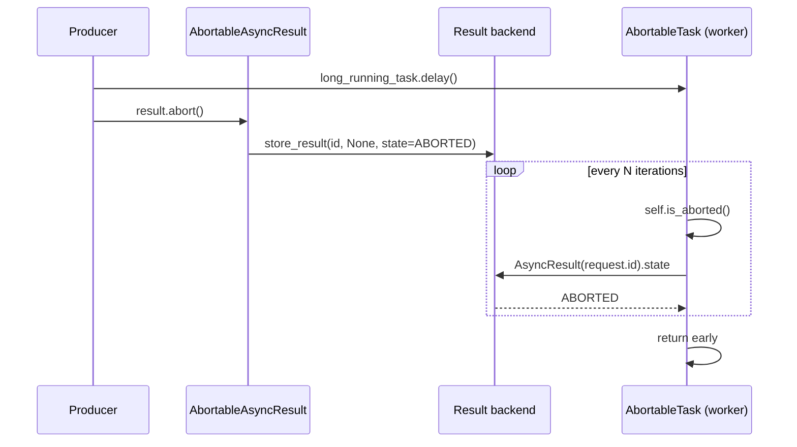
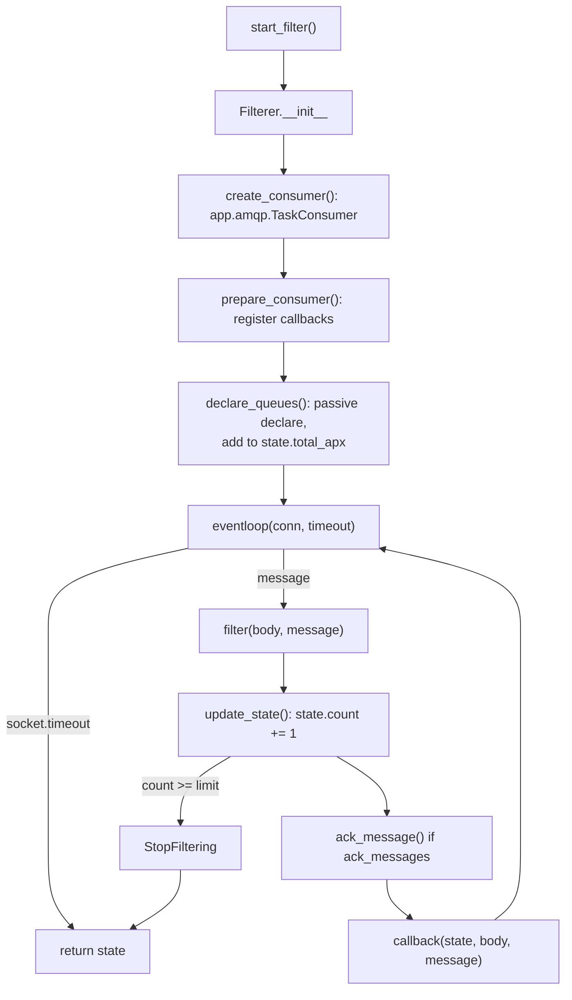

## Overview

`celery.contrib` collects optional modules that build on the core API but are not loaded by default. This page covers four of them: cooperative task cancellation (`abortable`), a telnet-accessible debugger for tasks running in pool processes (`rdb`), tools that move task messages between queues or brokers (`migrate`), and a Sphinx extension that documents tasks (`sphinx`). Each is imported explicitly by the code that needs it. The pytest plugin and test worker in the same package are described in [[Testing Celery Applications]], and the Django task class in [[Django Integration]].

Sources: [celery/contrib/abortable.py:1-22](repo://celery/contrib/abortable.py#L1-L22), [celery/contrib/rdb.py:1-42](repo://celery/contrib/rdb.py#L1-L42), [celery/contrib/migrate.py:1-19](repo://celery/contrib/migrate.py#L1-L19), [celery/contrib/sphinx.py:1-31](repo://celery/contrib/sphinx.py#L1-L31)

## Abortable tasks

### How abort requests travel

Celery cannot interrupt a running Python function safely without killing its process. `AbortableTask` offers a cooperative alternative: the producer writes the custom state `ABORTED` to the result backend, and the task polls that state at points it chooses and returns early.

Sources: [celery/contrib/abortable.py:1-22](repo://celery/contrib/abortable.py#L1-L22), [celery/contrib/abortable.py:87-100](repo://celery/contrib/abortable.py#L87-L100)



Sources: [celery/contrib/abortable.py:103-165](repo://celery/contrib/abortable.py#L103-L165)

### AbortableAsyncResult

`AbortableAsyncResult` extends `AsyncResult` with two methods. `is_aborted()` compares `self.state` with `ABORTED`. `abort()` calls `self.backend.store_result(self.id, result=None, state=ABORTED, traceback=None)`, overwriting whatever state the task had. The method returns immediately and guarantees neither when nor whether the task stops.

Sources: [celery/contrib/abortable.py:103-127](repo://celery/contrib/abortable.py#L103-L127)

### AbortableTask

`AbortableTask` is an abstract `Task` subclass. It overrides `AsyncResult(task_id)` to return an `AbortableAsyncResult` bound to the task's backend, so `delay()` and `apply_async()` hand the caller an object with `abort()`. Inside the task, `is_aborted(**kwargs)` builds a result for `kwargs.get('task_id', self.request.id)` and returns its `is_aborted()`, or `False` when the result is not an `AbortableAsyncResult`.

Sources: [celery/contrib/abortable.py:130-165](repo://celery/contrib/abortable.py#L130-L165)

Use it as a base class with `bind=True` so the task can call `self.is_aborted()`:

Sources: [celery/contrib/abortable.py:37-47](repo://celery/contrib/abortable.py#L37-L47)

```python
    @app.task(bind=True, base=AbortableTask)
    def long_running_task(self):
        results = []
        for i in range(100):
            # check after every 5 iterations...
            # (or alternatively, check when some timer is due)
            if not i % 5:
                if self.is_aborted():
                    # respect aborted state, and terminate gracefully.
                    logger.warning('Task aborted')
                    return
```

Sources: [celery/contrib/abortable.py:37-47](repo://celery/contrib/abortable.py#L37-L47)

> [!WARNING]
> Every `is_aborted()` call is a result-backend read, so poll at a reasonable interval. Producer and worker must share a result backend that stores custom states; the module documentation names the database backends. Configure backends as described in [[Result Backends]].

Sources: [celery/contrib/abortable.py:74-79](repo://celery/contrib/abortable.py#L74-L79), [celery/contrib/abortable.py:147-160](repo://celery/contrib/abortable.py#L147-L160)

## Remote debugger (rdb)

### Using rdb

Worker pool processes have no terminal, so `pdb.set_trace()` cannot be used inside a task. `celery.contrib.rdb` provides `Rdb`, a `Pdb` subclass that listens on a TCP socket and attaches the debugger to whoever connects with `telnet`. Call `rdb.set_trace()` inside the task, watch the worker log for the `Ready to connect: telnet <host> <port>` banner, and connect to that address.

Sources: [celery/contrib/rdb.py:1-22](repo://celery/contrib/rdb.py#L1-L22), [celery/contrib/rdb.py:72-78](repo://celery/contrib/rdb.py#L72-L78)

| Variable | Default | Meaning |
| --- | --- | --- |
| `CELERY_RDB_HOST` | `127.0.0.1` | Interface to bind; the default allows local connections only |
| `CELERY_RDB_PORT` | `6899` (`DEFAULT_PORT`) | Base port; the actual port is searched upward from it |

Sources: [celery/contrib/rdb.py:23-42](repo://celery/contrib/rdb.py#L23-L42), [celery/contrib/rdb.py:56-59](repo://celery/contrib/rdb.py#L56-L59)

> [!CAUTION]
> The debugger has no authentication. Anyone who can reach the port gets an interactive Python prompt inside the worker. Only set `CELERY_RDB_HOST` to a non-loopback address on a trusted network.

Sources: [celery/contrib/rdb.py:91-114](repo://celery/contrib/rdb.py#L91-L114)

### Session lifecycle

`set_trace(frame=None)` uses the caller's frame (via `sys._getframe().f_back`) and calls `debugger().set_trace(frame)`. `debugger()` reuses the instance in the module-level `_current` slot while it is active, and otherwise creates a new `Rdb()`.

Sources: [celery/contrib/rdb.py:61-64](repo://celery/contrib/rdb.py#L61-L64), [celery/contrib/rdb.py:175-187](repo://celery/contrib/rdb.py#L175-L187)

`Rdb.__init__` blocks the task until a client connects:

Sources: [celery/contrib/rdb.py:91-135](repo://celery/contrib/rdb.py#L91-L135)

1. Saves the current `sys.stdin` and `sys.stdout` in `_prev_handles`.
2. Calls `get_avail_port`, which derives a skew from the pool process name (`ForkPoolWorker-3` gives 3) so concurrent children start at different ports, then tries `port + skew + i` for up to `port_search_limit` (100) ports, skipping `EADDRINUSE` and `EINVAL`. When none is free it raises an `Exception` with `NO_AVAILABLE_PORT`.
3. Listens with a backlog of one, prints `BANNER`, and blocks in `accept()`.
4. On connect, prints `SESSION_STARTED`, replaces `sys.stdin`/`sys.stdout` with a file wrapping the client socket, and initializes `Pdb` on that handle with tab completion.

Sources: [celery/contrib/rdb.py:91-135](repo://celery/contrib/rdb.py#L91-L135)

`continue` (`c`, `cont`) and `quit` (`q`, `exit`) both call `_close_session()`, which restores the original standard streams, closes the handle, client and listening socket, marks the debugger inactive and prints `SESSION_ENDED`. `set_quit` is overridden to only clear the trace function instead of raising `BdbQuit`, so quitting the debugger lets the task continue running rather than failing it. `Rdb` also works as a context manager whose exit closes the session.

Sources: [celery/contrib/rdb.py:140-172](repo://celery/contrib/rdb.py#L140-L172)

## Message migration

### Moving messages between brokers

`celery.contrib.migrate` consumes task messages and republishes them elsewhere without executing them. It powers the `celery migrate SOURCE DESTINATION` command, which wraps both URLs in `kombu.Connection` and calls `migrate_tasks` with a progress callback. See [[Command Line Interface]] for the command itself.

Sources: [celery/bin/migrate.py:9-63](repo://celery/bin/migrate.py#L9-L63)

`migrate_tasks(source, dest, migrate=migrate_task, app=None, queues=None, **kwargs)` builds a producer on the destination connection (with `auto_declare=False`), normalises `queues` with `prepare_queues`, and passes a declare hook to `start_filter`. The hook recreates each source queue on the destination, renaming the queue, and a routing key or exchange that equals the queue name, according to the `queues` mapping.

Sources: [celery/contrib/migrate.py:99-118](repo://celery/contrib/migrate.py#L99-L118)

`prepare_queues` accepts a comma-separated string, a list of `"source:dest"` entries (an entry without a colon maps to itself), a dict, or `None`.

Sources: [celery/contrib/migrate.py:236-244](repo://celery/contrib/migrate.py#L236-L244)

`migrate_task` maps the message's original exchange and routing key through the same dict and calls `republish`. `republish` sends the raw body bytes with the original headers, content type, encoding and properties, but pops `compression` from the headers (so the producer re-applies it), converts `expiration` to a float, and removes `application_headers`, `content_type`, `content_encoding` and `headers` from the properties to avoid passing them twice.

Sources: [celery/contrib/migrate.py:50-86](repo://celery/contrib/migrate.py#L50-L86)

### The filter loop

Both migration and `move` run through `start_filter`, which constructs a `Filterer` and calls `start()`.

Sources: [celery/contrib/migrate.py:337-355](repo://celery/contrib/migrate.py#L337-L355)



Sources: [celery/contrib/migrate.py:247-334](repo://celery/contrib/migrate.py#L247-L334)

`Filterer` options:

Sources: [celery/contrib/migrate.py:247-270](repo://celery/contrib/migrate.py#L247-L270), [celery/contrib/migrate.py:286-319](repo://celery/contrib/migrate.py#L286-L319)

| Option | Default | Effect |
| --- | --- | --- |
| `limit` | `None` | Stop after this many messages (raises `StopFiltering`) |
| `timeout` | `1.0` | Seconds the event loop waits for a message before ending |
| `forever` | `False` | Ignore timeouts and keep consuming until killed |
| `ack_messages` | `False` | Acknowledge each message on the source; without it messages are redelivered there |
| `tasks` | `None` | Comma-separated or list of task names; other tasks are skipped by `filter_callback` |
| `queues` | `None` | Mapping of source to destination queue names; also the default queues to consume |
| `consume_from` | `None` | Explicit queue names or `Queue` objects to consume |
| `callback` | `None` | Called as `callback(state, body, message)` after each message |
| `accept` | `None` | Content types the consumer accepts |
| `state` | new `State()` | Progress object to update |

Sources: [celery/contrib/migrate.py:247-270](repo://celery/contrib/migrate.py#L247-L270), [celery/contrib/migrate.py:286-319](repo://celery/contrib/migrate.py#L286-L319)

`State` tracks `count` (messages seen), `filtered` (messages moved by `move`) and `total_apx`, the approximate queue size from passive declares. `strtotal` returns `'?'` when no count is known, and `repr()` shows `^filtered` once anything was moved, otherwise `count/total`.

Sources: [celery/contrib/migrate.py:31-47](repo://celery/contrib/migrate.py#L31-L47)

### move and its helpers

`move(predicate, connection=None, exchange=None, routing_key=None, source=None, app=None, callback=None, limit=None, transform=None, **kwargs)` moves messages within one broker. For each message it calls `predicate(body, message)` and, when that returns a true value, applies `transform` and picks the destination:

Sources: [celery/contrib/migrate.py:127-223](repo://celery/contrib/migrate.py#L127-L223)

- A `kombu.Queue`: declared with `maybe_declare`, then its exchange name and routing key are used.
- A two-item tuple: used as `(exchange, routing_key)`.
- Any other true value: `expand_dest` falls back to the `exchange` and `routing_key` arguments.

Sources: [celery/contrib/migrate.py:127-223](repo://celery/contrib/migrate.py#L127-L223)

After republishing, `move` acknowledges the original, increments `state.filtered`, invokes `callback(state, body, message)`, and raises `StopFiltering` once `limit` messages have been moved. `source` defaults to the queues in `task_queues`.

Sources: [celery/contrib/migrate.py:189-215](repo://celery/contrib/migrate.py#L189-L215)

| Helper | Matches on | Notes |
| --- | --- | --- |
| `move_task_by_id(task_id, dest, **kwargs)` | One task id | Delegates to `move_by_idmap({task_id: dest})` |
| `move_by_idmap(map, **kwargs)` | `message.properties['correlation_id']` in `map` | Sets `limit=len(map)` so consumption stops once all are found |
| `move_by_taskmap(map, **kwargs)` | `body['task']` in `map` | Maps task names to destination queues |
| `move_direct`, `move_direct_by_id`, `move_direct_by_idmap`, `move_direct_by_taskmap` | Same as above | Pre-set `transform=worker_direct`, so a worker hostname becomes its direct queue |
| `task_id_eq(task_id, body, message)`, `task_id_in(ids, body, message)` | `body['id']` | Predicates for use with `functools.partial` |

Sources: [celery/contrib/migrate.py:226-233](repo://celery/contrib/migrate.py#L226-L233), [celery/contrib/migrate.py:358-416](repo://celery/contrib/migrate.py#L358-L416)

> [!TIP]
> Pass a `kombu.Queue` as the destination, or use a `move_direct_*` variant with a worker node name. A plain queue-name string is not converted to a queue by `move` itself and falls back to the `exchange`/`routing_key` arguments.

Sources: [celery/contrib/migrate.py:195-206](repo://celery/contrib/migrate.py#L195-L206), [celery/contrib/migrate.py:218-223](repo://celery/contrib/migrate.py#L218-L223), [celery/utils/nodenames.py:38-50](repo://celery/utils/nodenames.py#L38-L50)

## Sphinx extension

### Enabling the extension

Adding `'celery.contrib.sphinx'` to `extensions` in `docs/conf.py` makes autodoc recognise task objects. Tasks created by `@app.task` are `Task` instances rather than functions, so plain autodoc would skip them or show the wrong signature. The extension adds:

Sources: [celery/contrib/sphinx.py:9-31](repo://celery/contrib/sphinx.py#L9-L31), [celery/contrib/sphinx.py:111-139](repo://celery/contrib/sphinx.py#L111-L139)

| Addition | Name | Purpose |
| --- | --- | --- |
| Autodocumenter | `TaskDocumenter` (`objtype = 'task'`) | Enables `.. autotask::` and picks up tasks under `automodule` |
| Directive | `py:task` (`TaskDirective`) | Renders a task with a configurable prefix |
| Role | `py:task` | Cross-references such as `:task:` to `proj.tasks.add` |
| Config value | `celery_task_prefix`, default `(task)` | Text shown before each task signature |
| Event handler | `autodoc-skip-member` | Stops autodoc from skipping tasks |

Sources: [celery/contrib/sphinx.py:9-31](repo://celery/contrib/sphinx.py#L9-L31), [celery/contrib/sphinx.py:111-139](repo://celery/contrib/sphinx.py#L111-L139)

### TaskDocumenter

`TaskDocumenter` extends autodoc's `FunctionDocumenter`:

Sources: [celery/contrib/sphinx.py:58-88](repo://celery/contrib/sphinx.py#L58-L88)

- `can_document_member` accepts objects that are `BaseTask` instances with a `__wrapped__` attribute, meaning tasks made from a decorated function.
- `format_args` renders the signature of `__wrapped__`, dropping a leading `self` or `cls` parameter so bound tasks show only their real arguments.
- `check_module` compares the wrapped function's `__module__` with the documented module, because the task object itself is a proxy and would fail autodoc's own check.
- `document_members` does nothing, so the task's class attributes are not listed.

Sources: [celery/contrib/sphinx.py:58-88](repo://celery/contrib/sphinx.py#L58-L88)

`autodoc_skip_member_handler` returns `False` (do not skip) for such tasks when autodoc wanted to skip them. Autodoc would otherwise hide them because a decorated task's `__doc__` equals its class's `__doc__`, which autodoc treats as repeated class documentation.

Sources: [celery/contrib/sphinx.py:98-108](repo://celery/contrib/sphinx.py#L98-L108)

> [!NOTE]
> Sphinx 9.0 rewrote autodoc, and `TaskDocumenter` needs the legacy class-based mode. On Sphinx 9.0 or later, `setup()` sets `autodoc_use_legacy_class_based = True` automatically and emits a `UserWarning` unless `conf.py` already sets it, so set it explicitly to silence the warning.

Sources: [celery/contrib/sphinx.py:33-46](repo://celery/contrib/sphinx.py#L33-L46), [celery/contrib/sphinx.py:117-129](repo://celery/contrib/sphinx.py#L117-L129)
