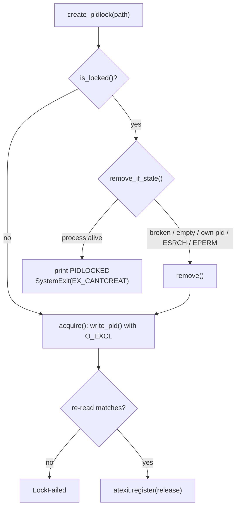
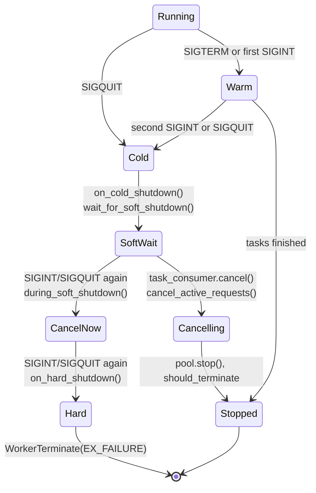

## Overview

Workers, beat and the events camera run as long-lived services. They need pidfiles, background detachment, privilege dropping, signal handling and readable process titles, and these behave differently on Linux, macOS, Windows, PyPy and Jython. `celery/platforms.py` gathers the platform-specific code behind one portable API. The program classes in `celery/apps/` and the daemon commands in `celery/bin/` call into it.

Sources: [celery/platforms.py:1-46](repo://celery/platforms.py#L1-L46)

Optional OS modules are loaded with `try_import`, so `pwd`, `grp`, `resource` and `setproctitle` may be `None`. Every function that needs one checks for it first. On Windows, for example, `detached()` raises `RuntimeError('This platform does not support detach.')` because `resource` is missing, and `maybe_drop_privileges()` returns immediately.

Sources: [celery/platforms.py:27-36](repo://celery/platforms.py#L27-L36), [celery/platforms.py:412-413](repo://celery/platforms.py#L412-L413), [celery/platforms.py:538-539](repo://celery/platforms.py#L538-L539)

| Constant | Value | Used for |
| --- | --- | --- |
| `EX_OK` | `os.EX_OK` or 0 | Normal exit |
| `EX_FAILURE` | 1 | Generic failure, cold shutdown exit code |
| `EX_UNAVAILABLE` | `os.EX_UNAVAILABLE` or 69 | CLI remote-command failures |
| `EX_USAGE` | `os.EX_USAGE` or 64 | Usage errors |
| `EX_CANTCREAT` | `os.EX_CANTCREAT` or 73 | Pidfile already locked |
| `IS_macOS`, `IS_WINDOWS` | from `platform.system()` | Platform branches |

Sources: [celery/platforms.py:48-59](repo://celery/platforms.py#L48-L59)

## PID files

`Pidfile(path)` is the lock that prevents two instances from sharing one pidfile. `write_pid()` opens the file with `O_CREAT | O_EXCL | O_WRONLY` and mode `0644`, so creation fails atomically if the file exists. It writes `"<pid>\n"`, flushes and `fsync`s, then re-reads the file and raises `LockFailed` if the content differs, which catches a racing writer. `acquire()` turns any `OSError` into `LockFailed`. `read_pid()` requires the trailing newline and raises `ValueError` for a partial or non-numeric file.

Sources: [celery/platforms.py:61-62](repo://celery/platforms.py#L61-L62), [celery/platforms.py:121-238](repo://celery/platforms.py#L121-L238)

`create_pidlock(pidfile)` is the function programs actually call. `_create_pidlock()` checks `is_locked()`. If the file exists, `remove_if_stale()` deletes it when it is broken, empty, holds our own pid (common for PID 1 in Kubernetes pods), or names a process that `os.kill(pid, 0)` reports as `ESRCH` or `EPERM`. Otherwise the program prints `PIDLOCKED` and exits with `EX_CANTCREAT`. `create_pidlock` also registers `pidlock.release` with `atexit`.

Sources: [celery/platforms.py:244-272](repo://celery/platforms.py#L244-L272), [celery/platforms.py:183-213](repo://celery/platforms.py#L183-L213)

Sources: [celery/platforms.py:183-272](repo://celery/platforms.py#L183-L272)

The worker takes the lock in `WorkController.on_start()`, beat in `Beat.start_scheduler()`, and the events camera in `evcam`. `celery multi` only reads pidfiles, through `Node.pid`, to find the processes to signal.

Sources: [celery/worker/worker.py:150-152](repo://celery/worker/worker.py#L150-L152), [celery/apps/beat.py:93-95](repo://celery/apps/beat.py#L93-L95), [celery/events/snapshot.py:93-93](repo://celery/events/snapshot.py#L93-L93), [celery/apps/multi.py:254-261](repo://celery/apps/multi.py#L254-L261)

## Detaching into the background

### detached()

`detached(logfile, pidfile, uid, gid, umask, workdir, fake)` prepares a daemon and returns a `DaemonContext`. Before forking it resets `SIGCLD` to the default handler and calls `maybe_drop_privileges(uid, gid)`. It then installs an `after_chdir` hook that runs after the fork and `chdir`. The hook opens the logfile in append mode, because errors would be lost once stderr points at `/dev/null`, and calls `_create_pidlock(pidfile).release()` to fail early on a live lock without creating the file. Creating the real pidfile is left to the child program.

Sources: [celery/platforms.py:376-429](repo://celery/platforms.py#L376-L429)

### DaemonContext

`DaemonContext.open()` (also `__enter__`) does the classic double fork in `_detach()`. The parent exits, the first child calls `setsid()` to leave the controlling terminal, and the second child continues as the daemon. It then changes to `workdir` (default `/`, but `detached()` passes the current directory), applies `umask` (string umasks are parsed as octal when they start with `0`), runs `after_chdir`, closes every file descriptor except stdio and `/dev/urandom`, redirects stdio to `/dev/null`, and runs `multiprocessing.util._run_after_forkers()` when `after_forkers` is true. `fake=True` skips the fork and descriptor handling, which is useful for debugging.

Sources: [celery/platforms.py:310-373](repo://celery/platforms.py#L310-L373)

> [!NOTE]
> `/dev/urandom` is kept open on purpose: beat's `shelve` store needs it, and closing it would break `celery beat --detach`. `fd_by_path()` finds the descriptor by matching `(st_ino, st_dev)` against every open descriptor.

Sources: [celery/platforms.py:275-307](repo://celery/platforms.py#L275-L307), [celery/platforms.py:345-351](repo://celery/platforms.py#L345-L351)

### Who detaches and how

`celery beat --detach` and `celery events --camera ... --detach` run the program inside `with detached(...)`. `celery worker --detach` instead re-executes itself: it removes `--detach`, `-D`, `--uid` and `--gid` from argv and calls `os.execv(sys.executable, ['-m', 'celery', ...])` inside `detached(..., after_forkers=False)`. The worker therefore starts from a clean interpreter after the fork. If `exec` fails, the error is logged to the node-formatted logfile and the command returns `EX_FAILURE`. Setting `C_FAKEFORK` forces `fake=True`.

Sources: [celery/bin/beat.py:61-72](repo://celery/bin/beat.py#L61-L72), [celery/bin/events.py:24-37](repo://celery/bin/events.py#L24-L37), [celery/bin/worker.py:105-133](repo://celery/bin/worker.py#L105-L133), [celery/bin/worker.py:336-356](repo://celery/bin/worker.py#L336-L356)

## Dropping privileges

### maybe_drop_privileges

`maybe_drop_privileges(uid, gid)` is called by `worker` and `beat` before they start, and by `detached()`. A process whose effective uid is non-zero but whose real uid is 0 is rejected with `SecurityError('contact support')`. With neither `uid` nor `gid` given, nothing else happens. `parse_uid`/`parse_gid` accept numbers or names (looked up via `pwd`/`grp`). With a uid, `_setuid(uid, gid)`:
1. Defaults `gid` to the user's primary group.
2. Calls `setgid(gid)` before anything else, because `setgid` can fail once uid has changed.
3. Calls `initgroups(uid, gid)` to load supplementary groups (`os.initgroups`, or `setgroups` with `_setgroups_hack`, which trims the list until the OS accepts it).
4. Calls `setuid(uid)`, then tries `setuid(0)`. This must fail with `EPERM`; success raises `SecurityError('non-root user able to restore privileges after setuid.')`.

Sources: [celery/platforms.py:432-525](repo://celery/platforms.py#L432-L525), [celery/platforms.py:528-583](repo://celery/platforms.py#L528-L583), [celery/bin/worker.py:358-358](repo://celery/bin/worker.py#L358-L358), [celery/bin/beat.py:61-62](repo://celery/bin/beat.py#L61-L62)

After the switch, `maybe_drop_privileges` checks again and raises "Still root uid after drop privileges!" or "Still root gid after drop privileges!" if either id is still 0.

Sources: [celery/platforms.py:552-555](repo://celery/platforms.py#L552-L555)

### check_privileges

`apps.worker.Worker.on_before_init()` calls `check_privileges(app.conf.accept_content)`. The worker is flagged if it runs as root (`uid` or `euid` 0) or its group or effective group is `sudo` or `wheel`. A missing group entry is treated as a possible root (`ASSUMING_ROOT`). When flagged, `_warn_or_raise_security_error()` raises `SecurityError(ROOT_DISALLOWED)` if `pickle` (or `application/group-python-serialize`) is accepted and `C_FORCE_ROOT` is not set. Otherwise it emits a `SecurityWarning` (`ROOT_DISCOURAGED`). Pickle combined with root would let any broker client execute arbitrary code as root.

Sources: [celery/platforms.py:64-89](repo://celery/platforms.py#L64-L89), [celery/platforms.py:788-845](repo://celery/platforms.py#L788-L845), [celery/apps/worker.py:94-104](repo://celery/apps/worker.py#L94-L104)

## Signals and process titles

### The signals wrapper

`platforms.signals` is a `Signals` instance that wraps the `signal` module and quietly ignores signals the platform lacks. This lets the same handler-installation code run on Windows.

Sources: [celery/platforms.py:594-698](repo://celery/platforms.py#L594-L698)

| API | Behaviour |
| --- | --- |
| `signals['TERM'] = handler` | `signal.signal(signum, handler)`, ignoring `AttributeError`/`ValueError` |
| `signals['TERM']` | Current handler via `signal.getsignal` |
| `signals.update(TERM=h, INT=h)` | Install several handlers at once |
| `signals.reset(*names)` / `signals.ignore(*names)` | Set `SIG_DFL` / `SIG_IGN` |
| `signals.signum(name)` | Name (`'INT'` or `'SIGINT'`, upper case required) or int to signal number |
| `signals.supported(name)` | True if the platform defines the signal |
| `signals.arm_alarm(s)` / `reset_alarm()` | `setitimer(ITIMER_REAL)` (falls back to `alarm(ceil(s))`) |
| `signal_name(signum)` | Number to name without the `SIG` prefix, from `SIGMAP` |

Sources: [celery/platforms.py:91-95](repo://celery/platforms.py#L91-L95), [celery/platforms.py:586-703](repo://celery/platforms.py#L586-L703)

`set_pdeathsig()` asks the kernel, through billiard, to send `SIGKILL` to a process when its parent dies, and silently ignores platforms without support. The prefork pool calls it in each child so pool processes do not outlive a crashed worker.

Sources: [celery/platforms.py:713-720](repo://celery/platforms.py#L713-L720), [celery/concurrency/prefork.py:48-48](repo://celery/concurrency/prefork.py#L48-L48)

### Process titles

`set_process_title(progname, info)` formats `[progname] info` and applies it with `setproctitle` when that package is installed. It always returns the string. `set_mp_process_title()` adds the hostname and the billiard process name (`celeryd: w1@host:MainProcess`). The worker uses it for statuses such as `-active-`. Setting `NOSETPS` in the environment replaces it with a no-op.

Sources: [celery/platforms.py:723-749](repo://celery/platforms.py#L723-L749), [celery/apps/worker.py:280-285](repo://celery/apps/worker.py#L280-L285)

## Worker signal handlers

`apps.worker.Worker.on_start()` calls `install_platform_tweaks()`, which installs the handlers below through `platforms.signals`. `SIGHUP` restart is only installed when stdout is not a TTY, so closing a terminal does not restart a foreground worker into the background. On macOS a warning handler replaces it, because a process using threads cannot `exec`.

Sources: [celery/apps/worker.py:128-145](repo://celery/apps/worker.py#L128-L145), [celery/apps/worker.py:254-274](repo://celery/apps/worker.py#L254-L274)

| Signal | Installer | Effect |
| --- | --- | --- |
| `SIGTERM` | `install_worker_term_handler` | Warm shutdown: `state.should_stop = EX_OK` (cold shutdown when billiard's `REMAP_SIGTERM == "SIGQUIT"`) |
| `SIGQUIT` | `install_worker_term_hard_handler` | Cold shutdown via `on_cold_shutdown`, exit code `EX_FAILURE` |
| `SIGINT` | `install_worker_int_handler` | First Ctrl+C: warm shutdown and re-arm `SIGINT` as cold shutdown |
| `SIGHUP` | `install_worker_restart_handler` | Warm stop, then `atexit` re-`exec` of `sys.argv` |
| `SIGUSR1` | `install_cry_handler` | Log a stack trace of all threads (`cry()`), not on PyPy |
| `SIGUSR2` | `install_rdb_handler` | Remote debugger breakpoint, only if `CELERY_RDBSIG` is set |

Sources: [celery/apps/worker.py:433-523](repo://celery/apps/worker.py#L433-L523)

`_shutdown_handler(worker, sig, how, callback, exitcode)` builds each shutdown handler. In the `MainProcess` it runs the callback, prints `worker: Warm shutdown (MainProcess)` and sends the `worker_shutting_down` signal. In every process it sets `state.should_stop` (warm) or `state.should_terminate` (cold) to the exit code, which the worker's loops poll. The handler body runs inside `in_sighandler()` so logging code knows it is in a signal context.

Sources: [celery/apps/worker.py:288-316](repo://celery/apps/worker.py#L288-L316)

Sources: [celery/apps/worker.py:319-430](repo://celery/apps/worker.py#L319-L430), [celery/apps/worker.py:453-463](repo://celery/apps/worker.py#L453-L463)

`on_cold_shutdown()` re-arms `SIGINT` and `SIGQUIT` (and `SIGTERM` when remapped) with `during_soft_shutdown`, waits for the optional soft-shutdown timeout, cancels the task consumer so requeued messages are not redelivered immediately, cancels unacknowledged requests, sets `state.should_terminate` and stops the pool. A further signal during that wait runs `during_soft_shutdown()`, which cancels active requests at once and re-arms the signals with `on_hard_shutdown`. The next signal raises `WorkerTerminate(EX_FAILURE)`. See [[Worker Architecture and Bootsteps]] for how `should_stop` and `should_terminate` are consumed.

Sources: [celery/apps/worker.py:338-430](repo://celery/apps/worker.py#L338-L430)

The restart handler sets `state.should_stop = EX_OK` and registers `_reload_current_worker` with `atexit`. After the warm shutdown completes, that function closes inherited descriptors and calls `os.execv(sys.executable, [sys.executable] + sys.argv)`.

Sources: [celery/apps/worker.py:469-487](repo://celery/apps/worker.py#L469-L487)

Beat installs a simpler pair: `SIGTERM` and `SIGINT` call `service.sync()` to flush the schedule database and raise `SystemExit`.

Sources: [celery/apps/beat.py:155-160](repo://celery/apps/beat.py#L155-L160)

## Deployment assets

### systemd

`extra/systemd/celery.service` is a `Type=forking` unit that runs as `celery:celery` from `/opt/celery`. It reads `/etc/conf.d/celery`, starts workers with `celery multi start`, stops them with `celery multi stopwait` (waits for each node to exit), and reloads with `celery multi restart`. `celerybeat.service` is `Type=simple` and runs `celery beat` in the foreground. Both use `Restart=always`.

Sources: [extra/systemd/celery.service:1-22](repo://extra/systemd/celery.service#L1-L22), [extra/systemd/celerybeat.service:1-17](repo://extra/systemd/celerybeat.service#L1-L17)

The environment file provides `CELERY_APP`, `CELERYD_NODES`, `CELERYD_OPTS`, `CELERY_BIN`, and the `%n`/`%I`-templated pid and log paths that `multi` expands per node. `celery.tmpfiles` creates `/var/run/celery` and `/var/log/celery` owned by `celery`.

Sources: [extra/systemd/celery.conf:1-16](repo://extra/systemd/celery.conf#L1-L16), [extra/systemd/celery.tmpfiles:1-2](repo://extra/systemd/celery.tmpfiles#L1-L2)

### Generic init.d scripts

`extra/generic-init.d/celeryd` must run as root and sources `/etc/default/<script name>`, so copying the script under another name gives a separately configured service. Each action wraps `celery multi` through `su` to `CELERYD_USER` (default `celery`): `start`, `stop` (`stopwait`), `restart`, `kill`, `dryrun`, `create-paths`, `check-paths` and `status`. `graceful` sends `SIGHUP` to each worker pid, which triggers the restart handler above.

Sources: [extra/generic-init.d/celeryd:30-66](repo://extra/generic-init.d/celeryd#L30-L66), [extra/generic-init.d/celeryd:248-310](repo://extra/generic-init.d/celeryd#L248-L310), [extra/generic-init.d/celeryd:347-409](repo://extra/generic-init.d/celeryd#L347-L409)

`extra/generic-init.d/celerybeat` starts `celery beat --detach` with `CELERYBEAT_PID_FILE` (default `/var/run/celery/beat.pid`). It stops beat by sending `SIGTERM` every 0.5 s until the process is gone, giving up after 60 tries.

Sources: [extra/generic-init.d/celerybeat:110-138](repo://extra/generic-init.d/celerybeat#L110-L138), [extra/generic-init.d/celerybeat:211-260](repo://extra/generic-init.d/celerybeat#L211-L260)

### supervisord, launchd and Azure WebJobs

| Asset | What it runs |
| --- | --- |
| `extra/supervisord/celeryd.conf` | `celery -A proj worker --loglevel=INFO` as `nobody`, `stopwaitsecs = 600` to let tasks finish, `stopasgroup=true` |
| `extra/supervisord/celerybeat.conf` | `celery -A myapp beat --schedule /var/lib/celery/beat.db`, priority 999 |
| `extra/macOS/org.celeryq.worker.plist` | launchd job running `celery worker --loglevel=WARNING` as `nobody` with `KeepAlive` |
| `extra/WindowsCMD-AzureWebJob/CeleryBeat/run.cmd` | Deletes stale pid/log files, then `celery beat` with the `django_celery_beat` `DatabaseScheduler` |

Sources: [extra/supervisord/celeryd.conf:5-34](repo://extra/supervisord/celeryd.conf#L5-L34), [extra/supervisord/celerybeat.conf:5-25](repo://extra/supervisord/celerybeat.conf#L5-L25), [extra/macOS/org.celeryq.worker.plist:1-29](repo://extra/macOS/org.celeryq.worker.plist#L1-L29), [extra/WindowsCMD-AzureWebJob/CeleryBeat/run.cmd:24-39](repo://extra/WindowsCMD-AzureWebJob/CeleryBeat/run.cmd#L24-L39)

These supervisors run the worker in the foreground and stop it with `SIGTERM`, which maps to the warm shutdown. The stop timeout (`stopwaitsecs`) must therefore exceed the longest task.

Sources: [extra/supervisord/celeryd.conf:25-30](repo://extra/supervisord/celeryd.conf#L25-L30), [celery/apps/worker.py:438-441](repo://celery/apps/worker.py#L438-L441)

### Docker

The tracked Docker assets are a development and test environment, not a production image. `docker/Dockerfile` builds on `debian:bookworm-slim`, creates the `CELERY_USER` user, installs several interpreters with pyenv (`pyenv global 3.13 3.12 3.11 3.10 pypy3.11`), installs Celery in editable mode, and uses `docker/entrypoint`, which cleans `.pyc` files and initialises pyenv before `exec "$@"`. `docker/docker-compose.yml` mounts the repository and starts RabbitMQ, Redis, DynamoDB Local and Azurite as test services, plus a docs container on port 7001.

Sources: [docker/Dockerfile:1-81](repo://docker/Dockerfile#L1-L81), [docker/Dockerfile:160-170](repo://docker/Dockerfile#L160-L170), [docker/entrypoint:1-7](repo://docker/entrypoint#L1-L7), [docker/docker-compose.yml:1-48](repo://docker/docker-compose.yml#L1-L48)

### Helm chart

`helm-chart/` deploys workers as a Kubernetes `Deployment` (`replicaCount: 4`, image `celery/celery:dev` by default). Configuration is injected as environment variables from a ConfigMap built from `configmap.data` (for example `CELERY_BROKER_URL`) and, optionally, a Secret. The `checksum/config` annotation hashes the rendered ConfigMap, so configuration changes roll the pods.

Sources: [helm-chart/templates/deployment.yaml:1-69](repo://helm-chart/templates/deployment.yaml#L1-L69), [helm-chart/values.yaml:1-30](repo://helm-chart/values.yaml#L1-L30), [helm-chart/values.yaml:69-73](repo://helm-chart/values.yaml#L69-L73), [helm-chart/templates/configmap.yaml:1-8](repo://helm-chart/templates/configmap.yaml#L1-L8), [helm-chart/templates/secret.yaml:1-13](repo://helm-chart/templates/secret.yaml#L1-L13)

> [!WARNING]
> The default liveness and readiness probes import `celery.task.control.inspect` and contain an `<APP>` placeholder. The `celery.task` package does not exist in this version, so the probes must be replaced, for example with a `celery -A <app> inspect ping -d celery@$HOSTNAME` command. The Deployment sets no container command either, so the image's entrypoint and command decide what runs. Inside a container the worker usually runs as PID 1, and `Pidfile.remove_if_stale()` treats a pidfile holding its own pid as stale for exactly this reason.

Sources: [helm-chart/values.yaml:52-67](repo://helm-chart/values.yaml#L52-L67), [helm-chart/templates/deployment.yaml:31-49](repo://helm-chart/templates/deployment.yaml#L31-L49), [celery/platforms.py:197-200](repo://celery/platforms.py#L197-L200)
