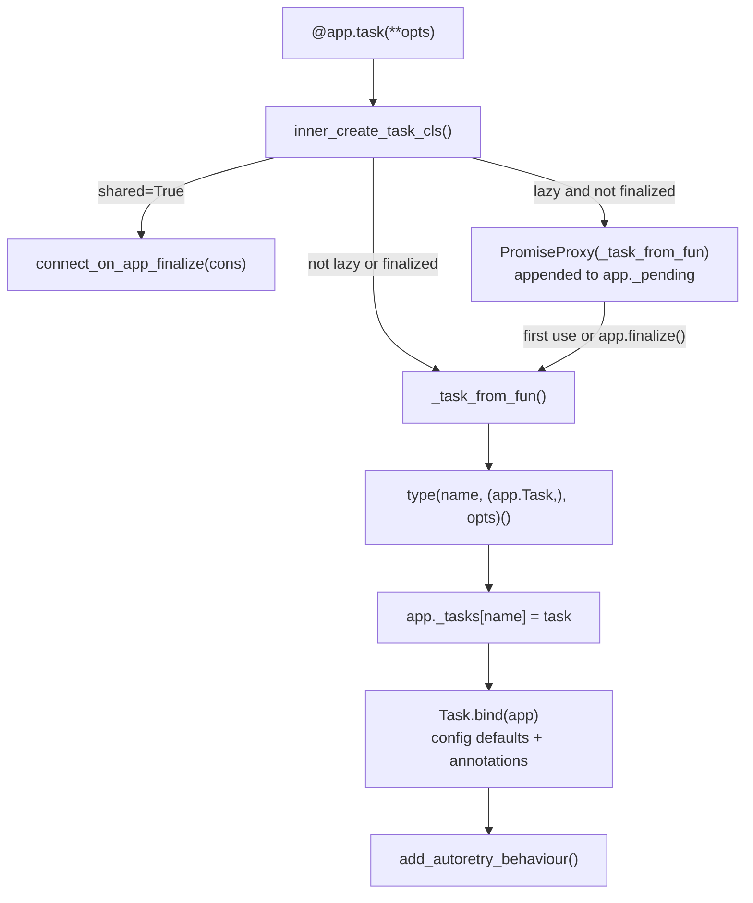
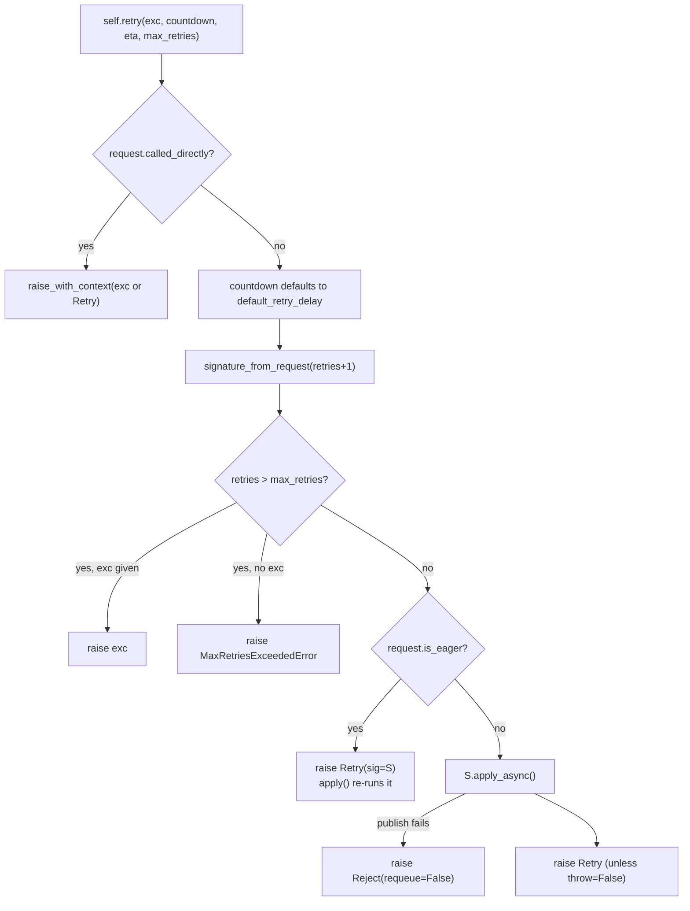

## Overview

A Celery task is a subclass of `celery.app.task.Task` whose `run` method holds the work. Most projects never write that subclass by hand: the `@app.task` and `@shared_task` decorators turn a plain function into a generated `Task` subclass, instantiate it once, and register the instance in the app's task registry under a name. The same instance is used to send messages (`delay`, `apply_async`) on the client and to execute the body in the worker.

Sources: [celery/app/task.py:205-226](repo://celery/app/task.py#L205-L226), [celery/app/base.py:590-633](repo://celery/app/base.py#L590-L633)

Task options are class attributes. Anything left at `None` is filled from the app configuration when the class is bound to an app, `task_annotations` can override attributes per task name, and `autoretry_for` wraps `run` so listed exceptions trigger `retry()` automatically. Calling a task is covered in [[Calling Tasks and Message Protocol]]; running it inside the worker in [[Task Execution and Tracing]].

Sources: [celery/app/task.py:396-455](repo://celery/app/task.py#L396-L455), [celery/app/autoretry.py:8-66](repo://celery/app/autoretry.py#L8-L66)

## Task decorators

### app.task

`Celery.task` accepts either a bare callable (`@app.task`) or keyword options (`@app.task(bind=True, max_retries=5)`). With options it returns `_create_task_cls`, a closure that receives the function later. Passing more than one positional argument, or a non-callable, raises `TypeError`.

Sources: [celery/app/base.py:515-585](repo://celery/app/base.py#L515-L585)

```python
@app.task(bind=True, max_retries=5, default_retry_delay=10)
def fetch(self, url):
    ...
```

Sources: [celery/app/base.py:515-544](repo://celery/app/base.py#L515-L544)

The decorator has three behaviours controlled by its own keywords, which are consumed by `inner_create_task_cls` and not passed on to the task class:

Sources: [celery/app/base.py:554-556](repo://celery/app/base.py#L554-L556)

| Keyword | Default | Effect |
| --- | --- | --- |
| `shared` | `True` | Registers a `cons(app)` callback with `connect_on_app_finalize`, so every app finalized later also gets a copy of the task. |
| `lazy` | `True` | If the app is not finalized, returns a `PromiseProxy` around `_task_from_fun` and appends it to `app._pending`; the task class is created on first use or at `finalize()`. |
| `filter` | `None` | A callable applied to the result (task or proxy) before it is returned. |

Sources: [celery/app/base.py:554-575](repo://celery/app/base.py#L554-L575)

When the process was started by multiprocessing with execv (`USING_EXECV`, set from the `FORKED_BY_MULTIPROCESSING` environment variable) and `lazy` is not disabled, `app.task` delegates to `shared_task(..., lazy=False)` so that the module-level name always resolves to the task instance of the current app.

Sources: [celery/app/base.py:85-85](repo://celery/app/base.py#L85-L85), [celery/app/base.py:545-552](repo://celery/app/base.py#L545-L552)

### shared_task

`celery.shared_task` is meant for reusable libraries that do not know which app they will run under. It registers a finalize callback that calls `app._task_from_fun(fun, **options)` for every future app, immediately creates the task in every already-finalized app (under `app._finalize_mutex`), and returns a `Proxy` whose target is looked up in `get_current_app().tasks` on every access.

Sources: [celery/app/__init__.py:24-76](repo://celery/app/__init__.py#L24-L76)

> [!NOTE]
> Because the proxy resolves through the current app, `add.app` is whichever app is current at the moment of access, not the app that existed when the module was imported.

Sources: [celery/app/__init__.py:34-46](repo://celery/app/__init__.py#L34-L46)

### Building the task class

`_task_from_fun` does the actual work for both decorators. It refuses to run before finalization when `autofinalize` is off, computes the name, and builds a new class with `type()` whose base is `base` or `app.Task`. Every extra decorator option becomes a class attribute in that `type()` call, which is why any `Task` attribute can be set from the decorator.

Sources: [celery/app/base.py:590-621](repo://celery/app/base.py#L590-L621)

```python
            run = fun if bind else staticmethod(fun)
            task = type(fun.__name__, (base,), dict({
                'app': self,
                'name': name,
                'run': run,
                '_decorated': True,
                '__doc__': fun.__doc__,
                '__module__': fun.__module__,
                '__annotations__': _get_annotations(fun),
                '__header__': self.type_checker(fun, bound=bind),
                '__wrapped__': run}, **options))()
```

Sources: [celery/app/base.py:611-621](repo://celery/app/base.py#L611-L621)

`bind=True` keeps `fun` as a normal method, so the task instance arrives as `self`; otherwise `run` is a `staticmethod`. `__header__` is a signature checker built by `head_from_fun`, which `apply_async` calls when `typing` is enabled to reject wrong arguments on the client. After instantiation the task is stored in `app._tasks`, bound with `task.bind(app)`, and passed to `add_autoretry_behaviour`. A second decoration with the same name returns the already registered instance unchanged.

Sources: [celery/app/base.py:587-633](repo://celery/app/base.py#L587-L633), [celery/app/task.py:662-668](repo://celery/app/task.py#L662-L668)

`pydantic=True` wraps the function with `pydantic_wrapper` before the class is built, using `pydantic_strict`, `pydantic_context` and `pydantic_dump_kwargs` to validate arguments and serialize the return value.

Sources: [celery/app/base.py:596-609](repo://celery/app/base.py#L596-L609)



Sources: [celery/app/base.py:554-633](repo://celery/app/base.py#L554-L633), [celery/app/base.py:657-677](repo://celery/app/base.py#L657-L677)

### Task names

Without `name=`, the name is `gen_task_name(app, fun.__name__, fun.__module__)`: `"<module>.<function>"`. When the module is `__main__` (or the file the worker was started from, via `MP_MAIN_FILE`) and the app has a `main` name, the module part is replaced by `app.main`, so a task defined in a script started directly still gets a stable name on both client and worker.

Sources: [celery/utils/imports.py:122-141](repo://celery/utils/imports.py#L122-L141), [celery/app/base.py:654-655](repo://celery/app/base.py#L654-L655)

### Class-based tasks

A `Task` subclass can be used as a decorator base (`@app.task(base=MyTask)`) to share handlers between tasks, or registered directly with `app.register_task`. `register_task` instantiates the class if needed, generates a name from the class name and module when `name` is unset, applies autoretry, stores it in `app.tasks` and binds it.

Sources: [celery/app/base.py:635-652](repo://celery/app/base.py#L635-L652)

The base class for an app is `app.Task`, created by `create_task_cls` from the `task_cls` argument of `Celery(...)` (default `'celery.app.task:Task'`). Setting `task_cls` changes the base of every task the app's decorator creates.

Sources: [celery/app/base.py:1335-1340](repo://celery/app/base.py#L1335-L1340), [celery/app/base.py:1457-1460](repo://celery/app/base.py#L1457-L1460), [celery/app/base.py:317-317](repo://celery/app/base.py#L317-L317)

## Task options

### Attributes and defaults

Each option is a class attribute on `Task`. The ones that matter most:

Sources: [celery/app/task.py:227-241](repo://celery/app/task.py#L227-L241)

| Attribute | Class default | Meaning |
| --- | --- | --- |
| `name` | `None` | Registry name; generated by `gen_task_name` when unset. |
| `typing` | `None` | Check call arguments against the function signature; falls back to `app.strict_typing`. |
| `max_retries` | `3` | Retry limit for `retry()`; `None` retries forever. |
| `default_retry_delay` | `180` | Seconds before a retry when neither `countdown` nor `eta` is given. |
| `rate_limit` | `None` | Such as `'100/s'`, `'100/m'`, `'100/h'`; enforced by the worker. |
| `ignore_result` | `None` | Do not store state and return value. |
| `store_errors_even_if_ignored` | `None` | Store failures even when results are ignored. |
| `serializer` | `None` | Kombu serializer name. |
| `time_limit` / `soft_time_limit` | `None` | Hard and soft execution time limits in seconds. |
| `track_started` | `None` | Report the `STARTED` state. |
| `acks_late` | `None` | Acknowledge after execution instead of before. |
| `acks_on_failure` / `acks_on_timeout` | `None` | With `acks_late`, still acknowledge on failure or timeout. |
| `reject_on_worker_lost` | `None` | Requeue instead of ack when the child process dies. |
| `throws` | `()` | Expected exceptions: stored as errors but not logged as errors. |
| `expires` | `None` | Default expiry for sent messages. |
| `priority` | `None` | Default message priority (0 to 9, broker-dependent meaning). |
| `trail` | `True` | Record started subtasks in `request.children`. |
| `send_events` | `True` | Emit task events when the worker sends events. |

Sources: [celery/app/task.py:230-300](repo://celery/app/task.py#L230-L300), [celery/app/task.py:302-380](repo://celery/app/task.py#L302-L380)

### Configuration fallbacks

`Task.bind(app)` runs once per class when it is attached to an app. For each pair in `from_config`, an attribute that is still `None` is set from the matching setting, so a decorator option always wins over configuration. `acks_on_failure` and `acks_on_timeout` then fall back to the deprecated `acks_on_failure_or_timeout`, and to `True` when that is unset too.

Sources: [celery/app/task.py:396-443](repo://celery/app/task.py#L396-L443)

| Attribute | Setting | Setting default |
| --- | --- | --- |
| `serializer` | `task_serializer` | `'json'` |
| `rate_limit` | `task_default_rate_limit` | `None` |
| `priority` | `task_default_priority` | `None` |
| `time_limit` | `task_time_limit` | `None` |
| `soft_time_limit` | `task_soft_time_limit` | `None` |
| `track_started` | `task_track_started` | `False` |
| `acks_late` | `task_acks_late` | `False` |
| `acks_on_failure_or_timeout` | `task_acks_on_failure_or_timeout` | `True` (deprecated) |
| `acks_on_failure` / `acks_on_timeout` | `task_acks_on_failure` / `task_acks_on_timeout` | `None` |
| `reject_on_worker_lost` | `task_reject_on_worker_lost` | `None` |
| `ignore_result` | `task_ignore_result` | `False` |
| `store_eager_result` | `task_store_eager_result` | `False` |
| `store_errors_even_if_ignored` | `task_store_errors_even_if_ignored` | `False` |

Sources: [celery/app/task.py:396-411](repo://celery/app/task.py#L396-L411), [celery/app/defaults.py:265-323](repo://celery/app/defaults.py#L265-L323)

On the first bind, `bind` also applies annotations and creates the per-class `request_stack` (a thread-local `LocalStack`), then calls the `on_bound(app)` hook that subclasses such as periodic-task helpers can override. Accessing `Task.app` on an unbound class binds it to `current_app` lazily through `_get_app`.

Sources: [celery/app/task.py:445-475](repo://celery/app/task.py#L445-L475)

### Publishing options

The attributes `queue`, `routing_key`, `exchange`, `priority`, `expires`, `serializer`, `delivery_mode`, `compression`, `time_limit` and `soft_time_limit` are read by `extract_exec_options` and cached in `_exec_options`; `apply_async` merges them under the per-call options. `apply_async` also rejects a task whose `soft_time_limit` is greater than its `time_limit` with `ValueError`.

Sources: [celery/app/task.py:31-36](repo://celery/app/task.py#L31-L36), [celery/app/task.py:1256-1259](repo://celery/app/task.py#L1256-L1259), [celery/app/task.py:659-680](repo://celery/app/task.py#L659-L680)

## The request context

`Task.request` returns the top of `request_stack`, a `Context` describing the current invocation. Outside any execution it returns a shared default `Context()` in which `called_directly` is `True`. Direct calls (`task(...)`) push a context holding `args` and `kwargs` around `run`; the worker pushes one built from the message.

Sources: [celery/app/task.py:1234-1254](repo://celery/app/task.py#L1234-L1254), [celery/app/task.py:495-502](repo://celery/app/task.py#L495-L502)

`Context` is a plain attribute bag; its class attributes document the fields the worker fills in:

Sources: [celery/app/task.py:75-79](repo://celery/app/task.py#L75-L79)

| Field | Meaning |
| --- | --- |
| `id`, `root_id`, `parent_id` | Task id and workflow ancestry. |
| `args`, `kwargs` | Arguments of this invocation. |
| `retries` | How many times this task has been retried. |
| `is_eager`, `called_directly` | Executed locally by `apply()`, or called as a function. |
| `group`, `group_index`, `chord`, `chain` | Canvas membership and remaining chain. |
| `callbacks`, `errbacks` | Linked signatures. |
| `delivery_info`, `reply_to`, `correlation_id`, `hostname` | Broker delivery data and worker host. |
| `eta`, `expires`, `timelimit`, `time_limit`, `soft_time_limit` | Scheduling and limits. |
| `headers`, `stamps`, `stamped_headers` | Custom message headers and stamping data. |
| `replaced_task_nesting` | How many `replace()` calls led to this task. |

Sources: [celery/app/task.py:75-114](repo://celery/app/task.py#L75-L114)

`Context.update` keeps `time_limit` and `soft_time_limit` in sync with the two-element `timelimit` tuple sent in the message, clearing both when `timelimit` is set to something else. When `headers` is not given explicitly, the constructor keeps every key that is not a known `Context` field (or `lang`, `task`, `argsrepr`, `kwargsrepr`, `compression`) as custom headers.

Sources: [celery/app/task.py:116-149](repo://celery/app/task.py#L116-L149)

`as_execution_options` turns the request back into `apply_async` options (task id, group, chord, chain, links, limits, headers, stamps). It drops RabbitMQ `x-death` headers so that a re-sent message is not taken for a dead-letter cycle. `retry()` and `signature_from_request` rely on it to resend the same task.

Sources: [celery/app/task.py:160-195](repo://celery/app/task.py#L160-L195), [celery/app/task.py:731-753](repo://celery/app/task.py#L731-L753)

## Retrying

### retry()

`retry()` resends the current request with `retries + 1` and raises `celery.exceptions.Retry` so the worker records the `RETRY` state instead of a failure. It is normally written as `raise self.retry(exc=exc, countdown=60)` in a bound task.

Sources: [celery/app/task.py:756-817](repo://celery/app/task.py#L756-L817)



Sources: [celery/app/task.py:818-867](repo://celery/app/task.py#L818-L867)

Details of the steps:

Sources: [celery/app/task.py:818-822](repo://celery/app/task.py#L818-L822)

1. A task called as a plain function has no message to resend, so `retry()` re-raises the original exception (or `Retry`) right away.
2. A `max_retries` argument overrides `Task.max_retries` for this attempt only, and is also stored on `override_max_retries` for the autoretry wrapper.
3. The new signature comes from `signature_from_request`, which keeps the original queue: an explicit `queue=` wins, a message sent to the default (anonymous) exchange is retried to its routing key as the queue, and otherwise the original `delivery_info` (exchange, routing key, priority) is reused.
4. In eager mode the `Retry` carries the signature, and `Task.apply` re-applies it with `retries + 1`.

Sources: [celery/app/task.py:818-867](repo://celery/app/task.py#L818-L867), [celery/app/task.py:731-753](repo://celery/app/task.py#L731-L753), [celery/app/task.py:948-949](repo://celery/app/task.py#L948-L949)

> [!WARNING]
> Setting `max_retries=None` in the `retry()` call means "use the default", not "retry forever". For unlimited retries set the task attribute `max_retries = None`.

Sources: [celery/app/task.py:794-799](repo://celery/app/task.py#L794-L799)

### Automatic retries

`add_autoretry_behaviour` runs for every task created by the decorator or `register_task`. It reads each option from the decorator options first and the task attribute second:

Sources: [celery/app/base.py:628-630](repo://celery/app/base.py#L628-L630), [celery/app/base.py:648-648](repo://celery/app/base.py#L648-L648)

| Option | Default | Effect |
| --- | --- | --- |
| `autoretry_for` | `()` | Exception classes that trigger a retry. Nothing is wrapped when empty. |
| `dont_autoretry_for` | `()` | Exception classes re-raised even if they match `autoretry_for`. |
| `retry_kwargs` | `{}` | Extra arguments for `retry()`, such as `max_retries` or `countdown`. |
| `retry_backoff` | `False` | Enables exponential backoff; a number is the backoff factor in seconds (`True` acts as `1`). |
| `retry_backoff_max` | `600` | Upper bound for the backoff delay. |
| `retry_jitter` | `True` | Randomizes the delay between 0 and the computed value. |

Sources: [celery/app/autoretry.py:8-31](repo://celery/app/autoretry.py#L8-L31)

When `autoretry_for` is non-empty and the task is not already wrapped, the original `run` is saved as `_orig_run` and replaced by a wrapper. `Ignore`, `Retry` and `dont_autoretry_for` exceptions pass through untouched; a matching exception calls `task.retry(exc=exc, **retry_kwargs)` and raises its result.

Sources: [celery/app/autoretry.py:33-66](repo://celery/app/autoretry.py#L33-L66)

```python
            except autoretry_for as exc:
                if retry_backoff:
                    retry_kwargs['countdown'] = \
                        get_exponential_backoff_interval(
                            factor=int(max(1.0, retry_backoff)),
                            retries=task.request.retries,
                            maximum=retry_backoff_max,
                            full_jitter=retry_jitter)
```

Sources: [celery/app/autoretry.py:47-54](repo://celery/app/autoretry.py#L47-L54)

The backoff is `min(retry_backoff_max, factor * 2 ** retries)`, and with jitter a random integer in `[0, countdown]`. A `max_retries` passed to a manual `self.retry()` that ends up inside the wrapper is carried over through `override_max_retries` and removed afterwards.

Sources: [celery/utils/time.py:463-477](repo://celery/utils/time.py#L463-L477), [celery/app/autoretry.py:55-64](repo://celery/app/autoretry.py#L55-L64)

```python
@app.task(autoretry_for=(ConnectionError,), retry_backoff=True,
          retry_kwargs={'max_retries': 5})
def sync(account_id):
    ...
```

Sources: [celery/app/autoretry.py:8-31](repo://celery/app/autoretry.py#L8-L31)

## Replacing a task

`replace(sig)` ends the current task and hands its identity to another signature: the replacement is frozen with the current `request.id`, so an `AsyncResult` the caller already holds keeps tracking it. Steps:

Sources: [celery/app/task.py:1068-1071](repo://celery/app/task.py#L1068-L1071)

1. Reject a signature that already has a `chord` option, or an empty chain, with `ImproperlyConfigured`.
2. Turn a `group` into a chord with a `celery.accumulate` body so callbacks can be linked to the whole group.
3. Copy the current request's `callbacks` and `errbacks` onto the replacement (for a chain, the links are also pushed to its last task).
4. Freeze with the current id and set `chord`, `group_id`, `group_index`, `root_id` and `replaced_task_nesting + 1`.
5. Append the rest of the current chain (`request.chain`, in order) so the workflow continues after the replacement.
6. Call `on_replace(sig)`.

Sources: [celery/app/task.py:1029-1095](repo://celery/app/task.py#L1029-L1095)

The default `on_replace` sends the signature with `delay()` and raises `Ignore('Replaced by new task')`, so the worker stores no result for the replaced task; in eager mode it runs `sig.apply().get()` and returns the value. Overrides must return `super().on_replace(sig)`.

Sources: [celery/app/task.py:1211-1227](repo://celery/app/task.py#L1211-L1227)

`add_to_chord(sig, lazy=False)` is the related helper for a task inside a chord header: it adds a new member to the running chord through the result backend (Redis only) and raises `ValueError` when the task is not part of a chord.

Sources: [celery/app/task.py:1097-1119](repo://celery/app/task.py#L1097-L1119)

## Handlers and state

Subclasses customise behaviour by overriding hooks that the worker calls around `run`. Their return values are ignored.

Sources: [celery/app/task.py:1135-1147](repo://celery/app/task.py#L1135-L1147)

| Method | Called |
| --- | --- |
| `before_start(task_id, args, kwargs)` | Before `run` starts. |
| `on_success(retval, task_id, args, kwargs)` | After a successful return. |
| `on_retry(exc, task_id, args, kwargs, einfo)` | When the task raised `Retry`. |
| `on_failure(exc, task_id, args, kwargs, einfo)` | When the task failed. |
| `after_return(status, retval, task_id, args, kwargs, einfo)` | After any outcome. |
| `on_replace(sig)` | From `replace()`. |
| `on_bound(app)` (classmethod) | When the class is bound to an app. |

Sources: [celery/app/task.py:1135-1227](repo://celery/app/task.py#L1135-L1227), [celery/app/task.py:457-464](repo://celery/app/task.py#L457-L464)

`update_state(task_id=None, state=None, meta=None)` writes a custom state for the current task (or another id) through `self.backend`, which is the task's own `backend` attribute or the app backend. See [[Task States and Exceptions]] for the states and [[Result Backends]] for storage.

Sources: [celery/app/task.py:1121-1133](repo://celery/app/task.py#L1121-L1133), [celery/app/task.py:1261-1270](repo://celery/app/task.py#L1261-L1270)

## Annotations

`task_annotations` changes task attributes from configuration without touching the task code. `app.annotations` is computed once by `prepare`: a dict becomes a `MapAnnotation`, a string is lazily imported and instantiated, and any other object is used as is.

Sources: [celery/app/annotations.py:18-47](repo://celery/app/annotations.py#L18-L47), [celery/app/base.py:1462-1464](repo://celery/app/base.py#L1462-L1464)

`resolve_all` asks each annotation object for `annotate(task)` (first match wins) and `annotate_any()` (first match wins). `MapAnnotation` looks up the task name for `annotate` and the `'*'` key for `annotate_any`, so a name-specific entry and a wildcard entry can both apply, the wildcard last.

Sources: [celery/app/annotations.py:12-31](repo://celery/app/annotations.py#L12-L31), [celery/app/annotations.py:50-52](repo://celery/app/annotations.py#L50-L52)

`Task.annotate` applies each resulting dict during the first `bind`. A plain key is set as a class attribute; a key starting with `@` names a method to wrap, and `add_around` replaces it with `around(original)` while remembering the original in `__wrapped__`.

Sources: [celery/app/task.py:477-493](repo://celery/app/task.py#L477-L493)

```python
app.conf.task_annotations = {
    'tasks.add': {'rate_limit': '10/s'},
    '*': {'@on_failure': lambda orig: my_on_failure},
}
```

Sources: [celery/app/annotations.py:18-31](repo://celery/app/annotations.py#L18-L31), [celery/app/task.py:477-493](repo://celery/app/task.py#L477-L493)

> [!NOTE]
> Annotations are applied on the first bind, after configuration fallbacks, so they override both decorator options and settings.

Sources: [celery/app/task.py:428-447](repo://celery/app/task.py#L428-L447)
