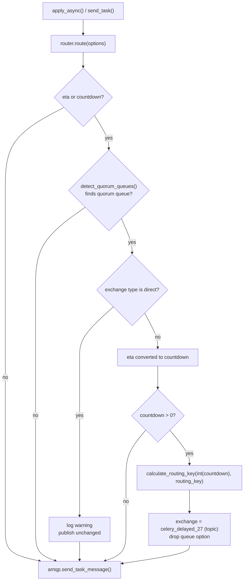
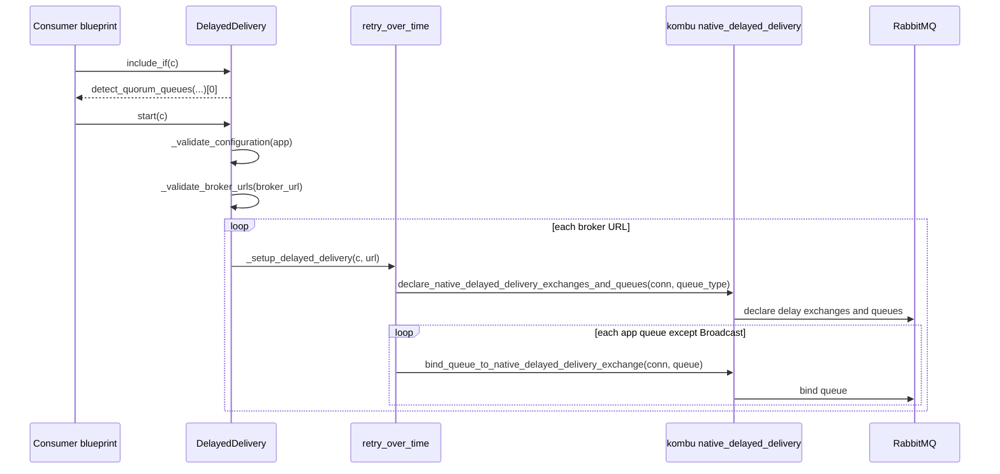

## Overview

RabbitMQ quorum queues do not support global QoS, so a worker consuming from them has a static prefetch count. Celery normally handles an ETA or countdown task by holding the message unacknowledged and raising the prefetch count so it can keep fetching other work; with a static prefetch count each held ETA message occupies a prefetch slot until its ETA arrives. Native delayed delivery fixes this by letting the broker hold the message: the publisher routes a delayed task through a chain of delay exchanges, and the message reaches the real queue only when it is due.

Sources: [docs/getting-started/backends-and-brokers/rabbitmq.rst:223-257](repo://docs/getting-started/backends-and-brokers/rabbitmq.rst#L223-L257)

Three parts of Celery cooperate. `detect_quorum_queues` decides whether the feature applies at all. `Celery.send_task` rewrites the exchange and routing key of a delayed message at publish time, using `calculate_routing_key` from `kombu.transport.native_delayed_delivery`. The `DelayedDelivery` consumer bootstep declares the delay exchanges and queues on the broker and binds every application queue to them when the worker starts. The topology itself (the exchange and queue names, the binary routing-key scheme) lives in Kombu; Celery only calls it. The design follows NServiceBus's RabbitMQ delayed delivery.

Sources: [celery/app/base.py:22-22](repo://celery/app/base.py#L22-L22), [celery/app/base.py:934-966](repo://celery/app/base.py#L934-L966), [celery/worker/consumer/delayed_delivery.py:13-25](repo://celery/worker/consumer/delayed_delivery.py#L13-L25), [docs/getting-started/backends-and-brokers/rabbitmq.rst:243-251](repo://docs/getting-started/backends-and-brokers/rabbitmq.rst#L243-L251)

## Detecting quorum queues

`detect_quorum_queues(app, driver_type)` returns a `(bool, str)` tuple: whether any configured queue is a quorum queue, and the name of the first one found. It only looks when the transport's `driver_type` is `'amqp'` (RabbitMQ through py-amqp or librabbitmq); for any other broker it returns `(False, "")`. A queue counts as a quorum queue when its `queue_arguments` contain `x-queue-type: quorum`.

Sources: [celery/utils/quorum_queues.py:4-20](repo://celery/utils/quorum_queues.py#L4-L20)

```python
def detect_quorum_queues(app, driver_type: str) -> tuple[bool, str]:
    is_rabbitmq_broker = driver_type == 'amqp'

    if is_rabbitmq_broker:
        queues = app.amqp.queues
        for qname in queues:
            qarguments = queues[qname].queue_arguments or {}
            if qarguments.get("x-queue-type") == "quorum":
                return True, qname

    return False, ""
```

Sources: [celery/utils/quorum_queues.py:4-20](repo://celery/utils/quorum_queues.py#L4-L20)

The queues it inspects come from `app.amqp.queues`, so a quorum queue is detected whether it was declared explicitly in `task_queues`, created as the default queue with `task_default_queue_type = "quorum"`, or auto-created with `task_create_missing_queue_type = "quorum"`. The last two paths add the `x-queue-type` argument for you; [[Task Routing and Queues]] covers how `app.amqp.queues` is built.

Sources: [celery/app/amqp.py:202-209](repo://celery/app/amqp.py#L202-L209), [celery/app/amqp.py:287-294](repo://celery/app/amqp.py#L287-L294)

The function has three callers, and they do not share one switch:

Sources: [celery/app/base.py:934-936](repo://celery/app/base.py#L934-L936), [celery/worker/consumer/delayed_delivery.py:55-64](repo://celery/worker/consumer/delayed_delivery.py#L55-L64), [celery/worker/consumer/tasks.py:103-124](repo://celery/worker/consumer/tasks.py#L103-L124)

| Caller | Effect when quorum queues are found | Gated by `worker_detect_quorum_queues` |
| --- | --- | --- |
| `Celery.send_task` | Rewrites delayed messages to the delay exchange | No |
| `DelayedDelivery.include_if` | Adds the bootstep to the worker's consumer | No |
| `Tasks.qos_global` | Sets `qos_global = False`, so the prefetch count is per consumer and static | Yes |

Sources: [celery/app/base.py:934-936](repo://celery/app/base.py#L934-L936), [celery/worker/consumer/delayed_delivery.py:55-64](repo://celery/worker/consumer/delayed_delivery.py#L55-L64), [celery/worker/consumer/tasks.py:103-124](repo://celery/worker/consumer/tasks.py#L103-L124)

> [!NOTE]
> Setting `worker_detect_quorum_queues = False` only restores global QoS. The publish-side rewrite and the `DelayedDelivery` bootstep still activate whenever a quorum queue is configured.

Sources: [celery/worker/consumer/tasks.py:115-122](repo://celery/worker/consumer/tasks.py#L115-L122), [celery/app/defaults.py:373-373](repo://celery/app/defaults.py#L373-L373)

## Publishing a delayed task

### Rewriting the destination

After `send_task` has merged options and run the router, it checks for `eta` or `countdown`. If either is set, it reads the `driver_type` of the producer pool's connection and calls `detect_quorum_queues`. When quorum queues are present it takes the exchange type, routing key and exchange name from the routed `Queue` (or from the raw `exchange_type`, `routing_key` and `exchange` options when the route named no queue). The rest of the publish path is described in [[Calling Tasks and Message Protocol]].

Sources: [celery/app/base.py:930-941](repo://celery/app/base.py#L930-L941)

```python
                if exchange_type != 'direct':
                    if eta:
                        if isinstance(eta, str):
                            eta = isoparse(eta)
                        countdown = (maybe_make_aware(eta) - self.now()).total_seconds()

                    if countdown:
                        if countdown > 0:
                            routing_key = calculate_routing_key(int(countdown), routing_key)
                            exchange = Exchange(
                                'celery_delayed_27',
                                type='topic',
                            )
                            options.pop("queue", None)
                            options['routing_key'] = routing_key
                            options['exchange'] = exchange
```

Sources: [celery/app/base.py:943-958](repo://celery/app/base.py#L943-L958)

1. An `eta` (a `datetime` or an ISO 8601 string) is turned into a countdown in seconds relative to `app.now()`; a naive datetime is made timezone-aware first.
2. A countdown of zero or less is left alone: the message goes straight to its queue.
3. A positive countdown is truncated to whole seconds and passed to `calculate_routing_key` together with the original routing key. Kombu encodes the delay into the new routing key so the delay exchanges can route the message level by level and finally deliver it with the original routing key.
4. The message is published to the topic exchange `celery_delayed_27`, the top level of Kombu's delay exchanges. `queue` is removed from the options so `send_task_message` does not fall back to the queue's own exchange.

Sources: [celery/app/base.py:943-958](repo://celery/app/base.py#L943-L958)

### What the message still carries

The rewrite changes only where the message is published. `send_task` still passes `countdown` and `eta` to `amqp.create_task_message`, and `as_task_v2` converts the countdown into an absolute `eta` header. When the broker finally delivers the message, the worker sees an ETA that has already passed or is only a fraction of a second away, so it runs the task almost at once instead of holding it.

Sources: [celery/app/base.py:1007-1016](repo://celery/app/base.py#L1007-L1016), [celery/app/amqp.py:435-443](repo://celery/app/amqp.py#L435-L443)

In `send_task_message`, `queue` is `None` but `exchange` is set, so the default-queue fallback is skipped; with no queue and no `exchange_type` option, `exchange_type` falls back to `'direct'`, but because both `exchange` and `routing_key` are present the anonymous-exchange conversion does not run, and the message is published to `celery_delayed_27` with the computed key. Nothing is added to `declare`, so publishing relies on the worker's `DelayedDelivery` step having created the delay exchanges beforehand.

Sources: [celery/app/amqp.py:506-524](repo://celery/app/amqp.py#L506-L524), [celery/app/amqp.py:537-551](repo://celery/app/amqp.py#L537-L551)



Sources: [celery/app/base.py:930-966](repo://celery/app/base.py#L930-L966), [celery/app/base.py:1007-1030](repo://celery/app/base.py#L1007-L1030)

### Direct exchanges are not supported

When the destination exchange is of type `direct`, the message is published unchanged and a warning is logged. The task then reaches the quorum queue immediately, and the worker holds it until the ETA, which is exactly the blocking behaviour the feature exists to avoid.

Sources: [celery/app/base.py:960-966](repo://celery/app/base.py#L960-L966)

```python
                    logger.warning(
                        'Direct exchanges are not supported with native delayed delivery.\n'
                        f'{exchange_name} is a direct exchange but should be a topic exchange or '
                        'a fanout exchange in order for native delayed delivery to work properly.\n'
                        'If quorum queues are used, this task may block the worker process until the ETA arrives.'
                    )
```

Sources: [celery/app/base.py:961-966](repo://celery/app/base.py#L961-L966)

> [!WARNING]
> `task_default_exchange_type` defaults to `'direct'`, so the default queue only works with native delayed delivery after you change it to `"topic"`. The RabbitMQ guide's quorum example sets `task_default_exchange_type = "topic"` for this reason.

Sources: [celery/app/defaults.py:284-286](repo://celery/app/defaults.py#L284-L286), [celery/app/amqp.py:640-650](repo://celery/app/amqp.py#L640-L650), [docs/getting-started/backends-and-brokers/rabbitmq.rst:198-212](repo://docs/getting-started/backends-and-brokers/rabbitmq.rst#L198-L212)

## The DelayedDelivery bootstep

### Registration and inclusion

`DelayedDelivery` is a `bootsteps.StartStopStep` (see [[Consumer and Message Handling]]) listed in the consumer blueprint's `default_steps` right after `Tasks` and before `Evloop`, and it declares `requires = (Tasks,)`. Its `include_if` replaces the default `self.enabled` check: the step exists only when `detect_quorum_queues` finds a quorum queue on the write connection's transport.

Sources: [celery/worker/consumer/consumer.py:170-184](repo://celery/worker/consumer/consumer.py#L170-L184), [celery/worker/consumer/delayed_delivery.py:39-64](repo://celery/worker/consumer/delayed_delivery.py#L39-L64), [celery/bootsteps.py:322-328](repo://celery/bootsteps.py#L322-L328)

### Start sequence

`start(c)` first runs `_validate_configuration`, which logs at critical level and re-raises any `ValueError`, stopping the consumer from starting. It then splits `broker_url` into a set of URLs and, for each URL, runs `_setup_delayed_delivery` under Kombu's `retry_over_time`.

Sources: [celery/worker/consumer/delayed_delivery.py:66-110](repo://celery/worker/consumer/delayed_delivery.py#L66-L110)

`_setup_delayed_delivery` opens `app.connection_for_write(url=broker_url)`, reads `broker_native_delayed_delivery_queue_type`, calls `declare_native_delayed_delivery_exchanges_and_queues(connection, queue_type)`, and then `_bind_queues`. Each stage logs a warning naming the sanitized URL and re-raises, so the outer retry loop sees the failure.

Sources: [celery/worker/consumer/delayed_delivery.py:112-150](repo://celery/worker/consumer/delayed_delivery.py#L112-L150)



Sources: [celery/worker/consumer/delayed_delivery.py:55-110](repo://celery/worker/consumer/delayed_delivery.py#L55-L110), [celery/worker/consumer/delayed_delivery.py:112-199](repo://celery/worker/consumer/delayed_delivery.py#L112-L199)

### Binding application queues

`_bind_queues` iterates over `app.amqp.queues.values()`. With no queues it logs a warning and returns. `Broadcast` queues are skipped. Every other queue is passed to `bind_queue_to_native_delayed_delivery_exchange`, so a delayed message whose original routing key matches the queue's binding ends up there once its delay expires.

Sources: [celery/worker/consumer/delayed_delivery.py:152-173](repo://celery/worker/consumer/delayed_delivery.py#L152-L173)

A failing bind is logged at error level and the loop continues with the next queue. After the loop, the collected errors are raised together as one `ExceptionGroup` (backported from `exceptiongroup` on Python older than 3.11). Errors of the retried types are the exception: they are re-raised at once, because Kombu's `retry_over_time` cannot catch exceptions wrapped inside an `ExceptionGroup`.

Sources: [celery/worker/consumer/delayed_delivery.py:9-11](repo://celery/worker/consumer/delayed_delivery.py#L9-L11), [celery/worker/consumer/delayed_delivery.py:174-199](repo://celery/worker/consumer/delayed_delivery.py#L174-L199)

## Retries and failure handling

The retry policy is fixed by module constants rather than settings.

Sources: [celery/worker/consumer/delayed_delivery.py:30-36](repo://celery/worker/consumer/delayed_delivery.py#L30-L36)

| Constant | Value | Meaning |
| --- | --- | --- |
| `RETRY_INTERVAL` | `1.0` | First sleep, in seconds, passed as `interval_start` |
| `MAX_RETRIES` | `3` | Retries per broker URL |
| `RETRIED_EXCEPTIONS` | `(ConnectionRefusedError, OSError)` | Exceptions that trigger a retry |
| `VALID_QUEUE_TYPES` | `{'classic', 'quorum'}` | Accepted values for the queue type setting |

Sources: [celery/worker/consumer/delayed_delivery.py:30-36](repo://celery/worker/consumer/delayed_delivery.py#L30-L36)

Before each retry, `_on_retry` takes the next interval from Kombu's interval iterator, logs `Retrying delayed delivery setup (attempt n/3) ...` with the error and the sleep time, and returns the interval for `retry_over_time` to sleep.

Sources: [celery/worker/consumer/delayed_delivery.py:201-214](repo://celery/worker/consumer/delayed_delivery.py#L201-L214)

Setup failures do not stop the worker. Any exception escaping the retries for one URL is logged as `Failed to setup delayed delivery for ...` and stored, and the loop moves on to the next URL. Only when every URL has failed does `start` log a critical message saying native delayed delivery will not be available; the worker keeps running, and delayed tasks published to `celery_delayed_27` will not reach their queues until the topology exists.

Sources: [celery/worker/consumer/delayed_delivery.py:86-110](repo://celery/worker/consumer/delayed_delivery.py#L86-L110)

## Configuration validation

Configuration errors are the one case that does stop the worker: `_validate_configuration` checks the broker URLs and the queue type, and `start` re-raises its `ValueError`.

Sources: [celery/worker/consumer/delayed_delivery.py:80-84](repo://celery/worker/consumer/delayed_delivery.py#L80-L84), [celery/worker/consumer/delayed_delivery.py:216-229](repo://celery/worker/consumer/delayed_delivery.py#L216-L229)

| Check | Error message |
| --- | --- |
| `broker_url` empty | `broker_url configuration is empty` |
| `broker_url` is a list with a non-string | `All broker URLs must be strings` |
| `broker_url` neither string nor list | `broker_url must be a string or list, got ...` |
| No URLs after splitting | `No valid broker URLs found in configuration` |
| Queue type empty | `broker_native_delayed_delivery_queue_type is not configured` |
| Queue type not `classic` or `quorum` | `Invalid queue type '...'. Must be one of: classic, quorum` |

Sources: [celery/worker/consumer/delayed_delivery.py:216-279](repo://celery/worker/consumer/delayed_delivery.py#L216-L279)

A string `broker_url` is split on `;`, the same separator Celery uses for failover URLs, and the result is turned into a set, so duplicate URLs are set up once. Each URL gets its own delay exchanges and bindings, which matters when the failover brokers are separate RabbitMQ clusters.

Sources: [celery/worker/consumer/delayed_delivery.py:244-261](repo://celery/worker/consumer/delayed_delivery.py#L244-L261)

## Settings

| Setting | Default | Role |
| --- | --- | --- |
| `broker_native_delayed_delivery_queue_type` | `'quorum'` | Queue type Kombu uses for the delay-level queues; `'classic'` is the alternative |
| `task_default_queue_type` | `'classic'` | Set to `'quorum'` to give the default queue `x-queue-type: quorum` |
| `task_create_missing_queue_type` | `'classic'` | Queue type for queues created on the fly |
| `task_default_exchange_type` | `'direct'` | Must be `'topic'` (or fanout) for delayed messages to be rewritten |
| `worker_detect_quorum_queues` | `True` | Disables global QoS when quorum queues are found |
| `broker_transport_options` | `{}` | Set `confirm_publish: True`, which quorum queues require |

Sources: [celery/app/defaults.py:98-98](repo://celery/app/defaults.py#L98-L98), [celery/app/defaults.py:279-286](repo://celery/app/defaults.py#L279-L286), [celery/app/defaults.py:373-373](repo://celery/app/defaults.py#L373-L373), [celery/app/defaults.py:88-88](repo://celery/app/defaults.py#L88-L88), [docs/getting-started/backends-and-brokers/rabbitmq.rst:187-196](repo://docs/getting-started/backends-and-brokers/rabbitmq.rst#L187-L196)

A configuration that turns the feature on for the default queue (the full list of settings is in [[Configuration]]):

Sources: [docs/getting-started/backends-and-brokers/rabbitmq.rst:198-212](repo://docs/getting-started/backends-and-brokers/rabbitmq.rst#L198-L212)

```python
task_default_queue_type = "quorum"
task_default_exchange_type = "topic"
task_default_queue = "my-queue"
broker_transport_options = {"confirm_publish": True}

task_routes = {
    "*": {
        "routing_key": "my-queue",
    },
}
```

Sources: [docs/getting-started/backends-and-brokers/rabbitmq.rst:198-212](repo://docs/getting-started/backends-and-brokers/rabbitmq.rst#L198-L212)

## The quorum-queues example

`examples/quorum-queues` holds a small playground for these features:

Sources: [examples/quorum-queues/myapp.py:1-23](repo://examples/quorum-queues/myapp.py#L1-L23)

| File | Purpose |
| --- | --- |
| `setup_cluster.sh` | Starts a three-node RabbitMQ cluster in Docker (`rabbit1` to `rabbit3`, AMQP on ports 5672 to 5674) and joins the nodes |
| `test_cluster.sh` | Recreates `my-quorum-queue` with `rabbitmqadmin` and round-trips a test message |
| `declare_queue.py` | Declares `my-quorum-queue` with Kombu and `queue_arguments={"x-queue-type": "quorum"}` |
| `myapp.py` | Celery app using `task_default_queue_type = "quorum"` and an interactive menu that sends plain, ETA and group tasks |

Sources: [examples/quorum-queues/setup_cluster.sh:44-117](repo://examples/quorum-queues/setup_cluster.sh#L44-L117), [examples/quorum-queues/test_cluster.sh:1-41](repo://examples/quorum-queues/test_cluster.sh#L1-L41), [examples/quorum-queues/declare_queue.py:1-15](repo://examples/quorum-queues/declare_queue.py#L1-L15), [examples/quorum-queues/myapp.py:33-48](repo://examples/quorum-queues/myapp.py#L33-L48)

Menu option `1.1` sends `identity.si(payload).apply_async(queue=queue, eta=eta)` with an ETA 30 seconds ahead, which goes through the delayed-publish branch of `send_task`.

Sources: [examples/quorum-queues/myapp.py:86-99](repo://examples/quorum-queues/myapp.py#L86-L99)

> [!NOTE]
> `myapp.py` does not change `task_default_exchange_type`, so its default `celery` queue uses a direct exchange and option `1.1` logs the "Direct exchanges are not supported" warning. Add `app.conf.task_default_exchange_type = "topic"` to watch the broker hold the message instead.

Sources: [examples/quorum-queues/myapp.py:33-48](repo://examples/quorum-queues/myapp.py#L33-L48), [celery/app/defaults.py:286-286](repo://celery/app/defaults.py#L286-L286), [celery/app/base.py:960-966](repo://celery/app/base.py#L960-L966)
