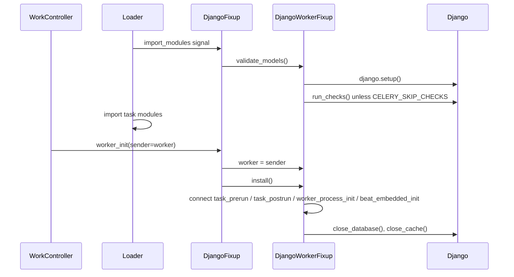

## Overview

Celery works with Django without a separate plugin package: a built-in "fix-up" detects a Django project from the `DJANGO_SETTINGS_MODULE` environment variable and adapts the app to it. The fix-up runs `django.setup()` before task modules are imported, swaps the default task class for `DjangoTask`, uses Django's timezone-aware clock, lets `app.autodiscover_tasks()` find `tasks.py` modules in every installed Django app, and closes database connections and caches around each task and after the worker forks.

Sources: [celery/fixups/django.py:1-63](repo://celery/fixups/django.py#L1-L63)

Every `Celery` instance builds its fix-ups at construction time. `BUILTIN_FIXUPS` holds only `celery.fixups.django:fixup`; unless the `fixups` argument overrides the set, each entry is resolved with `symbol_by_name` and called with the app, and the returned objects are kept in `app._fixups` so they stay alive. See [[The Celery Application]] for the rest of the app constructor.

Sources: [celery/app/base.py:82-84](repo://celery/app/base.py#L82-L84), [celery/app/base.py:410-413](repo://celery/app/base.py#L410-L413)

## Fix-up installation

`fixup(app, env='DJANGO_SETTINGS_MODULE')` decides whether anything happens at all. It installs `DjangoFixup` only when all of these hold:

Sources: [celery/fixups/django.py:33-63](repo://celery/fixups/django.py#L33-L63)

| Condition | Effect when false |
| --- | --- |
| `os.environ[env]` is set and non-empty | Returns `None`; the app is untouched |
| `'django'` is not in `app.loader_cls.lower()` | Returns `None` (a Django-specific loader is already in use) |
| `import django` succeeds | Emits `FixupWarning` with `ERR_NOT_INSTALLED` and returns `None` |
| `django.VERSION >= (1, 11)` | `_verify_django_version` raises `ImproperlyConfigured('Celery 5.x requires Django 1.11 or later.')` |

Sources: [celery/fixups/django.py:33-63](repo://celery/fixups/django.py#L33-L63)

`DjangoFixup.__init__` makes the app the default app when no default exists yet (`_state.default_app is None`), so `@shared_task` functions in Django apps bind to it. `install()` then performs the process-level changes:

Sources: [celery/fixups/django.py:66-89](repo://celery/fixups/django.py#L66-L89)

1. Prepends `os.getcwd()` to `sys.path`, so the project directory takes precedence over installed modules.
2. Resolves `django.conf:settings` lazily and replaces `app.loader.now` with `DjangoFixup.now`.
3. Sets `app.task_cls` to `celery.contrib.django.task:DjangoTask`, unless `app._custom_task_cls_used` is true.
4. Connects `on_import_modules` to the `import_modules` signal and `on_worker_init` to `worker_init`.

Sources: [celery/fixups/django.py:66-89](repo://celery/fixups/django.py#L66-L89)

`_custom_task_cls_used` is true when a `task_cls` argument was passed to `Celery(...)`, or when the app is a `Celery` subclass that defines a `task_cls` attribute. In both cases the fix-up leaves your class alone, so a custom base class must itself inherit from `DjangoTask` to keep the on-commit helpers.

Sources: [celery/app/base.py:360-366](repo://celery/app/base.py#L360-L366)

`DjangoFixup.now(utc=False)` returns `datetime.now(timezone.utc)` when `utc` is true and otherwise calls `django.utils.timezone.now`, which honours Django's `USE_TZ` setting. The function is resolved once and cached in the `_now` cached property.

Sources: [celery/fixups/django.py:118-127](repo://celery/fixups/django.py#L118-L127)

## Startup sequence

The fix-up hooks into two moments: the loader importing default task modules, and the worker finishing initialization. `on_import_modules` runs `validate_models()`, which calls `django.setup()` and then `django.core.checks.run_checks()` unless the `CELERY_SKIP_CHECKS` environment variable is set. Because the loader sends `import_modules` before it imports any task module, Django's app registry is ready by the time a `tasks.py` touches a model.

Sources: [celery/fixups/django.py:101-103](repo://celery/fixups/django.py#L101-L103), [celery/fixups/django.py:146-154](repo://celery/fixups/django.py#L146-L154), [celery/loaders/base.py:97-105](repo://celery/loaders/base.py#L97-L105)



Sources: [celery/fixups/django.py:91-116](repo://celery/fixups/django.py#L91-L116), [celery/fixups/django.py:156-163](repo://celery/fixups/django.py#L156-L163), [celery/loaders/base.py:107-111](repo://celery/loaders/base.py#L107-L111)

`DjangoWorkerFixup` is created lazily through the `worker_fixup` property the first time it is needed. `on_worker_init` stores the `WorkController` passed as the signal's `sender` on the worker fix-up (it is used later to detect the prefork pool); when the signal carries no sender it emits a `FixupWarning` and installs anyway. The worker fix-up's constructor reads `CELERY_DB_REUSE_MAX` from the app configuration and imports `django.db`, `django.core.cache` and the `InterfaceError`/`DatabaseError` classes it needs to tolerate.

Sources: [celery/fixups/django.py:105-116](repo://celery/fixups/django.py#L105-L116), [celery/fixups/django.py:130-144](repo://celery/fixups/django.py#L130-L144)

## Database connections and caches

### Around each task

Django normally closes connections at the end of each HTTP request. A worker has no requests, so `DjangoWorkerFixup.install()` connects handlers that do the same around tasks:

Sources: [celery/fixups/django.py:156-163](repo://celery/fixups/django.py#L156-L163), [celery/fixups/django.py:194-203](repo://celery/fixups/django.py#L194-L203)

| Signal | Handler | Action |
| --- | --- | --- |
| `task_prerun` | `on_task_prerun` | `close_database()` unless `sender.request.is_eager` |
| `task_postrun` | `on_task_postrun` | `close_database()` and `close_cache()` unless `sender.request.is_eager` |
| `worker_process_init` | `on_worker_process_init` | Drop inherited connections in the child process |
| `beat_embedded_init` | `close_database` | Close connections when beat starts inside the worker |

Sources: [celery/fixups/django.py:156-163](repo://celery/fixups/django.py#L156-L163), [celery/fixups/django.py:194-203](repo://celery/fixups/django.py#L194-L203)

Eager tasks (run with `apply()` or under `task_always_eager`) are skipped so that a task executed inline inside a Django view or test does not close the caller's connection mid-transaction.

Sources: [celery/fixups/django.py:194-203](repo://celery/fixups/django.py#L194-L203)

### Connection reuse with CELERY_DB_REUSE_MAX

`close_database()` closes immediately when `db_reuse_max` is unset. When it is set, the method counts calls in `_db_recycles` and only closes once the count reaches `db_reuse_max * 2`, then resets the counter. Since each task triggers two calls (prerun and postrun), a value of `N` keeps a connection open across roughly `N` tasks.

Sources: [celery/fixups/django.py:205-211](repo://celery/fixups/django.py#L205-L211)

`_close_database()` does the actual work. It iterates `connections.all(initialized_only=True)` (falling back to `connections.all()` on Django older than 4.1, which raises `TypeError` for the keyword) and calls `conn.close()` on each. When the alias has `OPTIONS["pool"]` enabled in `settings.DATABASES`, the worker uses the prefork pool, and the connection has `close_pool()`, the pool is closed too, so forked children never share pooled sockets. `InterfaceError` is ignored, and a `DatabaseError` is re-raised unless its message contains `closed` or `not connected`.

Sources: [celery/fixups/django.py:213-240](repo://celery/fixups/django.py#L213-L240)

`_is_prefork()` returns false when no worker was recorded; otherwise it checks whether the string `prefork` appears in `worker.pool_cls` (or in the pool class's module name when `pool_cls` is a class).

Sources: [celery/fixups/django.py:213-217](repo://celery/fixups/django.py#L213-L217)

### After a fork

A prefork child inherits the parent's open sockets. Calling `close()` on such a connection can send a termination message that breaks the parent's copy too, so `on_worker_process_init` first closes only the raw file descriptor of each live connection through `_maybe_close_db_fd`, then calls `_close_database()` (bypassing the reuse counter) and `close_cache()`. When `FORKED_BY_MULTIPROCESSING` is set (Windows or execv-started children) it re-runs `validate_models()` first, because those children start with a fresh interpreter.

Sources: [celery/fixups/django.py:165-192](repo://celery/fixups/django.py#L165-L192), [celery/fixups/django.py:39-44](repo://celery/fixups/django.py#L39-L44)

`close_cache()` calls `django.core.cache.close_caches()` and swallows `TypeError` and `AttributeError` for Django versions without it.

Sources: [celery/fixups/django.py:242-246](repo://celery/fixups/django.py#L242-L246)

## Task autodiscovery

`app.autodiscover_tasks()` without a package list delegates to the fix-ups. `_autodiscover_tasks_from_fixups` asks every fix-up that has an `autodiscover_tasks` method for package names; `DjangoFixup.autodiscover_tasks` returns `config.name` for each entry in `django.apps.apps.get_app_configs()`. The loader then imports `<package>.tasks` for each one. Discovery is lazy by default: it is attached to the `import_modules` signal and runs after the fix-up's `django.setup()` handler.

Sources: [celery/app/base.py:820-845](repo://celery/app/base.py#L820-L845), [celery/fixups/django.py:121-123](repo://celery/fixups/django.py#L121-L123)

## DjangoTask and on-commit dispatch

`DjangoTask` extends `Task` with two helpers that defer sending until the current database transaction commits, using `django.db.transaction.on_commit`. This avoids the race where a worker receives a task before the row it needs is visible.

Sources: [celery/contrib/django/task.py:1-21](repo://celery/contrib/django/task.py#L1-L21)

```python
class DjangoTask(Task):
    """
    Extend the base :class:`~celery.app.task.Task` for Django.

    Provide a nicer API to trigger tasks at the end of the DB transaction.
    """

    def delay_on_commit(self, *args, **kwargs) -> None:
        """Call :meth:`~celery.app.task.Task.delay` with Django's ``on_commit()``."""
        transaction.on_commit(functools.partial(self.delay, *args, **kwargs))

    def apply_async_on_commit(self, *args, **kwargs) -> None:
        """Call :meth:`~celery.app.task.Task.apply_async` with Django's ``on_commit()``."""
        transaction.on_commit(functools.partial(self.apply_async, *args, **kwargs))
```

Sources: [celery/contrib/django/task.py:1-21](repo://celery/contrib/django/task.py#L1-L21)

> [!WARNING]
> Both methods return `None`, not an `AsyncResult`: the message has not been sent yet when they return. Outside an atomic block Django runs the callback immediately, but the return value is still `None`. Use `delay()` or `apply_async()` when you need the result handle.

Sources: [celery/contrib/django/task.py:15-21](repo://celery/contrib/django/task.py#L15-L21)

Argument handling is identical to `delay()` and `apply_async()`, described in [[Calling Tasks and Message Protocol]].

Sources: [celery/contrib/django/task.py:15-21](repo://celery/contrib/django/task.py#L15-L21)

## Example project layout

`examples/django` shows the recommended layout. `proj/celery.py` sets a default `DJANGO_SETTINGS_MODULE` (which triggers the fix-up), creates the app, reads configuration from Django settings under the `CELERY` namespace, and calls `autodiscover_tasks()` with no arguments:

Sources: [examples/django/proj/celery.py:5-17](repo://examples/django/proj/celery.py#L5-L17)

```python
# Set the default Django settings module for the 'celery' program.
os.environ.setdefault('DJANGO_SETTINGS_MODULE', 'proj.settings')

app = Celery('proj')

# Using a string here means the worker doesn't have to serialize
# the configuration object to child processes.
# - namespace='CELERY' means all celery-related configuration keys
#   should have a `CELERY_` prefix.
app.config_from_object('django.conf:settings', namespace='CELERY')

# Load task modules from all registered Django apps.
app.autodiscover_tasks()
```

Sources: [examples/django/proj/celery.py:5-17](repo://examples/django/proj/celery.py#L5-L17)

With `namespace='CELERY'`, every setting in `settings.py` carries the prefix: `CELERY_BROKER_URL`, `CELERY_RESULT_BACKEND`, `CELERY_ACCEPT_CONTENT`, `CELERY_TASK_SERIALIZER`. See [[Configuration]] for how namespaces map to setting names.

Sources: [examples/django/proj/settings.py:9-16](repo://examples/django/proj/settings.py#L9-L16)

`proj/__init__.py` imports the app as `celery_app`, so it is created whenever Django loads the project package and `@shared_task` functions bind to it. The `demoapp/tasks.py` module uses only `@shared_task`, so the Django app does not import the project's Celery instance directly.

Sources: [examples/django/proj/__init__.py:1-5](repo://examples/django/proj/__init__.py#L1-L5), [examples/django/demoapp/tasks.py:1-32](repo://examples/django/demoapp/tasks.py#L1-L32)

The worker is started from the project directory with `celery -A proj worker -l INFO`; the fix-up's `sys.path.insert(0, os.getcwd())` is what makes `proj` importable there.

Sources: [examples/django/README.rst:44-50](repo://examples/django/README.rst#L44-L50), [celery/fixups/django.py:75-79](repo://celery/fixups/django.py#L75-L79)

## Environment variables and settings

| Name | Kind | Purpose |
| --- | --- | --- |
| `DJANGO_SETTINGS_MODULE` | Environment | Enables the fix-up when set |
| `CELERY_SKIP_CHECKS` | Environment | Skips `django.core.checks.run_checks()` in `validate_models()` |
| `FORKED_BY_MULTIPROCESSING` | Environment | Makes child processes re-run `validate_models()` |
| `CELERY_DB_REUSE_MAX` | App setting | Number of tasks a DB connection may serve before being closed |
| `DATABASES[alias]["OPTIONS"]["pool"]` | Django setting | Enables `close_pool()` in prefork workers |

Sources: [celery/fixups/django.py:52-63](repo://celery/fixups/django.py#L52-L63), [celery/fixups/django.py:134-136](repo://celery/fixups/django.py#L134-L136), [celery/fixups/django.py:150-154](repo://celery/fixups/django.py#L150-L154), [celery/fixups/django.py:165-169](repo://celery/fixups/django.py#L165-L169), [celery/fixups/django.py:228-234](repo://celery/fixups/django.py#L228-L234)
