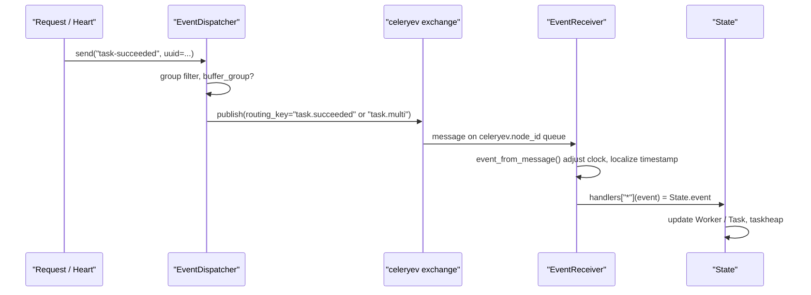

## Overview

Celery reports what is happening in a cluster by publishing small *event* messages to a dedicated exchange (`celeryev` by default). Workers send `worker-*` events about themselves and `task-*` events about each task they handle. Clients can send `task-sent` when they publish. Any process can consume the stream: `celery events` ships a curses monitor, a dumper and a snapshot camera, and tools such as Flower use the same `EventReceiver` and `State` classes.

Sources: [celery/events/event.py:11-15](repo://celery/events/event.py#L11-L15), [celery/events/state.py:1-14](repo://celery/events/state.py#L1-L14), [celery/bin/events.py:83-98](repo://celery/bin/events.py#L83-L98)

Events are off by default for task traffic: `worker_send_task_events` and `task_send_sent_event` both default to `False`, while worker heartbeats are sent whenever the event dispatcher is running. The event messages are separate from task results and from remote control replies (see [[Remote Control and Inspection]]). They are only a monitoring stream.

Sources: [celery/app/defaults.py:311-313](repo://celery/app/defaults.py#L311-L313), [celery/app/defaults.py:366-368](repo://celery/app/defaults.py#L366-L368), [celery/worker/consumer/events.py:20-33](repo://celery/worker/consumer/events.py#L20-L33)

## Event model

### Event dictionaries and groups

An event is a plain dict. `Event(type, **fields)` adds `type` and, unless one is given, a `timestamp` from `time.time()`. The *group* of an event is the part of its type before the first dash: `group_from('task-sent')` is `'task'`. The dispatcher filters by group and uses `type.replace('-', '.')` as the routing key, so a receiver can bind to `task.#` or `worker.#`.

Sources: [celery/events/event.py:18-43](repo://celery/events/event.py#L18-L43), [celery/events/dispatcher.py:116-140](repo://celery/events/dispatcher.py#L116-L140)

`get_exchange(conn, name)` returns a copy of the `celeryev` topic exchange, renamed to `event_exchange`. For the `redis` and `gcpubsub` transports it switches the type to `fanout`, because those transports cannot route topic patterns efficiently.

Sources: [celery/events/event.py:46-63](repo://celery/events/event.py#L46-L63)

### Event types

| Event | Sender | Extra fields |
| --- | --- | --- |
| `task-sent` | Client, when `task_send_sent_event` is on | task fields from the message, plus `queue`, `exchange`, `routing_key` |
| `task-received` | Worker strategy, on receipt | `uuid`, `name`, `args`, `kwargs`, `root_id`, `parent_id`, `retries`, `eta`, `expires` |
| `task-started` | `Request.on_accepted` | `uuid` |
| `task-succeeded` | `Request.on_success` | `result`, `runtime` |
| `task-failed` | `Request.on_failure` | `exception`, `traceback` |
| `task-retried` | `Request.on_retry` | `exception`, `traceback` |
| `task-revoked` | `Request._announce_revoked` | `terminated`, `signum`, `expired` |
| `task-rejected` | `Request.reject` | `requeue` |
| `task-cancelled` | `Request._announce_cancelled` | `uuid` |
| `worker-online`<br>`worker-heartbeat`<br>`worker-offline` | `celery.worker.heartbeat.Heart` | `freq`, `active`, `processed`, `loadavg`, `sw_ident`, `sw_ver`, `sw_sys` |

Sources: [celery/app/amqp.py:593-604](repo://celery/app/amqp.py#L593-L604), [celery/worker/strategy.py:167-176](repo://celery/worker/strategy.py#L167-L176), [celery/worker/request.py:439-461](repo://celery/worker/request.py#L439-L461), [celery/worker/request.py:511-523](repo://celery/worker/request.py#L511-L523), [celery/worker/request.py:605-620](repo://celery/worker/request.py#L605-L620), [celery/worker/request.py:719-724](repo://celery/worker/request.py#L719-L724), [celery/worker/request.py:736-740](repo://celery/worker/request.py#L736-L740), [celery/worker/heartbeat.py:39-61](repo://celery/worker/heartbeat.py#L39-L61)

Every published event also carries `hostname`, `utcoffset`, `pid` and `clock`, the sender's Lamport clock value, which `publish` adds.

Sources: [celery/events/dispatcher.py:135-137](repo://celery/events/dispatcher.py#L135-L137)

## Sending events

### EventDispatcher

`EventDispatcher(connection, hostname, enabled, channel, buffer_while_offline, ...)` resolves the exchange, serializer (`event_serializer`) and logical clock from the app. It disables itself on transports listed in `DISABLED_TRANSPORTS` (`sql`). When enabled, `enable()` creates a kombu `Producer` with `auto_declare=False` and runs every callback in `on_enabled`, and `disable()` runs `on_disabled`. The heartbeat service uses these two hooks to start and stop itself.

Sources: [celery/events/dispatcher.py:48-92](repo://celery/events/dispatcher.py#L48-L92), [celery/events/dispatcher.py:100-114](repo://celery/events/dispatcher.py#L100-L114)

`send(type, **fields)` does nothing unless the dispatcher is enabled, and drops events whose group is not in `groups` when that set is non-empty. Events in a `buffer_group` are built immediately (so they get the current clock) but appended to `_group_buffer`. When the buffer reaches `buffer_limit` (24) the dispatcher calls `flush()`; otherwise it calls `on_send_buffered`. Other events go straight to `publish`, which forwards the clock and calls `_publish` under a mutex.

Sources: [celery/events/dispatcher.py:164-199](repo://celery/events/dispatcher.py#L164-L199)

`_publish` sends with `declare=[exchange]`, the `hostname` header and `delivery_mode=1` (transient). If publishing raises and `buffer_while_offline` is true, the event is kept in `_outbound_buffer` instead of failing the caller. `flush()` re-sends that buffer and then publishes each group buffer as one message: a list of events with the routing key `<group>.multi`.

Sources: [celery/events/dispatcher.py:142-162](repo://celery/events/dispatcher.py#L142-L162), [celery/events/dispatcher.py:201-213](repo://celery/events/dispatcher.py#L201-L213)

### The worker's dispatcher

The consumer's `Events` bootstep owns the worker's dispatcher. It is enabled when task events are on, or when gossip or heartbeats are enabled. Without `-E`, `groups` is `['worker']`, so heartbeats still flow but `task-*` events are filtered out. With the event loop (`c.hub`), task events are buffered and `on_send_event_buffered` schedules `_flush_events` on the hub's ready queue, so a burst of task events goes out as a single `task.multi` message per loop iteration.

Sources: [celery/worker/consumer/events.py:15-52](repo://celery/worker/consumer/events.py#L15-L52), [celery/worker/consumer/consumer.py:624-630](repo://celery/worker/consumer/consumer.py#L624-L630)

On every consumer restart, for example after a lost connection, `Events.start` closes the previous dispatcher but keeps its `groups`, so changes made by remote control survive. It copies that dispatcher's offline buffer into the new one, flushes it, and points every reserved request's `eventer` at the new dispatcher.

Sources: [celery/worker/consumer/events.py:35-71](repo://celery/worker/consumer/events.py#L35-L71)

Requests emit through `Request.send_event`, which checks three things: the dispatcher exists, it is enabled, and the task's `send_events` attribute is true. That attribute defaults to `True` and lets a single task opt out. The strategy repeats the same check once per task type for `task-received`, to avoid a method call per message.

Sources: [celery/worker/request.py:511-513](repo://celery/worker/request.py#L511-L513), [celery/worker/strategy.py:112-117](repo://celery/worker/strategy.py#L112-L117), [celery/app/task.py:264-268](repo://celery/app/task.py#L264-L268)

### Heartbeats

`celery.worker.heartbeat.Heart` registers its `start`/`stop` on the dispatcher's `on_enabled`/`on_disabled`. `start` sends `worker-online` and schedules `worker-heartbeat` every `interval` seconds (default 2.0) on the consumer timer. `stop` cancels the timer and sends `worker-offline` without retry. Each heartbeat reports the number of active requests, the total processed count, the load average and `SOFTWARE_INFO`. The `heartbeat_sent` signal is sent only if it has receivers.

Sources: [celery/worker/heartbeat.py:14-61](repo://celery/worker/heartbeat.py#L14-L61), [celery/worker/state.py:27-32](repo://celery/worker/state.py#L27-L32)

The consumer `Heart` step creates that service after `Events`, using `--heartbeat-interval`. `--without-heartbeat` disables it. These are event heartbeats, unrelated to the AMQP `broker_heartbeat`.

Sources: [celery/worker/consumer/heart.py:10-36](repo://celery/worker/consumer/heart.py#L10-L36), [celery/bin/worker.py:277-284](repo://celery/bin/worker.py#L277-L284)

### Client and custom events

`task-sent` is published by `amqp.send_task_message` only when the message was created with `create_sent_event`, which `send_task` sets from `task_send_sent_event`. It uses the app's disabled `_event_dispatcher` with the task's own producer, so it goes over the same connection as the task message. Code inside a task can emit custom events with `Task.send_event(type_, **fields)`, which opens `app.events.default_dispatcher` and adds the current task id as `uuid`.

Sources: [celery/app/base.py:1007-1015](repo://celery/app/base.py#L1007-L1015), [celery/app/amqp.py:593-604](repo://celery/app/amqp.py#L593-L604), [celery/app/amqp.py:653-657](repo://celery/app/amqp.py#L653-L657), [celery/app/task.py:1003-1027](repo://celery/app/task.py#L1003-L1027)

## Receiving events

### EventReceiver

`EventReceiver(channel, handlers, routing_key='#', node_id=None, ...)` is a kombu `ConsumerMixin`. It declares a queue named `<event_queue_prefix>.<node_id>` bound to the event exchange. The queue's TTL, expiry, exclusivity and durability come from the `event_queue_*` settings, and asking for both exclusive and durable raises `ImproperlyConfigured`. It accepts the configured `event_serializer` plus `json`.

Sources: [celery/events/receiver.py:23-78](repo://celery/events/receiver.py#L23-L78)

`capture(limit, timeout, wakeup=True)` consumes until stopped. When the consumer is ready, `on_consume_ready` broadcasts the `heartbeat` remote control command, so every worker sends a heartbeat immediately and a new monitor sees the cluster without waiting for the next interval.

Sources: [celery/events/receiver.py:90-111](repo://celery/events/receiver.py#L90-L111), [celery/worker/control.py:370-376](repo://celery/worker/control.py#L370-L376)

`_receive` accepts both a single event and a list of events (the `<group>.multi` batches). For each event, `event_from_message` adjusts the local Lamport clock from the event's `clock`. `task-sent` events instead get `clock = local value - 1`, because clients never synchronize clocks. The method then converts `timestamp` to local time using `utcoffset`, stamps `local_received`, and `process` dispatches to `handlers[type]` or the catch-all `handlers['*']`.

Sources: [celery/events/receiver.py:80-83](repo://celery/events/receiver.py#L80-L83), [celery/events/receiver.py:113-145](repo://celery/events/receiver.py#L113-L145)



Sources: [celery/worker/request.py:511-513](repo://celery/worker/request.py#L511-L513), [celery/events/dispatcher.py:164-213](repo://celery/events/dispatcher.py#L164-L213), [celery/events/receiver.py:113-145](repo://celery/events/receiver.py#L113-L145), [celery/events/state.py:501-503](repo://celery/events/state.py#L501-L503)

### app.events shortcuts

`app.events` is an `Events` instance whose `Receiver`, `Dispatcher` and `State` properties are subclasses bound to the app. `default_dispatcher(hostname, enabled, buffer_while_offline=False)` borrows a producer from `app.amqp.producer_pool` and yields a dispatcher on that producer's connection and channel.

Sources: [celery/app/events.py:7-40](repo://celery/app/events.py#L7-L40), [celery/app/base.py:1581-1584](repo://celery/app/base.py#L1581-L1584)

```python
from celery import Celery

app = Celery(broker='amqp://')

def on_failed(event):
    print('task failed', event['uuid'], event['exception'])

with app.connection_for_read() as conn:
    recv = app.events.Receiver(conn, handlers={'task-failed': on_failed})
    recv.capture(limit=None, timeout=None, wakeup=True)
```

Sources: [celery/events/receiver.py:36-45](repo://celery/events/receiver.py#L36-L45), [celery/events/receiver.py:98-106](repo://celery/events/receiver.py#L98-L106)

## Cluster state

### State

`State` folds the event stream into an in-memory picture of workers and tasks. `workers` and `tasks` are `LRUCache`s bounded by `max_workers_in_memory` (5000) and `max_tasks_in_memory` (10000). `tasks_by_type` and `tasks_by_worker` are `WeakSet` indexes, so evicted tasks drop out of them automatically. `state.event(event)` takes a mutex and calls the closure built once by `_create_dispatcher`.

Sources: [celery/events/state.py:398-440](repo://celery/events/state.py#L398-L440), [celery/events/state.py:501-503](repo://celery/events/state.py#L501-L503)

The closure increments `event_count`, calls the optional `callback`, then splits the type into group and subject. A handler registered in `state.handlers[group]` takes over and its return value is passed back to the caller. Without one, the closure handles the two built-in groups as follows.

Sources: [celery/events/state.py:540-553](repo://celery/events/state.py#L540-L553)

- `worker-*` events find or create the `Worker` by hostname, feed it the event, call `on_node_join` for new or `online` workers, and on `offline` call `on_node_leave` and remove the worker.
- `task-*` events find or create the `Task` by `uuid`. They record `client` for `task-sent` or link the task to its worker (and count the event as a worker heartbeat). They insert a `(clock, timestamp, origin, task)` tuple into the time-ordered `_taskheap`, capped at `max_tasks_in_memory * heap_multiplier`, update the type and worker indexes, and link parents and children through `parent_id`, holding children whose parent has not arrived yet in `_tasks_to_resolve`.

Sources: [celery/events/state.py:540-634](repo://celery/events/state.py#L540-L634)

`Task.event` maps the subject to a state through `TASK_EVENT_TO_STATE` and stores the timestamp in the matching attribute (`succeeded`, `failed`, and so on). Events arrive out of order, so it compares state precedence. If the incoming state logically happened *before* the current one (for example `task-received` after `task-succeeded`), it only merges the fields listed in `merge_rules` (`name`, `args`, `kwargs`, `eta` and so on) and leaves `state` unchanged. `RETRY` is exempt from this check. Unknown subjects become custom states named `type_.upper()`.

Sources: [celery/events/state.py:66-76](repo://celery/events/state.py#L66-L76), [celery/events/state.py:264-277](repo://celery/events/state.py#L264-L277), [celery/events/state.py:305-332](repo://celery/events/state.py#L305-L332)

Query helpers include `itertasks`, `tasks_by_time`, `tasks_by_type(name)`, `tasks_by_worker(hostname)`, `task_types()` and `alive_workers()`. `clear_tasks(ready=True)` keeps only tasks that are not yet in a ready state.

Sources: [celery/events/state.py:451-475](repo://celery/events/state.py#L451-L475), [celery/events/state.py:650-711](repo://celery/events/state.py#L650-L711)

### Heartbeat expiry

`Worker` keeps the last `heartbeat_max` (4) `local_received` times, sorted. A worker is `alive` while `now < heartbeat_expires`, and `heartbeat_expires(timestamp, freq, expire_window)` returns `timestamp + freq * expire_window / 100`. With `HEARTBEAT_EXPIRE_WINDOW = 200` and the default 2-second heartbeat, a worker is shown `OFFLINE` once 4 seconds pass without an event. A `worker-offline` event clears the heartbeat list at once.

Sources: [celery/events/state.py:45-48](repo://celery/events/state.py#L45-L48), [celery/events/state.py:114-123](repo://celery/events/state.py#L114-L123), [celery/events/state.py:149-239](repo://celery/events/state.py#L149-L239)

> [!WARNING]
> When an event's `timestamp` differs from the local receive time by more than `HEARTBEAT_DRIFT_MAX` (16 seconds), `State` logs "Substantial drift ... may mean clocks are out of sync" once per hostname. Heavy drift makes workers flap between online and offline, so keep worker and monitor clocks synchronized.

Sources: [celery/events/state.py:50-57](repo://celery/events/state.py#L50-L57), [celery/events/state.py:106-111](repo://celery/events/state.py#L106-L111), [celery/events/state.py:200-205](repo://celery/events/state.py#L200-L205)

## Monitoring tools

### celery events command

`celery events` picks one of three tools: `--dump` runs `evdump`, `--camera` runs `evcam` (optionally detached, with `--frequency`, `--maxrate` and `--loglevel`), and no option runs the curses `evtop`. A missing `_curses` module becomes a usage error. Options from `app.user_options['events']` are added to the command.

Sources: [celery/bin/events.py:18-98](repo://celery/bin/events.py#L18-L98), [celery/bin/celery.py:157-160](repo://celery/bin/celery.py#L157-L160)

| Tool | Module | What it does |
| --- | --- | --- |
| `evtop` | `celery/events/cursesmon.py` | `CursesMonitor` draws tasks from `State.tasks_by_time` and alive workers. A `DisplayThread` redraws while `capture_events` feeds `state.event` and reconnects on connection errors. |
| `evdump` | `celery/events/dumper.py` | `Dumper.on_event` prints one line per event, remembering task names from `task-received`/`task-sent` in an LRU cache. The loop reconnects after connection or channel errors. |
| `evcam` | `celery/events/snapshot.py` | Builds a `State`, instantiates the camera class, installs it, and captures all events into the state until interrupted. |

Sources: [celery/events/cursesmon.py:466-531](repo://celery/events/cursesmon.py#L466-L531), [celery/events/dumper.py:15-99](repo://celery/events/dumper.py#L15-L99), [celery/events/snapshot.py:86-111](repo://celery/events/snapshot.py#L86-L111)

The curses monitor is also a small remote control client: its key map binds `j`/`k` to move, `i` to info, `t` to the traceback, `r` to the result, `c` to revoke the selected task and `l` to set a rate limit.

Sources: [celery/events/cursesmon.py:34-64](repo://celery/events/cursesmon.py#L34-L64), [celery/events/cursesmon.py:141-153](repo://celery/events/cursesmon.py#L141-L153)

### Snapshot cameras

`Polaroid(state, freq=1.0, maxrate=None, cleanup_freq=3600.0)` is the base class for cameras. `install()` schedules `capture` every `freq` seconds and `cleanup` every `cleanup_freq` seconds on a timer. `capture` runs `shutter` inside `state.freeze_while`, so the state cannot change while it is recorded, and clears the state afterwards when `clear_after` is true. `shutter` respects the optional `maxrate` token bucket, sends `shutter_signal` and calls `on_shutter(state)`. `cancel()` takes one last shot before stopping.

Sources: [celery/events/snapshot.py:24-83](repo://celery/events/snapshot.py#L24-L83), [celery/events/state.py:442-449](repo://celery/events/state.py#L442-L449)

```python
from celery.events.snapshot import Polaroid

class DumpCam(Polaroid):
    clear_after = True

    def on_shutter(self, state):
        print('Workers: {}'.format(list(state.alive_workers())))
        print('Tasks: {}'.format(state.task_count))
```

Sources: [celery/events/snapshot.py:24-66](repo://celery/events/snapshot.py#L24-L66), [celery/events/state.py:706-708](repo://celery/events/state.py#L706-L708)

Run it with `celery -A proj events -c myapp.DumpCam --frequency=2.0`: `evcam` loads the class by name with `instantiate`.

Sources: [celery/bin/events.py:57-70](repo://celery/bin/events.py#L57-L70), [celery/events/snapshot.py:97-101](repo://celery/events/snapshot.py#L97-L101)

## Configuration

| Setting or option | Default | Effect |
| --- | --- | --- |
| `worker_send_task_events` / `-E`, `--task-events` | `False` | Adds the `task` group to the worker dispatcher. |
| `task_send_sent_event` | `False` | Clients publish `task-sent` with each task message. |
| `event_exchange` | `'celeryev'` | Exchange name for both dispatcher and receiver. |
| `event_serializer` | `'json'` | Serializer for published events. Receivers also accept `json`. |
| `event_queue_prefix` | `'celeryev'` | Receiver queue name prefix. |
| `event_queue_ttl` | `5.0` | Message TTL on receiver queues. |
| `event_queue_expires` | `60.0` | Receiver queue expiry. |
| `event_queue_exclusive` | `True` | Exclusive receiver queue. Cannot be combined with durable. |
| `event_queue_durable` | `False` | Durable, non-auto-delete receiver queue. |
| `--without-heartbeat`, `--heartbeat-interval` | enabled, 2s | Controls the `Heart` step. |

Sources: [celery/app/defaults.py:179-189](repo://celery/app/defaults.py#L179-L189), [celery/app/defaults.py:311-313](repo://celery/app/defaults.py#L311-L313), [celery/app/defaults.py:366-368](repo://celery/app/defaults.py#L366-L368), [celery/bin/worker.py:212-220](repo://celery/bin/worker.py#L212-L220), [celery/bin/worker.py:277-284](repo://celery/bin/worker.py#L277-L284), [celery/worker/heartbeat.py:25-28](repo://celery/worker/heartbeat.py#L25-L28)

Task events can also be toggled on running workers with the `enable_events` and `disable_events` remote control commands, which add or remove `task` from the dispatcher's `groups`. They return `event dispatcher unavailable` when the worker has no dispatcher. Settings in general are described in [[Configuration]].

Sources: [celery/worker/control.py:344-367](repo://celery/worker/control.py#L344-L367)
