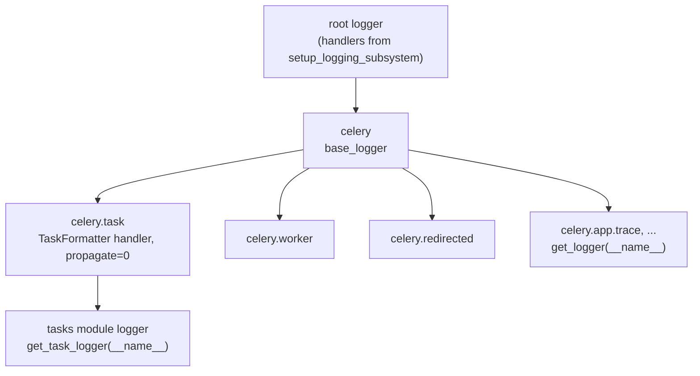
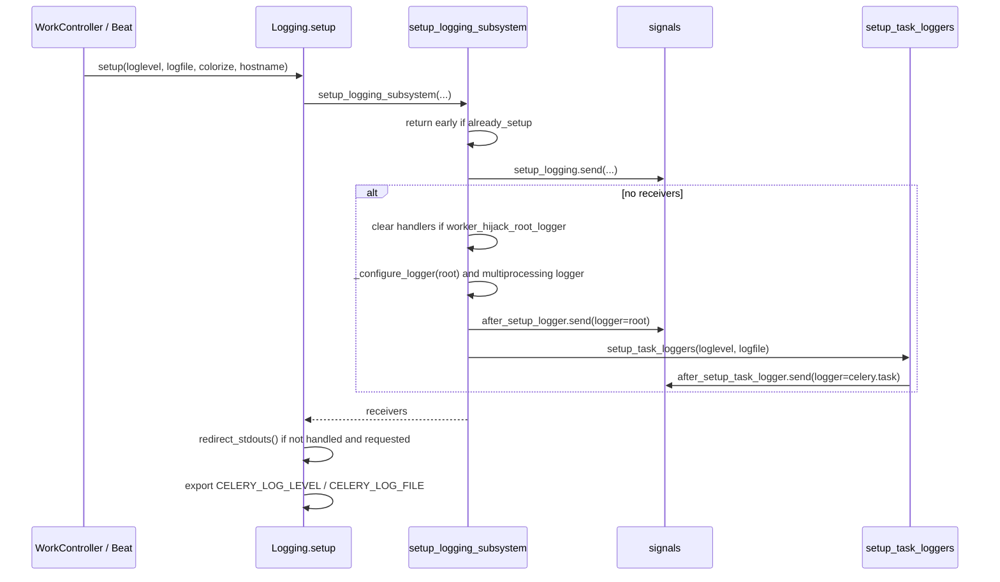

## Overview

Celery configures Python's standard `logging` module for its own programs (worker, beat, `celery events` snapshots) so that every process writes in a consistent format, task log lines carry the task name and id, and stray `print()` output from user code ends up in the log instead of being lost after the worker detaches from its terminal. The work is split between two modules: `celery/app/log.py` holds the `Logging` class that each app exposes as `app.log`, and `celery/utils/log.py` holds the logger hierarchy helpers, the colouring formatter and the stdout proxy.

Sources: [celery/app/log.py:1-27](repo://celery/app/log.py#L1-L27), [celery/utils/log.py:1-36](repo://celery/utils/log.py#L1-L36)

`app.log` is a cached property that instantiates `log_cls`, which defaults to `'celery.app.log:Logging'` and can be replaced through the `log` argument of the `Celery` constructor (see [[The Celery Application]]). The worker drives the setup at start-up, beat does the same in its own `setup_logging`, and every prefork child repeats it in `process_initializer`.

Sources: [celery/app/base.py:1592-1594](repo://celery/app/base.py#L1592-L1594), [celery/apps/worker.py:183-190](repo://celery/apps/worker.py#L183-L190), [celery/apps/beat.py:86-91](repo://celery/apps/beat.py#L86-L91), [celery/concurrency/prefork.py:57-66](repo://celery/concurrency/prefork.py#L57-L66)

## Logger hierarchy

### The celery and celery.task loggers

Every logger Celery creates hangs below one of two roots. `base_logger` is the `celery` logger; `get_logger(name)` fetches a logger through kombu and, unless it is the root logger or a direct child of root, re-parents it under `celery`. `task_logger` (`celery.task`) and `worker_logger` (`celery.worker`) are created at import time this way.

Sources: [celery/utils/log.py:29-36](repo://celery/utils/log.py#L29-L36), [celery/utils/log.py:97-106](repo://celery/utils/log.py#L97-L106)

```python
def get_logger(name):
    """Get logger by name."""
    l = _get_logger(name)
    if logging.root not in (l, l.parent) and l is not base_logger:
        l = _using_logger_parent(base_logger, l)
    return l
```

Sources: [celery/utils/log.py:97-102](repo://celery/utils/log.py#L97-L102)

Re-parenting goes through `_using_logger_parent`, which only overwrites `logger.parent` when `logger_isa` finds the target is not already an ancestor. `logger_isa` walks `.parent` links up to 1000 steps and raises `RuntimeError` on a cycle, so a logger already inside the hierarchy keeps its own parent.

Sources: [celery/utils/log.py:72-94](repo://celery/utils/log.py#L72-L94)

### Task loggers

`get_task_logger(name)` is the logger to use inside task modules. It refuses the reserved names `celery` and `celery.task` with `RuntimeError`, then parents the logger under `celery.task`. Because `celery.task` is the logger that `setup_task_loggers` equips with a `TaskFormatter` handler, a task module logger inherits that handler and its records show the running task's name and id.

Sources: [celery/utils/log.py:105-113](repo://celery/utils/log.py#L105-L113), [celery/app/log.py:156-181](repo://celery/app/log.py#L156-L181)

```python
from celery.utils.log import get_task_logger

logger = get_task_logger(__name__)
```

Sources: [examples/stamping/tasks.py:8-10](repo://examples/stamping/tasks.py#L8-L10)



Sources: [celery/utils/log.py:29-36](repo://celery/utils/log.py#L29-L36), [celery/utils/log.py:97-113](repo://celery/utils/log.py#L97-L113), [celery/app/log.py:78-81](repo://celery/app/log.py#L78-L81), [celery/app/log.py:168-175](repo://celery/app/log.py#L168-L175)

### Level names

`mlevel(level)` converts a level name such as `'info'` into its integer through kombu's `LOG_LEVELS`, case-insensitively, and returns integers and falsy values unchanged. Every entry point of `Logging` passes its `loglevel` through it, so the `-l/--loglevel` CLI option (default `WARNING`) can be given as a name.

Sources: [celery/utils/log.py:116-120](repo://celery/utils/log.py#L116-L120), [celery/bin/worker.py:162-168](repo://celery/bin/worker.py#L162-L168)

## Setup flow

### Logging.setup

`Logging.__init__` reads three settings once: `worker_log_format`, `worker_task_log_format` and `worker_log_color`, and sets the default level to `WARN`. `setup()` is the single entry point the programs call: it calls `setup_logging_subsystem`, redirects stdout/stderr only when no `setup_logging` receiver took over and `redirect_stdouts` is true, exports the level and file in `CELERY_LOG_LEVEL` / `CELERY_LOG_FILE`, forces Celery's deprecation warnings to always show, and routes `warnings` into logging with `logging.captureWarnings(True)`.

Sources: [celery/app/log.py:54-76](repo://celery/app/log.py#L54-L76)



Sources: [celery/app/log.py:61-131](repo://celery/app/log.py#L61-L131), [celery/app/log.py:156-181](repo://celery/app/log.py#L156-L181)

### setup_logging_subsystem

The subsystem is configured once per process: the class attribute `Logging._setup` (exposed as the `already_setup` class property) makes later calls return immediately. When both `logfile` and `hostname` are given, `node_format` expands node placeholders such as `%n` and `%i` in the file name. The method then resolves level, format and colour, resets billiard's multiprocessing logger, and sends the `setup_logging` signal.

Sources: [celery/app/log.py:87-101](repo://celery/app/log.py#L87-L101), [celery/app/log.py:242-248](repo://celery/app/log.py#L242-L248)

If no receiver answered, Celery configures logging itself, in this order:

Sources: [celery/app/log.py:103-103](repo://celery/app/log.py#L103-L103)

1. When `worker_hijack_root_logger` is true (the default), it empties the handlers of the root, `celery`, `celery.task` and `celery.redirected` loggers.
2. `_configure_logger` attaches a handler to the root logger and sets its level.
3. The billiard multiprocessing logger gets a handler too, at `ERROR` unless the `MP_LOG` environment variable is set, in which case it uses the requested level.
4. `after_setup_logger` is sent with the root logger.
5. `setup_task_loggers` configures `celery.task`.

Sources: [celery/app/log.py:103-131](repo://celery/app/log.py#L103-L131), [celery/app/log.py:148-154](repo://celery/app/log.py#L148-L154)

Whatever path was taken, the stream of the root's first handler becomes kombu's default encoding file, and `_MP_FORK_LOGLEVEL_`, `_MP_FORK_LOGFILE_` and `_MP_FORK_LOGFORMAT_` are exported so a pool child started by fork+exec can log before `Process.run`. The return value is the list of signal receivers, which `setup()` and the worker treat as "custom logging is in charge".

Sources: [celery/app/log.py:133-146](repo://celery/app/log.py#L133-L146)

### Handlers and colour

`setup_handlers` skips a logger that `_is_configured` already: one with a non-`NullHandler` handler and no `_rudimentary_setup` marker. Otherwise `_detect_handler` picks the handler: `sys.__stderr__` when `logfile` is `None`, a `StreamHandler` for any object with `write`, or a `WatchedFileHandler` (UTF-8) for a path, so external log rotation is picked up. The formatter class defaults to `ColorFormatter`.

Sources: [celery/app/log.py:213-237](repo://celery/app/log.py#L213-L237)

`supports_color` decides the `use_color` flag. Windows never gets colour; when `colorize` is true or unset, colour is used only when there is no log file and `sys.stderr` is a TTY; an explicit `False` disables it. `colored()` wraps the same decision for the worker banner.

Sources: [celery/app/log.py:199-211](repo://celery/app/log.py#L199-L211)

### Task loggers setup

`setup_task_loggers` uses `worker_task_log_format`, installs a handler on `celery.task` with `formatter=TaskFormatter`, sets the level, and sets `propagate` to `int(propagate)` (false by default) so task records are not printed a second time by the root handler. It then sends `after_setup_task_logger` and returns the logger.

Sources: [celery/app/log.py:156-181](repo://celery/app/log.py#L156-L181)

### Worker, beat and pool children

The worker calls `setup_logging` from `on_init_blueprint` and stores the result as `_custom_logging`; it passes `redirect_stdouts=False` and does the redirect later in `on_start`, after the banner has been printed, only if no custom logging receiver exists and `worker_redirect_stdouts` is on. Beat passes its redirect options straight to `setup()`.

Sources: [celery/apps/worker.py:106-125](repo://celery/apps/worker.py#L106-L125), [celery/apps/worker.py:131-147](repo://celery/apps/worker.py#L131-L147), [celery/apps/worker.py:183-190](repo://celery/apps/worker.py#L183-L190), [celery/apps/beat.py:86-91](repo://celery/apps/beat.py#L86-L91)

Prefork children rebuild their logging from the environment variables `setup()` and `redirect_stdouts()` exported. When `CELERY_LOG_FILE` contains `%i` (the pool process index), the child resets `already_setup` so it opens its own file instead of the parent's. See [[Concurrency Pools and Autoscaling]].

Sources: [celery/concurrency/prefork.py:57-66](repo://celery/concurrency/prefork.py#L57-L66)

## Formatters

### ColorFormatter

`ColorFormatter` maps `DEBUG`, `WARNING`, `ERROR` and `CRITICAL` to blue, yellow, red and magenta from `celery.utils.term.colored`; `INFO` stays uncoloured. With `use_color` off it only returns `safe_str(msg)`. If colouring raises, the record is formatted again with the message replaced by `<Unrepresentable ...>` and `exc_info=1`, and the original `msg` and `exc_info` are restored afterwards for other handlers.

Sources: [celery/utils/log.py:123-175](repo://celery/utils/log.py#L123-L175)

### TaskFormatter

`TaskFormatter` extends `ColorFormatter`. It asks `get_current_task()` (see [[App State, Proxies and Lazy Objects]]) for the executing task and copies `task_id` and `task_name` onto the record; outside a task both default to `???`, so the task format never fails with a missing key.

Sources: [celery/app/log.py:32-43](repo://celery/app/log.py#L32-L43)

```python
class TaskFormatter(ColorFormatter):
    """Formatter for tasks, adding the task name and id."""

    def format(self, record):
        task = get_current_task()
        if task and task.request:
            record.__dict__.update(task_id=task.request.id,
                                   task_name=task.name)
        else:
            record.__dict__.setdefault('task_name', '???')
            record.__dict__.setdefault('task_id', '???')
        return super().format(record)
```

Sources: [celery/app/log.py:32-43](repo://celery/app/log.py#L32-L43)

## Redirecting stdout and stderr

`redirect_stdouts(loglevel, name='celery.redirected')` calls `redirect_stdouts_to_logger` with the `celery.redirected` logger and exports `CELERY_LOG_REDIRECT=1` plus the level for pool children. `redirect_stdouts_to_logger` builds one `LoggingProxy` and assigns it to `sys.stdout` and/or `sys.stderr`.

Sources: [celery/app/log.py:78-85](repo://celery/app/log.py#L78-L85), [celery/app/log.py:183-197](repo://celery/app/log.py#L183-L197)

`LoggingProxy` is a minimal file object. Its level comes from the argument, else the logger's level, else `ERROR`. On construction it replaces each handler's `handleError` so a handler failure prints its traceback to `sys.__stderr__` rather than to the proxied `sys.stderr`, which would loop. `write()` strips the trailing newline and logs non-empty data; `flush()` does nothing, `close()` stops forwarding and `isatty()` returns `False`.

Sources: [celery/utils/log.py:178-260](repo://celery/utils/log.py#L178-L260)

Two guards keep `write()` safe:

Sources: [celery/utils/log.py:217-236](repo://celery/utils/log.py#L217-L236)

| Guard | Trigger | Behaviour |
| --- | --- | --- |
| `_in_sighandler` | set by `set_in_sighandler` or the `in_sighandler()` context manager | prints straight to `sys.__stderr__`, because the logging module takes locks that are unsafe inside a signal handler |
| `_thread.recurse_protection` | a handler of the target logger writes back to the proxy | returns `0` and drops the write instead of recursing |

Sources: [celery/utils/log.py:39-69](repo://celery/utils/log.py#L39-L69), [celery/utils/log.py:217-236](repo://celery/utils/log.py#L217-L236)

The worker's shutdown and restart signal handlers run inside `in_sighandler()`, so any output they produce through the proxy goes to the real stderr.

Sources: [celery/apps/worker.py:301-310](repo://celery/apps/worker.py#L301-L310)

## Configuration

| Setting | Default | Effect |
| --- | --- | --- |
| `worker_log_format` | `[%(asctime)s: %(levelname)s/%(processName)s] %(message)s` | format of the root handler |
| `worker_task_log_format` | `[%(asctime)s: %(levelname)s/%(processName)s] %(task_name)s[%(task_id)s]: %(message)s` | format of the `celery.task` handler |
| `worker_log_color` | `None` (auto: colour only on a TTY without log file) | passed to `supports_color` |
| `worker_hijack_root_logger` | `True` | remove existing root and `celery*` handlers before configuring |
| `worker_redirect_stdouts` | `True` | redirect stdout/stderr into `celery.redirected` |
| `worker_redirect_stdouts_level` | `WARNING` | level of redirected output |

Sources: [celery/app/defaults.py:13-17](repo://celery/app/defaults.py#L13-L17), [celery/app/defaults.py:346-370](repo://celery/app/defaults.py#L346-L370)

The log file and level come from the command line: `-l/--loglevel` and `-f/--logfile` (stderr when omitted). The file name is node-formatted in `setup_logging_subsystem`, except for detached workers, which format it beforehand because `detached()` must touch the file before logging is set up. More settings are listed in [[Configuration]] and the options in [[Command Line Interface]].

Sources: [celery/bin/base.py:221-221](repo://celery/bin/base.py#L221-L221), [celery/bin/worker.py:108-133](repo://celery/bin/worker.py#L108-L133)

## Extension points

Three [[Signals]] let an application take over or adjust logging:

Sources: [celery/signals.py:117-135](repo://celery/signals.py#L117-L135)

| Signal | Sent from | Arguments | Use |
| --- | --- | --- | --- |
| `setup_logging` | `setup_logging_subsystem` before any handler is added | `loglevel`, `logfile`, `format`, `colorize` | connecting any receiver disables Celery's own configuration and the stdout redirect |
| `after_setup_logger` | after the root logger is configured | `logger`, `loglevel`, `logfile`, `format`, `colorize` | add handlers or filters to the root logger |
| `after_setup_task_logger` | end of `setup_task_loggers` | `logger`, `loglevel`, `logfile`, `format`, `colorize` | adjust the `celery.task` logger |

Sources: [celery/signals.py:117-135](repo://celery/signals.py#L117-L135), [celery/app/log.py:98-131](repo://celery/app/log.py#L98-L131), [celery/app/log.py:176-180](repo://celery/app/log.py#L176-L180)

> [!NOTE]
> Because a `setup_logging` receiver short-circuits the whole branch, `after_setup_logger` and `after_setup_task_logger` are not sent at all when one is connected, and the worker also skips `redirect_stdouts`.

Sources: [celery/app/log.py:103-131](repo://celery/app/log.py#L103-L131), [celery/apps/worker.py:146-147](repo://celery/apps/worker.py#L146-L147)

A full replacement of the class is also possible: pass `log='myproject.log:MyLogging'` to `Celery(...)` to set `log_cls`, and `app.log` will instantiate it with `app=`.

Sources: [celery/app/base.py:315-315](repo://celery/app/base.py#L315-L315), [celery/app/base.py:358-358](repo://celery/app/base.py#L358-L358), [celery/app/base.py:1592-1594](repo://celery/app/base.py#L1592-L1594)
