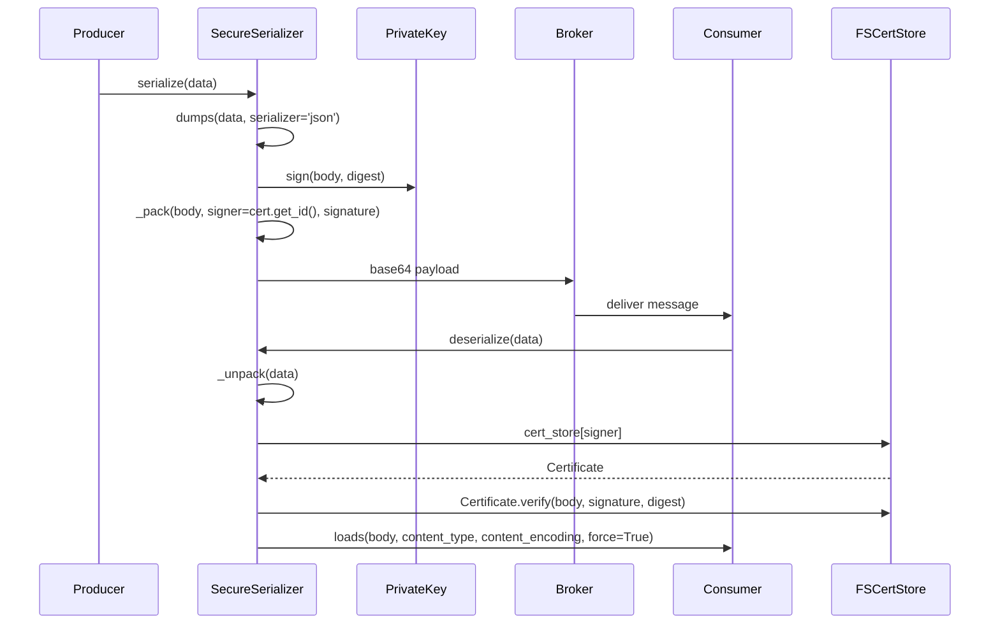

## Overview

Message signing lets a worker reject task messages that were not produced by a trusted client. `celery.security` registers a Kombu serializer named `auth` that wraps a normal serializer (JSON by default): the producer signs the serialized body with an RSA private key, and the consumer verifies the signature against a store of trusted X.509 certificates before decoding anything. Anyone who can publish to the broker but lacks a trusted key cannot get a task executed.

Sources: [celery/security/__init__.py:1-41](repo://celery/security/__init__.py#L1-L41), [celery/security/serialization.py:1-29](repo://celery/security/serialization.py#L1-L29)

The package depends on the `cryptography` library and raises `ImproperlyConfigured` with `CRYPTOGRAPHY_NOT_INSTALLED` at import time when it is missing. Only RSA keys and certificates are accepted.

Sources: [celery/security/__init__.py:9-14](repo://celery/security/__init__.py#L9-L14), [celery/security/__init__.py:38-41](repo://celery/security/__init__.py#L38-L41), [celery/security/key.py:24-25](repo://celery/security/key.py#L24-L25), [celery/security/certificate.py:41-42](repo://celery/security/certificate.py#L41-L42)

## Enabling signing

### Configuration

Signing is switched on by setting the serializer options and calling `app.setup_security()` in every process that sends or consumes tasks. The bundled example configures it like this:

Sources: [examples/security/mysecureapp.py:35-44](repo://examples/security/mysecureapp.py#L35-L44)

```python
app.conf.update(
    security_key='ssl/worker.key',
    security_certificate='ssl/worker.pem',
    security_cert_store='ssl/*.pem',
    task_serializer='auth',
    event_serializer='auth',
    accept_content=['auth'],
    result_accept_content=['json']
)
app.setup_security()
```

Sources: [examples/security/mysecureapp.py:35-44](repo://examples/security/mysecureapp.py#L35-L44)

The settings live in the `security` namespace (old names use the `celery_security_` prefix):

Sources: [celery/app/defaults.py:239-247](repo://celery/app/defaults.py#L239-L247), [celery/app/defaults.py:20-20](repo://celery/app/defaults.py#L20-L20)

| Setting | Type | Default | Meaning |
| --- | --- | --- | --- |
| `security_key` | string | none | Path to the PEM-encoded RSA private key used to sign |
| `security_key_password` | bytes | none | Password for an encrypted private key |
| `security_certificate` | string | none | Path to the PEM certificate matching the key; its id is embedded as the signer |
| `security_cert_store` | string | none | Directory or glob of trusted PEM certificates used to verify |
| `security_digest` | string | `sha256` | Hash algorithm name from `cryptography.hazmat.primitives.hashes` |

Sources: [celery/app/defaults.py:239-247](repo://celery/app/defaults.py#L239-L247), [celery/app/defaults.py:20-20](repo://celery/app/defaults.py#L20-L20)

> [!NOTE]
> Results are not signed by this mechanism, which is why the example keeps `result_accept_content=['json']` while `accept_content` is `['auth']`.

Sources: [examples/security/mysecureapp.py:35-43](repo://examples/security/mysecureapp.py#L35-L43)

### setup_security

`Celery.setup_security(allowed_serializers=None, key=None, key_password=None, cert=None, store=None, digest=DEFAULT_SECURITY_DIGEST, serializer='json')` imports `celery.security` lazily and forwards to the module-level `setup_security` with `app=self`. The operation is global: it changes Kombu's serializer registry for every app in the process.

Sources: [celery/app/base.py:750-780](repo://celery/app/base.py#L750-L780)

The module function then runs these steps:

Sources: [celery/security/__init__.py:16-34](repo://celery/security/__init__.py#L16-L34), [celery/security/__init__.py:44-70](repo://celery/security/__init__.py#L44-L70)

1. Falls back to `current_app` when no app is given.
2. Calls Kombu's `disable_insecure_serializers(allowed_serializers)` so untrusted content types can no longer be decoded.
3. Checks that `task_serializer` is `'auth'` and `accept_content` is exactly `['auth']`; otherwise raises `ImproperlyConfigured(SETTING_MISSING)`.
4. Fills `key`, `key_password`, `cert`, `store` and `digest` from the `security_*` settings when the arguments are empty, and raises `ImproperlyConfigured(SECURITY_SETTING_MISSING)` if key, certificate or store is still missing.
5. Reads the key and certificate files and calls `register_auth(...)`.
6. Makes `auth` Kombu's default serializer with `registry._set_default_serializer('auth')`.

Sources: [celery/security/__init__.py:16-34](repo://celery/security/__init__.py#L16-L34), [celery/security/__init__.py:44-70](repo://celery/security/__init__.py#L44-L70)

> [!WARNING]
> `Celery.setup_security` passes `digest='sha256'` by default, so the `digest or conf.security_digest` fallback never reaches the setting. To use another digest, pass `digest=` explicitly to `app.setup_security()`.

Sources: [celery/app/base.py:750-752](repo://celery/app/base.py#L750-L752), [celery/security/__init__.py:62-62](repo://celery/security/__init__.py#L62-L62)

`disable_untrusted_serializers(whitelist=None)` is a thin alias for Kombu's `disable_insecure_serializers` for callers that only want to restrict deserialization without enabling signing.

Sources: [celery/security/__init__.py:73-74](repo://celery/security/__init__.py#L73-L74)

## Sign and verify flow

### SecureSerializer

`register_auth` wraps the raw PEM strings in `PrivateKey`, `Certificate` and `FSCertStore` (each only when provided), builds a `SecureSerializer`, and registers its `serialize`/`deserialize` pair under the name `auth` with content type `application/data` and encoding `utf-8`.

Sources: [celery/security/serialization.py:80-90](repo://celery/security/serialization.py#L80-L90)



Sources: [celery/security/serialization.py:31-58](repo://celery/security/serialization.py#L31-L58)

`serialize` first encodes the data with the inner serializer, then signs the resulting bytes rather than the Python object. The comment in the code gives the reason: the receiver can verify the signature before decoding, so a malicious payload never reaches the decoder.

Sources: [celery/security/serialization.py:31-46](repo://celery/security/serialization.py#L31-L46)

`deserialize` unpacks the envelope, looks up the signer's certificate in the store (an unknown signer raises `SecurityError('Unknown certificate: ...')`), verifies, and only then calls Kombu's `loads` with `force=True` so the inner content type is decoded even though it was disabled by `setup_security`.

Sources: [celery/security/serialization.py:48-58](repo://celery/security/serialization.py#L48-L58), [celery/security/certificate.py:86-91](repo://celery/security/certificate.py#L86-L91)

### Wire format

`_pack` joins five fields with `DEFAULT_SEPARATOR` (`b"\x00\x01"`) and base64-encodes the result; `_unpack` reverses it with `split(sep, maxsplit=4)`, so the body is always the last field and may contain anything.

Sources: [celery/security/serialization.py:14-17](repo://celery/security/serialization.py#L14-L17), [celery/security/serialization.py:60-77](repo://celery/security/serialization.py#L60-L77)

```python
    def _pack(self, body, content_type, content_encoding, signer, signature,
              sep=DEFAULT_SEPARATOR):
        fields = sep.join(
            ensure_bytes(s) for s in [b64encode(signer), b64encode(signature),
                                      content_type, content_encoding, body]
        )
        return b64encode(fields)
```

Sources: [celery/security/serialization.py:14-17](repo://celery/security/serialization.py#L14-L17), [celery/security/serialization.py:60-77](repo://celery/security/serialization.py#L60-L77)

| Field | Encoding | Content |
| --- | --- | --- |
| signer | base64 | `Certificate.get_id()`: issuer string plus serial number |
| signature | base64 | RSA-PSS signature of the body |
| content_type | raw | Inner serializer content type, for example `application/json` |
| content_encoding | raw | Inner serializer encoding, for example `utf-8` |
| body | raw | Serialized payload bytes |

Sources: [celery/security/serialization.py:60-77](repo://celery/security/serialization.py#L60-L77), [celery/security/certificate.py:57-63](repo://celery/security/certificate.py#L57-L63)

### Signature scheme

Both sides use RSA with PSS padding, `MGF1` over the configured digest, and `PSS.MAX_LENGTH` salt. `get_digest_algorithm` turns the digest name into a hash object with `getattr(hashes, digest.upper())()`, so any name in `cryptography.hazmat.primitives.hashes` (for example `sha256`, `sha512`) is valid.

Sources: [celery/security/key.py:27-35](repo://celery/security/key.py#L27-L35), [celery/security/certificate.py:65-73](repo://celery/security/certificate.py#L65-L73), [celery/security/utils.py:13-16](repo://celery/security/utils.py#L13-L16)

## Keys and certificates

### PrivateKey

`PrivateKey(key, password=None)` loads a PEM private key with `serialization.load_pem_private_key`; a parse failure or a non-RSA key becomes `SecurityError('Invalid private key: ...')`. `sign(data, digest)` returns the PSS signature.

Sources: [celery/security/key.py:12-35](repo://celery/security/key.py#L12-L35)

### Certificate

`Certificate(cert)` loads a PEM X.509 certificate and rejects non-RSA public keys. Its methods:

Sources: [celery/security/certificate.py:31-73](repo://celery/security/certificate.py#L31-L73)

| Method | Returns |
| --- | --- |
| `has_expired()` | True when now (UTC) is past `not_valid_after_utc` |
| `get_pubkey()` | The certificate's public key |
| `get_serial_number()` | Serial number |
| `get_issuer()` | Issuer attribute values joined with spaces |
| `get_id()` | `f'{issuer} {serial}'`, the key used in cert stores |
| `verify(data, signature, digest)` | `None`, or raises on a bad signature |

Sources: [celery/security/certificate.py:31-73](repo://celery/security/certificate.py#L31-L73)

### CertStore and FSCertStore

`CertStore` is an in-memory mapping from certificate id to `Certificate`. `__getitem__` decodes the id from bytes and raises `SecurityError` when it is unknown; `add_cert` refuses a second certificate with the same id; `itercerts()` yields all certificates.

Sources: [celery/security/certificate.py:76-97](repo://celery/security/certificate.py#L76-L97)

`FSCertStore(path)` fills the store from disk. A directory path becomes `path/*`; otherwise the path is treated as a glob. Each matched file is parsed as a `Certificate`, and an expired certificate aborts loading with `SecurityError('Expired certificate: ...')`, so the worker fails to start rather than silently trusting fewer signers.

Sources: [celery/security/certificate.py:100-113](repo://celery/security/certificate.py#L100-L113)

> [!TIP]
> Every file matched by `security_cert_store` must be a valid certificate. Point the glob at certificates only (the example uses `ssl/*.pem`) so private keys in the same directory are not parsed as certificates.

Sources: [examples/security/mysecureapp.py:35-38](repo://examples/security/mysecureapp.py#L35-L38), [celery/security/certificate.py:105-109](repo://celery/security/certificate.py#L105-L109)

## Errors

All cryptographic failures surface as `celery.exceptions.SecurityError`, a `CeleryError` subclass. The conversion is done by the `reraise_errors(msg, errors)` context manager, which catches the given exception types and re-raises `SecurityError(msg.format(exc))` with the original traceback.

Sources: [celery/security/utils.py:19-28](repo://celery/security/utils.py#L19-L28), [celery/exceptions.py:210-211](repo://celery/exceptions.py#L210-L211)

| Where | Message prefix | Caught types |
| --- | --- | --- |
| `PrivateKey.__init__` | `Invalid private key:` | `ValueError` |
| `PrivateKey.sign` | `Unable to sign data:` | default |
| `Certificate.__init__` | `Invalid certificate:` | `ValueError` |
| `Certificate.verify` | `Bad signature:` | default |
| `SecureSerializer.serialize` | `Unable to serialize:` | `Exception` |
| `SecureSerializer.deserialize` | `Unable to deserialize:` | `Exception` |

Sources: [celery/security/key.py:15-35](repo://celery/security/key.py#L15-L35), [celery/security/certificate.py:34-73](repo://celery/security/certificate.py#L34-L73), [celery/security/serialization.py:31-58](repo://celery/security/serialization.py#L31-L58)

> [!NOTE]
> The default `errors` value is `(cryptography.exceptions,)`, a module rather than an exception class. When an exception reaches that `except` clause, Python raises `TypeError` instead. For a bad signature the outer `reraise_errors` in `deserialize` catches that `TypeError`, so the caller still gets a `SecurityError`, but its message reads `Unable to deserialize: TypeError(...)` instead of `Bad signature: ...`.

Sources: [celery/security/utils.py:19-28](repo://celery/security/utils.py#L19-L28), [celery/security/serialization.py:48-56](repo://celery/security/serialization.py#L48-L56)

A rejected message never reaches task code: the consumer fails to decode it. See [[Consumer and Message Handling]] for how undecodable messages are handled and [[Calling Tasks and Message Protocol]] for the serializer settings that `auth` wraps.

Sources: [celery/security/serialization.py:48-58](repo://celery/security/serialization.py#L48-L58)

## Generating keys for the example

The example docstring shows how to create a self-signed RSA certificate with OpenSSL and run the worker; `examples/security/ssl` contains a ready-made `worker.key` and `worker.pem` for local testing only.

Sources: [examples/security/mysecureapp.py:1-26](repo://examples/security/mysecureapp.py#L1-L26)

```text
mkdir ssl
openssl req -x509 -newkey rsa:4096 -keyout ssl/worker.key -out ssl/worker.pem -days 365
# remove passphrase
openssl rsa -in ssl/worker.key -out ssl/worker.key
```

Sources: [examples/security/mysecureapp.py:1-26](repo://examples/security/mysecureapp.py#L1-L26)

> [!WARNING]
> The key committed under `examples/security/ssl` is public. Never reuse it outside the example.

Sources: [examples/security/ssl/worker.key:1-5](repo://examples/security/ssl/worker.key#L1-L5)
