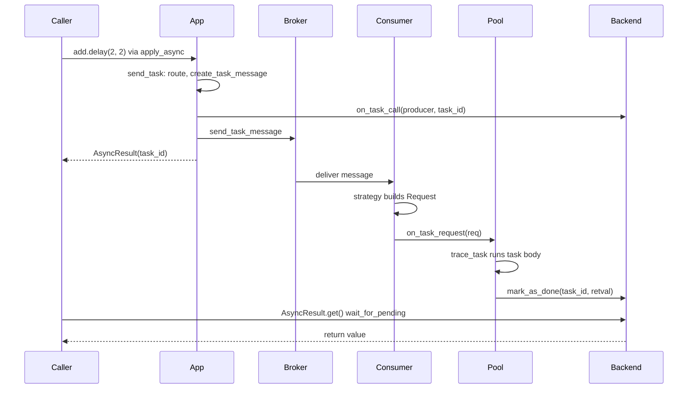
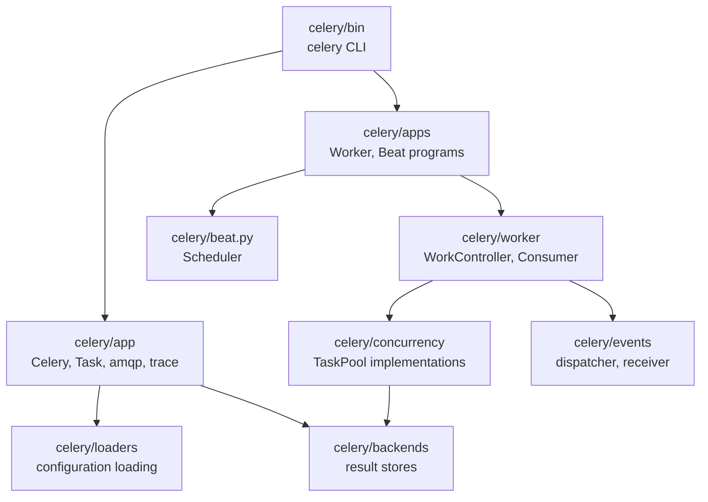

## Overview

Celery is a distributed task queue for Python. A program (the client) describes a unit of work as a task, publishes it as a message to a broker, and one or more worker processes consume those messages, execute the task and optionally store the return value in a result backend. Workers and brokers can be multiplied for high availability and horizontal scaling, and because the message protocol is language independent, clients exist for Node.js, PHP, Go and Rust as well.

Sources: [README.rst:91-118](repo://README.rst#L91-L118)

The package is published as `celery` version `5.6.2` (series `recovery`). Its distribution metadata (version, author, homepage, keywords) is read by `setup.py` straight from the header of `celery/__init__.py`, up to the `# -eof meta-` marker, and the `celery` console script points at `celery.__main__:main`.

Sources: [celery/__init__.py:25-34](repo://celery/__init__.py#L25-L34), [setup.py:51-77](repo://setup.py#L51-L77), [setup.py:137-159](repo://setup.py#L137-L159)

The smallest useful Celery program is an application object plus one decorated function. Everything else in this documentation explains what happens around those few lines.

Sources: [README.rst:188-198](repo://README.rst#L188-L198)

```python
from celery import Celery

app = Celery('hello', broker='amqp://guest@localhost//')

@app.task
def hello():
    return 'hello world'
```

Sources: [README.rst:192-198](repo://README.rst#L192-L198)

## Main components

Celery is built from a small set of cooperating parts. The application object is the hub: every other component is created lazily from it, so two apps in one process can use different brokers, backends and settings.

Sources: [celery/app/base.py:311-318](repo://celery/app/base.py#L311-L318), [celery/app/base.py:1534-1609](repo://celery/app/base.py#L1534-L1609)

| Component | Where it lives | Role |
| --- | --- | --- |
| Application (`Celery`) | `celery/app/base.py` | Holds configuration, the task registry and factories for every other component. See [[The Celery Application]]. |
| Task | `celery/app/task.py` | Class created by `@app.task`; `delay()` / `apply_async()` publish a message. See [[Defining Tasks]] and [[Calling Tasks and Message Protocol]]. |
| Broker connection (`app.amqp`, `app.pool`) | `celery/app/amqp.py`, Kombu | Builds task messages, routes them to queues and publishes them. See [[Task Routing and Queues]]. |
| Worker (`WorkController`) | `celery/worker/` | Bootstep blueprint (Hub, Pool, Timer, Consumer, Beat, Autoscaler) that consumes and executes tasks. See [[Worker Architecture and Bootsteps]]. |
| Concurrency pool | `celery/concurrency/` | Runs task bodies in prefork processes, threads, eventlet/gevent greenlets or inline (`solo`). See [[Concurrency Pools and Autoscaling]]. |
| Result backend (`app.backend`) | `celery/backends/` | Stores states and return values; `AsyncResult.get()` reads them back. See [[Result Backends]] and [[Task Results]]. |
| Beat (`celery.beat.Scheduler`) | `celery/beat.py` | Sends periodic tasks on a schedule. See [[Periodic Tasks with Beat]]. |
| Events (`app.events`) | `celery/events/` | Workers emit `task-*` / `worker-*` event messages consumed by monitors. See [[Events and Monitoring]]. |
| Remote control (`app.control`) | `celery/app/control.py` | Broadcast commands and inspection of live workers. See [[Remote Control and Inspection]]. |

Sources: [celery/app/base.py:1430-1486](repo://celery/app/base.py#L1430-L1486), [celery/app/base.py:1534-1594](repo://celery/app/base.py#L1534-L1594), [celery/worker/worker.py:63-88](repo://celery/worker/worker.py#L63-L88), [celery/concurrency/__init__.py:11-24](repo://celery/concurrency/__init__.py#L11-L24), [celery/beat.py:219-239](repo://celery/beat.py#L219-L239), [celery/events/dispatcher.py:19-30](repo://celery/events/dispatcher.py#L19-L30)

The result backend is chosen from the `result_backend` setting. `celery.app.backends.by_url` splits a URL such as `redis://...` or `db+postgresql://...` at the scheme (and at `+`), then `by_name` resolves the alias through `BACKEND_ALIASES`, loader overrides and `celery.result_backends` entry points. With no backend configured the alias `disabled` maps to `DisabledBackend`.

Sources: [celery/app/backends.py:15-69](repo://celery/app/backends.py#L15-L69), [celery/app/base.py:1224-1228](repo://celery/app/base.py#L1224-L1228)

The worker's concurrency implementation is also picked by alias. `celery.concurrency.ALIASES` maps `prefork`, `eventlet`, `gevent`, `solo` and `threads` to `TaskPool` classes, and the environment variable `CELERY_CUSTOM_WORKER_POOL` adds a `custom` alias for out-of-tree pools.

Sources: [celery/concurrency/__init__.py:11-48](repo://celery/concurrency/__init__.py#L11-L48)

## How a task travels

### From caller to broker

Calling `add.delay(2, 2)` is shorthand for `add.apply_async((2, 2), {})`. Unless `task_always_eager` is set (in which case the task runs in-process through `Task.apply`), `apply_async` hands the call to `app.send_task` with `task_type=self`, so the task's own execution options are already merged.

Sources: [celery/app/task.py:523-534](repo://celery/app/task.py#L523-L534), [celery/app/task.py:682-708](repo://celery/app/task.py#L682-L708)

`Celery.send_task` does the real publishing work:

Sources: [celery/app/base.py:846-862](repo://celery/app/base.py#L846-L862)

1. It generates a `task_id` with `uuid()` and takes the router from `app.amqp.router`.
2. If no `task_type` was given (a plain `send_task('name', ...)`), it looks the name up in the local registry without finalizing the app and merges that task's execution options.
3. `router.route()` resolves the destination queue, exchange and routing key; see [[Task Routing and Queues]].
4. For `eta`/`countdown` on quorum queues it rewrites the routing to the `celery_delayed_27` topic exchange; see [[Delayed Delivery with Quorum Queues]].
5. `expires` is converted to seconds and stored as the message `expiration`.
6. When called from inside a worker task, `root_id` and `parent_id` are filled in from `current_worker_task`.
7. `amqp.create_task_message()` builds the protocol message, and inside `producer_or_acquire()` the backend's `on_task_call` hook runs before `amqp.send_task_message()` publishes it.
8. An `AsyncResult(task_id)` is returned and, inside a worker, added to the parent task's trail.

Sources: [celery/app/base.py:846-930](repo://celery/app/base.py#L846-L930), [celery/app/base.py:931-1041](repo://celery/app/base.py#L931-L1041)

### From broker to worker to result

On the worker, the Consumer bootstep receives the message and dispatches it to the per-task strategy built by `celery.worker.strategy.default`. The strategy turns the message into a `Request`, applies ETA scheduling and rate limits, emits `task-received`, and finally calls `consumer.on_task_request`, which hands the request to the concurrency pool. See [[Consumer and Message Handling]].

Sources: [celery/worker/strategy.py:99-131](repo://celery/worker/strategy.py#L99-L131), [celery/worker/strategy.py:195-209](repo://celery/worker/strategy.py#L195-L209)

In the pool, the tracer produced by `celery.app.trace.build_tracer` runs the task body, dispatches callbacks and chains, and on success calls `task.backend.mark_as_done(...)` to store the result. See [[Task Execution and Tracing]].

Sources: [celery/app/trace.py:344-360](repo://celery/app/trace.py#L344-L360), [celery/app/trace.py:615-627](repo://celery/app/trace.py#L615-L627)

The caller's `AsyncResult.get()` returns immediately for ignored results, refuses to block inside a task (`assert_will_not_block`), re-raises parent errors when following a chain, and otherwise registers itself with `backend.add_pending_result` and waits through `backend.wait_for_pending`.

Sources: [celery/result.py:191-262](repo://celery/result.py#L191-L262)



Sources: [celery/app/task.py:682-708](repo://celery/app/task.py#L682-L708), [celery/app/base.py:1007-1041](repo://celery/app/base.py#L1007-L1041), [celery/worker/strategy.py:195-209](repo://celery/worker/strategy.py#L195-L209), [celery/app/trace.py:615-627](repo://celery/app/trace.py#L615-L627), [celery/result.py:243-262](repo://celery/result.py#L243-L262)

## Package layout

The top-level `celery` package re-exports its public API lazily: `celery/__init__.py` calls `local.recreate_module` so that `Celery`, `shared_task`, `Task`, `current_app`, `current_task` and the canvas primitives (`chain`, `group`, `chord`, `signature`...) are only imported on first attribute access. The mechanism is explained in [[App State, Proxies and Lazy Objects]].

Sources: [celery/__init__.py:36-41](repo://celery/__init__.py#L36-L41), [celery/__init__.py:155-180](repo://celery/__init__.py#L155-L180)

| Path | Contents |
| --- | --- |
| `celery/app/` | The application: `base.py` (`Celery`), `task.py` (`Task`), `amqp.py` (messages and queues), `routes.py`, `trace.py` (task execution), `defaults.py` and `utils.py` (settings), `log.py`, `control.py`, `events.py`, `registry.py`, `builtins.py`, `autoretry.py`, `annotations.py`, `backends.py`. |
| `celery/apps/` | Program-level wrappers: `worker.py` (the `celery worker` banner and signals), `beat.py`, `multi.py`. |
| `celery/worker/` | `WorkController` (`worker.py`), bootsteps (`components.py`), the `consumer/` blueprint, `strategy.py`, `request.py`, `autoscale.py`, `control.py`, `state.py`. |
| `celery/concurrency/` | Pool implementations: `prefork.py` and `asynpool.py`, `eventlet.py`, `gevent.py`, `solo.py`, `thread.py`. |
| `celery/backends/` | Result backends: `redis.py`, `rpc.py`, `database/`, `mongodb.py`, `cache.py`, `s3.py`, `gcs.py`, `dynamodb.py`, `cassandra.py` and more, all built on `base.py`. |
| `celery/events/` | `dispatcher.py`, `receiver.py`, `state.py`, `snapshot.py`, `cursesmon.py`, `dumper.py`. |
| `celery/bin/` | The click-based `celery` command and its subcommands (`worker`, `beat`, `call`, `inspect`, `control`, `events`, `multi`, `purge`, `result`, `shell`...). See [[Command Line Interface]]. |
| `celery/loaders/` | Configuration loaders (`base.py`, `app.py`, `default.py`). See [[Configuration]]. |
| `celery/contrib/` | Optional extras: `pytest.py` and `testing/`, `abortable.py`, `rdb.py`, `migrate.py`, `sphinx.py`, `django/`. See [[Contrib Extensions]] and [[Testing Celery Applications]]. |
| `celery/fixups/` | `django.py`, the built-in Django fixup. See [[Django Integration]]. |
| `celery/security/` | Message signing serializer and certificates. See [[Message Signing (Security)]]. |
| `celery/utils/` | Helpers: `log.py`, `threads.py`, `imports.py`, `time.py`, `timer2.py`, `dispatch/` (signals), `quorum_queues.py`. |
| top-level modules | `canvas.py` (signatures and workflows), `result.py`, `states.py`, `exceptions.py`, `signals.py`, `schedules.py`, `beat.py`, `bootsteps.py`, `platforms.py`, `_state.py`, `local.py`. |

Sources: [celery/app/base.py:311-318](repo://celery/app/base.py#L311-L318), [celery/bin/celery.py:13-30](repo://celery/bin/celery.py#L13-L30), [celery/bin/celery.py:175-191](repo://celery/bin/celery.py#L175-L191), [celery/app/base.py:82-84](repo://celery/app/base.py#L82-L84), [celery/concurrency/__init__.py:11-24](repo://celery/concurrency/__init__.py#L11-L24)



Sources: [celery/app/base.py:1430-1455](repo://celery/app/base.py#L1430-L1455), [celery/app/base.py:1586-1589](repo://celery/app/base.py#L1586-L1589), [celery/worker/worker.py:76-88](repo://celery/worker/worker.py#L76-L88)

## Entry point and early patching

The `celery` console script runs `celery.__main__.main`. Before importing anything else it calls `maybe_patch_concurrency()` (skipped for `celery multi`), which scans `argv` for `-P` / `--pool`, applies `eventlet.monkey_patch()` or `gevent.monkey.patch_all()` when one of those pools is requested, and only then imports `celery.bin.celery.main`.

Sources: [celery/__main__.py:10-15](repo://celery/__main__.py#L10-L15), [celery/__init__.py:88-152](repo://celery/__init__.py#L88-L152)

> [!NOTE]
> `celery/__init__.py` saves `os.write` as `_original_os_write` before any monkey patching, so signal handlers running inside the eventlet hub can still write without triggering "do not call blocking functions from the mainloop".

Sources: [celery/__init__.py:18-23](repo://celery/__init__.py#L18-L23)

## Supported platforms and extras

`setup.py` declares `python_requires=">=3.10"` and classifiers for CPython and PyPy 3.10 to 3.14, while the README text for 5.6.x still mentions Python 3.9; the `setup.py` constraint is what pip enforces. Core dependencies come from `requirements/default.txt` (billiard, kombu, vine, click and its plugins, python-dateutil, tzlocal), and every name in `EXTENSIONS` becomes an extra backed by `requirements/extras/<name>.txt`. Installing extras is covered in [[Quickstart]].

Sources: [setup.py:12-47](repo://setup.py#L12-L47), [setup.py:113-125](repo://setup.py#L113-L125), [setup.py:150-153](repo://setup.py#L150-L153), [setup.py:167-182](repo://setup.py#L167-L182), [requirements/default.txt:1-10](repo://requirements/default.txt#L1-L10), [README.rst:120-129](repo://README.rst#L120-L129)

## Where to go next

- [[Quickstart]]: install Celery, write a task, run a worker.
- [[The Celery Application]] and [[Configuration]]: the app object and its settings.
- [[Canvas: Signatures and Workflows]]: chains, groups and chords.
- [[Task States and Exceptions]] and [[Signals]]: lifecycle hooks and error handling.
- [[Daemonization and Platform Support]] and [[Logging]]: running workers in production.

Sources: [celery/__init__.py:36-41](repo://celery/__init__.py#L36-L41)
