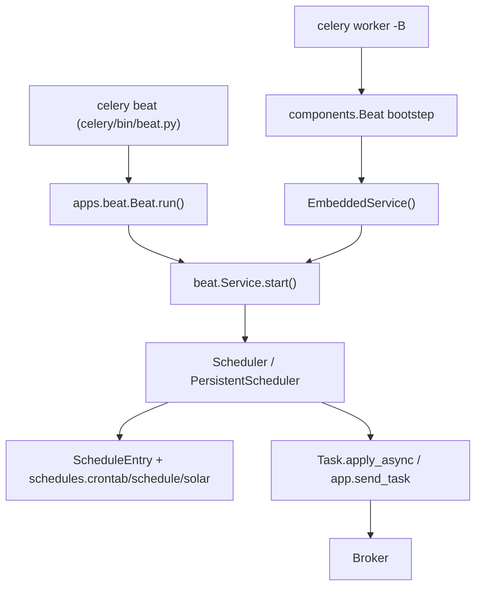
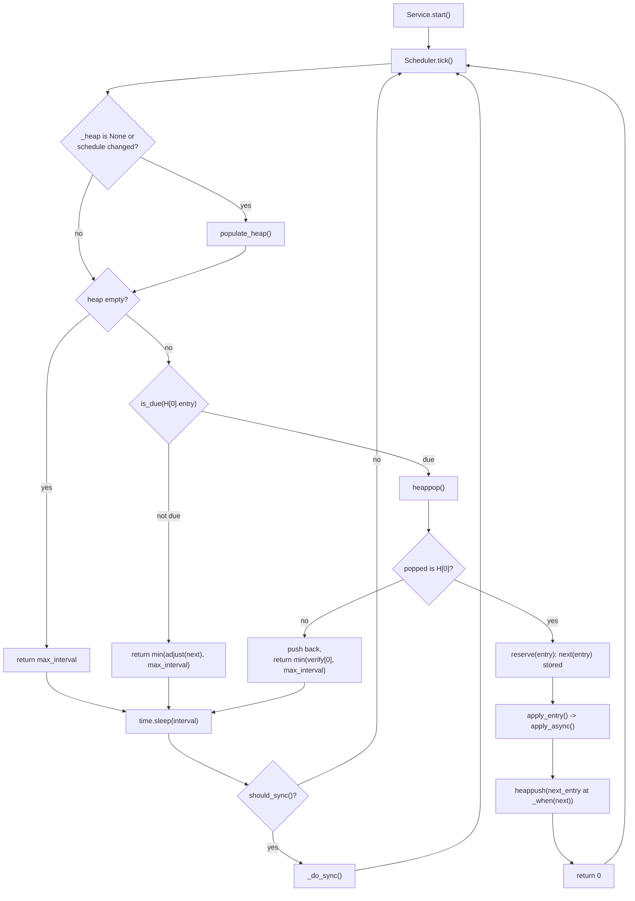

## Overview

Celery beat is the clock of a Celery deployment: a single long-running process that wakes up, checks which periodic entries are due, and publishes them as ordinary task messages for workers to consume. Beat never executes task bodies itself, so the workers, routing and result backends described in [[Calling Tasks and Message Protocol]] and [[Task Routing and Queues]] apply unchanged to scheduled tasks.

Sources: [celery/beat.py:1-43](repo://celery/beat.py#L1-L43)

The implementation is split in three layers. `celery.schedules` defines *when* something runs (`schedule`, `crontab`, `solar`). `celery.beat` defines the scheduler loop (`ScheduleEntry`, `Scheduler`, `PersistentScheduler`, `Service`, `EmbeddedService`). `celery.apps.beat.Beat` and the `celery beat` click command wrap the service as a program with logging, a pidfile and signal handlers.

Sources: [celery/schedules.py:65-110](repo://celery/schedules.py#L65-L110), [celery/beat.py:32-35](repo://celery/beat.py#L32-L35), [celery/apps/beat.py:1-24](repo://celery/apps/beat.py#L1-L24)



Sources: [celery/bin/beat.py:47-72](repo://celery/bin/beat.py#L47-L72), [celery/apps/beat.py:78-118](repo://celery/apps/beat.py#L78-L118), [celery/worker/components.py:181-205](repo://celery/worker/components.py#L181-L205), [celery/beat.py:612-680](repo://celery/beat.py#L612-L680)

## Defining the schedule

The schedule lives in the `beat_schedule` setting, a dict mapping an entry name to a dict of `ScheduleEntry` keyword arguments: `task` (registered task name), `schedule`, and optionally `args`, `kwargs`, `options` (passed to `apply_async`) and `relative`. The scheduler turns each value into an entry with `self.Entry(**dict(b[key], name=key, app=self.app))`, so any other key raises a `TypeError` at startup.

Sources: [celery/beat.py:117-128](repo://celery/beat.py#L117-L128), [celery/beat.py:458-472](repo://celery/beat.py#L458-L472), [celery/app/defaults.py:73-82](repo://celery/app/defaults.py#L73-L82)

An illustrative configuration using all three value styles accepted by `maybe_schedule` (number of seconds, `timedelta`, schedule object):

Sources: [celery/schedules.py:703-714](repo://celery/schedules.py#L703-L714)

```python
from datetime import timedelta
from celery.schedules import crontab

app.conf.beat_schedule = {
    'cleanup-every-30s': {'task': 'proj.tasks.cleanup', 'schedule': 30.0},
    'report-hourly': {'task': 'proj.tasks.report', 'schedule': timedelta(hours=1),
                      'options': {'queue': 'reports'}},
    'digest-monday-morning': {'task': 'proj.tasks.digest',
                              'schedule': crontab(hour=7, minute=30, day_of_week='mon'),
                              'args': (16, 16)},
}
```

Sources: [celery/beat.py:117-128](repo://celery/beat.py#L117-L128), [celery/beat.py:458-472](repo://celery/beat.py#L458-L472)

`app.add_periodic_task(schedule, sig, ...)` is the programmatic alternative. It converts the signature into the same entry dict (`schedule`, `task`, `args`, `kwargs`, `options`), keyed by `name` or by `repr(sig)`. If the app is not configured yet, the entry is queued in `_pending_periodic_tasks` and flushed into `conf.beat_schedule` when the configuration is first loaded. Adding an unnamed signature whose key already exists logs a "shadowed a previous unnamed periodic task" warning.

Sources: [celery/app/base.py:1273-1277](repo://celery/app/base.py#L1273-L1277), [celery/app/base.py:1295-1333](repo://celery/app/base.py#L1295-L1333)

Arguments that must be computed at send time can be wrapped in `BeatLazyFunc(func, *args, **kwargs)`. Before every send, `_evaluate_entry_args` and `_evaluate_entry_kwargs` call each `BeatLazyFunc` value and pass the result instead, so a value such as the current time is fresh on every run.

Sources: [celery/beat.py:50-78](repo://celery/beat.py#L50-L78), [celery/beat.py:201-216](repo://celery/beat.py#L201-L216)

## Schedule types

### schedule: fixed intervals

`schedule(run_every, relative=False)` stores `run_every` as a `timedelta`. `remaining_estimate()` delegates to `celery.utils.time.remaining`, comparing the timezone-aware `last_run_at` with `now()`. `is_due()` returns a `schedstate(is_due, next)` named tuple: when no time remains it returns `(True, self.seconds)`, otherwise `(False, remaining_s)`. The `next` value is a hint for how long beat may sleep, not a promise; `beat_max_loop_interval` caps it.

Sources: [celery/schedules.py:24-24](repo://celery/schedules.py#L24-L24), [celery/schedules.py:111-193](repo://celery/schedules.py#L111-L193)

All schedules inherit from `BaseSchedule`, which resolves `now()` through an optional `nowfun` or `app.now`, takes the timezone from `app.timezone`, and converts naive datetimes with `maybe_make_aware`. When `enable_utc` is off, `to_local()` falls back to the local timezone.

Sources: [celery/schedules.py:65-108](repo://celery/schedules.py#L65-L108)

### crontab and crontab_parser

`crontab(minute, hour, day_of_week, day_of_month, month_of_year)` expands every field into a set of integers once, in `__init__`, via `_expand_cronspec`. An `int` becomes a one-element set, a `str` is parsed by `crontab_parser(max_, min_)`, and a `set` or other iterable is used as-is. Every value is then checked against the range, raising `ValueError` with `CRON_PATTERN_INVALID` when out of bounds. `crontab.from_string('m h dom mon dow')` splits a classic five-field cron string.

Sources: [celery/schedules.py:401-478](repo://celery/schedules.py#L401-L478)

`crontab_parser.parse()` splits the spec on commas and tries four regexes in order: `range/step` (`1-30/2`), `range` (`9-17`), `*/step`, and a bare `*`. Anything else is a single number. `_expand_number` accepts integers, month names (`yearmonth`) and weekday names (`weekday`), and rejects negative numbers. A range whose end is lower than its start wraps around `max_`.

Sources: [celery/schedules.py:244-320](repo://celery/schedules.py#L244-L320)

| Field | `max_` | `min_` | Example |
| --- | --- | --- | --- |
| `minute` | 60 | 0 | `'*/15'`, `'1,13,30-45,50-59/2'` |
| `hour` | 24 | 0 | `'0,8-17/2'` |
| `day_of_week` | 7 | 0 (Sunday) | `'mon-fri'` |
| `day_of_month` | 31 | 1 | `'1-7,15-21'` |
| `month_of_year` | 12 | 1 | `'*/3'` |

Sources: [celery/schedules.py:337-413](repo://celery/schedules.py#L337-L413)

`remaining_delta()` finds the next fire time from `last_run_at`: the next minute in the same hour if allowed, else the next hour today, else the next allowed weekday (when both `day_of_month` and `month_of_year` are `'*'`), else `_delta_to_next()` which walks forward over days and months. `is_due()` treats zero remaining time as due. If `beat_cron_starting_deadline` is set, it walks forward to the last missed run and refuses to fire when that run is older than the deadline, which stops a beat that was down for hours from firing a stale cron run on restart.

Sources: [celery/schedules.py:572-639](repo://celery/schedules.py#L572-L639), [celery/schedules.py:641-688](repo://celery/schedules.py#L641-L688)

> [!WARNING]
> `day_of_week='*/2'` means "days whose number is divisible by two", not "every other day", and a day only matches when it satisfies all three of `day_of_week`, `day_of_month` and `month_of_year`.

Sources: [celery/schedules.py:354-398](repo://celery/schedules.py#L354-L398)

### solar

`solar(event, lat, lon)` fires on astronomical events (`sunrise`, `sunset`, `solar_noon`, the civil, nautical and astronomical dawn and dusk variants). It imports the optional `ephem` package in `__init__`, validates the event name and coordinates, and builds an `ephem.Observer` whose horizon depends on the event. `remaining_estimate()` calls `next_rising`, `next_setting` or `next_transit` from `last_run_at`. On a `CircumpolarError` (the sun never rises or sets that day) it checks again after the next anti-transit.

Sources: [celery/schedules.py:717-819](repo://celery/schedules.py#L717-L819), [celery/schedules.py:820-878](repo://celery/schedules.py#L820-L878)

### maybe_schedule

`maybe_schedule(s, relative, app)` is the coercion used by every entry: numbers become `timedelta(seconds=s)`, a `timedelta` becomes `schedule(s, relative, app=app)`, and a schedule object only gets its `app` attribute bound.

Sources: [celery/schedules.py:703-714](repo://celery/schedules.py#L703-L714)

## ScheduleEntry

`ScheduleEntry` holds `name`, `task`, `schedule`, `args`, `kwargs`, `options`, `last_run_at` and `total_run_count`. `last_run_at` defaults to `schedule.now()`, so a new interval entry first fires one interval after beat starts. `next(entry)` (`_next_instance`) returns a fresh copy with `last_run_at` set to now and the count incremented. The scheduler stores that copy back, which keeps entries immutable from the heap's point of view.

Sources: [celery/beat.py:81-141](repo://celery/beat.py#L81-L141)

Equality and `update()` only consider the editable fields `task`, `schedule`, `args`, `kwargs` and `options`. `merge_inplace` therefore keeps `last_run_at` and `total_run_count` from the persisted entry while picking up configuration changes. `__lt__` compares by `id()` because heap order is decided by the `(time, priority)` prefix of `event_t`. `__reduce__` makes entries picklable for the shelve store.

Sources: [celery/beat.py:143-198](repo://celery/beat.py#L143-L198), [celery/beat.py:37-37](repo://celery/beat.py#L37-L37)

## The tick loop

`Service.start()` sends the `beat_init` signal and then loops until `_is_shutdown` is set: it calls `scheduler.tick()`, sleeps for the returned interval, and syncs when `should_sync()` says so. `KeyboardInterrupt` and `SystemExit` end the loop, and `finally` always calls `sync()`, which closes the scheduler and sets `_is_stopped`.

Sources: [celery/beat.py:633-664](repo://celery/beat.py#L633-L664)

`Scheduler.tick()` sends at most one task per call. It keeps a min-heap of `event_t(time, priority, entry)` tuples. When the heap is missing, or `schedules_equal()` finds that the schedule changed since the last copy, `populate_heap()` rebuilds it, using `0` as the delay for entries that are already due. `_when()` converts "seconds from now" into an absolute UTC timestamp, and `adjust()` subtracts 10 ms so beat wakes slightly early.

Sources: [celery/beat.py:292-364](repo://celery/beat.py#L292-L364), [celery/beat.py:366-379](repo://celery/beat.py#L366-L379)



Sources: [celery/beat.py:326-364](repo://celery/beat.py#L326-L364), [celery/beat.py:643-655](repo://celery/beat.py#L643-L655)

`apply_entry()` logs "Scheduler: Sending due task" and calls `apply_async(entry, producer, advance=False)`; the entry has already been advanced by `reserve()`. `apply_async()` evaluates lazy arguments, then uses `task.apply_async(...)` when the task is registered in this process, or `app.send_task(entry.task, ...)` when it is not, so an entry can name a task that only the workers define. Any exception is re-raised as `SchedulingError`, which `apply_entry()` logs as "Message Error" without stopping the loop.

Sources: [celery/beat.py:279-290](repo://celery/beat.py#L279-L290), [celery/beat.py:389-421](repo://celery/beat.py#L389-L421)

The producer is a cached `self.Producer(self._ensure_connected(), auto_declare=False)` built on `app.connection_for_write()`. `_ensure_connected()` retries with `broker_connection_max_retries`, logging "beat: Connection error" before each retry.

Sources: [celery/beat.py:474-498](repo://celery/beat.py#L474-L498)

## Persistence and syncing

The base `Scheduler` keeps the schedule in a plain dict (`self.data`), and its `sync()` does nothing. `setup_schedule()` installs default entries and merges `beat_schedule`. `install_default_entries()` adds `celery.backend_cleanup` at 04:00 daily, via `crontab('0', '4', '*')`, when `result_expires` is set and the result backend does not support auto-expiry.

Sources: [celery/beat.py:252-277](repo://celery/beat.py#L252-L277), [celery/beat.py:423-439](repo://celery/beat.py#L423-L439)

Syncing is driven by two triggers in `should_sync()`: more than `sync_every` seconds (180) since the last sync, or `sync_every_tasks` (the `beat_sync_every` setting) tasks sent since then. `apply_async()` increments `_tasks_since_sync` in its `finally` block, so failed sends also count.

Sources: [celery/beat.py:241-248](repo://celery/beat.py#L241-L248), [celery/beat.py:381-387](repo://celery/beat.py#L381-L387), [celery/beat.py:415-433](repo://celery/beat.py#L415-L433)

`PersistentScheduler`, the default `beat_scheduler`, stores entries in a `shelve` database at `schedule_filename` (`celerybeat-schedule` by default, opened with `writeback=True`). This is how `last_run_at` survives restarts. Its `setup_schedule()`:
1. Opens the shelf and reads its keys. Any exception counts as corruption: `_destroy_open_corrupted_schedule()` deletes every file with a `known_suffixes` suffix (`''`, `.db`, `.dat`, `.bak`, `.dir`) and reopens it.
2. `_create_schedule()` creates the `entries` key, or clears the store if `__version__`, `tz` or `utc_enabled` is missing (an old-format database).
3. Clears the store when the stored `tz` or `utc_enabled` differs from the current `timezone`/`enable_utc`, because stored timestamps would be misinterpreted.
4. Merges `beat_schedule`, installs default entries, writes the metadata keys, and calls `sync()`.

Sources: [celery/beat.py:505-609](repo://celery/beat.py#L505-L609)

> [!NOTE]
> `merge_inplace()` removes every stored key that is not in `beat_schedule` (`A ^ B`). Entries added only at runtime through `Scheduler.add()` are therefore dropped on the next restart unless they are also in the configuration.

Sources: [celery/beat.py:441-472](repo://celery/beat.py#L441-L472)

## Running beat

### The celery beat command

`celery beat` is a `CeleryDaemonCommand`, so it gets `--logfile`, `--pidfile`, `--uid`, `--gid`, `--umask` and `--executable` in addition to its own options. Extra `key=value` arguments are applied with `app.config_from_cmdline`. Without `--detach` it drops privileges in place. With `--detach` it runs `app.Beat(...).run()` inside `platforms.detached(...)` (see [[Daemonization and Platform Support]]).

Sources: [celery/bin/beat.py:10-72](repo://celery/bin/beat.py#L10-L72), [celery/bin/base.py:214-227](repo://celery/bin/base.py#L214-L227)

| Option | Default | Effect |
| --- | --- | --- |
| `--detach` | off | Daemonize via `detached()` |
| `-s`, `--schedule` | `beat_schedule_filename` | Path of the shelve database |
| `-S`, `--scheduler` | `beat_scheduler` | Scheduler class or alias |
| `--max-interval` | `beat_max_loop_interval` | Maximum sleep between ticks |
| `-l`, `--loglevel` | `WARNING` | Log level |

Sources: [celery/bin/beat.py:13-44](repo://celery/bin/beat.py#L13-L44)

### apps.beat.Beat

`Beat.__init__` resolves the schedule filename, scheduler class and stdout redirection through `app.either(setting, value)`, so command-line values win over configuration. `run()` prints the banner line, calls `init_loader()` (`loader.init_worker()` and `app.finalize()`, which imports task modules), sets the process title to `celery beat`, and then `start_scheduler()`.

Sources: [celery/apps/beat.py:46-91](repo://celery/apps/beat.py#L46-L91), [celery/apps/beat.py:129-153](repo://celery/apps/beat.py#L129-L153)

`start_scheduler()` takes the pidfile lock with `platforms.create_pidlock`, builds the `Service`, prints the startup banner (`startup_info()` builds a scheduler with `lazy=True` just to print its class, `info` and `max_interval`), sets up logging and the default socket timeout, installs a `SIGTERM`/`SIGINT` handler that calls `service.sync()` and raises `SystemExit`, and starts the service. Unhandled exceptions are logged as critical and re-raised.

Sources: [celery/apps/beat.py:93-118](repo://celery/apps/beat.py#L93-L118), [celery/apps/beat.py:135-160](repo://celery/apps/beat.py#L135-L160)

### Embedded beat (worker -B)

`celery worker -B` enables the conditional `Beat` bootstep in the worker blueprint. Its `create()` refuses eventlet and gevent pools with `ERR_B_GREEN`, then builds `EmbeddedService(app, schedule_filename=..., scheduler_cls=...)`. The `-B` option type `CeleryBeat` rejects the flag on Windows.

Sources: [celery/worker/components.py:20-23](repo://celery/worker/components.py#L20-L23), [celery/worker/components.py:181-205](repo://celery/worker/components.py#L181-L205), [celery/bin/worker.py:22-32](repo://celery/bin/worker.py#L22-L32), [celery/bin/worker.py:289-304](repo://celery/bin/worker.py#L289-L304)

`EmbeddedService()` returns a `_Process` (a billiard `Process`) by default. Its `run()` resets signals, closes inherited file descriptors except stdio and logger files, makes the app current, and starts the service with `embedded_process=True`. That sends `beat_embedded_init` and sets the title `celery beat`. With `thread=True`, or when multiprocessing is unavailable, it returns a daemon `_Threaded` thread with `max_interval=1`, so `stop()` is noticed within about a second.

Sources: [celery/beat.py:682-738](repo://celery/beat.py#L682-L738), [celery/beat.py:638-641](repo://celery/beat.py#L638-L641)

> [!WARNING]
> Only one beat may run per schedule. Every `-B` worker runs its own scheduler, and nothing coordinates between them, so starting several workers with `-B` sends each periodic task several times.

Sources: [celery/worker/components.py:190-205](repo://celery/worker/components.py#L190-L205)

## Configuration

| Setting | Default | Used by |
| --- | --- | --- |
| `beat_schedule` | `{}` | `Scheduler.setup_schedule()` / `merge_inplace()` |
| `beat_scheduler` | `celery.beat:PersistentScheduler` | `Beat`, `celery beat -S`, worker `--scheduler` |
| `beat_schedule_filename` | `celerybeat-schedule` | `Service`, `PersistentScheduler` |
| `beat_max_loop_interval` | `0` (falls back to `DEFAULT_MAX_INTERVAL` = 300 s) | `Scheduler.max_interval` |
| `beat_sync_every` | `0` | `Scheduler.sync_every_tasks` |
| `beat_cron_starting_deadline` | `None` | `crontab.is_due()` |

Sources: [celery/app/defaults.py:73-82](repo://celery/app/defaults.py#L73-L82), [celery/beat.py:43-43](repo://celery/beat.py#L43-L43), [celery/beat.py:252-266](repo://celery/beat.py#L252-L266)

## Custom schedulers

`Service.get_scheduler()` resolves `scheduler_cls` with `symbol_by_name`, using aliases loaded from the `celery.beat_schedulers` entry-point namespace. A package can therefore register a short name such as `django` and users can pass `-S django`. Subclasses usually override `setup_schedule()`, `get_schedule()`/`set_schedule()` (the `schedule` property), `sync()` and `info`. The constructor must stay side-effect free when `lazy=True`, because beat builds a lazy instance only to print the banner.

Sources: [celery/beat.py:219-266](repo://celery/beat.py#L219-L266), [celery/beat.py:485-502](repo://celery/beat.py#L485-L502), [celery/beat.py:666-679](repo://celery/beat.py#L666-L679)

Custom schedule types subclass `BaseSchedule` and implement `is_due(last_run_at)` returning `schedstate(is_due, next)`, plus `remaining_estimate()`. They should define `__eq__` (used by `schedules_equal()` to detect changes) and `__reduce__` (used to pickle entries into the shelve store).

Sources: [celery/schedules.py:65-108](repo://celery/schedules.py#L65-L108), [celery/schedules.py:175-189](repo://celery/schedules.py#L175-L189)
