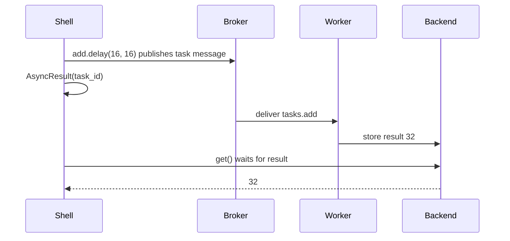

## Overview

This page takes you from an empty virtualenv to a task that runs on a worker and returns its result. It uses the same pieces as the repository's own examples: `examples/tutorial/tasks.py` (the minimal app) and `examples/app/myapp.py` (an app with a broker URL, extra settings and a commented-out result backend). For what each component does, read [[Overview]]; for the app object itself, read [[The Celery Application]].

Sources: [examples/tutorial/tasks.py:1-12](repo://examples/tutorial/tasks.py#L1-L12), [examples/app/myapp.py:1-45](repo://examples/app/myapp.py#L1-L45)

## Install Celery

### Core package

Celery is on PyPI. `pip install -U Celery` installs the core package with its required dependencies, which `setup.py` reads from `requirements/default.txt`: `billiard`, `kombu`, `vine`, `click` (with `click-didyoumean`, `click-repl`, `click-plugins`), `python-dateutil` and `tzlocal`. Python 3.10 or newer is required by `python_requires`.

Sources: [README.rst:301-312](repo://README.rst#L301-L312), [setup.py:118-120](repo://setup.py#L118-L120), [setup.py:150-151](repo://setup.py#L150-L151), [requirements/default.txt:1-10](repo://requirements/default.txt#L1-L10)

```bash
pip install -U Celery
```

Sources: [README.rst:307-312](repo://README.rst#L307-L312)

### Extras (bundles)

Optional transports, result backends, serializers and pools are installed as extras in brackets, several separated by commas. Each name listed in `EXTENSIONS` in `setup.py` becomes an extra whose requirements come from `requirements/extras/<name>.txt`, so `celery[redis]` pulls in `kombu[redis]` and `celery[sqs]` pulls in `boto3`, `pycurl`, `urllib3` and `kombu[sqs]`.

Sources: [README.rst:316-331](repo://README.rst#L316-L331), [setup.py:12-47](repo://setup.py#L12-L47), [setup.py:113-125](repo://setup.py#L113-L125), [requirements/extras/redis.txt:1-1](repo://requirements/extras/redis.txt#L1-L1), [requirements/extras/sqs.txt:1-5](repo://requirements/extras/sqs.txt#L1-L5)

```bash
pip install "celery[redis]"
pip install "celery[redis,auth,msgpack]"
```

Sources: [README.rst:326-331](repo://README.rst#L326-L331)

| Group | Extras |
| --- | --- |
| Serializers | `auth`, `msgpack`, `yaml` |
| Concurrency pools | `eventlet`, `gevent` |
| Brokers | `redis`, `sqs`, `gcpubsub`, `zookeeper`, `librabbitmq`, `pyro`, `slmq`, `consul` |
| Result backends | `redis`, `sqlalchemy`, `memcache`, `pymemcache`, `mongodb`, `cassandra`, `elasticsearch`, `couchbase`, `couchdb`, `arangodb`, `dynamodb`, `azureblockblob`, `cosmosdbsql`, `s3`, `gcs`, `consul` |
| Compression and other | `brotli`, `zstd`, `tblib` (for `task_remote_tracebacks`), `pydantic`, `pytest`, `django`, `solar` |

Sources: [setup.py:12-47](repo://setup.py#L12-L47), [README.rst:333-426](repo://README.rst#L333-L426)

> [!NOTE]
> The README also lists `celery[amqp]` and `celery[riak]`, but neither name is in `EXTENSIONS`, so pip will warn that the extra does not exist. The default AMQP transport ships with `kombu` and needs no extra.

Sources: [README.rst:359-360](repo://README.rst#L359-L360), [README.rst:398-399](repo://README.rst#L398-L399), [setup.py:12-47](repo://setup.py#L12-L47)

## Run a broker

Celery needs a message broker. The examples here use RabbitMQ at `amqp://guest@localhost//`; Redis works the same way with a `redis://localhost:6379/0` URL once `celery[redis]` is installed. RabbitMQ and Redis are the feature-complete transports, and others (SQS, Google Pub/Sub, SQLite for local development) are also supported.

Sources: [README.rst:147-150](repo://README.rst#L147-L150), [README.rst:221-223](repo://README.rst#L221-L223), [examples/app/myapp.py:13-22](repo://examples/app/myapp.py#L13-L22)

## Define an app and a task

Create `tasks.py`. The first argument to `Celery` is the main module name, used as the prefix for generated task names; `broker` becomes the `broker_url` setting. `@app.task` turns the function into a task class registered under the name `tasks.add`.

Sources: [examples/tutorial/tasks.py:1-12](repo://examples/tutorial/tasks.py#L1-L12), [celery/app/base.py:252-265](repo://celery/app/base.py#L252-L265), [celery/app/base.py:394-398](repo://celery/app/base.py#L394-L398)

```python
from celery import Celery

app = Celery('tasks', broker='amqp://')


@app.task()
def add(x, y):
    return x + y


if __name__ == '__main__':
    app.start()
```

Sources: [examples/tutorial/tasks.py:1-12](repo://examples/tutorial/tasks.py#L1-L12)

To get return values back you also need a result backend. `examples/app/myapp.py` shows where it goes (`backend='rpc'`, commented out) and that any setting can be passed as a keyword argument, here `task_acks_late=True`. Unknown keyword arguments to `Celery()` are stored as pre-configuration via `__autoset`, exactly like `broker` and `backend`.

Sources: [examples/app/myapp.py:25-41](repo://examples/app/myapp.py#L25-L41), [celery/app/base.py:394-401](repo://celery/app/base.py#L394-L401), [celery/app/base.py:447-450](repo://celery/app/base.py#L447-L450)

```python
from time import sleep

from celery import Celery

app = Celery(
    'myapp',
    broker='amqp://guest@localhost//',
    # ## add result backend here if needed.
    # backend='rpc'
    task_acks_late=True
)


@app.task
def add(x, y):
    sleep(10)
    return x + y
```

Sources: [examples/app/myapp.py:25-41](repo://examples/app/myapp.py#L25-L41)

The `backend` value is resolved by `celery.app.backends.by_url`: `rpc` sends results back over the broker as messages, `redis://...` uses Redis, `db+postgresql://...` uses SQLAlchemy. See [[Result Backends]].

Sources: [celery/app/backends.py:15-38](repo://celery/app/backends.py#L15-L38), [celery/app/backends.py:59-69](repo://celery/app/backends.py#L59-L69)

## Start a worker

Start a worker with the `celery` command, pointing `-A` / `--app` at the module that holds the app. `-A` is a global option and must come before the subcommand: Celery 5 prints a dedicated error if you write `celery worker -A ...`.

Sources: [celery/bin/celery.py:57-66](repo://celery/bin/celery.py#L57-L66), [celery/bin/celery.py:197-217](repo://celery/bin/celery.py#L197-L217)

```bash
celery -A tasks worker -l INFO
```

Sources: [examples/app/myapp.py:13-22](repo://examples/app/myapp.py#L13-L22)

`find_app` decides which object `-A` names. With `module:attr` it uses that attribute. With a bare module name it tries `module.app`, then `module.celery`, then (for a package) the submodule `module.celery`, and finally any `Celery` instance found in the module's namespace.

Sources: [celery/app/utils.py:378-415](repo://celery/app/utils.py#L378-L415)

The script form works too, because `app.start()` runs the `celery` command with this app as the default for `--app`: `python myapp.py worker -l INFO`.

Sources: [examples/app/myapp.py:1-5](repo://examples/app/myapp.py#L1-L5), [celery/app/base.py:480-497](repo://celery/app/base.py#L480-L497)

Common worker options:

Sources: [celery/bin/worker.py:138-215](repo://celery/bin/worker.py#L138-L215)

| Option | Default | Effect |
| --- | --- | --- |
| `-l`, `--loglevel` | `WARNING` | Logging level. See [[Logging]]. |
| `-c`, `--concurrency` | `worker_concurrency` (CPU count) | Number of pool processes or threads. |
| `-P`, `--pool` | `prefork` | Pool implementation: `prefork`, `threads`, `solo`, `eventlet`, `gevent`. See [[Concurrency Pools and Autoscaling]]. |
| `-n`, `--hostname` | `celery@%h` style node name | Custom node name, expands `%h`, `%n`, `%d`. |
| `-E`, `--task-events` | off | Send task events for monitors. See [[Events and Monitoring]]. |
| `-Q`, `--queues` | all configured queues | Consume only from these queues. See [[Task Routing and Queues]]. |
| `-B`, `--beat` | off | Embed the beat scheduler. See [[Periodic Tasks with Beat]]. |
| `-D`, `--detach` | off | Run in the background. See [[Daemonization and Platform Support]]. |

Sources: [celery/bin/worker.py:138-215](repo://celery/bin/worker.py#L138-L215), [celery/bin/worker.py:254-258](repo://celery/bin/worker.py#L254-L258), [celery/bin/worker.py:289-294](repo://celery/bin/worker.py#L289-L294)

Global options such as `-b/--broker`, `--result-backend`, `--config` and `--loader` are turned into the environment variables `CELERY_BROKER_URL`, `CELERY_RESULT_BACKEND`, `CELERY_CONFIG_MODULE` and `CELERY_LOADER` before the app is loaded, so they override what the code sets. The full list is in [[Command Line Interface]].

Sources: [celery/bin/celery.py:67-83](repo://celery/bin/celery.py#L67-L83), [celery/bin/celery.py:123-133](repo://celery/bin/celery.py#L123-L133)

## Call the task and fetch the result

From another shell, import the task and call it. `delay()` returns an `AsyncResult` at once; `get()` blocks until the worker has stored the return value in the result backend.

Sources: [examples/app/myapp.py:5-10](repo://examples/app/myapp.py#L5-L10), [celery/app/task.py:523-534](repo://celery/app/task.py#L523-L534)

```python
>>> from myapp import add
>>> add.delay(16, 16).get()
32
```

Sources: [examples/app/myapp.py:7-10](repo://examples/app/myapp.py#L7-L10)



Sources: [celery/app/task.py:682-708](repo://celery/app/task.py#L682-L708), [celery/app/base.py:1007-1041](repo://celery/app/base.py#L1007-L1041), [celery/result.py:243-262](repo://celery/result.py#L243-L262)

Without a configured backend the app uses the `disabled` alias (`DisabledBackend`), so `get()` cannot return a value. Configure `backend=` (or the `result_backend` setting) before calling `get()`. See [[Task Results]].

Sources: [celery/app/backends.py:41-56](repo://celery/app/backends.py#L41-L56), [celery/app/base.py:1224-1228](repo://celery/app/base.py#L1224-L1228)

You can do the same from the command line, with no Python client. `celery call` publishes by name through `app.send_task` and prints the task id. `celery result` prints the return value, or the traceback with `--traceback`.

Sources: [celery/bin/call.py:8-71](repo://celery/bin/call.py#L8-L71), [celery/bin/result.py:7-30](repo://celery/bin/result.py#L7-L30)

```bash
celery -A myapp call myapp.add -a '[16, 16]'
celery -A myapp result <task-id>
```

Sources: [celery/bin/call.py:9-23](repo://celery/bin/call.py#L9-L23), [celery/bin/result.py:8-13](repo://celery/bin/result.py#L8-L13)

> [!TIP]
> To debug a task without a worker, set `task_always_eager = True`: `apply_async` then runs the task in-process through `Task.apply` after a serialization round-trip, so arguments that cannot be serialized still fail. Use this only in tests. See [[Testing Celery Applications]].

Sources: [celery/app/task.py:682-701](repo://celery/app/task.py#L682-L701)

## Next steps

- [[Configuration]]: move settings into a `celeryconfig` module with `app.config_from_object`.
- [[Defining Tasks]] and [[Calling Tasks and Message Protocol]]: task options, retries, `apply_async` arguments.
- [[Canvas: Signatures and Workflows]]: compose tasks with `chain`, `group` and `chord`.
- [[Django Integration]]: wiring Celery into a Django project.

Sources: [celery/app/base.py:703-725](repo://celery/app/base.py#L703-L725)
