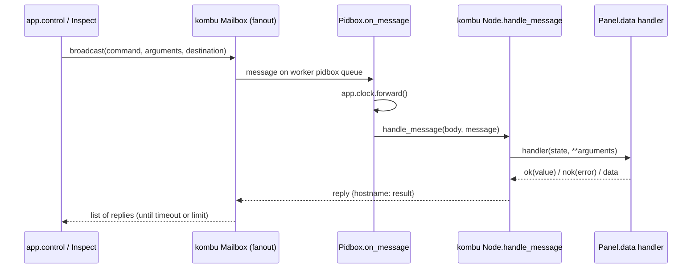

## Overview

Remote control lets a client talk to running workers without restarting them: ask what they are executing, revoke tasks, change rate and time limits, grow or shrink the pool, start or stop consuming from queues, or shut them down. The client half lives in `celery.app.control` and splits commands into two families: `Inspect` commands only read worker state, while `Control` commands have side effects.

Sources: [celery/app/control.py:1-27](repo://celery/app/control.py#L1-L27)

The server half is the `Control` bootstep of the worker's consumer, which wraps a `Pidbox` (a kombu pidbox `Node`) and dispatches each incoming command to a handler registered in the `Panel` registry of `celery.worker.control`. Every application exposes the client as the cached property `app.control`, an instance of `control_cls` (`celery.app.control:Control` by default). The `celery inspect`, `celery control` and `celery status` commands are thin wrappers over this client. The bootstep's place in the consumer is described in [[Consumer and Message Handling]].

Sources: [celery/worker/consumer/control.py:1-33](repo://celery/worker/consumer/control.py#L1-L33), [celery/app/base.py:1576-1580](repo://celery/app/base.py#L1576-L1580), [celery/app/base.py:316-316](repo://celery/app/base.py#L316-L316)

## Message Flow

Commands travel over a fanout exchange (the `control_exchange` setting, `celery` by default) through a kombu `Mailbox`. `Control.broadcast` publishes the command name, its arguments and an optional destination list; every worker's pidbox queue is bound to the exchange, so each worker receives the message and the kombu `Node` decides whether it is addressed to it. When `reply=True`, the client waits on a reply queue until `timeout` expires or `limit` replies arrive, calling `callback` for each reply as it lands.

Sources: [celery/app/control.py:426-452](repo://celery/app/control.py#L426-L452), [celery/app/control.py:755-790](repo://celery/app/control.py#L755-L790)



Sources: [celery/app/control.py:755-790](repo://celery/app/control.py#L755-L790), [celery/worker/pidbox.py:20-49](repo://celery/worker/pidbox.py#L20-L49), [celery/worker/control.py:31-66](repo://celery/worker/control.py#L31-L66)

Replies come back as a list of single-key dictionaries, one per node. `Inspect._prepare` runs them through `flatten_reply`, which merges them into one `{hostname: reply}` dictionary and emits a `DuplicateNodenameWarning` when two workers answer with the same node name. If `Inspect` was created with a single destination (not a list), `_prepare` returns only that node's reply; if a `pattern` was given, it filters nodes with `kombu.matcher.match`.

Sources: [celery/app/control.py:38-63](repo://celery/app/control.py#L38-L63), [celery/app/control.py:94-117](repo://celery/app/control.py#L94-L117)

## Client API

### Control methods

`Control` methods are thin helpers that build the argument dictionary and call `broadcast`. Most of them do not wait for replies unless the caller passes `reply=True` through `**kwargs`; `ping` sets `reply=True` itself.

Sources: [celery/app/control.py:488-510](repo://celery/app/control.py#L488-L510), [celery/app/control.py:560-576](repo://celery/app/control.py#L560-L576)

| Method | Command sent | Arguments |
| --- | --- | --- |
| `revoke(task_id, terminate=False, signal='SIGTERM')` | `revoke` | `task_id`, `terminate`, `signal` |
| `revoke_by_stamped_headers(headers, ...)` | `revoke_by_stamped_headers` | `headers`, `terminate`, `signal` |
| `terminate(task_id, signal=...)` | `revoke` | shortcut for `revoke(..., terminate=True)` |
| `ping(timeout=1.0)` | `ping` | none, `reply=True` |
| `rate_limit(task_name, rate_limit)` | `rate_limit` | `task_name`, `rate_limit` |
| `time_limit(task_name, soft, hard)` | `time_limit` | `task_name`, `soft`, `hard` |
| `add_consumer(queue, exchange, exchange_type='direct', routing_key, options)` | `add_consumer` | queue declaration plus `options` merged in |
| `cancel_consumer(queue)` | `cancel_consumer` | `queue` |
| `enable_events()` / `disable_events()` | `enable_events` / `disable_events` | none |
| `pool_grow(n=1)` / `pool_shrink(n=1)` | `pool_grow` / `pool_shrink` | `n` |
| `autoscale(max, min)` | `autoscale` | `max`, `min` |
| `pool_restart(modules, reload, reloader)` | `pool_restart` | `modules`, `reload`, `reloader` |
| `heartbeat()` | `heartbeat` | none |
| `shutdown()` | `shutdown` | none |
| `election(id, topic, action)` | `election` | `id`, `topic`, `action` |

Sources: [celery/app/control.py:480-598](repo://celery/app/control.py#L480-L598), [celery/app/control.py:600-700](repo://celery/app/control.py#L600-L700), [celery/app/control.py:700-753](repo://celery/app/control.py#L700-L753)

`purge` (alias `discard_all`) is the one method that does not broadcast: it acquires a connection and calls `app.amqp.TaskConsumer(conn).purge()` to delete every waiting task message from the task queues, returning the number discarded.

Sources: [celery/app/control.py:462-478](repo://celery/app/control.py#L462-L478)

### Inspect

`app.control.inspect` is a cached property that returns the `Inspect` class bound to the app through `subclass_with_self`, so `app.control.inspect(destination=[...], timeout=2.0)` creates a configured instance. Every query method funnels into `_request`, which calls `broadcast` with `reply=True` and the instance's `destination`, `timeout`, `callback`, `connection`, `limit`, `pattern` and `matcher`.

Sources: [celery/app/control.py:73-117](repo://celery/app/control.py#L73-L117), [celery/app/control.py:457-460](repo://celery/app/control.py#L457-L460)

```python
    def _request(self, command, **kwargs):
        return self._prepare(self.app.control.broadcast(
            command,
            arguments=kwargs,
            destination=self.destination,
            callback=self.callback,
            connection=self.connection,
            limit=self.limit,
            timeout=self.timeout, reply=True,
            pattern=self.pattern, matcher=self.matcher,
        ))
```

Sources: [celery/app/control.py:107-117](repo://celery/app/control.py#L107-L117)

The query methods are `report`, `clock`, `active(safe=None)`, `scheduled`, `reserved`, `stats`, `revoked`, `registered(*taskinfoitems)`, `ping`, `active_queues`, `query_task(*ids)`, `conf(with_defaults=False)`, `hello(from_node, revoked)`, `memsample`, `memdump(samples=10)` and `objgraph(type='Request', n=200, max_depth=10)`. Each sends the inspect command of the same name, passing its arguments as keyword arguments.

Sources: [celery/app/control.py:119-180](repo://celery/app/control.py#L119-L180), [celery/app/control.py:181-297](repo://celery/app/control.py#L181-L297), [celery/app/control.py:298-360](repo://celery/app/control.py#L298-L360), [celery/app/control.py:361-423](repo://celery/app/control.py#L361-L423)

### broadcast arguments

`broadcast` merges any extra keyword arguments into `arguments`, acquires a connection with `app.connection_or_acquire`, and calls `mailbox(conn)._broadcast`. It only forwards `pattern` and `matcher` when both are set.

Sources: [celery/app/control.py:755-790](repo://celery/app/control.py#L755-L790)

| Argument | Meaning |
| --- | --- |
| `command` | Name of the command registered in `Panel` on the worker |
| `arguments` | Keyword arguments for the handler |
| `destination` | List of node names; empty means every worker |
| `connection` / `channel` | Explicit broker connection or channel; otherwise one is taken from the pool |
| `reply` | Wait for and return replies |
| `timeout` | Seconds to wait for replies (default `1.0`) |
| `limit` | Stop after this many replies |
| `callback` | Called with each reply as it arrives |
| `pattern` / `matcher` | Select destination nodes by pattern instead of exact names |

Sources: [celery/app/control.py:755-773](repo://celery/app/control.py#L755-L773)

## Worker Side

### Panel registry

`Panel` is a `UserDict` whose `data` and `meta` are class-level dictionaries shared across the process, so a handler is available as soon as the module that defines it is imported. `Panel._register` stores the function under its name (and under `alias` when given) and records a `controller_info_t` namedtuple with the command's `type` (`control` or `inspect`), `visible`, `default_timeout`, `help` (the first docstring line by default), `signature`, `args` and `variadic`. The `control_command` and `inspect_command` decorators are shorthands that fix `type`.

Sources: [celery/worker/control.py:25-74](repo://celery/worker/control.py#L25-L74)

Handlers receive a `state` object first, then the broadcast arguments as keyword arguments. They answer with `ok(value)`, which wraps the value as `{'ok': value}`, with `nok(value)`, which wraps it as `{'error': value}`, or with plain data for inspect commands such as `active` or `stats`.

Sources: [celery/worker/control.py:31-36](repo://celery/worker/control.py#L31-L36), [celery/worker/control.py:444-454](repo://celery/worker/control.py#L444-L454)

### Pidbox

`Pidbox.__init__` creates a kombu `Node` from `app.control.mailbox.Node`, named after the worker hostname, with `Panel.data` as handlers and an `AttributeDict` as the handler state. That state carries `app`, `hostname`, `consumer` (the worker's `Consumer`) and `tset`: `pass1` when the worker uses the event loop, `set` otherwise, so handlers iterating over shared request sets take a copy when other threads may mutate them.

Sources: [celery/worker/pidbox.py:20-37](repo://celery/worker/pidbox.py#L20-L37)

`start` opens a channel on the consumer's connection and calls `node.listen(callback=self.on_message)`. `on_message` first forwards the worker's logical clock (clients usually have no valid clock to merge), then calls `node.handle_message`. A `KeyError` is logged as "No such control command"; any other exception is logged and triggers `reset`, which stops and restarts the pidbox consumer on a fresh channel.

Sources: [celery/worker/pidbox.py:39-80](repo://celery/worker/pidbox.py#L39-L80)

`gPidbox` is used when the pool is green (eventlet or gevent). Its `start` spawns `loop` in the pool, which opens its own read connection with `connection_for_read`, and drains events with a one-second timeout until a shutdown `threading.Event` is set or the consumer loses its connection. `reset` only increments a counter; the loop notices it and re-creates the channel and consumer. `on_stop` sets the shutdown event and waits for the loop to acknowledge it.

Sources: [celery/worker/pidbox.py:83-126](repo://celery/worker/pidbox.py#L83-L126)

### Control bootstep

The consumer's `Control` step requires the `Tasks` step and picks `gPidbox` or `Pidbox` from `c.pool.is_green`, delegating `start`, `stop` and `shutdown` to it. `include_if` drops the step when `worker_enable_remote_control` is false or the transport does not support the `fanout` exchange type, in which case the worker never answers remote commands.

Sources: [celery/worker/consumer/control.py:18-33](repo://celery/worker/consumer/control.py#L18-L33)

## Command Reference

### Control commands

Control handlers act on `state.consumer` and its `controller` (the `WorkController`). Queue changes are scheduled with `consumer.call_soon` so they run in the consumer's own loop rather than inside the pidbox callback.

Sources: [celery/worker/control.py:540-628](repo://celery/worker/control.py#L540-L628), [celery/worker/consumer/consumer.py:257-262](repo://celery/worker/consumer/consumer.py#L257-L262)

| Command | Worker behaviour |
| --- | --- |
| `revoke` | Adds ids to `worker_state.revoked`, marks them revoked in the backend, optionally terminates matching active requests |
| `revoke_by_stamped_headers` | Appends stamps to `worker_state.revoked_stamps`; with `terminate`, terminates active requests whose `stamps` match |
| `terminate` | `revoke(..., terminate=True, signal=signal)` |
| `rate_limit` | Validates with `rate()`, sets `task.rate_limit`, calls `consumer.reset_rate_limits()` |
| `time_limit` | Sets `task.soft_time_limit` and `task.time_limit` |
| `enable_events` / `disable_events` | Adds or removes `task` from `event_dispatcher.groups` |
| `heartbeat` | Sends a `worker-heartbeat` event immediately |
| `election` | Forwards to `consumer.gossip.election` if gossip is enabled |
| `pool_grow` / `pool_shrink` | `pool.grow(n)` / `pool.shrink(n)` then `_update_prefetch_count`; refused when an autoscaler is active |
| `autoscale` | `autoscaler.update(max, min)`; raises `ValueError` without an autoscaler |
| `pool_restart` | `controller.reload(modules, reload, reloader=...)`; raises `ValueError` unless `worker_pool_restarts` is on |
| `add_consumer` / `cancel_consumer` | `consumer.add_task_queue` / `consumer.cancel_task_queue` via `call_soon` |
| `shutdown` | Logs and raises `WorkerShutdown(EX_OK)` |

Sources: [celery/worker/control.py:134-242](repo://celery/worker/control.py#L134-L242), [celery/worker/control.py:245-323](repo://celery/worker/control.py#L245-L323), [celery/worker/control.py:331-379](repo://celery/worker/control.py#L331-L379), [celery/worker/control.py:540-628](repo://celery/worker/control.py#L540-L628)

### Inspect commands

| Command (alias) | Returns |
| --- | --- |
| `report` | `app.bugreport()` |
| `conf` (`dump_conf`) | Configuration table, JSON-safe, optionally with defaults |
| `query_task` | `{id: (state, info)}` with state `active`, `reserved` or `ready` |
| `clock` | `app.clock.value` |
| `hello` (hidden) | Mingle sync data: merged `revoked` set and forwarded clock |
| `ping` | `ok('pong')` |
| `stats` | `consumer.controller.stats()` |
| `scheduled` (`dump_schedule`) | ETA/countdown requests waiting in the consumer timer |
| `reserved` (`dump_reserved`) | Reserved requests that are not yet active |
| `active` (`dump_active`) | `request.info(safe=safe)` for each active request |
| `revoked` (`dump_revoked`) | List of revoked task ids |
| `registered` (`dump_tasks`) | Task names with `exchange`, `routing_key`, `rate_limit`; built-in `celery.*` tasks excluded unless `builtins` |
| `objgraph`, `memsample`, `memdump` | Memory-leak debugging helpers |
| `active_queues` | `queue.as_dict(recurse=True)` for each queue of `consumer.task_consumer` |

Sources: [celery/worker/control.py:79-131](repo://celery/worker/control.py#L79-L131), [celery/worker/control.py:325-329](repo://celery/worker/control.py#L325-L329), [celery/worker/control.py:381-489](repo://celery/worker/control.py#L381-L489), [celery/worker/control.py:491-538](repo://celery/worker/control.py#L491-L538), [celery/worker/control.py:631-637](repo://celery/worker/control.py#L631-L637)

### Revocation

`_revoke` is shared by `revoke` and `terminate`. It adds the ids to the in-memory `worker_state.revoked` set (consulted when requests arrive or are about to run), then calls `app.backend.mark_as_revoked(task_id, reason='revoked', store_result=True)` for each id, logging but not failing when the backend raises. With `terminate`, it converts the signal name with `signals.signum` and calls `request.terminate(state.consumer.pool, signal=signum)` on each matching request found in `worker_state.requests`.

Sources: [celery/worker/control.py:214-242](repo://celery/worker/control.py#L214-L242), [celery/worker/control.py:115-121](repo://celery/worker/control.py#L115-L121)

On the client, `revoke_by_stamped_headers` collects any task ids that workers report as a set in their `ok` replies and issues a regular `revoke` for them, so terminated stamped tasks are also recorded by id. Revoked ids are held in memory only; the `hello` command lets a starting worker pull the revoked set from its peers during mingle (see [[Consumer and Message Handling]]).

Sources: [celery/app/control.py:512-546](repo://celery/app/control.py#L512-L546), [celery/worker/control.py:381-396](repo://celery/worker/control.py#L381-L396)

## Command Line

`celery status`, `celery inspect COMMAND` and `celery control COMMAND` share the options `--timeout` (default `1.0`), `--destination` (comma-separated node names) and `--json`. `inspect` and `control` also accept an eager `--list` flag that prints the visible commands of that type from `Panel.meta`, each with its `signature` and `help`.

Sources: [celery/bin/control.py:69-104](repo://celery/bin/control.py#L69-L104), [celery/bin/control.py:107-129](repo://celery/bin/control.py#L107-L129)

`_verify_command_name` rejects unknown names with a `click.UsageError` listing the valid commands. `_compile_arguments` then turns positional CLI arguments into keyword arguments: it reads `Panel.meta[command].args` (name and type pairs) and converts each value, and if the command is `variadic`, the remaining arguments are passed as a list under that name. So `celery control rate_limit tasks.add 10/m` becomes `{'task_name': 'tasks.add', 'rate_limit': '10/m'}`.

Sources: [celery/bin/control.py:26-66](repo://celery/bin/control.py#L26-L66)

`status` calls `inspect(...).ping()` and prints the node count; `inspect` calls `Inspect._request(command, **arguments)`; `control` calls `app.control.broadcast(command, reply=True, ...)`. Without `--json`, each reply is printed as it arrives through `_say_remote_command_reply`. When no node answers within the timeout, all three raise `CeleryCommandException` with exit code `EX_UNAVAILABLE`. The general CLI is covered in [[Command Line Interface]].

Sources: [celery/bin/control.py:129-208](repo://celery/bin/control.py#L129-L208), [celery/bin/control.py:211-262](repo://celery/bin/control.py#L211-L262)

## Configuration

| Setting | Default | Effect |
| --- | --- | --- |
| `control_exchange` | `'celery'` | Name of the fanout exchange used by the mailbox |
| `control_queue_ttl` | `300.0` | Message TTL for the pidbox and reply queues |
| `control_queue_expires` | `10.0` | Seconds before an unused pidbox or reply queue is deleted |
| `control_queue_exclusive` | `True` | Declare control queues as exclusive |
| `control_queue_durable` | `False` | Declare control queues as durable |
| `worker_enable_remote_control` | `True` | Include the consumer `Control` step at all |
| `worker_pool_restarts` | `False` | Allow the `pool_restart` command |

Sources: [celery/app/defaults.py:151-157](repo://celery/app/defaults.py#L151-L157), [celery/app/defaults.py:343-354](repo://celery/app/defaults.py#L343-L354)

`Control.__init__` raises `ImproperlyConfigured` when `control_queue_durable` and `control_queue_exclusive` are both true, since exclusive queues are deleted with their connection and cannot be durable. The mailbox also uses `accept_content` and `task_serializer`, and borrows producers from `app.amqp.producer_pool`; after a fork, `_after_fork` drops that cached producer pool so the child does not reuse the parent's connections. Settings are listed in [[Configuration]].

Sources: [celery/app/control.py:431-455](repo://celery/app/control.py#L431-L455)

## Errors

- An unknown command name reaching the worker raises `KeyError` in the node and is logged as `No such control command`; the CLI rejects unknown names before sending.
- A handler that raises (for example `autoscale` without an autoscaler, or `pool_restart` when restarts are disabled) is logged as `Control command error` and the pidbox is reset; the client receives no reply from that node.
- Handlers that detect bad input return `nok(...)` instead, such as an invalid rate-limit string, an unknown task name, or `pool_grow` while autoscaling.
- Broker failures in the CLI go through `handle_remote_command_error`, which turns an `OperationalError` into a "Could not connect to the message broker" message with exit code `EX_UNAVAILABLE`.

Sources: [celery/worker/pidbox.py:39-49](repo://celery/worker/pidbox.py#L39-L49), [celery/worker/control.py:255-292](repo://celery/worker/control.py#L255-L292), [celery/worker/control.py:541-589](repo://celery/worker/control.py#L541-L589), [celery/bin/base.py:123-139](repo://celery/bin/base.py#L123-L139)

> [!NOTE]
> `controller_info_t.default_timeout` is recorded for each command (`0.2` for `ping`, `60.0` for `objgraph`), but the client in this repository always uses the `timeout` it is given, `1.0` by default.

Sources: [celery/worker/control.py:399-402](repo://celery/worker/control.py#L399-L402), [celery/worker/control.py:491-496](repo://celery/worker/control.py#L491-L496), [celery/app/control.py:755-758](repo://celery/app/control.py#L755-L758)

## Custom Commands

A custom command is a function decorated with `control_command` or `inspect_command` in a module the worker imports (for example a module listed in the `imports` setting), because registration happens at import time into the process-wide `Panel.data`. `args` and `signature` make the command usable from `celery control` / `celery inspect`.

Sources: [celery/worker/control.py:39-74](repo://celery/worker/control.py#L39-L74), [celery/bin/control.py:44-53](repo://celery/bin/control.py#L44-L53)

```python
from celery.worker.control import control_command, inspect_command

@control_command(
    args=[('n', int)],
    signature='[N=1]',
)
def increase_prefetch_count(state, n=1):
    state.consumer.qos.increment_eventually(n)
    return {'ok': 'prefetch count incremented'}

@inspect_command()
def current_prefetch_count(state):
    return {'prefetch_count': state.consumer.qos.value}
```

Sources: [celery/worker/control.py:69-74](repo://celery/worker/control.py#L69-L74), [celery/worker/pidbox.py:28-36](repo://celery/worker/pidbox.py#L28-L36)

The client then calls them with `app.control.broadcast('increase_prefetch_count', arguments={'n': 2}, reply=True)` or `app.control.inspect()._request('current_prefetch_count')`.

Sources: [celery/app/control.py:107-117](repo://celery/app/control.py#L107-L117), [celery/app/control.py:755-790](repo://celery/app/control.py#L755-L790)
