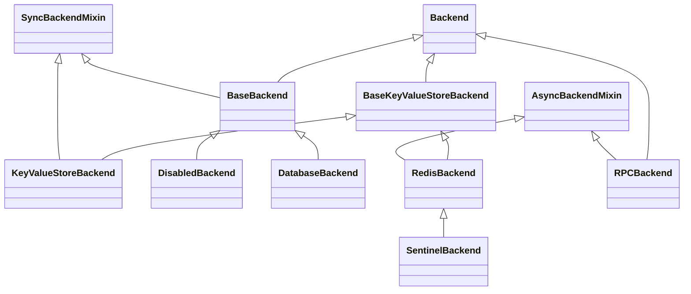
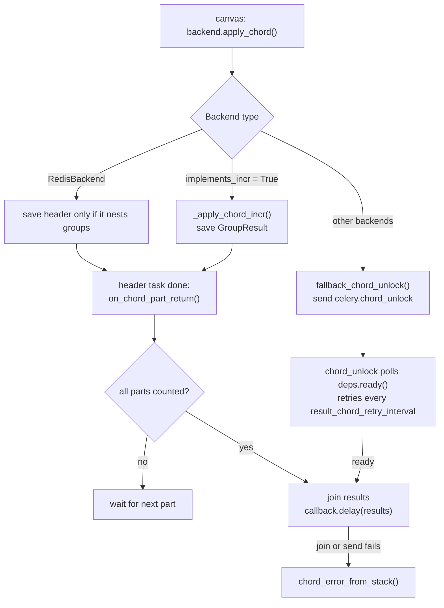
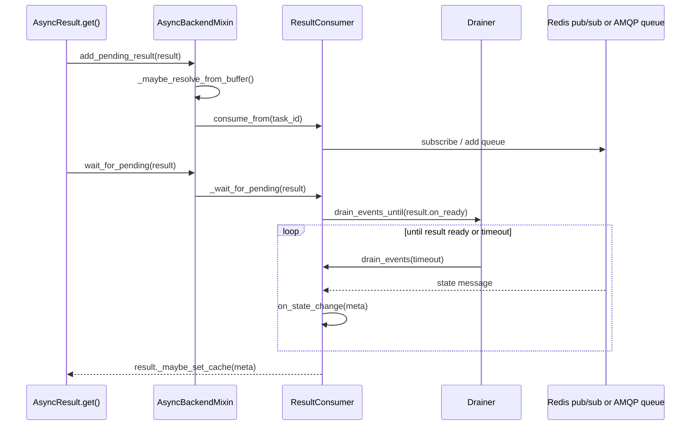

## Overview

A result backend is where Celery keeps task state and return values so a client holding an `AsyncResult` can ask "is it done, and what did it return?" long after the worker that ran the task has moved on. The worker writes through the backend (`store_result`, `mark_as_done`, `mark_as_failure`), the client reads through it (`get_task_meta`, `wait_for_pending`), and canvas primitives use it to synchronize chords. Every backend implements one interface defined in `celery/backends/base.py`; concrete stores such as Redis, SQLAlchemy or the AMQP-based RPC backend only fill in how bytes are written and read.

Sources: [celery/backends/base.py:1-36](repo://celery/backends/base.py#L1-L36), [celery/backends/base.py:108-136](repo://celery/backends/base.py#L108-L136)

The app builds its backend lazily: the first access to `app.backend` calls `_get_backend`, which resolves the `result_backend` setting through `celery.app.backends.by_url` and instantiates the class with the app and the URL. If the instance declares `thread_safe` (setting `result_backend_thread_safe`) it is cached on the app; otherwise each thread gets its own instance through `app._local`. How results look from the client side is covered in [[Task Results]]; the states written here are defined in [[Task States and Exceptions]].

Sources: [celery/app/base.py:1224-1228](repo://celery/app/base.py#L1224-L1228), [celery/app/base.py:1540-1563](repo://celery/app/base.py#L1540-L1563), [celery/backends/base.py:157-161](repo://celery/backends/base.py#L157-L161)

## Selecting a backend

`by_url` splits the configured value on `://`. The scheme becomes the backend name, and a scheme containing `+` (for example `db+postgresql://...`) is split once more so the part before `+` names the backend and the rest stays as the URL handed to the backend's constructor.

Sources: [celery/app/backends.py:59-69](repo://celery/app/backends.py#L59-L69)

```python
def by_url(backend=None, loader=None):
    """Get backend class by URL."""
    url = None
    if backend and '://' in backend:
        url = backend
        scheme, _, _ = url.partition('://')
        if '+' in scheme:
            backend, url = url.split('+', 1)
        else:
            backend = scheme
    return by_name(backend, loader), url
```

Sources: [celery/app/backends.py:59-69](repo://celery/app/backends.py#L59-L69)

`by_name` defaults to `'disabled'` when nothing is configured. It merges three alias sources: the built-in `BACKEND_ALIASES`, the loader's `override_backends`, and classes registered under the `celery.result_backends` entry-point namespace (later sources win). The name is then resolved with `symbol_by_name`, so a full dotted path such as `myproj.backends:MyBackend` works without any alias. A `ValueError` from the lookup is re-raised as `ImproperlyConfigured` with the "Unknown result backend" message, and a name that resolves to a module rather than a class is rejected the same way.

Sources: [celery/app/backends.py:11-13](repo://celery/app/backends.py#L11-L13), [celery/app/backends.py:41-56](repo://celery/app/backends.py#L41-L56)

## Class hierarchy

`Backend` holds everything independent of storage and of how waiting works. Two mixins decide the waiting model: `SyncBackendMixin` polls (`wait_for` loops on `get_task_meta`), while `AsyncBackendMixin` delegates to a push-based `ResultConsumer`. `BaseBackend` and `KeyValueStoreBackend` are the synchronous bases most stores derive from; `RedisBackend` and `RPCBackend` combine a base with `AsyncBackendMixin` instead.

Sources: [celery/backends/base.py:879-961](repo://celery/backends/base.py#L879-L961), [celery/backends/base.py:1259-1260](repo://celery/backends/base.py#L1259-L1260), [celery/backends/redis.py:204-204](repo://celery/backends/redis.py#L204-L204), [celery/backends/rpc.py:147-147](repo://celery/backends/rpc.py#L147-L147)



Sources: [celery/backends/base.py:957-964](repo://celery/backends/base.py#L957-L964), [celery/backends/base.py:1259-1263](repo://celery/backends/base.py#L1259-L1263), [celery/backends/database/__init__.py:45-45](repo://celery/backends/database/__init__.py#L45-L45), [celery/backends/redis.py:727-728](repo://celery/backends/redis.py#L727-L728)

`Backend.__init__` resolves its options from the app config: `serializer` falls back to `result_serializer`; `accept` takes the explicit argument, then `result_accept_content`, then `accept_content`; `result_cache_max` of `-1` swaps the LRU cache for `_nulldict`, a dict that silently ignores writes; `expires` comes from `prepare_expires`, which converts a `timedelta` `result_expires` into seconds. The retry settings and the `_pending_results` / `_pending_messages` buffers used by asynchronous backends are created here too.

Sources: [celery/backends/base.py:95-99](repo://celery/backends/base.py#L95-L99), [celery/backends/base.py:138-165](repo://celery/backends/base.py#L138-L165), [celery/backends/base.py:558-565](repo://celery/backends/base.py#L558-L565)

## Writing results

### store_result and the mark_as helpers

The tracer in [[Task Execution and Tracing]] never writes raw states; it calls the `mark_as_*` helpers, which all end in `store_result`. `store_result` first runs `encode_result` (exceptions in an exception state go through `prepare_exception`, `ResultBase` values become tuples unless the serializer is pickle), then calls the backend-specific `_store_result` inside `_ensure_retryable`, with `BackendStoreError` as the error raised once retries are exhausted.

Sources: [celery/backends/base.py:528-532](repo://celery/backends/base.py#L528-L532), [celery/backends/base.py:573-576](repo://celery/backends/base.py#L573-L576), [celery/backends/base.py:673-693](repo://celery/backends/base.py#L673-L693), [celery/app/trace.py:620-627](repo://celery/app/trace.py#L620-L627)

| Helper | State written | Extra behaviour |
| --- | --- | --- |
| `mark_as_started` | `STARTED` | Stores the given meta; the tracer itself writes `STARTED` with `pid`/`hostname` through `store_result` when `track_started` is on |
| `mark_as_done` | `SUCCESS` | Skips the write when `request.ignore_result` is set; calls `on_chord_part_return` when `request.chord` is set |
| `mark_as_failure` | `FAILURE` | Chord notification, propagation through `request.chain`, then errbacks |
| `mark_as_revoked` | `REVOKED` | Wraps the reason in `TaskRevokedError`; notifies the chord |
| `mark_as_retry` | `RETRY` | Stores the exception that triggered the retry |

Sources: [celery/backends/base.py:176-186](repo://celery/backends/base.py#L176-L186), [celery/backends/base.py:188-252](repo://celery/backends/base.py#L188-L252), [celery/backends/base.py:306-323](repo://celery/backends/base.py#L306-L323), [celery/app/trace.py:574-578](repo://celery/app/trace.py#L574-L578)

`_get_result_meta` builds the stored document: `status`, `result`, `traceback`, `children` (from the current request) and `date_done`, which is only set for ready states. `group_id` and `parent_id` are added when the request has them. With `result_extended` enabled it also records the task `name`, `args`, `kwargs`, `worker`, `retries`, `queue` and any stamps; the database backend passes `encode=True` so `args`/`kwargs` are serialized to bytes first.

Sources: [celery/backends/base.py:581-630](repo://celery/backends/base.py#L581-L630)

### Failure propagation through chains

When a task fails, the tasks chained after it will never run, yet clients may be waiting on the last link. `mark_as_failure` therefore walks `request.chain` with a deque: each element is rebuilt as a `Context`, and if the state is in `PROPAGATE_STATES` and the element has a `task_id`, the same exception is stored under that id. Elements carrying a `chord` option also get `on_chord_part_return`, and an element whose `subtask_type` is `chord` has its body appended to the queue, because a chord step completes only when its body does. Finally the request's errbacks run through `_call_task_errbacks`.

Sources: [celery/backends/base.py:196-252](repo://celery/backends/base.py#L196-L252)

`_call_task_errbacks` calls an errback in-process when its task function accepts more than one argument (the new `(request, exc, traceback)` signature), logging rather than raising if it fails. Old-style errbacks that take only a task id, and errbacks not registered in this worker, are collected into a `group` and applied with the failed task's id, eagerly when `task_always_eager` or the request is eager.

Sources: [celery/backends/base.py:254-304](repo://celery/backends/base.py#L254-L304)

### Write-once success in key/value stores

`BaseKeyValueStoreBackend._store_result` reads the current meta before writing and returns without writing if the stored status is already `SUCCESS`. This prevents a duplicate delivery (a lost worker, a network partition) from overwriting a finished result with `STARTED` or `FAILURE`.

Sources: [celery/backends/base.py:1116-1138](repo://celery/backends/base.py#L1116-L1138)

## Exception serialization

`prepare_exception` keeps exceptions as objects only for codecs in `EXCEPTION_ABLE_CODECS` (pickle), passing them through `get_pickleable_exception`. For every other serializer it stores a dict with `exc_type` (the qualified name), `exc_message` (the exception args made serializable) and `exc_module`.

Sources: [celery/backends/base.py:38-38](repo://celery/backends/base.py#L38-L38), [celery/backends/base.py:447-455](repo://celery/backends/base.py#L447-L455)

On read, `meta_from_decoded` passes the result of any meta whose status is in `EXCEPTION_STATES` to `exception_to_python`. That method imports nothing: it looks the module up in `sys.modules` and walks the dotted `exc_type`; if either is missing it synthesizes a class with `create_exception_cls` under `celery.exceptions`. The resolved object must be a subclass of `BaseException`, otherwise a `SecurityError` is raised, so a forged payload such as `exc_module: "os"`, `exc_type: "system"` cannot be turned into a call. If the constructor rejects the stored args, a plain `Exception` describing the class and message is returned instead.

Sources: [celery/backends/base.py:457-526](repo://celery/backends/base.py#L457-L526), [celery/backends/base.py:541-547](repo://celery/backends/base.py#L541-L547)

## Reading results

`get_task_meta` warns when `task_always_eager` is on without `task_store_eager_result`, then serves from the local cache, then calls `_get_task_meta_for` through `_ensure_retryable` (failing with `BackendGetMetaError`). Only `SUCCESS` metas are cached, so polling a pending task always reaches the store. Group metas follow the same pattern through `get_group_meta`, `save_group` and `delete_group`, which wrap `_restore_group`, `_save_group` and `_delete_group`.

Sources: [celery/backends/base.py:723-730](repo://celery/backends/base.py#L723-L730), [celery/backends/base.py:746-768](repo://celery/backends/base.py#L746-L768), [celery/backends/base.py:785-818](repo://celery/backends/base.py#L785-L818)

Synchronous backends wait by polling: `SyncBackendMixin.wait_for` sleeps `interval` between `get_task_meta` calls and raises `TimeoutError` once the accumulated time passes `timeout`. Key/value stores additionally implement `get_many`, which yields cached ready results first and then repeatedly `mget`s the remaining keys, keeping only metas in `READY_STATES`.

Sources: [celery/backends/base.py:918-944](repo://celery/backends/base.py#L918-L944), [celery/backends/base.py:1075-1111](repo://celery/backends/base.py#L1075-L1111)

Key/value stores name their keys with `task_keyprefix` (`celery-task-meta-`), `group_keyprefix` (`celery-taskset-meta-`) and `chord_keyprefix` (`chord-unlock-`). A `global_keyprefix` in `result_backend_transport_options` is prepended to all three, with `_` appended unless it already ends in one of `:_-.`.

Sources: [celery/backends/base.py:964-998](repo://celery/backends/base.py#L964-L998), [celery/backends/base.py:1021-1044](repo://celery/backends/base.py#L1021-L1044)

## Retrying backend operations

`_ensure_retryable` wraps every store, read, forget and group operation. It retries only when `result_backend_always_retry` is on and the backend's `exception_safe_to_retry` returns true for the error; the base implementation returns false, Redis accepts its `connection_errors`, and the database backend accepts SQLAlchemy `DatabaseError`, `InterfaceError`, `InvalidRequestError` and `StaleDataError`. Before each retry it calls the `on_backend_retryable_error` hook, then sleeps an exponential backoff between `result_backend_base_sleep_between_retries_ms` and `result_backend_max_sleep_between_retries_ms`. After `result_backend_max_retries` it raises the fallback exception (carrying `task_id` and `state` when available).

Sources: [celery/backends/base.py:635-671](repo://celery/backends/base.py#L635-L671), [celery/backends/base.py:732-744](repo://celery/backends/base.py#L732-L744), [celery/backends/redis.py:487-490](repo://celery/backends/redis.py#L487-L490), [celery/backends/database/__init__.py:26-31](repo://celery/backends/database/__init__.py#L26-L31), [celery/backends/database/__init__.py:117-121](repo://celery/backends/database/__init__.py#L117-L121)

## Chord synchronization

### Strategies per backend

A chord body must run exactly once, after the last header task finishes. Canvas calls `backend.apply_chord` before sending the header and `set_chord_size` when a chain ends in a group (see [[Canvas: Signatures and Workflows]]); each worker finishing a header task reaches `on_chord_part_return` through `mark_as_done` / `mark_as_failure`. Backends pick one of three strategies.

Sources: [celery/canvas.py:1809-1811](repo://celery/canvas.py#L1809-L1811), [celery/canvas.py:2269-2277](repo://celery/canvas.py#L2269-L2277), [celery/backends/base.py:829-867](repo://celery/backends/base.py#L829-L867)



Sources: [celery/backends/base.py:838-867](repo://celery/backends/base.py#L838-L867), [celery/backends/base.py:971-978](repo://celery/backends/base.py#L971-L978), [celery/backends/base.py:1183-1256](repo://celery/backends/base.py#L1183-L1256), [celery/backends/redis.py:573-583](repo://celery/backends/redis.py#L573-L583), [celery/app/builtins.py:37-98](repo://celery/app/builtins.py#L37-L98)

### Polling with chord_unlock

The default `apply_chord` calls `fallback_chord_unlock`, which sends the built-in `celery.chord_unlock` task with the header results as tuples, routed to the body's queue and priority. That task rebuilds the `GroupResult`, retries itself every `result_chord_retry_interval` until `deps.ready()`, joins with `result_chord_join_timeout`, and calls `callback.delay(ret)`. `DatabaseBackend`, `MongoBackend`, `CassandraBackend` and key/value stores without `incr` use this path, and `on_chord_part_return` does nothing for them.

Sources: [celery/backends/base.py:832-867](repo://celery/backends/base.py#L832-L867), [celery/app/builtins.py:47-98](repo://celery/app/builtins.py#L47-L98), [celery/backends/base.py:1188-1190](repo://celery/backends/base.py#L1188-L1190)

### Counting with incr

A key/value backend that sets `implements_incr = True` (cache, DynamoDB, GCS) has `apply_chord` replaced by `_apply_chord_incr`, which saves the header `GroupResult`. In `on_chord_part_return` each finished part restores that group, increments the key `get_key_for_chord` builds from `chord-unlock-` and the group id, and compares the value with `request.chord["chord_size"]` (or the number of restored results). The part that reaches the size joins the group, sends the body, and deletes both the group and the counter; earlier parts only refresh the counter's expiry.

Sources: [celery/backends/base.py:971-978](repo://celery/backends/base.py#L971-L978), [celery/backends/base.py:1183-1256](repo://celery/backends/base.py#L1183-L1256), [celery/backends/cache.py:90-96](repo://celery/backends/cache.py#L90-L96), [celery/backends/dynamodb.py:66-66](repo://celery/backends/dynamodb.py#L66-L66), [celery/backends/gcs.py:161-168](repo://celery/backends/gcs.py#L161-L168)

### Redis sorted-set counting

`RedisBackend` keeps three keys per group: `.j` holds the encoded part results, `.t` a count adjustment incremented by `add_to_chord` (used by `Task.add_to_chord`), and `.s` the chord size written by `set_chord_size`. In one pipeline `on_chord_part_return` adds `[1, tid, state, result]` to `.j` (a sorted set scored by `group_index` when `result_chord_ordered` is true, the default; a list otherwise), reads its length and the two counters, and refreshes expiry on all three.

Sources: [celery/backends/redis.py:554-571](repo://celery/backends/redis.py#L554-L571), [celery/backends/redis.py:585-620](repo://celery/backends/redis.py#L585-L620), [celery/app/task.py:1097-1118](repo://celery/app/task.py#L1097-L1118)

When the ready count equals `.s` plus `.t`, the worker that observed it builds the body's argument. If `apply_chord` saved the header (only when it contains nested `GroupResult`s), it restores and joins the group to keep the nested structure; otherwise it reads `.j` back and decodes each entry with `_unpack_chord_result`, which raises a `ChordError` (with the original exception as `__cause__`) for any part in a propagating state. It then calls `callback.delay(resl)` and deletes the three keys. Join or callback failures are routed to `chord_error_from_stack`.

Sources: [celery/backends/redis.py:557-568](repo://celery/backends/redis.py#L557-L568), [celery/backends/redis.py:622-686](repo://celery/backends/redis.py#L622-L686)

### Chord errors

`chord_error_from_stack` marks the chord body as failed so its waiters are released. It uses the body task's own backend when the task is registered, gives the body a `task_id` if it has none, runs the body's `link_error` errbacks against a fake request built by `_create_fake_task_request`, and finally stores the failure with `fail_from_current_stack`. When the body is a `group`, `_handle_group_chord_error` freezes it, revokes every member, runs errbacks and stores the original exception for each member and for the group id, so group bodies do not hang (#8786).

Sources: [celery/backends/base.py:68-92](repo://celery/backends/base.py#L68-L92), [celery/backends/base.py:325-427](repo://celery/backends/base.py#L325-L427), [celery/backends/base.py:428-445](repo://celery/backends/base.py#L428-L445)

## Asynchronous result consumption

### AsyncBackendMixin

Redis and RPC deliver results by push, so a client does not poll. `AsyncResult.get` calls `backend.add_pending_result`, which starts the drainer, tries to resolve the result from `_pending_messages` (results that arrived before anyone asked), and otherwise registers it in `_pending_results` and calls `result_consumer.consume_from(task_id)`. `wait_for_pending` then drives `result_consumer._wait_for_pending` and finally calls `result.maybe_throw`. `iter_native` uses per-result buckets so `ResultSet` iteration yields results as they arrive.

Sources: [celery/result.py:260-266](repo://celery/result.py#L260-L266), [celery/backends/asynchronous.py:225-313](repo://celery/backends/asynchronous.py#L225-L313)



Sources: [celery/backends/asynchronous.py:260-309](repo://celery/backends/asynchronous.py#L260-L309), [celery/backends/asynchronous.py:393-449](repo://celery/backends/asynchronous.py#L393-L449)

### BaseResultConsumer and drainers

`BaseResultConsumer.on_state_change` forwards every meta to an optional `on_message` callback; for ready states it looks up the pending result, sets its cache and drops it into its bucket, or buffers the meta in `_pending_messages` if nobody registered it yet. `_wait_for_pending` converts the drainer's `socket.timeout` into Celery's `TimeoutError`. `reconnect_on_error` wraps transport calls: a connection error triggers `_reconnect`, and a second connection error during reconnection raises `RuntimeError` telling the user to restart the app.

Sources: [celery/backends/asynchronous.py:316-361](repo://celery/backends/asynchronous.py#L316-L361), [celery/backends/asynchronous.py:397-449](repo://celery/backends/asynchronous.py#L397-L449)

The drainer is picked by `detect_environment()` from the `register_drainer` registry. The default `Drainer` calls `drain_events` in the waiting thread, with each wait bounded by `interval`, until the promise is ready. `eventletDrainer` and `geventDrainer` instead spawn one green thread that drains continuously and signals a `_drain_complete_event` after each pass, so many greenlets can wait on results concurrently.

Sources: [celery/backends/asynchronous.py:55-112](repo://celery/backends/asynchronous.py#L55-L112), [celery/backends/asynchronous.py:115-222](repo://celery/backends/asynchronous.py#L115-L222), [celery/backends/asynchronous.py:333-333](repo://celery/backends/asynchronous.py#L333-L333)

### Redis pub/sub consumer

`RedisBackend._set` writes the value (with `SETEX` when `expires` is set) and `PUBLISH`es it on the same key in one pipeline. The Redis `ResultConsumer` subscribes to the task's meta key when the task is sent (`on_task_call`, unless joining would block), decodes messages in `drain_events`, and unsubscribes as soon as a ready state arrives. On reconnect it `MGET`s every subscribed key first, so state changes published while the connection was down are not lost.

Sources: [celery/backends/redis.py:532-539](repo://celery/backends/redis.py#L532-L539), [celery/backends/redis.py:501-503](repo://celery/backends/redis.py#L501-L503), [celery/backends/redis.py:97-141](repo://celery/backends/redis.py#L97-L141), [celery/backends/redis.py:175-201](repo://celery/backends/redis.py#L175-L201)

## RPC backend

`RPCBackend` sends each state as a message back to the client instead of storing it. Every client process has one reply queue named after `app.thread_oid`; `on_task_call` declares it before the task is published. On the worker, `store_result` reads `reply_to` and `correlation_id` from the request (`destination_for`) and publishes `task_id`, `status`, `result`, `traceback` and `children` on the anonymous direct exchange, returning silently when there is no `reply_to`.

Sources: [celery/backends/rpc.py:178-198](repo://celery/backends/rpc.py#L178-L198), [celery/backends/rpc.py:205-238](repo://celery/backends/rpc.py#L205-L238), [celery/backends/rpc.py:254-271](repo://celery/backends/rpc.py#L254-L271), [celery/backends/rpc.py:273-280](repo://celery/backends/rpc.py#L273-L280), [celery/backends/rpc.py:389-401](repo://celery/backends/rpc.py#L389-L401)

Because state lives in a queue, `get_task_meta` works differently: it drains up to `backlog_limit` (1000) messages with `basic_get`, keeps only the latest message per correlation id (acking older ones), requeues the latest for the asked task, and buffers messages for other tasks as out-of-band results. More than 1000 messages raises `BacklogLimitExceeded`. Chords raise `NotImplementedError` from `ensure_chords_allowed`, and the group operations and `reload_*_result` are not supported. Results are transient by default (`persistent = False`) unless `result_persistent` is set.

Sources: [celery/backends/rpc.py:282-350](repo://celery/backends/rpc.py#L282-L350), [celery/backends/rpc.py:214-215](repo://celery/backends/rpc.py#L214-L215), [celery/backends/rpc.py:355-374](repo://celery/backends/rpc.py#L355-L374), [celery/backends/base.py:567-571](repo://celery/backends/base.py#L567-L571)

The RPC `ResultConsumer` wraps a `kombu.Consumer` on the reply queue. On a connection error `_reconnect` cancels the stale consumer, closes the connection, opens a new one and re-consumes the same queues; after a fork the consumer and connection are discarded so the child does not share sockets with the parent.

Sources: [celery/backends/rpc.py:41-144](repo://celery/backends/rpc.py#L41-L144), [celery/backends/rpc.py:197-203](repo://celery/backends/rpc.py#L197-L203)

## Database backend

`DatabaseBackend` stores results through SQLAlchemy using the URL after `db+` (or `database_url`). It overrides the retry defaults to `result_backend_always_retry=True` and `result_backend_max_retries=3`, switches to the `TaskExtended` model when `result_extended` is on, applies `database_table_schemas` / `database_table_names` to the models, and creates the tables at setup unless `database_create_tables_at_setup` is false. On a retryable error the session manager's cached engine for the URL is disposed.

Sources: [celery/backends/database/__init__.py:45-133](repo://celery/backends/database/__init__.py#L45-L133)

| Model | Table | Columns |
| --- | --- | --- |
| `Task` | `celery_taskmeta` | `id`, `task_id` (unique), `status`, `result` (`PickleType`), `date_done`, `traceback` |
| `TaskExtended` | `celery_taskmeta` | `Task` columns plus `name`, `args`, `kwargs` (binary), `worker`, `retries`, `queue` |
| `TaskSet` | `celery_tasksetmeta` | `id`, `taskset_id` (unique), `result` (`PickleType`), `date_done` |

Sources: [celery/backends/database/models.py:27-121](repo://celery/backends/database/models.py#L27-L121)

`_store_result` loads or creates the `Task` row and `_update_result` copies every column except `id` and `task_id` from `_get_result_meta`, so columns missing from the meta are reset to `None`. Reads return a transient `PENDING` row when none exists. `cleanup` deletes task and group rows whose `date_done` is older than `result_expires`; it is the backend's answer to the daily `backend_cleanup` task, since `supports_autoexpire` is false.

Sources: [celery/backends/database/__init__.py:135-185](repo://celery/backends/database/__init__.py#L135-L185), [celery/backends/database/__init__.py:237-250](repo://celery/backends/database/__init__.py#L237-L250), [celery/backends/base.py:123-126](repo://celery/backends/base.py#L123-L126)

`SessionManager` creates engines with `NullPool` (dropping pool options) until the process forks; after a fork it caches one engine and session factory per URL, recreating the factory on each call when `database_short_lived_sessions` is set. `prepare_models` runs `create_all` with up to 10 backoff retries because concurrent workers race to create the tables.

Sources: [celery/backends/database/session.py:29-106](repo://celery/backends/database/session.py#L29-L106)

## DisabledBackend

With no `result_backend`, `by_name` selects `DisabledBackend`. Its `store_result` is a no-op, so workers run normally, but every read (`get_state`, `get_result`, `get_task_meta_for`, `wait_for`, `get_many`) raises `NotImplementedError` with "No result backend is configured", and `ensure_chords_allowed` raises the chord message, which also covers a group chained into a task because canvas upgrades that to a chord.

Sources: [celery/backends/base.py:48-60](repo://celery/backends/base.py#L48-L60), [celery/backends/base.py:1263-1281](repo://celery/backends/base.py#L1263-L1281)

## Built-in backends

| Alias | Class | Base | Chord strategy |
| --- | --- | --- | --- |
| `redis`, `rediss` | `celery.backends.redis:RedisBackend` | `BaseKeyValueStoreBackend` + `AsyncBackendMixin` | Sorted-set counting |
| `sentinel` | `celery.backends.redis:SentinelBackend` | `RedisBackend` | Sorted-set counting |
| `rpc` | `celery.backends.rpc.RPCBackend` | `Backend` + `AsyncBackendMixin` | Not supported |
| `db`, `database` | `celery.backends.database:DatabaseBackend` | `BaseBackend` | `chord_unlock` |
| `cache` | `celery.backends.cache:CacheBackend` | `KeyValueStoreBackend` | `incr` counter |
| `dynamodb` | `celery.backends.dynamodb:DynamoDBBackend` | `KeyValueStoreBackend` | `incr` counter |
| `gs` | `celery.backends.gcs:GCSBackend` | `GCSBackendBase` (key/value) | `incr` counter |
| `mongodb` | `celery.backends.mongodb:MongoBackend` | `BaseBackend` | `chord_unlock` |
| `cassandra` | `celery.backends.cassandra:CassandraBackend` | `BaseBackend` | `chord_unlock` |
| `elasticsearch` | `celery.backends.elasticsearch:ElasticsearchBackend` | `KeyValueStoreBackend` | `chord_unlock` |
| `couchbase` | `celery.backends.couchbase:CouchbaseBackend` | `KeyValueStoreBackend` | `chord_unlock` |
| `couchdb` | `celery.backends.couchdb:CouchBackend` | `KeyValueStoreBackend` | `chord_unlock` |
| `cosmosdbsql` | `celery.backends.cosmosdbsql:CosmosDBSQLBackend` | `KeyValueStoreBackend` | `chord_unlock` |
| `consul` | `celery.backends.consul:ConsulBackend` | `KeyValueStoreBackend` | `chord_unlock` |
| `azureblockblob` | `celery.backends.azureblockblob:AzureBlockBlobBackend` | `KeyValueStoreBackend` | `chord_unlock` |
| `arangodb` | `celery.backends.arangodb:ArangoDbBackend` | `KeyValueStoreBackend` | `chord_unlock` |
| `s3` | `celery.backends.s3:S3Backend` | `KeyValueStoreBackend` | `chord_unlock` |
| `file` | `celery.backends.filesystem:FilesystemBackend` | `KeyValueStoreBackend` | `chord_unlock` |
| `disabled` | `celery.backends.base:DisabledBackend` | `BaseBackend` | Raises |

Sources: [celery/app/backends.py:15-38](repo://celery/app/backends.py#L15-L38), [celery/backends/cache.py:90-96](repo://celery/backends/cache.py#L90-L96), [celery/backends/dynamodb.py:29-66](repo://celery/backends/dynamodb.py#L29-L66), [celery/backends/gcs.py:161-168](repo://celery/backends/gcs.py#L161-L168), [celery/backends/mongodb.py:36-37](repo://celery/backends/mongodb.py#L36-L37), [celery/backends/cassandra.py:71-72](repo://celery/backends/cassandra.py#L71-L72), [celery/backends/elasticsearch.py:30-31](repo://celery/backends/elasticsearch.py#L30-L31), [celery/backends/couchbase.py:23-24](repo://celery/backends/couchbase.py#L23-L24), [celery/backends/couchdb.py:21-22](repo://celery/backends/couchdb.py#L21-L22), [celery/backends/cosmosdbsql.py:30-31](repo://celery/backends/cosmosdbsql.py#L30-L31), [celery/backends/consul.py:27-28](repo://celery/backends/consul.py#L27-L28), [celery/backends/azureblockblob.py:24-25](repo://celery/backends/azureblockblob.py#L24-L25), [celery/backends/arangodb.py:23-24](repo://celery/backends/arangodb.py#L23-L24), [celery/backends/s3.py:20-21](repo://celery/backends/s3.py#L20-L21), [celery/backends/filesystem.py:25-26](repo://celery/backends/filesystem.py#L25-L26)

> [!WARNING]
> `BACKEND_ALIASES` still maps `riak` to `celery.backends.riak:RiakBackend`, but no `celery/backends/riak.py` exists in this tree, so selecting `riak://` fails when the module is imported.

Sources: [celery/app/backends.py:29-29](repo://celery/app/backends.py#L29-L29)

## Configuration

The settings below are read by the base classes; backend-specific settings (`redis_*`, `database_*` and so on) are listed in [[Configuration]].

Sources: [celery/app/defaults.py:205-229](repo://celery/app/defaults.py#L205-L229)

| Setting | Default | Read by |
| --- | --- | --- |
| `result_backend` | unset (`disabled`) | `app._get_backend` via `by_url` |
| `result_serializer` | `json` | `Backend.__init__`; decides exception format |
| `result_accept_content` | `None` (falls back to `accept_content`) | `Backend.__init__` |
| `result_cache_max` | `-1` (cache disabled) | `Backend.__init__` |
| `result_expires` | 1 day | `prepare_expires`; key TTLs and database `cleanup` |
| `result_persistent` | `None` | `prepare_persistent` (RPC delivery mode) |
| `result_extended` | `False` | `_get_result_meta`; `TaskExtended` model |
| `result_backend_transport_options` | `{}` | `global_keyprefix`, `result_chord_ordered`, Redis `retry_policy` |
| `result_chord_retry_interval` | `1.0` | `celery.chord_unlock` retry delay |
| `result_chord_join_timeout` | `3.0` | Chord joins in every strategy |
| `result_backend_always_retry` | `False` (`True` for database) | `_ensure_retryable` |
| `result_backend_max_retries` | infinite (`3` for database) | `_ensure_retryable` |
| `result_backend_base_sleep_between_retries_ms` | `10` | `_ensure_retryable` backoff |
| `result_backend_max_sleep_between_retries_ms` | `10000` | `_ensure_retryable` backoff |
| `result_backend_thread_safe` | `False` | `app._backend` (share one instance across threads) |

Sources: [celery/app/defaults.py:205-229](repo://celery/app/defaults.py#L205-L229), [celery/backends/base.py:138-165](repo://celery/backends/base.py#L138-L165), [celery/backends/database/__init__.py:62-66](repo://celery/backends/database/__init__.py#L62-L66), [celery/app/base.py:1550-1556](repo://celery/app/base.py#L1550-L1556), [celery/backends/redis.py:585-591](repo://celery/backends/redis.py#L585-L591)
